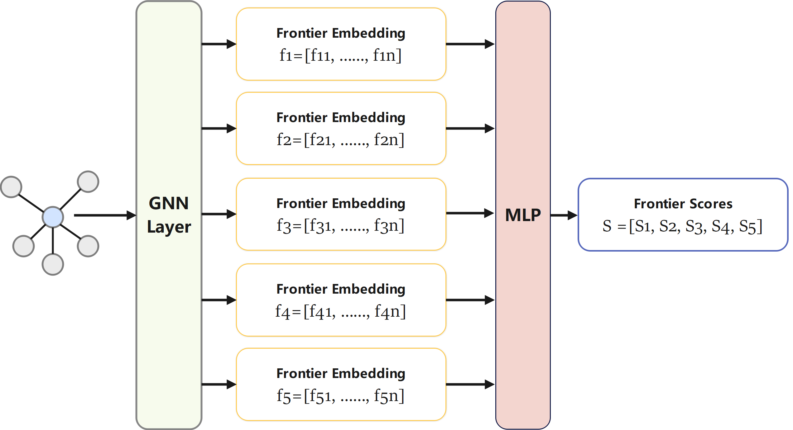
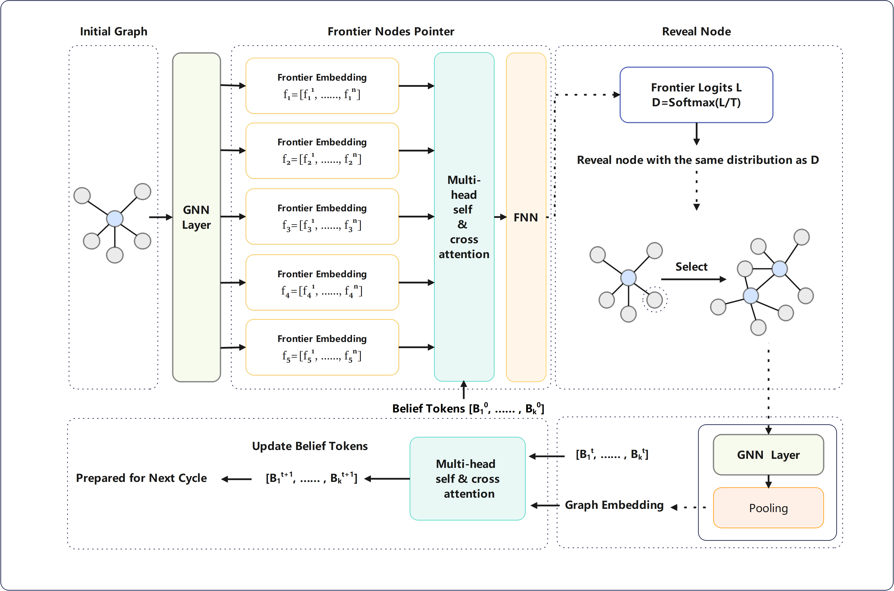
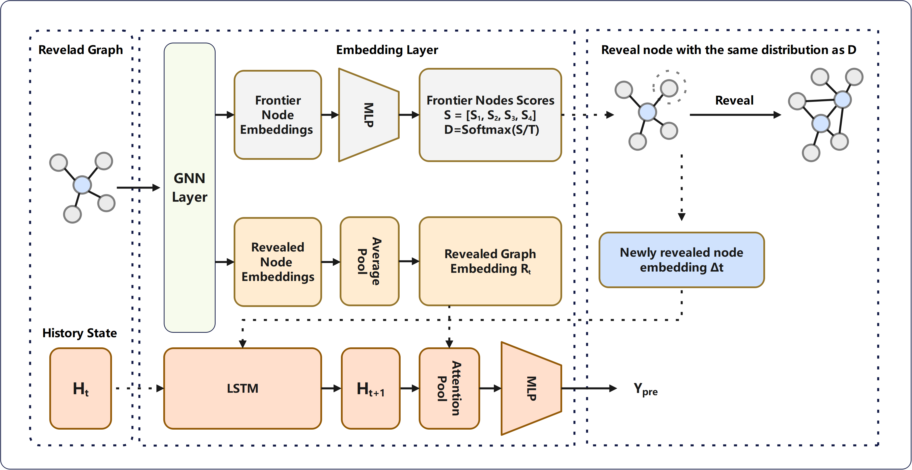

# Summary of Experiments

## Reader 结构

### base

只有GNN、MLP决策头。训练时按照前沿节点分数分布温度采样，预算使用完后得到子图。最后使用冻结分类器分类



### attention

使用注意力机制维护信念，辅助决策。在base reader的基础上，在决策前加入注意力机制改变前沿节点的编码再给MLP决策。由于设计上的冗余导致性能与base reader没有区分度，不展示评估数据



### evidence

拥有决策头与分类头，而这共用一个GNN。决策头：MLP；分类头使用LSTM状态+attention池化层+MLP分类。这样设计的reader 可以突破分类器的限制

## Reader 两阶段训练

### base reader

BC阶段：

* 损失函数：教师动作的逐步负对数似然（行为克隆）

$$
\mathcal{L}_{act}=\frac{1}{|\mathcal{D}|}\sum_{\tau\in\mathcal{D}}\sum_{t=1}^{T_\tau}-\log\,\pi_\theta\big(a_t^{tea}\mid s_t\big)
$$

其中 $s_t$ 为第 $t$ 步的已揭示状态，$a_t^{tea}$ 为教师轨迹在该步的选点。

RL阶段：

* 奖励源：冻结的全图分类器
* 奖励函数：asymmetric 读满预算后对最终揭示子图 $G_i$ 判定，判对给 $+1$、判错给 $-0.1$：

$$
R_i=\begin{cases}+1, & \arg\max\, z^{clf}(G_i)=y_i\\ -0.1, & \text{否则}\end{cases}
$$

其中 $z^{clf}(G_i)$ 为冻结分类器对揭示子图的 logits，$y_i$ 为真标签。

* 损失函数：REINFORCE（自采样轨迹），batch 优势归一化(可关闭，$A_i$ 变为 $R_i$)

$$
\mathcal{L}_{RL}=-\frac{1}{N}\sum_{i=1}^{N}A_i\sum_{t=1}^{T_i}\log\,\pi_\theta(a_t\mid s_t),\qquad A_i=\frac{R_i-\mu_R}{\sigma_R+\varepsilon}
$$

### evidence reader

BC阶段：

* 损失函数：动作克隆 + 证据头监督联合（证据头 CE 在每步 reveal 后与读满后的补充前向各计一次）

$$
\mathcal{L}_{BC}=\mathcal{L}_{act}+\lambda_{ev}\,\mathcal{L}_{ev}
$$

$\mathcal{L}_{act}$ 同 base reader；$\mathcal{L}_{ev}=\frac{1}{M}\sum_m \mathrm{CE}\big(z^{ev}_m,\,y_m\big)$ 为证据头对图标签的交叉熵。

RL阶段

* 奖励源：classifier、reader、both、soft-both
* 奖励函数：

* [ ] classifier、reader、both：判定指示 $c_i$ + asymmetric 变换
* [ ] soft-both：软乘积（不经判定指示）。记 $z^{ev}(G_i)$ 为证据头终判 logits：

$$
c_i=\begin{cases}\mathbb{1}\big[\arg\max z^{clf}(G_i)=y_i\big], & \text{classifier}\\[2pt] \mathbb{1}\big[\arg\max z^{ev}(G_i)=y_i\big], & \text{reader}\\[2pt] \mathbb{1}\big[\arg\max z^{clf}=y_i\big]\cdot\mathbb{1}\big[\arg\max z^{ev}=y_i\big], & \text{both}\end{cases}\qquad R_i=\begin{cases}+1, & c_i=1\\ -0.1, & c_i=0\end{cases}
$$

$$
R_i^{\text{soft-both}}=\underbrace{\mathrm{softmax}\big(z^{ev}(G_i)\big)_{y_i}}_{P_{reader}(y)}\cdot\underbrace{\mathrm{softmax}\big(z^{clf}(G_i)\big)_{y_i}}_{P_{classifier}(y)}\;\in[0,1]
$$

* [ ] 可以选择开启优势归一化

* 损失函数：与 base 同一 REINFORCE，另加证据流监督

$$
\mathcal{L}=\mathcal{L}_{RL}+\lambda_{ev}\,\mathcal{L}_{ev}
$$

## 基线

Random：随机从前沿节点揭示；

BFS：依次选择所有邻居；

Max-Frontier-Degree：选择前沿节点中度数最大的节点；

Random-Walk：DFS，每次只选择上次揭示节点的邻居；

SAGPool：原版 SAGPool 是分类模型内部的可微池化层。可学习打分头（score_layer）完整图上一次性 top-k 选点。

- top-k 发生在**完整图**上，输入是全部节点/边——评测态不可见的信息；
- 打分头仅由分类损失**间接**监督（经读出头回传），没有独立的选点监督；
- "选了哪些节点"只是池化中间产物：模型对外的接口是**整图分类**，
  不存在"给定当前已揭示状态，选下一个节点"的序贯决策入口。

SAGPool适应协议：两阶段：全图 scorer 训练 → 协议选点策略。推理中，每步在可见子图上重打分、选 1 个 frontier 节点

Soft-Mask：原版 Soft-Mask（WWW 2021）同样是分类模型内部的池化层（软掩码版）。掩码生成器每层给每个节点输出软掩码 $m_v\in(0,1)$，消息传递被掩码调制（$x\odot m$ 参与聚合），端到端分类监督下逐层软提取子结构。

- 掩码每层动态重算、软连续（sigmoid 概率），不是排序/选点——全节点保留、按权重缩放；
- 掩码生成的邻域聚合在**完整图**上进行（评测态不可见的信息）；
- 掩码仅由分类损失间接监督；无预算/时序概念。

Soft-Mask适应协议（已实现）：与 SAGPool 同构的两阶段：全图 scorer 训练 → 推理中每步在可见子图上重算第一层掩码分数、选 1 个 frontier 节点。与 SAGPool 构成"软加权 vs 硬 top-k"的成对对照

AgentNet：原版 AgentNet（ICLR 2023）是多智能体图游走分类器：K 个 agent 带可学习嵌入，每步在当前位置的邻居上做注意力（+可学习 BSEU 探索偏置）经 gumbel-softmax 选边移动，逐步读出累加分类。整条游走端到端可微，训练信号只有分类 NLL。

- 移动候选是当前位置的**全部邻居**——完整图结构，评测态不可见；
- agent 可往返/停留（self-loop、back 偏置），无预算概念（K agent × 16 步 ≫ 5%~15% 节点预算）；
- 初始选址用全图信息（随机选址除外）。

AgentNet适应协议（已实现）：策略直译而非打分器移植：单 agent 游走一步 ≙ 揭示 1 个 frontier 节点；候选限缩为当前位置的 frontier 邻居，初始位置 = seed；死角（frontier 候选为空）时在已揭示区内按 BSEU 分数导航回有候选的位置，不消耗预算。候选结构与 Random-Walk 等价（深度型），构成"DFS式均匀随机 vs DFS式学习型选点分布"的控制变量对照。评测按双口径记录：协议终判（冻结分类器）+ 其自身读出头准确率（acc_own_*，参照口径）

## 协议

Active Graph Reading（AGR）：预算受限的图读取任务。模型不接触完整图，从 seed 节点出发逐步"揭示"节点，预算耗尽后对已揭示部分做图分类。

| #  | 约束     | 内容                                                                                                                                                                                                           |
| -- | -------- | -------------------------------------------------------------------------------------------------------------------------------------------------------------------------------------------------------------- |
| P1 | 预算     | Budget = 揭示节点数（**不含 seed**）；按图取比例 $B=\max(1,\ \mathrm{int}(ratio \times n_{nodes}))$（int 向下取整，与轨迹生成/训练/评测全链路同式）；预算档 cifar10/ppa = 5/10/15%，COLLAB = 10/15/20% |
| P2 | 种子     | 确定性伪随机公式$(idx \times 31 + seed_i \times 17 + 7) \bmod n_{nodes}$，idx 为图索引；每图多种子（n_seeds）取平均                                                                                          |
| P3 | 选点约束 | 每步只能从当前**frontier**（与已揭示区相邻的未揭示节点）中选 → 揭示区域与 seed 始终连通                                                                                                                 |
| P4 | 可见信息 | 已揭示节点特征 + 已揭示边（含特征）+ frontier 边的**one-ended 特征（免费可见）**；frontier 节点的身份可见、节点特征不可见                                                                                |
| P5 | 终判     | 读满预算后对最终揭示子图分类：base reader 与全部基线用冻结上界分类器；evidence reader 用自身证据头终判（冻结分类器判定作参照）                                                                                 |
| P6 | 自环     | 揭示子图构图时每节点恰好 1 条自环（remove+add 归一）                                                                                                                                                           |

补充规则：

- **预算记账**：只有首次揭示消耗预算；重访、区域内导航不消耗。frontier 为空但预算未耗尽（seed 落入孤立小分量）时瞬移（teleport）到未揭示节点继续——瞬移即揭示跳转节点，消耗 1 预算（固定策略基线按 rollout 契约不瞬移，frontier 空即结束）；
- **Visible ≠ Revealed**：frontier 边特征在揭示前即可查询（`state.get_frontier_edge_feat(u, v)`，不计预算）——v1 协议的核心区分点，选点可以"先看边再决定揭谁"；
- **评估确定性**：同一 (图, seed_i) 必须产出同一轨迹；策略内部随机源按 (seed_node, n_nodes) 播种；分数平分取小 id；评估用 argmax（训练时按分布采样）。

单步循环：

```
观察（已揭示区 + frontier 边特征）→ 策略从 frontier 选 1 点 → reveal
→ 预算记账（首次揭示 -1）→ 预算耗尽或 frontier 空（teleport）→ 循环 → 终判
```

## 实验设置

1. 冻结分类器：reader 和 基线 读出的子图在冻结分类器上评估可以判断是否阅读到关键的特征。工程上可用联合训练于提升系统的指标，但是无法评估是否获取到关键的特征。
2. Reader在RL阶段训练时采用分布采样。
3. 基线和reader在评估时都使用argmax选择前沿节点，相同分数取id小的节点

---

## 基础对比实验

### 1.OGBG-PPA

数据集稠密，拓扑结构复杂，边特征丰富，无节点特征

#### baseline: valid/test   Full-Graph: 64.2/65.6

|     | Random      | BFS         | Max-Frontier-Degree | Random-walk | SAGPool     | Soft-Mask   | AgentNet    | AgentNet-own<br>（自带头） | Best                                             |
| --- | ----------- | ----------- | ------------------- | ----------- | ----------- | ----------- | ----------- | -------------------------- | ------------------------------------------------ |
| 5%  | 18.86/20.16 | 23.45/24.45 | 25.31/26.20         | 19.71/21.46 | 26.08/27.28 | 20.68/21.88 | 22.38/23.43 | 9.98/9.48                  | 26.08(SAGPool)/27.28(SAGPool)                    |
| 10% | 31.14/33.07 | 34.07/35.68 | 36.33/37.28         | 32.34/34.54 | 36.25/37.92 | 32.25/33.89 | 34.35/35.75 | 9.98/9.48                  | 36.33(Max-Frontier-DegreeSAGPool)/37.92(SAGPool) |
| 15% | 39.37/41.88 | 40.84/42.92 | 42.94/44.52         | 40.21/42.99 | 43.03/45.08 | 40.12/42.00 | 41.46/43.51 | 9.98/9.48                  | 43.03(SAGPool)/45.08(SAGPool)                    |

SAGPool依靠先验打分层，利用边特征和拓扑信息，居于首位。

AgentNet 自身分类能力发生严重坍缩，维持在某一类

#### Base Reader BC-RL: valid/test   Full-Graph: 64.2/65.6

|     | BC          | BCref<br />(冻结分类器) | BC-Best     | RL          | RLref<br />(冻结分类器) | RL-BC       | RL/Full-Graph |
| --- | ----------- | ----------------------- | ----------- | ----------- | ----------------------- | ----------- | ------------- |
| 5%  | 25.66/26.70 | -                       | -0.42/-0.58 | 29.27/30.53 | -                       | +3.61/+3.83 | 45.59/46.54   |
| 10% | 36.10/37.41 | -                       | -0.23/-0.51 | 39.63/41.42 | -                       | +3.53/+4.01 | 61.73/63.14   |
| 15% | 42.34/44.42 | -                       | -1.03/-0.66 | 44.5/46.21  | -                       | +2.16/+1.79 | 69.31/70.44   |

#### Evidence Reader BC-RL: valid/test

##### reward source ：reader Full-Graph: 64.2/65.6

|     | BC        | BCref<br />(冻结分类器) | BC-Best | RL          | RLref<br />(冻结分类器) | RL-BC | RL/Full-Graph |
| --- | --------- | ----------------------- | ------- | ----------- | ----------------------- | ----- | ------------- |
| 5%  | 3.90/3.97 | 26.17/27.11             |         | 23.53/26.90 | 19.65/20.73             |       |               |
| 10% | 7.23/7.37 | 32.50/37.45             |         | 28.12/32.34 | 26.83/27.41             |       |               |
| 15% | 9.04/9.03 | 42.98/44.29             |         | 30.76/35.05 | 31.87/32.99             |       |               |

这次试验错误：一开始就让 reader 自己分类。rl阶段的冻结分类器准确率相较bc阶段大幅下降可以看出，reader在训练集上拟合了噪声。

##### new reward source Full-Graph: 64.2/65.6

先使用 classifier 做奖励源收敛后，使用 soft-both 做奖励源收敛后，使用 both 做奖励源

|     | BC        | BCref<br />(冻结分类器) | BC-Best | RL | RLref<br />(冻结分类器) | RL-BC | RL/Full-Graph |
| --- | --------- | ----------------------- | ------- | -- | ----------------------- | ----- | ------------- |
| 5%  | 3.90/3.97 | 26.17/27.11             |         |    |                         |       |               |
| 10% | 7.23/7.37 | 32.50/37.45             |         |    |                         |       |               |
| 15% | 9.04/9.03 | 42.98/44.29             |         |    |                         |       |               |

### 2.LRGB-CIFAR10SuperPixelDataset

SuperPixel算法将像素图片转为图，其算法原理导致了每个节点的度均在{3，5，8}之间。数据间拓扑结构几乎没有区别，完全依靠节点和边特征。

#### baseline: test    Full-Graph: 60.5

|     | Random | BFS   | Max-Frontier-Degree | Random-walk | SAGPool | Soft-Mask | AgentNet | AgentNet-own<br>（自带头） | Best                     |
| --- | ------ | ----- | ------------------- | ----------- | ------- | --------- | -------- | -------------------------- | ------------------------ |
| 5%  | 16.32  | 16.32 | 16.09               | 16.30       | 15.49   | 16.12     | 16.25    | 16.25                      | 16.32（Random/BFS 并列） |
| 10% | 18.69  | 18.06 | 17.31               | 19.03       | 16.91   | 18.45     | 18.88    | 18.30                      | 19.03（Random-walk）     |
| 15% | 20.57  | 19.59 | 18.98               | 21.36       | 18.10   | 21.07     | 21.58    | 19.11                      | 21.58（AgentNet）        |

这里基于拓扑结构的Max-Frontier-Degree、BFS被random系列反超，足以说明拓扑结构贡献微小

注：Soft-Mask/AgentNet 为协议适配版（冻结分类器终判，GIN-plus，test 10000 图全量）；AgentNet 为 2 seeds（其余 4 seeds），2026-09-20 以 v2 配方复训（预算驱动步数 / epochs 10 / batch 4）并重评。两个学习型基线均未超过最优固定策略太多，15% 预算下 AgentNet（21.58）小幅领先 Random-walk（21.36）。AgentNet 自身读出头 v2 复训后**具备判别力**（acc_own 16.25/18.30/19.11，随预算增长，接近但低于协议口径；不再是复训前恒输出单一类的 10% 频率水平）——cifar10 上"学习型选点顺序 + 自带分类"两端口径均成立，与 COLLAB 上自带头仍为常数输出（多数类占比）的现象形成对照。

#### Base Reader BC-RL: test

##### base-best

code\result\cifar10\experiments\1-teacher\base\bc\eval_learnable.json

code\result\cifar10\experiments\1-teacher\base\rl\eval_learnable.json

|     | BC    | BCref<br />(冻结分类器) | BC-Best | RL    | RLref<br />(冻结分类器) | RL-BC | RL/Full-Graph |
| --- | ----- | ----------------------- | ------- | ----- | ----------------------- | ----- | ------------- |
| 5%  | 16.60 | -                       | +0.28   | 16.89 | -                       | +0.29 | 27.9%         |
| 10% | 20.84 | -                       | +1.81   | 20.99 | -                       | +0.15 | 34.7%         |
| 15% | 22.96 | -                       | +1.60   | 23.85 | -                       | +0.89 | 39.4%         |

图的拓扑不再提供有效信息，需要在有限预算下收集重要边和节点特征很难。

#### Evidence Reader BC-RL: test

将每步的信息按照时序顺序收集起来，帮助判断分类突破了分类器的限制

##### evidence-best： Full-Graph: 60.5

code\result\cifar10\experiments\ev1\evidence\bc\eval_learnable.json

code\result\cifar10\experiments\ev-R-read\evidence\rl\eval_learnable.json

reward source：classifier 作为奖励源收敛后（evidence-second） reader 做奖励源

|     | BC    | BCref<br />(冻结分类器) | BC-Best | RL    | RLref<br />(冻结分类器) | RL-BC  | RL/Full-Graph |
| --- | ----- | ----------------------- | ------- | ----- | ----------------------- | ------ | ------------- |
| 5%  | 16.91 | 16.08                   | +0.59   | 25.32 | 16.68                   | +8.41  | 41.9%         |
| 10% | 17.87 | 17.82                   | −1.16  | 30.03 | 19.78                   | +12.43 | 50.1%         |
| 15% | 18.39 | 19.44                   | −2.97  | 32.68 | 22.98                   | +14.29 | 54.0%         |

##### evidence-second： Full-Graph: 60.5

code\result\cifar10\experiments\ev1\evidence\bc\eval_learnable.json

code\result\cifar10\experiments\default\evidence\rl\eval_learnable.json

reward source：classifier 作为奖励源收敛

|     | BC    | BCref<br />(冻结分类器) | BC-Best | RL    | RLref<br />(冻结分类器) | RL-BC  | RL/Full-Graph |
| --- | ----- | ----------------------- | ------- | ----- | ----------------------- | ------ | ------------- |
| 5%  | 16.91 | 16.08                   | +0.59   | 23.33 | 16.55                   | +6.42  | 38.6%         |
| 10% | 17.87 | 17.82                   | -1.16   | 26.57 | 19.49                   | +8.70  | 43.9%         |
| 15% | 18.39 | 19.44                   | -2.97   | 28.62 | 22.42                   | +10.23 | 47.3%         |

##### evidence-third：使用性能次一级的分类器做奖励源 Full-Graph: 55.73

code\result\cifar10\experiments\ev1\evidence\bc\eval_learnable.json

code\result\cifar10\experiments\ev1\evidence\rl\eval_heldout_test_reader.json

|     | BC    | BCref<br />(冻结分类器) | BC-Best | RL    | RLref<br />(冻结分类器) | RL-BC | RL/Full-Graph |
| --- | ----- | ----------------------- | ------- | ----- | ----------------------- | ----- | ------------- |
| 5%  | 16.91 | 16.08                   | +0.59   | 20.68 | 15.34                   | +3.77 | 37.1%         |
| 10% | 17.87 | 17.82                   | -1.16   | 23.59 | 20.95                   | +5.72 | 42.3%         |
| 15% | 18.39 | 19.44                   | -2.97   | 25.35 | 23.66                   | +6.96 | 45.5%         |

### 3.TUDataset-COLLAB

（预算档为 10/15/20%）

#### baseline: valid/test   Full-Graph: 71.54/69.06（finetune 冻结分类器参照）

|     | Random      | BFS         | Max-Frontier-Degree | Random-walk | SAGPool     | Soft-Mask   | AgentNet    | AgentNet-own<br>（自带头） | Best                                                    |
| --- | ----------- | ----------- | ------------------- | ----------- | ----------- | ----------- | ----------- | -------------------------- | ------------------------------------------------------- |
| 10% | 15.43/15.57 | 15.53/15.57 | 15.63/15.57         | 15.43/15.57 | 15.43/15.57 | 15.43/15.57 | 15.43/15.57 | 52.1/51.9                  | 15.63/15.57（Max-Frontier-Degree/并列）                 |
| 15% | 15.43/15.57 | 15.73/15.57 | 15.83/15.72         | 15.43/15.57 | 15.43/15.57 | 15.43/15.57 | 15.43/15.57 | 52.1/51.9                  | 15.83/15.72（Max-Frontier-Degree/Max-Frontier-Degree）  |
| 20% | 15.43/15.57 | 15.98/15.72 | 16.03/15.87         | 15.43/15.57 | 15.43/15.57 | 15.48/15.57 | 15.63/15.57 | 52.1/51.9                  | 16.03//15.87（Max-Frontier-Degree/Max-Frontier-Degree） |

注：全部固定策略（含 Soft-Mask、AgentNet）被冻结分类器钉死在单一类别输出上（子图塌缩区，数值≈该类在 split 中的占比），固定策略路线在 COLLAB 上失效。

#### Base Reader BC-RL: valid/test   Full-Graph: 71.54/69.06

code\result\collab\experiments\ex2\base\bc\eval_learnable.json

rl暂无：严重坍缩

|     | BC          | BCref<br />(冻结分类器) | BC-Best     | RL | RLref<br />(冻结分类器) | RL-BC | RL/Full-Graph |
| --- | ----------- | ----------------------- | ----------- | -- | ----------------------- | ----- | ------------- |
| 10% | 15.88/15.72 | -                       | +0.25/+0.15 | -  | -                       | -     | -             |
| 15% | 18.09/18.26 | -                       | +2.26/+2.54 | -  | -                       | -     | -             |
| 20% | 20.64/20.36 | -                       | +4.61/+4.49 | -  | -                       | -     | -             |

#### Evidence Reader BC-RL: valid/test   Full-Graph: 71.54/69.06

code\result\collab\experiments\evidence1\evidence\bc\eval_learnable.json

code\result\collab\experiments\evidence1\evidence\rl\eval_learnable.json

|     | BC          | BCref<br />(冻结分类器) | BC-Best      | RL          | RLref<br />(冻结分类器) | RL-BC         | RL/Full-Graph |
| --- | ----------- | ----------------------- | ------------ | ----------- | ----------------------- | ------------- | ------------- |
| 10% | 16.78/16.42 | 15.88/15.72             | +1.15/+0.85  | 52.20/51.90 | 15.88/15.72             | +35.42/+35.48 | 72.97/75.15   |
| 15% | 20.24/19.96 | 18.04/18.21             | +4.41/+4.24  | 54.56/53.44 | 18.09/18.21             | +34.32/+33.48 | 76.27/77.38   |
| 20% | 27.56/25.60 | 20.64/20.26             | +11.53/+9.73 | 58.02/55.74 | 20.64/20.26             | +30.46/+30.14 | 81.10/80.71   |

evidence reader 依靠证据流分类，可以突破上界分类器对子图的限制

## BC消融实验

### 1.LRGB-CIFAR10SuperPixelDataset

|     | full  | no-pool | no-lstm | v1:no-pool-lstm |
| --- | ----- | ------- | ------- | --------------- |
| 5%  | 18.35 | 17.16   | 17.56   | 16.91           |
| 10% | 20.07 | 18.09   | 18.26   | 18.58           |
| 15% | 20.45 | 19.01   | 19.15   | 19.38           |

### 2.TUDataset-COLLAB

|     | full  | no-pool | no-lstm | v1:no-pool-lstm |
| --- | ----- | ------- | ------- | --------------- |
| 10% | 16.42 | 15.72   | 15.72   | 15.88           |
| 15% | 19.96 | 18.41   | 18.21   | 18.04           |
| 20% | 25.60 | 21.11   | 20.11   | 20.64           |
