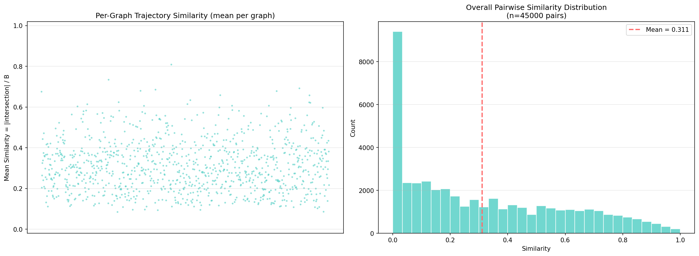
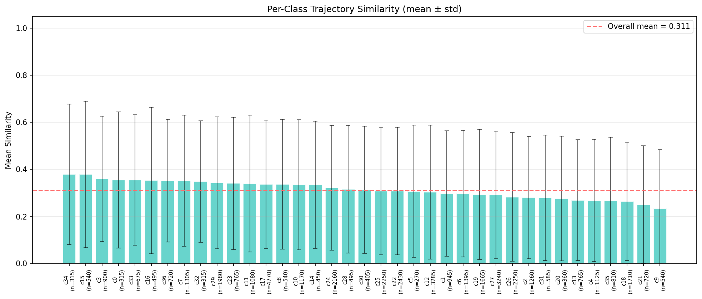
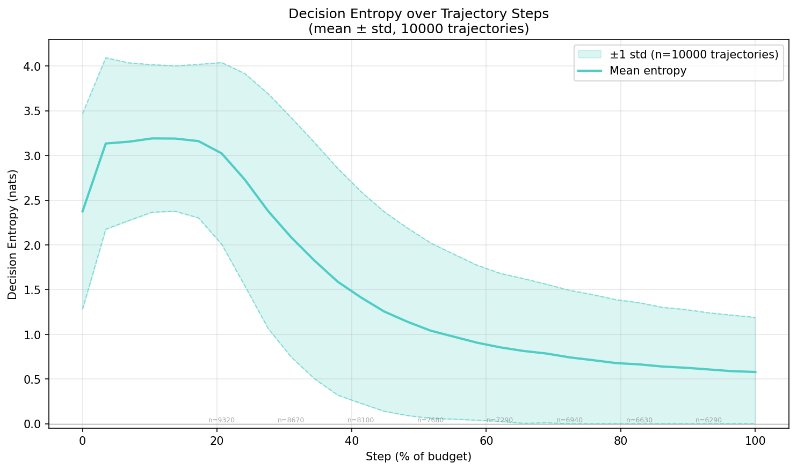

# RL Reader 轨迹多样性分析

**日期**: 2026-07-18

---

## 1. 实验设置

| 参数       | 值                                         |
| ---------- | ------------------------------------------ |
| Checkpoint | `m5/base/rl/binary/checkpoint_epoch4.pt` |
| 分析集     | 训练集（train split），分层采样 1000 张图  |
| Budget     | 10%                                        |
| 每图轨迹数 | 10（不同 seed，temperature=0.2 采样）      |
| 总轨迹数   | 10,000                                     |

---

## 2. 子图相似度

**同一张图的 10 条采样轨迹，最终子图的重合程度。**

- **总体 mean similarity = 0.311 ± 0.274**
- 左图：每点一张图的 mean pairwise similarity，大部分散在 0.1–0.5 区间
- 右图：pairwise 相似度分布偏右但极宽，Jaccard 从 0 到接近 1 都有

**结论**：同一张图、同一模型、不同 seed 的轨迹之间平均只重合 31% 的节点。

- 37 个类的 mean similarity 在 0.23–0.38 之间，std 均在 0.25–0.31
- **没有任一类明显更容易学到稳定策略** — 最好类 (c34, 0.379) 与最差类 (c9, 0.233) 差距仅 0.15
- 高频类（c17, c12, c27）未因样本多而收敛更好 — 排除样本量不足的解释

---

## 3. 决策熵

**每步 action probability 分布的熵——衡量 reader 的选择确定性。**

