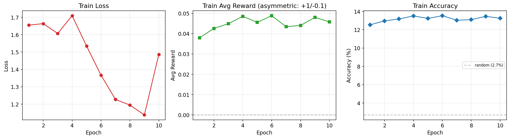
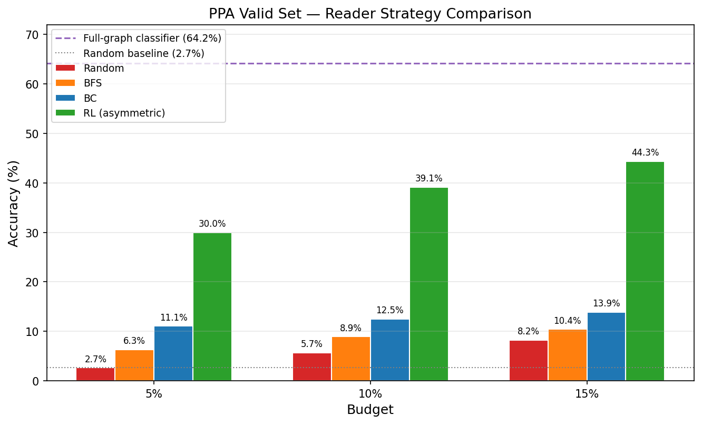
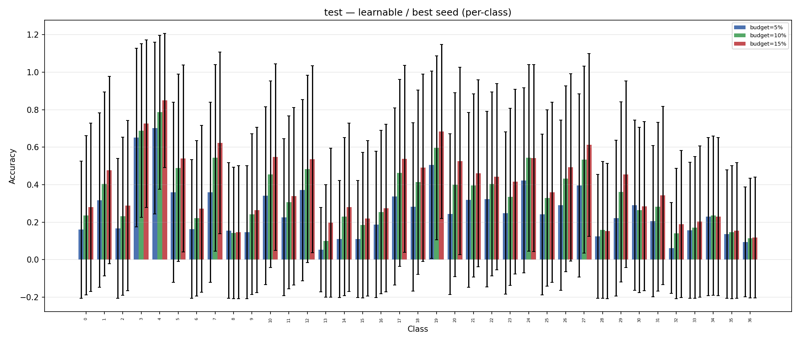
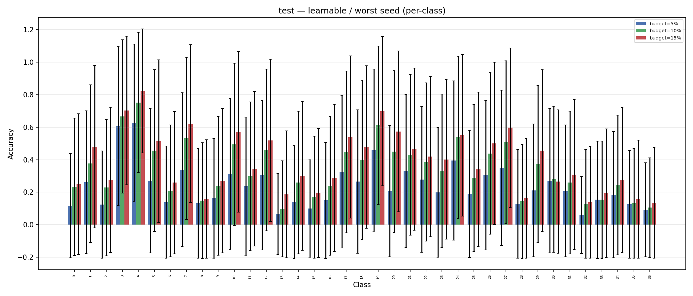
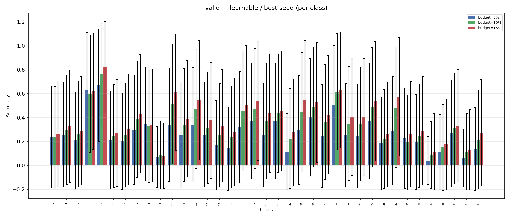
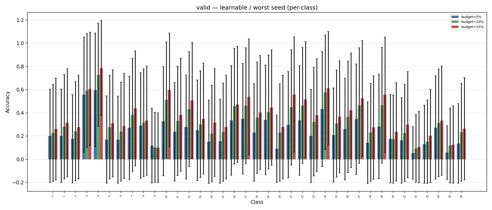
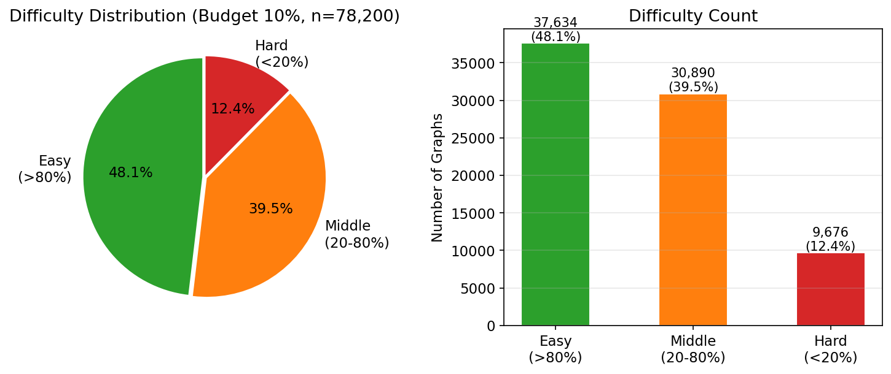
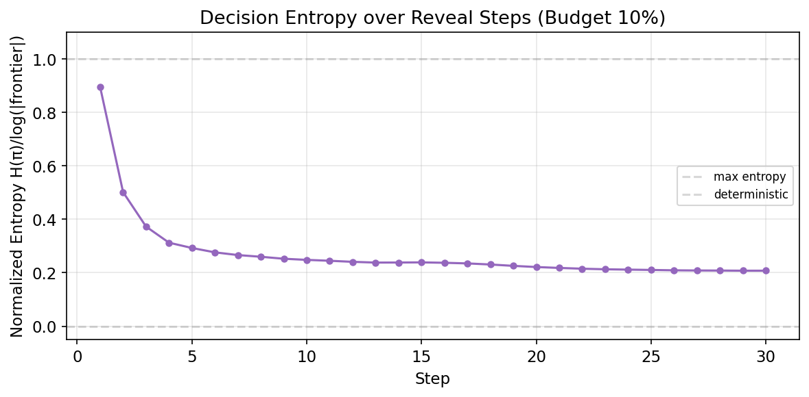
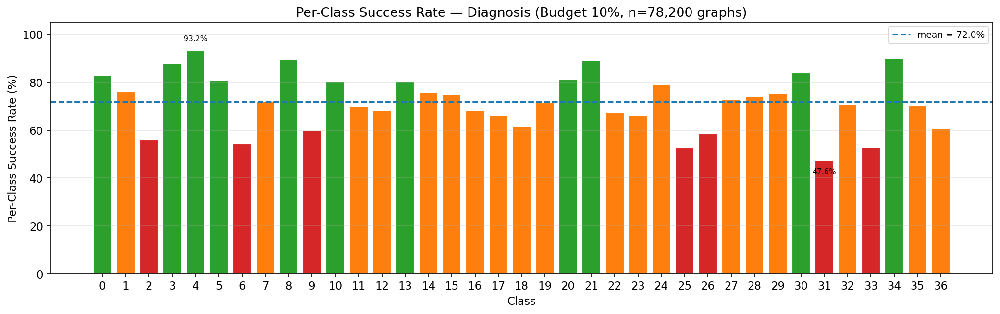

# RL Asymmetric Reward 训练结果 (ex1)

**日期**: 2026-07-26

---

## 1. 实验配置

| 参数             | 值                                                            |
| ---------------- | ------------------------------------------------------------- |
| 实验目录         | `code/m5/base/rl/asymmetric/ex1`                            |
| Reward 类型      | asymmetric: +1.0 (分类正确) / -0.1 (分类错误)                 |
| Temperature      | 0.2                                                           |
| Batch 构造       | 32 graphs × 4 rollouts = 128 trajectories / optimizer.step() |
| Bootstrap Reader | BC 训练 `best_reader.pt`（详见下方 BC baseline）            |
| Classifier       | 冻结 `best_model_ft.pt`，val_acc=0.6419 (full graph)        |
| Checkpoint 选择  | max training accuracy across all epochs →**epoch 6**   |
| Reader 结构      | hidden_dim=128, n_layers=2                                    |
| 训练集           | full training set (train.csv.gz)                              |

---

## 2. 训练动态

| Epoch       | Train Loss       | Train Avg R      | Train Acc        |
| ----------- | ---------------- | ---------------- | ---------------- |
| 1           | 1.6549           | 0.0380           | 12.54%           |
| 2           | 1.6639           | 0.0426           | 12.96%           |
| 3           | 1.6070           | 0.0449           | 13.17%           |
| 4           | 1.7096           | 0.0486           | 13.51%           |
| 5           | 1.5347           | 0.0456           | 13.23%           |
| **6** | **1.3668** | **0.0489** | **13.53%** |
| 7           | 1.2271           | 0.0434           | 13.04%           |
| 8           | 1.1948           | 0.0441           | 13.10%           |
| 9           | 1.1381           | 0.0481           | 13.46%           |
| 10          | 1.4863           | 0.0458           | 13.25%           |

**观察**：

- Loss 整体下降但震荡明显（epoch 6 最低 1.37 → epoch 10 反弹至 1.49）
- Train avg reward 始终在 0.038–0.049 之间，远低于理论期望（~40% 准确率对应的期望 reward ≈ 0.34）
- Train accuracy 在 12.5%–13.5% 窄幅波动，仅略高于 random baseline（1/37 ≈ 2.7%）
- **训练信号极弱**：asymmetric reward 在低准确率场景下几乎无法提供有效梯度

---

## 3. 评估结果

### 3.1 策略对比总览

| Budget | Random | BFS    | BC     | RL (asymmetric) | Full-Graph |
| ------ | ------ | ------ | ------ | --------------- | ---------- |
| 5%     | 2.66%  | 6.31%  | 11.07% | 29.97%          | 64.19%     |
| 10%    | 5.68%  | 8.93%  | 12.49% | 39.14%          | 64.19%     |
| 15%    | 8.24%  | 10.44% | 13.90% | 44.35%          | 64.19%     |

**BC vs RL 提升幅度（Valid, Best）**：

| Budget | BC → RL  | 倍数  |
| ------ | --------- | ----- |
| 5%     | +18.90 pp | 2.7× |
| 10%    | +26.65 pp | 3.1× |
| 15%    | +30.45 pp | 3.2× |

### 3.2 Per-Class 准确率（Test, Best / Worst CheckpointBest Checkpoint）

**最好 5 类**：

| top-5 Class   | 4      | 3      | 19     | 7      | 24     |
| -------------- | ------ | ------ | ------ | ------ | ------ |
| Acc@10%        | 78.64% | 68.89% | 59.75% | 54.33% | 54.33% |
| bottom-5 Class | 13     | 28     | 8      | 32     | 35     |
| Acc@10%        | 10.00% | 15.83% | 14.33% | 14.00% | 14.71% |

类间差距极大：最好类 (78.6%) 与最差类 (10.0%) 相差 **68.6 个百分点**。

### 3.3 Per-Class 准确率（Valid, Best / Worst Checkpoint）

---

## 4. Diagnosis 分析（78,200 张训练图, Budget 10%）

评估方式：每张图固定 seed 节点，temperature=0.2 采样 4 条轨迹，统计分类成功率。详见 [`diagnosis.json`](../../code/m5/base/rl/asymmetric/ex1/diagnosis/diagnosis.json)。

### 4.1 难度分布

| 难度   | 阈值               | 图数   | 占比  |
| ------ | ------------------ | ------ | ----- |
| Easy   | success_rate > 0.8 | 37,634 | 48.1% |
| Middle | 0.2 ≤ sr ≤ 0.8   | 30,890 | 39.5% |
| Hard   | success_rate < 0.2 | 9,676  | 12.4% |

- Mean success rate: **69.56%**

### 4.2 轨迹一致性（Fixed-Start Similarity）

- Mean pairwise Jaccard similarity: **0.580 ± 0.198**
- 同一张图、同一 seed、仅采样随机性不同的 4 条轨迹，平均重合 58% 的节点
- 比之前 binary reward 实验的 31%（不同 seed）显著更高——**固定起点大幅提升一致性**

### 4.3 决策熵随 Step 变化

| Step 1 | Step 5 | Step 10 | Step 20 | Step 30 |
| ------ | ------ | ------- | ------- | ------- |
| 0.895  | 0.293  | 0.245   | 0.226   | 0.208   |

### 4.4 Per-Class 成功率

| 最好 3 类 | Acc    | 最差 3 类 | Acc    |
| --------- | ------ | --------- | ------ |
| Class 4   | 93.17% | Class 31  | 47.58% |
| Class 34  | 89.92% | Class 25  | 52.73% |
| Class 8   | 89.63% | Class 33  | 52.90% |

---
