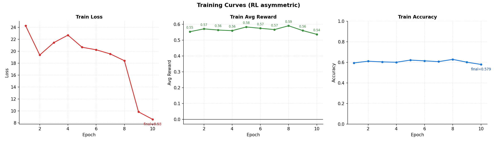
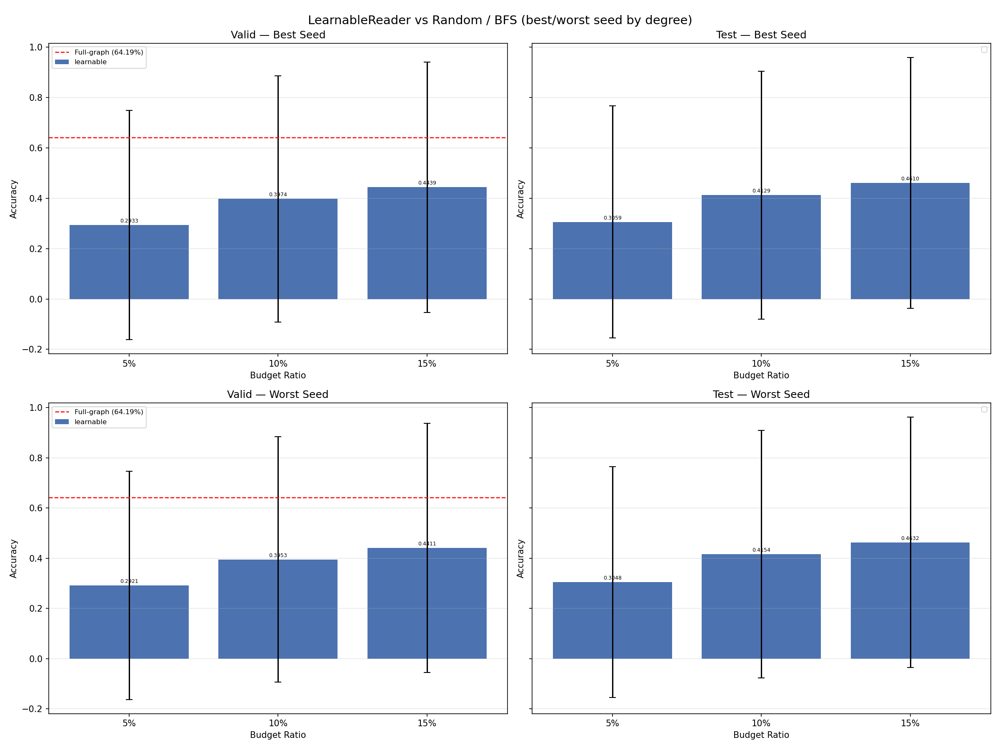
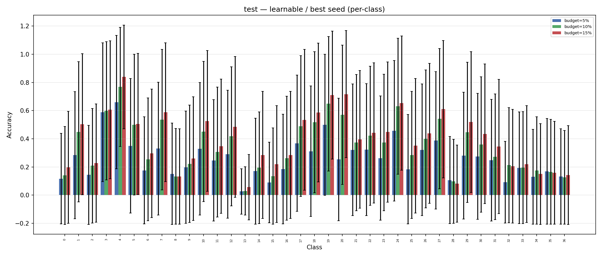
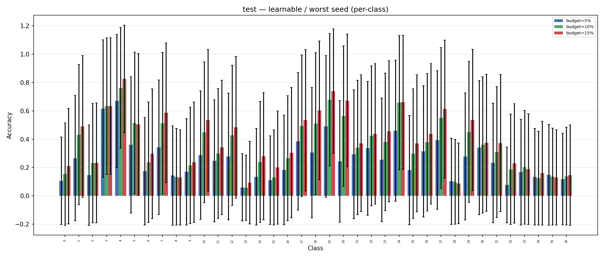
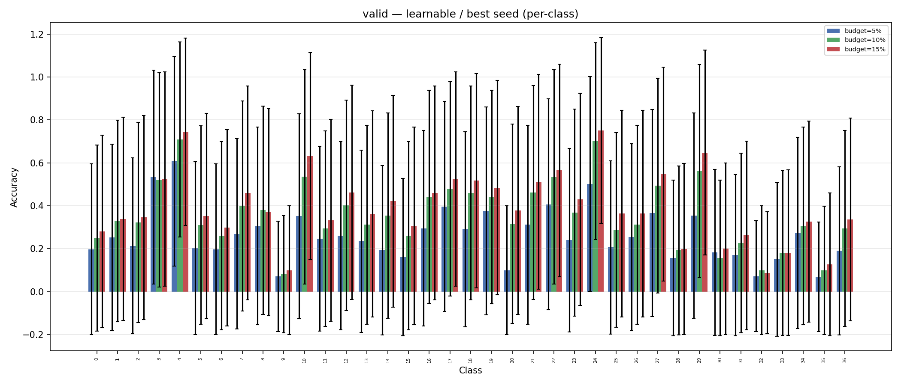
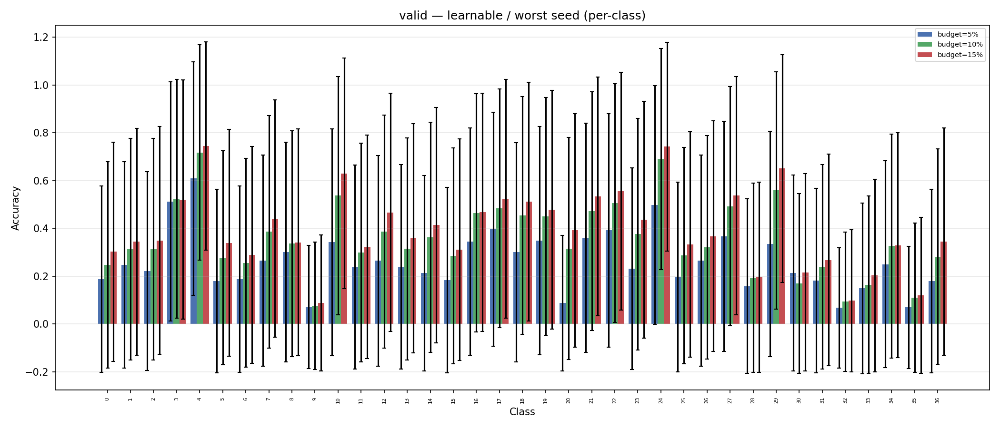
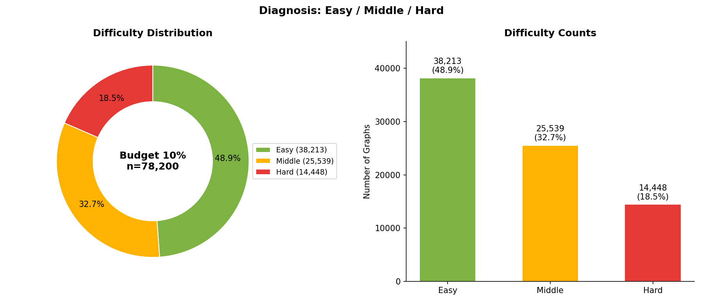
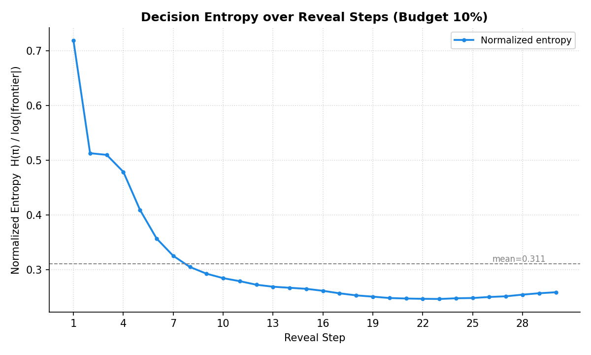
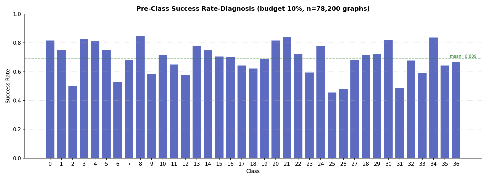

# RL Asymmetric Reward 训练结果 (ex2)

**日期**: 2026-08-05

---

## 1. 实验配置

| 参数             | 值                                                            |
| ---------------- | ------------------------------------------------------------- |
| 实验目录         | `code/m5/base/rl/asymmetric/ex2`                            |
| Reward 类型      | asymmetric: +1.0 (分类正确) / -0.1 (分类错误)                 |
| Temperature      | 0.2                                                           |
| Batch 构造       | 32 graphs × 4 rollouts = 128 trajectories / optimizer.step() |
| Bootstrap Reader | BC 训练 `best_reader.pt`（详见下方 BC baseline）            |
| Classifier       | 冻结 `best_model_ft.pt`，val_acc=0.6419 (full graph)        |
| Checkpoint 选择  | max training accuracy across all epochs →**epoch 8**   |
| Reader 结构      | hidden_dim=128, n_layers=2                                    |
| 训练集           | full training set (train.csv.gz)                              |

---

## 2. 训练动态

| Epoch       | Train Loss        | Train Avg R      | Train Acc        |
| ----------- | ----------------- | ---------------- | ---------------- |
| 1           | 24.2849           | 0.5534           | 59.40%           |
| 2           | 19.3769           | 0.5713           | 61.03%           |
| 3           | 21.4601           | 0.5640           | 60.36%           |
| 4           | 22.7143           | 0.5600           | 60.00%           |
| 5           | 20.6831           | 0.5833           | 62.12%           |
| 6           | 20.2534           | 0.5750           | 61.36%           |
| 7           | 19.5585           | 0.5667           | 60.61%           |
| **8** | **18.4270** | **0.5908** | **62.80%** |
| 9           | 9.8372            | 0.5607           | 60.06%           |
| 10          | 8.5805            | 0.5367           | 57.89%           |

**观察**：

- Loss 前 8 个 epoch 在 18–24 震荡，epoch 9–10 骤降至 ~9 / ~8.6
- Train avg reward 在 0.54–0.59 高位稳定，远高于 ex1（0.04 量级）——训练信号显著增强
- Train accuracy 稳定在 57.6%–62.8%，与诊断集的 mean success rate (66%) 同量级，说明 rollout 采样轨迹的准确率已具备有效监督信号
- Epoch 9–10 虽然 loss 骤降，但 accuracy 反而回落（epoch 10 跌至 57.89%），存在 overfit / 方差增大迹象；最终按 max train acc 选择 **epoch 8**

---

## 3. 评估结果

### 3.1 策略对比总览

**Valid Set**（best / worst seed）：

| Budget | Random      | BFS          | BC            | RL (asymmetric) |
| ------ | ----------- | ------------ | ------------- | --------------- |
| 5%     | 2.66 / 2.76 | 6.31 / 5.26  | 11.07 / 9.34  | 29.33 / 29.21   |
| 10%    | 5.68 / 5.13 | 8.93 / 7.85  | 12.49 / 11.22 | 39.74 / 39.53   |
| 15%    | 8.24 / 7.81 | 10.44 / 9.36 | 13.90 / 12.89 | 44.39 / 44.11   |

**Test Set**（best / worst seed）：

| Budget | Random      | BFS          | BC            | RL (asymmetric) |
| ------ | ----------- | ------------ | ------------- | --------------- |
| 5%     | 2.90 / 2.87 | 5.87 / 5.16  | 10.60 / 8.99  | 30.59 / 30.48   |
| 10%    | 5.77 / 5.38 | 8.81 / 7.92  | 12.57 / 11.48 | 41.29 / 41.54   |
| 15%    | 8.20 / 7.82 | 10.21 / 9.25 | 14.15 / 13.00 | 46.10 / 46.32   |

Full-graph classifier reference (valid): **64.19%**

**BC → RL 提升幅度（Valid, Best）**：

| Budget | Δ Accuracy | 倍数   |
| ------ | ----------- | ------ |
| 5%     | +18.26 pp   | 2.65× |
| 10%    | +27.25 pp   | 3.18× |
| 15%    | +30.49 pp   | 3.19× |

RL 在 10% budget 下达到 full-graph 性能的 **61.9%**（39.74 / 64.19）。seed 敏感性已基本消失。

### 3.2 Per-Class 准确率（Test, Best / Worst Checkpoint）

**最好 5 类**：

| top-5 Class    | 4      | 19     | 24     | 3      | 20     |
| -------------- | ------ | ------ | ------ | ------ | ------ |
| Acc@10%        | 76.82% | 64.88% | 63.17% | 59.78% | 57.00% |
| bottom-5 Class | 13     | 28     | 36     | 8      | 15     |
| Acc@10%        | 3.00%  | 9.83%  | 12.67% | 13.33% | 13.50% |

类间差距依旧极大：最好类 (76.8%) 与最差类 (3.0%) 相差 **73.8 个百分点**。与 ex1 相比，最好类 Acc 从 78.6% 略降至 76.8%，最差类从 10.0% 降至 3.0%（class 13 在 test 上几乎全部失败）。

### 3.3 Per-Class 准确率（Valid, Best / Worst Checkpoint）

---

## 4. Diagnosis 分析（78,200 张训练图, Budget 10%）

评估方式：每张图固定 seed 节点，temperature=0.2 采样 4 条轨迹，统计分类成功率。详见 [`diagnosis.json`](../../code/m5/base/rl/asymmetric/ex2/diagnosis/diagnosis.json)。

### 4.1 难度分布

| 难度   | 阈值               | 图数   | 占比  |
| ------ | ------------------ | ------ | ----- |
| Easy   | success_rate > 0.8 | 38,213 | 48.9% |
| Middle | 0.2 ≤ sr ≤ 0.8   | 25,539 | 32.7% |
| Hard   | success_rate < 0.2 | 14,448 | 18.5% |

- Mean success rate: **65.98%**

### 4.2 轨迹一致性（Fixed-Start Similarity）

- Mean pairwise Jaccard similarity: **0.630 ± 0.208**
- 同一张图、同一 seed、仅采样随机性不同的 4 条轨迹，平均重合 63% 的节点
- **固定起点 + asymmetric reward 下轨迹高度确定**

### 4.3 决策熵随 Step 变化

| Step 1 | Step 5 | Step 10 | Step 20 | Step 30 |
| ------ | ------ | ------- | ------- | ------- |
| 0.719  | 0.410  | 0.285   | 0.248   | 0.259   |

step 20 后熵停止下降并微幅回升（0.248 → 0.259），说明后期步骤的决策确定性没有继续提升。

### 4.4 Per-Class 成功率

| 最好 3 类 | Acc    | 最差 3 类 | Acc    |
| --------- | ------ | --------- | ------ |
| Class 8   | 84.95% | Class 25  | 45.72% |
| Class 21  | 84.06% | Class 26  | 48.04% |
| Class 34  | 83.79% | Class 31  | 48.70% |

最差类在训练集上仍有接近一半的成功率，但 eval 中 class 13 在 test 上仅 3.0%，说明困难类在 test 上泛化失效严重。

---
