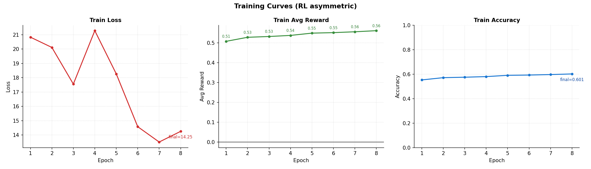
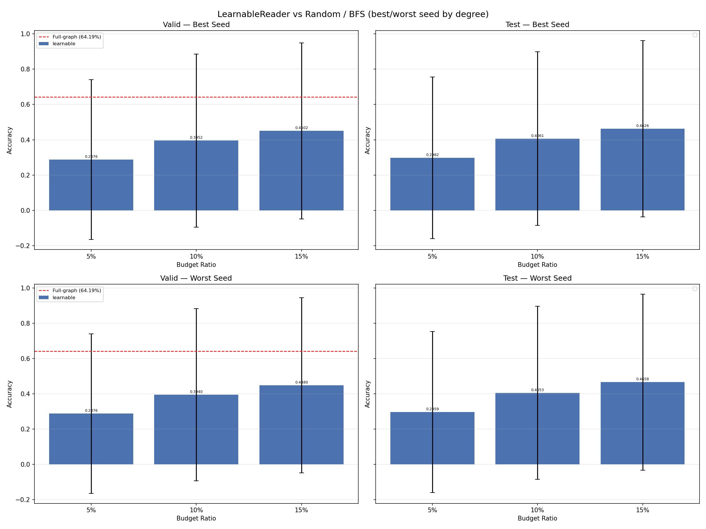
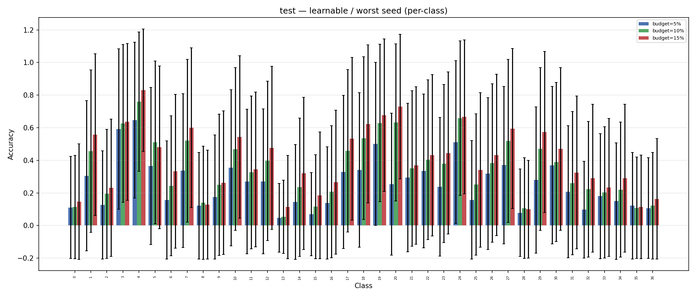
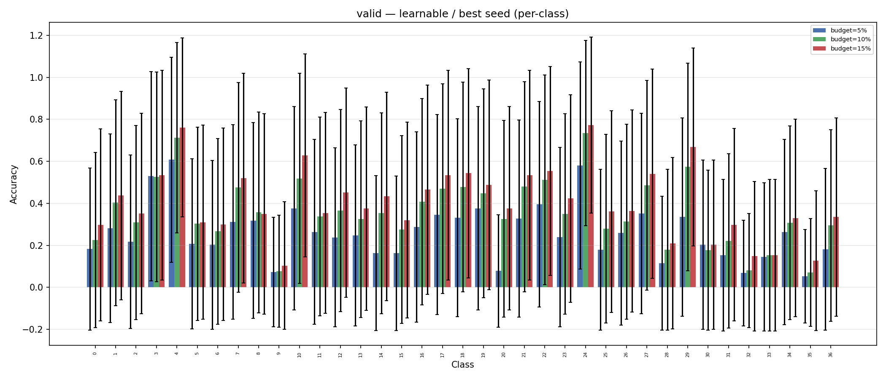
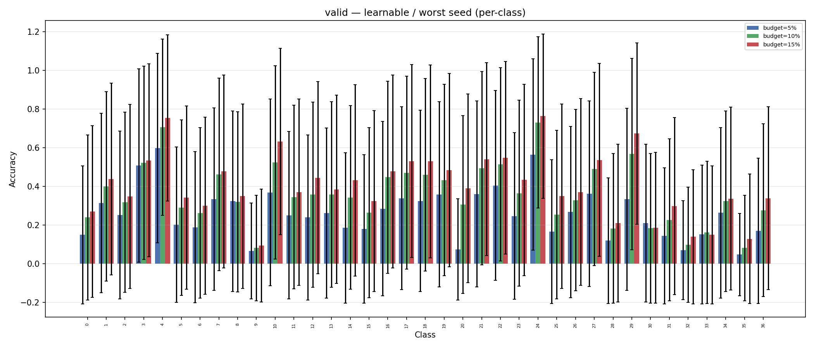
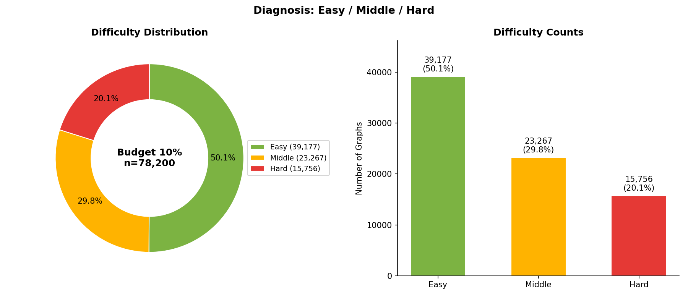
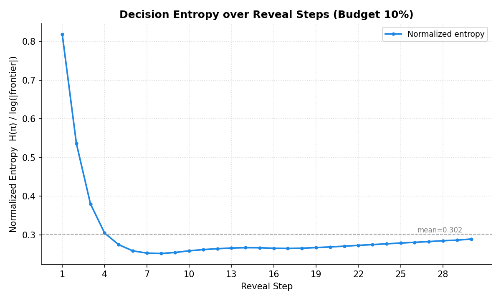
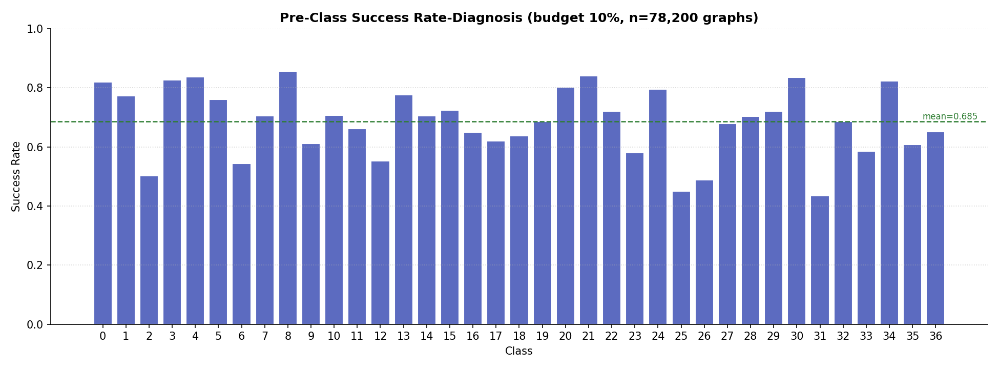

# RL Asymmetric Reward 训练结果 (ex3) — 难度过滤训练集

**日期**: 2026-08-13

---

## 1. 实验配置

| 参数             | 值                                                            |
| ---------------- | ------------------------------------------------------------- |
| 实验目录         | `code/m5/base/rl/asymmetric/ex3`                              |
| Reward 类型      | asymmetric: +1.0 (分类正确) / -0.1 (分类错误)                 |
| Temperature      | 0.2                                                           |
| Batch 构造       | 32 graphs × 4 rollouts = 128 trajectories / optimizer.step() |
| Bootstrap Reader | BC 训练 `best_reader.pt`（val_acc=0.4956）                    |
| Classifier       | 冻结 `best_model_ft.pt`，val_acc=0.6419 (full graph)          |
| Checkpoint 选择  | max training accuracy across all epochs → **epoch 8**         |
| Reader 结构      | hidden_dim=128, n_layers=2, dropout=0.1 (169,347 params)      |
| 训练集           | **难度过滤集** `train_filtered.csv.gz`（见 1.1）              |
| Epochs           | 8（config 设定 10，实际训练 8 轮）                            |

### 1.1 训练集过滤方式（基于 ex2 诊断）

ex2 诊断将全训练集 78,200 图按 success_rate 划分为 easy / middle / hard 三档。本实验通过
`rank_easy_by_ce.py` 用 ex2 的 reader（epoch 8）在 **easy 图**上采样 4 条轨迹，
按轨迹平均 CE（classifier 交叉熵）从高到低排序，**保留 reader 最挣扎的前 30% easy 图**，
与全部 middle 图合并构成新训练集，hard 图全部排除：

| 组成            | 图数   | 说明                                   |
| --------------- | ------ | -------------------------------------- |
| easy (top 30%)  | 11,464 | CE 最高、reader 最挣扎的 easy 图       |
| middle (全部)   | 25,539 | 保留全部                               |
| easy (bottom 70%) | 26,749 | 排除（CE≈0，梯度易饱和）             |
| hard (全部)     | 14,448 | 排除（asymmetric reward 下仅产生负信号） |
| **过滤训练集**  | **37,003** | 占全训练集 **47.3%**               |

动机：easy 图占训练集约一半，轨迹几乎必然分类正确（CE≈0），REINFORCE 梯度饱和、
贡献极小；hard 图在 15% 预算内难以成功，asymmetric 奖励下持续 -0.1 负信号。
保留的 easy 图 CE 范围 0.003 ~ 22.9（多数仍偏低，但相对全量 easy 已显著提高）。

---

## 2. 训练动态

| Epoch | Train Loss | Train Avg R | Train Acc |
| ----- | ---------- | ----------- | --------- |
| 1     | 20.8307    | 0.5077      | 55.24%    |
| 2     | 20.1129    | 0.5280      | 57.09%    |
| 3     | 17.5559    | 0.5320      | 57.46%    |
| 4     | 21.2840    | 0.5375      | 57.96%    |
| 5     | 18.2672    | 0.5490      | 59.00%    |
| 6     | 14.5786    | 0.5515      | 59.23%    |
| 7     | 13.5076    | 0.5558      | 59.62%    |
| **8** | **14.2523** | **0.5614** | **60.13%** |

**观察**：

- Train accuracy 与 avg reward **单调上升**（55.2% → 60.1%，0.508 → 0.561），无 ex2 在 epoch 9–10 出现的 loss 骤降 + accuracy 回落现象，训练更稳定
- 注意：本表 train acc 是在**过滤集**上统计的（排除了 70% easy 和全部 hard），不能与 ex2 的 train acc（全训练集）直接比较；过滤集本身难度分布更集中，55–60% 属合理水平
- avg_R 起点（0.508）低于 ex2（0.553），符合过滤集不含"必然成功"的 easy 图这一事实

---

## 3. 评估结果

### 3.1 与 ex1 / ex2（全训练集）对比

**Test Set**（best / worst seed）：

| Budget | ex1 (full)     | ex2 (full)     | ex3 (filtered) | Δ vs ex2 |
| ------ | -------------- | -------------- | -------------- | -------- |
| 5%     | 30.76 / 27.83  | 30.59 / 30.48  | 29.82 / 29.59  | -0.77    |
| 10%    | 40.55 / 39.43  | 41.29 / 41.54  | 40.61 / 40.53  | -0.68    |
| 15%    | 46.32 / 45.66  | 46.10 / 46.32  | 46.26 / 46.58  | +0.16    |

**Valid Set**（best / worst seed）：

| Budget | ex1 (full)     | ex2 (full)     | ex3 (filtered) | Δ vs ex2 |
| ------ | -------------- | -------------- | -------------- | -------- |
| 5%     | 29.97 / 27.05  | 29.33 / 29.21  | 28.76 / 28.76  | -0.57    |
| 10%    | 39.14 / 37.61  | 39.74 / 39.53  | 39.52 / 39.40  | -0.22    |
| 15%    | 44.35 / 43.14  | 44.39 / 44.11  | **45.02 / 44.80** | **+0.63** |

Full-graph classifier reference (valid): **64.19%**

**核心结论**：ex3 只用 47.3% 的训练图，test 准确率与全量训练的 ex1/ex2 **基本持平**
（各预算差距 ≤0.8pp），valid 15% 预算甚至高出 0.63pp。证明被排除的 52.7% 训练图
（bottom-70% easy + 全部 hard）对 RL 梯度贡献冗余甚至轻微有害。

### 3.2 Per-Class 准确率（Test, Best seed）

| top-5 Class    | 4      | 24     | 19     | 3      | 20     |
| -------------- | ------ | ------ | ------ | ------ | ------ |
| Acc@10%        | 77.36% | 64.33% | 62.00% | 61.33% | 57.00% |
| bottom-5 Class | 13     | 35     | 28     | 36     | 8      |
| Acc@10%        | 5.67%  | 9.71%  | 10.67% | 11.67% | 14.00% |

类间差距与 ex2 一致（最好 77.4% vs 最差 5.7%，相差 71.7pp）。ex2 中最差的 class 13
（3.0%）在 ex3 中略回升至 5.7%，但 class 35 成为新的最差类之一（9.7%）。
困难类的泛化失效问题依旧存在，与训练集过滤无关。

### 3.3 Per-Class 准确率（Valid, Best seed）

Valid best-5 @10%：class 24 (73.43%), 4 (71.25%), 29 (57.33%), 3 (52.60%), 10 (51.88%)；
bottom-5 @10%：class 35 (7.11%), 9 (7.71%), 32 (8.00%), 33 (15.33%), 30 (17.67%)。

---

## 4. Diagnosis 分析（78,200 张训练图, Budget 10%）

用 ex3 训练后的 reader 在全训练集上重新诊断（与 ex2 诊断同协议：固定 seed、
T=0.2 采样 4 条轨迹统计成功率）。详见 [`diagnosis.json`](../../code/m5/base/rl/asymmetric/ex3/diagnosis/diagnosis.json)。

### 4.1 难度分布（ex2 vs ex3）

| 难度   | ex2 (全量训练) | ex3 (过滤训练) |
| ------ | -------------- | -------------- |
| Easy   | 38,213 (48.9%) | 39,177 (50.1%) |
| Middle | 25,539 (32.7%) | 23,267 (29.8%) |
| Hard   | 14,448 (18.5%) | 15,756 (20.1%) |
| Mean success rate | 65.98% | 65.54% |

两者分布基本一致：ex3 reader 的 hard 比例略升（+1.6pp）、middle 略降（-2.9pp），
整体成功率几乎不变（-0.44pp）——在过滤集上训练没有损害 reader 在完整训练分布上的表现。

### 4.2 轨迹一致性（Fixed-Start Similarity）

- ex3：mean pairwise Jaccard similarity **0.692 ± 0.218**
- ex2：0.630 ± 0.208

轨迹一致性进一步提高，过滤集训练出的 policy 决策更确定。

### 4.3 决策熵随 Step 变化

| Step 1 | Step 5 | Step 10 | Step 20 | Step 30 |
| ------ | ------ | ------- | ------- | ------- |
| 0.818  | 0.275  | 0.262   | 0.269   | 0.289   |

首步熵高于 ex2（0.818 vs 0.719），但下降更快，step 5 后即低于 ex2 同期水平；
后期（step 20–30）熵缓慢回升至 0.289，与 ex2 同期的 0.259 相近。

### 4.4 Per-Class 成功率（训练集）

| 最好 3 类 | Acc    | 最差 3 类 | Acc    |
| --------- | ------ | --------- | ------ |
| Class 8   | 85.55% | Class 31  | 43.40% |
| Class 21  | 84.12% | Class 25  | 45.07% |
| Class 4   | 83.71% | Class 26  | 48.76% |

与 ex2 诊断（最好 84.95% / 最差 45.72%）几乎一致。

---

## 5. 结论

1. **数据过滤有效**：用 47.3% 训练图（easy top-30% CE + 全部 middle）训练的 reader
   与全量训练在 test 上持平（差距 ≤0.8pp）、valid 15% 略优（+0.63pp）。
2. **训练更稳定且省时**：train acc / avg_R 单调上升，无 ex2 后期崩坏；每 epoch
   数据量减半，训练时间约减半。
3. **排除的图确实冗余**：bottom-70% easy 图 CE≈0、梯度饱和；hard 图在 15% 预算内
   几乎无法成功，asymmetric 奖励下只贡献噪声。两者对最终泛化无贡献。
4. **遗留问题不变**：困难类（class 13/35/28/36/8）在 test 上仍大面积失败，
   类间差距 71.7pp，说明这是 reader 能力边界问题，与训练数据构成无关。

**下一步候选方向**：在过滤集基础上尝试更长的训练轮数（ex3 只训了 8 轮，
全量 ex2 的 10 轮在后期才出现退化，过滤集上或许可以训更久）；
或针对困难类做 class-balanced 采样 / 单独诊断。
