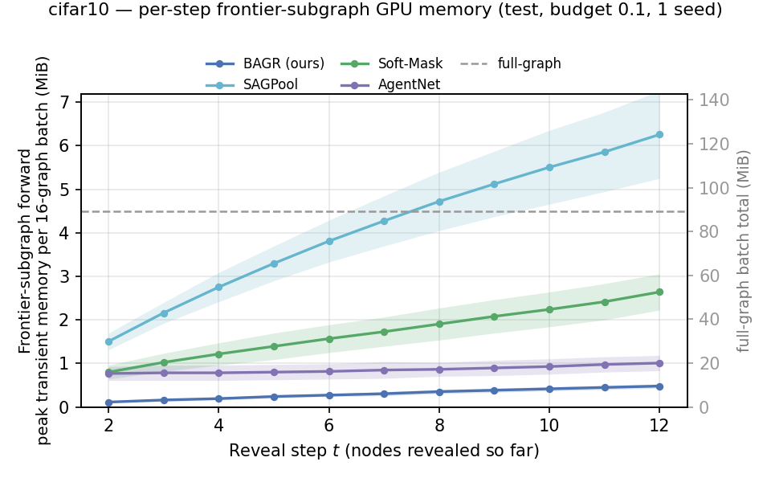
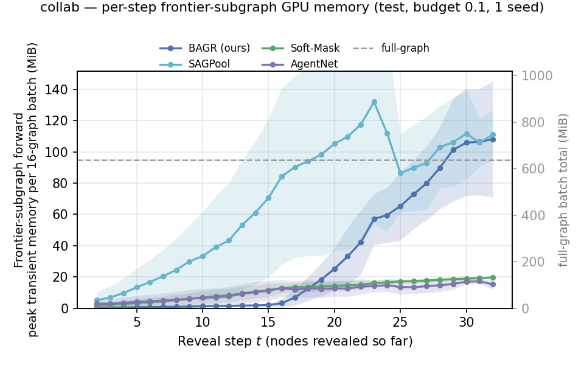

## 审稿人 zJYV 对投稿55473的官方评审

表达：2：总体可理解，但部分地方需要花费较大精力。
信息量：1：我几乎或完全没有从本文学到新东西。
可靠性：2：我对论文的可靠性有一些轻微或可修复的疑虑。
关键缺点：
W1. 方法新颖性和必要性有限。BAGR 组合了若干已有技术，却没有清晰突出的核心算法贡献。无模仿学习初始化的强化学习性能相当，这进一步质疑了完整框架的必要性。

W2. 对节点选择带来的增益隔离不足。主要比较在不同方法间使用了不同的预测器，而附录显示不同预测器在相同子图上存在显著准确率差异。这使得难以将改进归因于所提出的节点选择策略。

W3. 对分阶段强化学习的论证不足。两阶段奖励设计缺乏与更简单替代方案的受控比较，例如仅 reader 奖励或仅 reference 奖励。奖励切换后性能继续提升，并不能证明所提出调度方案的必要性。

给作者的问题：

| question | answer                                                                                                                                                                                                                                                                                                                                                                                                                                                                                                                                                                                                                                                                                                                                                                                                                                                                                                                                                                                                                                                                                                                                                                                                                                                                                                                                                                                            |
| -------- | ------------------------------------------------------------------------------------------------------------------------------------------------------------------------------------------------------------------------------------------------------------------------------------------------------------------------------------------------------------------------------------------------------------------------------------------------------------------------------------------------------------------------------------------------------------------------------------------------------------------------------------------------------------------------------------------------------------------------------------------------------------------------------------------------------------------------------------------------------------------------------------------------------------------------------------------------------------------------------------------------------------------------------------------------------------------------------------------------------------------------------------------------------------------------------------------------------------------------------------------------------------------------------------------------------------------------------------------------------------------------------------------------- |
| W1       |                                                                                                                                                                                                                                                                                                                                                                                                                                                                                                                                                                                                                                                                                                                                                                                                                                                                                                                                                                                                                                                                                                                                                                                                                                                                                                                                                                                                   |
| W2       | 文中的裁判（冻结分类器）分为两类：冻结的全图分类器和模型自带的分类头 为了体现不同训练基线最好的表现，SAGPool、softmax、Agentnet、BAGR都使用了自身的分类器/分类头。 文中主表格反应的是性能的上界，我们可以补充同一冻结分类器下的性能数据。 因为我认为该命题下，基于全图/子图数据集训练的冻结分类器不能承担所有的策略评价功能。原因如下： 1.子图空间爆炸。使用子图数据集训练的冻结分类器，也只是子图数据集上过拟合而已，坍缩同样严重 实际实验效果并不好。 2.全图分类器的偏好。它对不同类别的判别能力不同，在不平衡数据集+子图的限制下，又被严重放大。 附录的表格（table4）展示的是BAGR读出的子图在冻结的全图分类器下的表现。 3.潜在的冲突。好决策不一定会在全图分类器下取得好结果。根据经验，分类器性能越不平衡，这一点越明显 因为分类器产生明显偏好结合子图偏移会对结果造成致命打击。而分类器性能很大程度依赖数据集的平衡。 平衡数据集cifar10上，二者没有冲突。冻结分类器给RL得到的策略的评分全场最高 数据集collab上0类占了一半以上的比例，导致输入全图时，分类器喜欢预测0，在子图上又坍缩到另一个类别。 此时基线读出的子图在分类器下的性能没有明显差别，而BAGR做出了突破。 PPA上max / min ≈ 14 冲突爆发了。RL得到的策略在全图分类器”不看好“，但是利于BAGR 这也是更换奖励函数的原因。我们并不想分类器过多限制模型。 而根据使用同一冻结分类器判断子图的结果，BAGR同样有优势。总体呈 训练基线 < 启发式 略小于 BAGR。 |
| W3       |                                                                                                                                                                                                                                                                                                                                                                                                                                                                                                                                                                                                                                                                                                                                                                                                                                                                                                                                                                                                                                                                                                                                                                                                                                                                                                                                                                                                   |

针对W2：统一使用冻结分类器

| 统一使用冻结分类器 | CIFAR10 superpixels    | COLLAB                  | OGBG-PPA |
| :-----------------: | ---------------------- | ----------------------- | -------- |
|       Random       | 16.32 /18.69 / 20.57  | 5.57 / 15.57 / 15.67   | 20.16    |
|         BFS         | 16.32 / 18.06 / 19.59  | 15.57 / 15.57 / 16.47  | 24.45    |
| Max-Frontier-Degree | 16.09 / 17.31 / 18.98 | 15.57 / 15.72 / 17.27   | 26.20    |
|     Random-Walk     | 16.30 / 19.03 / 21.36 | 15.57 / 15.57 / 15.62 | 21.46    |
|       SAGPool       | 15.35 / 16.79 / 18.34  | 15.43 / 15.43 / 15.43 | 27.14    |
|      Soft-Mask      | 16.1 / 18/58 / 21.52   | 15.43 / 15.43 / 15.43 | 21.88    |
|      AgentNet      | 16.2 / 19.03 / 21.81   | 15.43 / 15.43 / 15.43 | 23.43    |
|       BAGR-BC       | 16.08 / 17.82 / 19.44  | 15.72 / 18.21 / 20.26   | 27.11    |
|       BAGR-RL       | 16.68 / 19.78 / 22.98 | 15.72 / 18.21 / 20.26  | 20.73    |

| 数据集  | 系统       | params | ckpt (MiB) | 常驻显存 (MiB) |
| ------- | ---------- | ------ | ---------- | -------------- |
| cifar10 | full-graph | 2.18M  | 25.12      | 8.37           |
|         | sagpool    | 0.14M  | 0.57       | 0.55           |
|         | softmask   | 0.32M  | 1.22       | 1.20           |
|         | agentnet   | 0.57M  | 2.18       | 2.17           |
|         | bagr       | 0.38M  | 4.46       | 1.47           |
| collab  | full-graph | 1.82M  | 20.91      | 6.97           |
|         | sagpool    | 0.14M  | 0.57       | 0.55           |
|         | softmask   | 0.31M  | 1.21       | 1.20           |
|         | agentnet   | 0.53M  | 2.04       | 2.03           |
|         | bagr       | 0.38M  | 4.44       | 1.47           |

伦理审查标记：无
评分：2：弱拒
信心：3：我熟悉该主题及其相关文献。

## 审稿人 4jJN 对投稿55473的官方评审

表达：2：总体可理解，但部分地方需要花费较大精力。
信息量：2：我学到了一些有趣或有用的内容。
可靠性：1：我对论文的可靠性有重大疑虑，且似乎不易解决。

**关键缺点：**
经验层面：可训练基线在 CIFAR10 和 OGBG-PPA 上的性能显著低于随机基线。此外，未报告运行时间和内存消耗，这些数据本可用于评估预算感知采样带来的收益。

理论层面：没有结果能解释所提方法的优势。

**给作者的问题：**
W1 为什么训练过的基线表现比随机启发式更差？

W2 是什么使 BAGR 优于其他基线方法？是否有直觉解释？作者能否提供所提方法策略相对于最优策略的近似保证？

| W1 | 1.基线SAGpool和Softmask原本都会在知晓全图拓扑结构的条件下工作，池化选择节点。 而在协议中，每一步只能看见局部拓扑图，这带来了严重的坍缩。 2.AgentNet的工作环境和我们完全一致。但是,它是多个智能体同时从多个种子节点开始， 每个智能体揭示一个前沿节点花费1点预算。我们将它收缩到了单智能体状态，其性能发生了严重下降。 |
| -- | ----------------------------------------------------------------------------------------------------------------------------------------------------------------------------------------------------------------------------------------------------------------------------------------------------------------------------------- |
| W2 | 直觉上，BAGR利用LTSM模块建立起了每次决策后，当前状态信息的时序关系来获得更好的性能                                                                                                                                                                                                                                                  |

**伦理审查标记：无**
**评分：2：弱拒**
**信心：3：我熟悉该主题及其相关文献。**

## **审稿人 phri 对投稿55473的官方评审**

**表达：3：清晰且易于理解。**
**信息量：2：我学到了一些有趣或有用的内容。**
**可靠性：2：我对论文的可靠性有一些轻微或可修复的疑虑。**

**关键缺点：**
据我所知，作者没有描述他们使用的是什么预训练冻结分类器，以及它是如何训练的。鉴于该预训练分类器是强化学习训练的关键组件，我认为缺少对它的详细介绍是一个关键缺点。我尤其关心两点：1，训练该分类器所需的数据规模和数据覆盖假设。2，用于训练该分类器的数据是否已经（或有可能）提供一种选择机制？这两个问题都可以通过提供对该预训练分类器的详细描述来回答。

**给作者的问题：**
我的主要问题是关于这项工作的动机。例如，在引言第一幅图中作者提到的图像分类例子里，为什么在某个裁剪区域上运行图像编码器代价高昂？更重要的是，为什么不能将整张图像作为输入，因为我认为这是该任务的常规设定？我认为增加更多关于该预算受限设定的说明，对于读者理解所提方法的重要性至关重要。

| 预训练冻结分类器 | 分类器由5层GINE层和浅层神经网络堆叠而成，在3个训练集上训练后冻结得到3个数据集上的分类器。                                                                                                                                                                                                                                                                                                                                                                        |
| ---------------- | ---------------------------------------------------------------------------------------------------------------------------------------------------------------------------------------------------------------------------------------------------------------------------------------------------------------------------------------------------------------------------------------------------------------------------------------------------------------- |
| 动机             | 在特殊场景如：金融、生物蛋白、交通中，拓扑图会非常大，通常包含数千或者几十万、几百万个节点。 在这类拓扑图上做消息传递是昂贵甚至不可能的。 **现实生活很多时候就是一场没有全图、只能边走边绘制地图的图探索游戏。 例如：**医学诊断**已做了一些检查，知道下一步可选检查，但不知道结果指向什么病。 追踪金融犯罪不需要事无巨细的获取某段时间银行所有交易记录， 从节点出发，沿交易关系逐步收集证据获得一个子图就可以有充分的证据** |

**伦理审查标记：无**
**评分：2：弱拒**
**信心：2：我对该领域有广泛了解，但几乎没有或没有直接研究经验。**

## 待补充实验

* [ ] 统计全图分类器、基线、BAGR的运行时间和内存消耗，评估预算感知采样带来的收益
