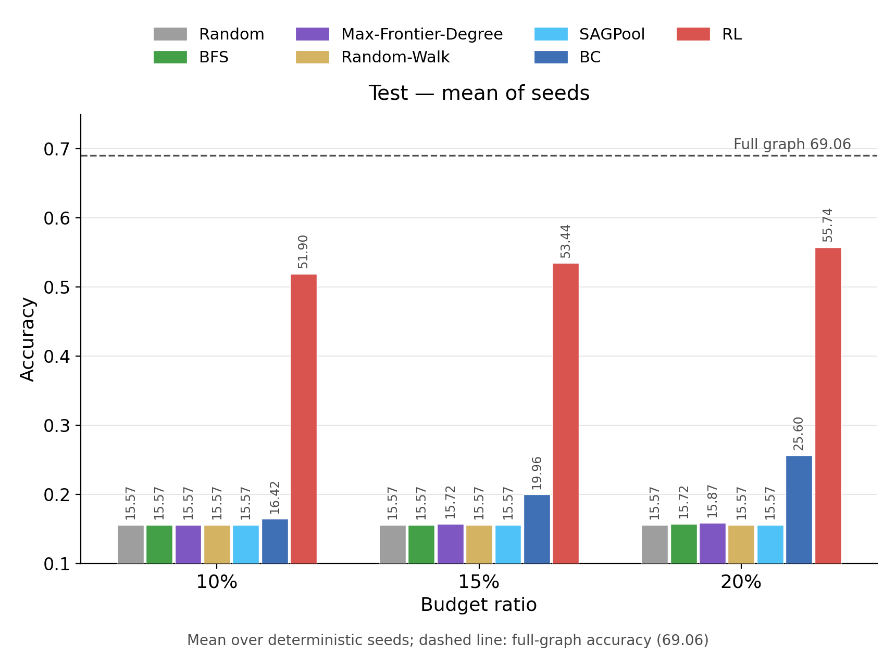
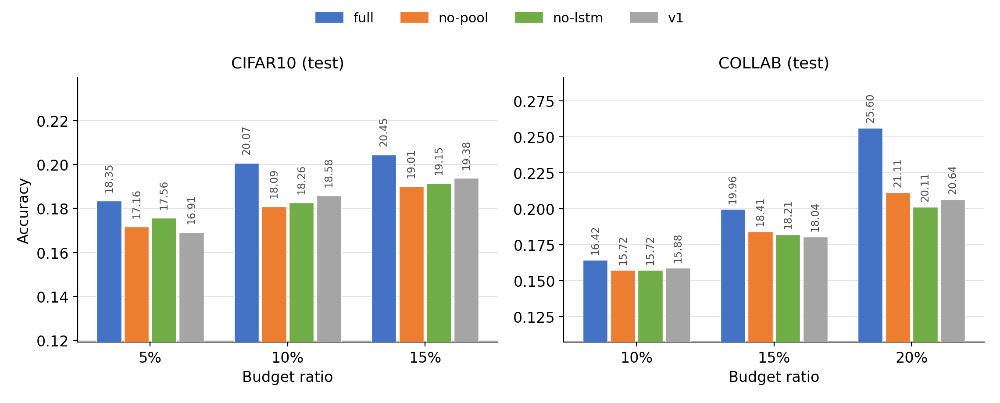

# Learning Where to Read: Adaptive Node-Revealing Policies for Budget-Limited Graph Classification

**Anonymous authors** (paper under double-blind review)

> English full text, version 2. The Chinese counterpart is `main_zh-v2.md`; figures live in `figures/`.
> Inline math is written in $...$; 【REF：…】 are citation placeholders to be filled.

---

## Abstract

Graph classification methods almost universally assume that the entire graph is available at prediction time, yet on large graphs discriminative evidence is often concentrated in a small region while node-by-node inspection carries real cost. We study **budget-limited active graph reading**: an agent starts from a single seed node, repeatedly selects frontier nodes to reveal under a fixed node budget, and then classifies the revealed subgraph. We first give a leak-proof formalization of the problem and prove that optimal reading is computationally intractable — NP-complete in the deterministic case and PSPACE-hard under succinct randomized graph models — so learning an amortized policy is a complexity-theoretic necessity rather than an engineering compromise. We further prove that task-agnostic greedy reading carries a $(1-1/e)$ optimality guarantee in a conditionally independent world, but that evidence correlation and reachability blockade on graphs make the guarantee necessarily fail. Empirically, the learned policy recovers about 81% of full-graph test accuracy on COLLAB under a 20% node budget, exceeds the best fixed policy by up to 11.3 percentage points on CIFAR10, and does not yet surpass the best fixed policy on PPA, which marks the clear boundary of the current method.

---

## 1 Introduction

Graph classification supports applications from security provenance to molecular screening, yet the dominant paradigm trains and evaluates on fully observed graphs. This assumption fails systematically in real settings: observation itself has a cost, and discriminative evidence is often concentrated in a small region (§2). Once only part of the graph can be inspected, the order of inspection matters — a breadth-first scan squanders the budget on irrelevant neighborhoods, a degree greedy ignores the task entirely, and each revealed node changes what the frontier makes visible and what is worth revealing next, so "where to read next" is a sequential decision problem. This paper formally brings this evidence-acquisition perspective into graph classification: we study **budget-limited active graph reading**, learning a policy that decides where to read under a budget and predicts using only the revealed subgraph.

Existing lines of work each provide part of the answer but stop short of this setting: graph pooling answers "which nodes matter" on the **complete** graph【REF：graph-pooling、sagpool】, graph explanation finds reasons for a prediction **after** it is made【REF：subgraphx、graph-explainability】, and active learning and active feature acquisition on graphs budget training labels and node attributes respectively【REF：active-learning-graphs、feature-acquisition】 (§3 discusses each in turn). What is missing is twofold: an evaluation protocol that makes partial graph observation leak-proof and reproducible, and evidence that a learned policy indeed beats fixed policies under matched budgets.

Our contributions unfold along four lines. **Protocol.** We give a three-tier visibility model: T0 preserves frontier attachment structure; T1 makes frontier edge features freely visible; T2 permanently disables all content of unvisited nodes. **Theory.** We prove that optimal reading is computationally intractable: NP-complete in the deterministic case and PSPACE-hard under succinct randomized graph models; task-agnostic greedy carries a $(1-1/e)$ guarantee in a conditionally independent world and necessarily fails on graphs due to evidence correlation and reachability blockade. **Method.** Behavior cloning distills an initial policy from successful teacher trajectories; reinforcement learning fine-tunes it with an asymmetric reward judged by a frozen classifier; the evidence reader accumulates what has been read in a recurrent state decoupled from node selection (§5). **Experiments.** On COLLAB all fixed policies collapse to the majority-class level, and the learned policy recovers about 81% of full-graph test accuracy with a 20% budget; on CIFAR10 it exceeds the best fixed policy by up to 11.3 percentage points; on PPA it does not yet surpass the best fixed policy, marking the clear boundary of the current method (§6).

---

## 2 Background

In several realistic graph-classification scenarios the default assumption "the whole graph is available at prediction time" fails systematically, and it fails in different ways. In security provenance, evidence graphs reach TB scale and are noise-heavy, with the discriminative signal often hidden in a very small subgraph【REF：evidence-concentration】; biological networks are highly redundant, multi-source evidence and near-duplicate patterns repeat extensively, and undiscriminating additional observation mostly injects noise rather than new information; in financial anti-fraud, due-diligence and KYC queries are billed per call, so investigation budgets are naturally limited. The three scenarios share one premise: **acquiring the graph itself has a cost**. The effective question is therefore not "the more one reads the better", but how to extract discriminative features efficiently under a small budget.

The way LLM agents work under a context budget offers a direct analogy【REF：llm-agent-context】: they do not read the entire codebase; they retrieve relevant fragments, accumulate context, and stop when the information suffices to answer. Bringing this "evidence acquisition" idea into graph classification yields **budget-limited active graph reading** (AGR): with only a small node budget, a policy actively decides step by step "where to look", and once the budget is exhausted, classification uses only the revealed subgraph.

## 3 Related Work

**Graph classification and pooling under full-graph observation.** Message-passing classifiers such as GIN consume the entire graph【REF：gin】, and pooling methods score nodes on the complete graph with task-aware attention and sparsify computation accordingly, from differentiable cluster assignments to self-attention top-$k$ selection【REF：diffpool、sagpool、pooling-survey】. All of these answer "which nodes matter after the whole graph has been read"; under a node budget the same question must be answered **before** the graph is visible, from frontier information alone.

**Graph explanation.** Explanation methods identify reasons for a trained model's prediction on an **already observed** graph. Our setting reverses the direction of this step: evidence must be acquired **before** there is a prediction to explain, and explanation-style scoring is unavailable under partial observation by construction.

**Learned sequential readers.** Closest to our setting are agents that "selectively read graphs within a budget". GAM trains recurrent walkers with reinforcement learning for budgeted whole-graph classification: a rank network inspects the neighbors of the current node and samples the next step, an LSTM integrates the reading history, and multiple walkers can pool their histories into shared memory【REF：gam】. RWE-SGNN keeps the walk but switches to a DQN rewarded by the decrease of downstream loss, using a **sampler–predictor split** of two models to generate class-relevant substructures for self-supervised graph classification【REF：rwesgnn】. AgentNet replaces reinforcement learning with straight-through Gumbel transitions, letting a population of identity-carrying agents walk differentiably and sublinearly, exchanging state with visited nodes at every step【REF：agentnet】. RAW formulates walking as a POMDP for semi-supervised **node** classification, incorporates edge content into observations, and aggregates neighbor features whose relevance passes a threshold【REF：raw】. The four tasks bracket ours: RAW protects the label of a single node with the rest of the graph observable by default; the other three share our graph-level objective. But all violate the discipline our protocol enforces. First, unrevealed content enters decisions and even predictive representations: GAM inspects neighbor contents before moving, RAW aggregates features of never-visited neighbors, and AgentNet absorbs neighbor states each step, with differentiable transitions back-propagating into the embeddings of unvisited candidates. Second, none maintains a "single-seed, monotonically growing revealed set": budgets are accounted by walk steps or agent counts, GAM may revisit nodes, RWE-SGNN launches multiple walks from globally top-scored entries, and AgentNet spreads agents across the whole graph. Third, GAM, RAW and AgentNet all read out the prediction from the same recurrent state that drives selection; RWE-SGNN's two-model split points the same way as our decoupling but has no revelation discipline. Our reader guarantees by construction that the prediction path is a function of the revealed set only.

---

## 4 Problem Setup

### 4.1 Protocol

The AGR protocol fixes how the budget is accounted, what is visible at each step, and how the final judgment is made; its design goal is to rule out information leakage under partial observation. We describe these aspects in turn.

**Budget and seed.** The budget $B$ is the number of revealed nodes, **excluding** the seed, and is reported as a fraction of the graph's node count (main experiments 5/10/15%; COLLAB 10/15/20%); all comparisons are made at matched budgets, averaged over multiple deterministic seeds. The seed $s_0$ is produced by a deterministic pseudo-random formula from the graph index.

**Revelation process.** The agent reveals step by step from the seed: at each step exactly one node from the current **frontier** may be selected for revelation, so the revealed set grows monotonically and never revisits. When the frontier is empty but budget remains (e.g., the seed falls in an isolated small component), a teleport to an unrevealed node is allowed, consuming one unit of budget.

**Visibility.** Visibility has three tiers: revealed node features, revealed edges (with features), and the existence and attachment structure of the frontier (T0) are visible to all methods; the **features of frontier edges** — edges with one revealed and one unrevealed endpoint (T1) — are freely queryable before revelation and consume no budget, so a policy may "look at the edge first, then decide whom to reveal"; all content of unvisited nodes (T2) is permanently disabled for the predictor.

### 4.2 Problem Formalization

This section writes the protocol of §4.1 as mathematical objects. Let $\omega_G=(Y,V,E,X,Z)$: $Y\in[K]$ is the graph label, $V=[n]$ a fixed vertex set, $E$ the edge set, and $X,Z$ node and edge features respectively. The revealed set starts from $S_0=\{s_0\}$; at each step an action $a_t$ is chosen from the frontier $F_t=N(S_t)\setminus S_t$, and after revelation $S_{t+1}=S_t\cup\{a_t\}$; the transition is deterministic and $|S_t|=t+1$.

**Observation.** A protocol $p\in\{0,1\}$ is given by a family of measurable maps $\Phi^p_t:\mathcal G\times 2^V\to\mathcal O^p_t$, with $o^p_t=\Phi^p_t(\omega_G,S_t)$. The observation $o_t$ consists of the ordered action history, the edges associated with $S_t$ (the structure of revealed and frontier edges), the features of revealed nodes, and the features of edges with both endpoints revealed; under protocol $p{=}1$ it additionally contains frontier edge features $Z_e\ (e\in\partial_t)$, where $\partial_t$ is the frontier edge set.

**Objective.** A policy is a family of kernels mapping observation histories to distributions on $F_t$ (randomization allowed); a terminal classifier $f$ outputs a label from $o_B$, and the value function is

$$
V^*(B)\;=\;\sup_{\pi,f}\ \Pr\big[f(o_B)=Y\big],
$$

with $V^{*,p}(B)$ under protocol $p$. The belief is defined as $b_t=\Pr(\omega_G\in\cdot\mid o_t)$.

### 4.3 Computational Complexity of Optimal Reading

**Proposition 1 (NP-completeness).** Deciding "does there exist a legal revelation sequence making the terminal classifier output $y$" (OPT-READ) is NP-complete, the optimization version is NP-hard, and the hardness holds when $B$ is part of the input. The proof reduces from Set Cover: set nodes carry set-indicator features and are all adjacent to the seed, and a "frontier-constraint failure lemma" shows the dynamic action space excludes no combination on this gadget, so the problem degenerates to pure set selection. Notably, the hardness comes from the combinatorial core of "which observations to select under a budget", not from adaptivity itself; full proof in Appendix A.1.

**Theorem 1 (PSPACE-hardness).** Under a succinct graph model of "polynomial-size deterministic skeleton + independent random bits", adaptive policies, and polynomial-size circuit classifiers, deciding $V^*(B)\ge\tau$ is PSPACE-hard. The proof reduces from SSAT (stochastic quantified Boolean formulas, i.e., "games against nature"); a dedicated lemma is needed to show one cannot directly embed general POMDPs — in AGR the secret is fixed at the start and revelation is only reading, unlike the real-time response semantics of POMDPs; full proof in Appendix A.2.

Together, the two complexity results yield a direct corollary: the optimal policy is a policy tree of depth $B$ with branching controlled by the frontier size, and exact solution is infeasible; amortizing the per-instance search cost into one-time cross-graph policy learning (teachers → BC → RL) is therefore a complexity-theoretic necessity.

### 4.4 Guarantees and Necessary Failure of Greedy Reading

**Theorem 2 (guarantee in a conditionally independent world).** If node evidence is conditionally independent given the label (CI), the information gain $f(S)=I(Y;X_S)$ is adaptive monotone and adaptive submodular, and the greedy that stepwise maximizes expected marginal gain achieves $(1-1/e)\cdot\mathrm{OPT}$. The proof is a restoration of the adaptive Nemhauser theorem in this setting: the potential $\Phi_t=\mathrm{OPT}-\mathbb E[f(A_t)\mid\psi_t]$ contracts by $(1-1/B)$ each step; full proof in Appendix A.4.

**Proposition 2 (necessary failure of the guarantee).** On graphs, evidence correlation first breaks submodularity — under an XOR structure two nodes have zero marginal information individually and complete information jointly, so marginal gains increase and submodularity fails; embedding this into the frontier constraint, reachability blockade keeps the high-information nodes out of the action space, while any stepwise marginal-scoring policy is permanently attracted by weak-signal decoy nodes. On the constructed instance, greedy's terminal accuracy is at most $0.757$ while the optimal policy achieves $1$, a gap of at least $0.24$ that does not vanish with budget; full proof in Appendix A.3.

## 5 Method

Figure 1 shows the overall architecture of the evidence reader. The selection path (upper half) is byte-identical to the base reader and stateless; the evidence path (lower half) accumulates what has been read in a recurrent state; the two paths share one encoder and are separated by two guardrails — guardrail one: the evidence stream never enters the policy scores; guardrail two: the prediction path reads only embeddings of revealed nodes.

### 5.1 Overview

The revealed subgraph, together with T1 frontier edge features, is fed to a shared GINE encoder; the selection head is an MLP that scores all frontier nodes. During training the reader randomizes revelation with a temperature; at evaluation it takes the argmax. The entire path is stateless, and introducing the evidence stream changes no selection behavior.

Each step's evidence stream consists of four actions. The encoder produces an embedding $\Delta_t$ for the node newly revealed at step $t$ (step 0 is the seed); an LSTM integrator merges it into the history state, $h_t=\mathrm{LSTM}(\Delta_t,h_{t-1})$; history-guided attention pooling uses $h_t$ as query and revealed node embeddings as K/V, producing a readout vector $z_t$; the evidence head $\mathrm{MLP}([z_t;h_t])$ outputs a per-step class distribution. In this decomposition, LSTM integration corresponds to Bayesian-filter-style stepwise evidence accumulation (a relaxed implementation), attention pooling provides extra readout capacity for evidence correlation beyond conditionally independent models, and the evidence head carries the terminal readout (§5.3).

### 5.2 Selection Head

**Motivation.** The protocol restricts what the selection head may use to $o_t$: candidate nodes are unrevealed with no readable features, and any scoring that depends on global structure (e.g., whole-graph top-$k$ pooling, §3) is unavailable. The selection head is therefore designed as a lightweight scorer over visible information, not a heavy reasoning module.

**Mechanism.** The shared encoder runs message passing on the visible subgraph (the revealed part, frontier attachment structure, and T1 frontier edge features), producing embeddings for all nodes; for each frontier candidate $v$, it concatenates

$$
u_v=\big[\,h_v\ ;\ \rho_t\ ;\ \phi_v\,\big],
$$

where $h_v$ is its embedding, $\rho_t\in[0,1]$ is the remaining budget fraction (shared by all candidates, letting the score perceive the remaining steps), and $\phi_v\in\mathbb R^3$ are structural features computable within the visible subgraph: normalized revealed degree (connections of $v$ to the revealed subgraph), signed normalized frontier degree (distinguishing "exits on the revealed side" from "frontier candidates"), and the local clustering coefficient among revealed neighbors. The selection head $\mathrm{MLP}$ outputs a scalar score, normalized by a softmax over the frontier into a policy

$$
\pi_\theta(a_t{=}v\mid o_t)\;=\;\frac{\exp s_\theta(u_v)}{\sum_{v'\in F_t}\exp s_\theta(u_{v'})}.
$$

**Relation to the protocol.** This path is entirely stateless: each candidate's score is a function of the current visible state only, independent of how the history came about. This makes the selection behavior of the base and evidence readers byte-identical (guardrail one, §5) and means the critique of prior work in §3 — unrevealed information entering decisions — cannot arise in our construction.

### 5.3 Evidence Path

**Motivation.** The terminal judgment needs a readout from $o_B$ to a label. Two naive options each have flaws: encoding and reading out the final revealed subgraph in one shot has capacity limited by the encoder's receptive field — two rounds of message passing cannot let distant pieces of read evidence interact; looking only at the last step discards all history. The evidence path instead accumulates new evidence step by step in a recurrent state, so information transfer between any two steps is carried by an explicit state.

**Mechanism.** Each step's evidence stream consists of four actions (Figure 1, lower half). (i) The encoder produces an embedding $\Delta_t$ for the node newly revealed at step $t$ (step 0 is the seed), taken from the same forward pass as the selection path — no second encoder; (ii) an LSTM integrator merges it into the history state, $h_t=\mathrm{LSTM}(\Delta_t,h_{t-1})$; (iii) history-guided attention pooling uses $h_t$ as query and revealed node embeddings as K/V, with single-head scaled dot-product producing the readout $z_t=\sum_i\alpha_i v_i$, $\alpha=\mathrm{softmax}(Kq/\sqrt d)$ — the accumulated state decides "what to look back at now"; (iv) the evidence head $\mathrm{MLP}([z_t;h_t])$ outputs a per-step class distribution, and the terminal judgment takes the step-$B$ output.

**Role.** Two design disciplines decouple prediction from selection: the evidence stream never enters the selection scores (guardrail one), and the gradients of the LSTM and attention pooling come only from the stepwise supervision $\mathcal L_{ev}$, never from the policy gradient — so the policy updates in the RL stage cannot corrupt the readout. Evaluation reports both the evidence head's terminal judgment and the reference head — the frozen classifier reading the same revealed subgraph — whose gap distinguishes "selecting well" from "reading well" (§6).

### 5.4 Training Objective

**Teacher trajectories and behavior cloning.** Teachers generate reading trajectories by gradient saliency, information gain, structural heuristics, and their hybrid combinations【REF：teacher-details-SI】; trajectories are scored by the frozen classifier's correctness on the final revealed subgraph, filtered for successes, and class-balanced, yielding $\mathcal{D}=\big\{(o_t^{\tau},\,a_t^{\tau})\big\}$ ($\tau$ indexes trajectories, $t=0,\dots,B_\tau{-}1$). Behavior cloning minimizes the per-step negative log-likelihood of actions

$$
\mathcal{L}_{act}=\frac{1}{N_{\mathrm{act}}}\sum_{\tau\in\mathcal{D}}\sum_{t=0}^{B_\tau-1}-\log\,\pi_\theta\big(a_t^{\tau}\mid o_t^{\tau}\big),
$$

where $N_{\mathrm{act}}=\sum_\tau B_\tau$ is the total number of actions; simultaneously the evidence head is supervised by a stepwise cross-entropy ($\ell_\theta^{\tau}(t)$ denotes the evidence head's logits at step $t$; $N_{\mathrm{ev}}=\sum_\tau(B_\tau+1)$ is the total number of stepwise predictions, including the step-0 seed prediction):

$$
\mathcal{L}_{ev}=\frac{1}{N_{\mathrm{ev}}}\sum_{\tau\in\mathcal{D}}\sum_{t=0}^{B_\tau}\mathrm{CE}\big(\ell_\theta^{\tau}(t),\,y_\tau\big),
\qquad
\mathcal{L}_{BC}=\mathcal{L}_{act}+\lambda_{ev}\,\mathcal{L}_{ev}.
$$

$\mathcal L_{ev}$ is the only training signal of the evidence path (§5.3); for the selection path it is an auxiliary task, providing a stepwise shaping signal of "does what has been read support some class" during rollouts.

**Reinforcement fine-tuning.** BC inherits the teachers' biases; RL uses the frozen classifier $f$'s judgment on the final revealed subgraph $o_B$ as the reward, compressing each trajectory into a single scalar. The reward takes the asymmetric form: $R(\tau)=+1$ if $f(o_B^{\tau})=y_\tau$ and $-0.1$ otherwise — the negative side is far smaller than the positive side, preventing an all-negative reward from collapsing the expected advantage to a constant. Advantages are standardized within a batch with the negative side down-weighted: $A_\tau=(R_\tau-\hat\mu)/(\hat\sigma+\varepsilon)$, and negative advantages are additionally multiplied by $\eta<1$ ($\hat\mu,\hat\sigma$ are batch statistics; $\eta$ suppresses gradient noise from failed trajectories). The policy gradient weights the whole trajectory's log-likelihood by the advantage:

$$
\nabla_\theta J(\theta)\;=\;\mathbb{E}_{\tau\sim\pi_\theta}\Big[\sum_{t=0}^{B-1}A_\tau\,\nabla_\theta\log\pi_\theta\big(a_t^{\tau}\,\big|\,o_t^{\tau}\big)\Big].
$$

The terminal reward is a single-shot event with large across-trajectory variance, so the RL stage keeps $\mathcal L_{ev}$ as a dense auxiliary supervision to reduce policy-gradient variance:

$$
\mathcal{L}_{RL}= -\sum_{\tau}A_\tau\sum_{t=0}^{B-1}\log\pi_\theta\big(a_t^{\tau}\mid o_t^{\tau}\big),
\qquad
\mathcal{L}^{total}=\mathcal{L}_{RL}+\lambda_{ev}\,\mathcal{L}_{ev}.
$$

### 5.5 Algorithm

Inference and training share the same rollout loop: one forward pass on the visible subgraph per step, with cost $O(|E(G_t)|)$ determined by the subgraph induced by the revealed set and the frontier (usually far smaller than the whole graph); a $B$-step trajectory costs linearly in $B$. Rollouts for training and evaluation run in lockstep batches across graphs. The three-stage pipeline is given in Algorithm 1.

```
Algorithm 1  Three-stage training pipeline
Input: training graphs {G_i}; frozen classifier f̂; budget tiers B; teachers {gradient, info-gain, structural, hybrid}
Output: policy and evidence-head parameters θ

# Stage A: teacher trajectories
for G_i, seed s₀, teacher T:
  S ← {s₀}
  while |S|−1 < B:                       # budget = number of reveals, excluding seed
    F ← N(S)\S; if F=∅ then teleport (costs 1 budget)
    a ← T(observation); reveal a; S ← S∪{a}   # record (o_t, a_t) stepwise
  if f̂(G_S)=y: 𝒟 ← 𝒟 ∪ this trajectory
Class-balance 𝒟

# Stage B: behavior cloning
repeat: sample a batch from 𝒟, reproduce observations by temperature rollout; gradient descent on L_BC

# Stage C: reinforcement fine-tuning
repeat: rollout with θ at temperature; R ← +1 if f̂(o_B)=y else −0.1; standardize advantages;
gradient descent on L^total
```

### 5.6 Implementation Details

The shared encoder is a GINE-style edge-feature convolution, by default 2 layers of width 128 with dropout 0.1 (configurable layer-wise); the selection MLP and the evidence modules (LSTM 128→128, single-head attention pooling, evidence head $2d{\to}d{\to}K$) operate at the same width; the evidence modules add about 0.2M parameters over base, with forward cost comparable to base ($\Delta_t$ comes from the same forward pass — no second encoder). Optimization uses Adam (representative configuration: learning rate $10^{-3}$, batch size 64, about 10 BC epochs, with RL fine-tuned for a few more epochs); training rollouts sample at temperature and evaluation takes the argmax, with 4 deterministic seeds per graph (§4.1). Budget tiers, class counts, and feature dimensions per dataset are given by the dataset registry; all hyperparameters and architectures are embedded in the corresponding checkpoints and released with the code — per-dataset differences are not enumerated here.

---

## 6 Experiments

### 6.1 Experimental Setup

We evaluate on three large-scale graph classification benchmarks: OGBG-PPA【REF：ogbg】, CIFAR10 superpixels【REF：lrgb】, and COLLAB【REF：tudataset】. The three cover different structural regimes the protocol must face: CIFAR10 superpixels are node-feature-centric, near-grid, and bounded-diameter; PPA has only 7-dimensional edge features, averages 243 nodes, and its train/test split is by species, so the label distributions differ; COLLAB has only edge features and is severely class-imbalanced (majority class about 15%). The metric is accuracy (%); budget fractions follow §4.1 at 5/10/15% (COLLAB 10/15/20%), all numbers are averages over four deterministic seeds, and except for Table 1 (test only) all cells report both validation and test. Fixed baselines comprise four revelation strategies — Random, BFS, Max-Frontier-Degree, Random-Walk — plus SAGPool adapted into a stepwise static selector; the frozen full-graph classifier provides each dataset's upper bound, and its accuracy on the revealed subgraph is reported as the reference head (acc_clf).

**How baselines enter the protocol.** The four fixed strategies share one protocol interface — at each step they select exactly one unrevealed endpoint from the current frontier, with budget accounting, seed formulas, and terminal judgment identical to the learned methods; they differ only in the **sequential heuristic** that orders reading. Random samples uniformly over frontier edges (breadth-type); BFS reveals in first-in-first-out order of frontier-edge discovery, a strict layer-order expansion; Max-Frontier-Degree reveals the frontier node with the most connections to the revealed subgraph; Random-Walk walks along random edges from the current node and reveals the first unrevealed node it arrives at (depth-type, locally correlated; revisits consume no budget, and beyond a walk-step limit it degenerates to uniform frontier sampling and counts as a teleport). The only knowledge-bearing baseline, SAGPool, requires substantive adaptation to enter the protocol: its original form performs one-shot top-$k$ selection on the complete graph, consuming unobserved global structure and guaranteeing neither connectivity to the seed. The adapted version turns its scorer into a stepwise static selector — at each step it recomputes gating scores on the visible subgraph only (revealed ∪ frontier, with frontier node features zeroed) and reveals the highest-scoring frontier node (ties broken by smaller id, deterministic); the scorer itself is still trained on complete graphs with standard supervision, and the resulting distribution shift at evaluation is part of that baseline's setting; its convolutions are replaced by GINE-style edge-feature convolutions to consume edge features (PPA/COLLAB have no node features). The four fixed strategies are pure structure heuristics: they consume only T0 structural information and do not query T1 frontier edge features; the adapted SAGPool uses T1, as does the learned reader. All methods share the same terminal judgment, upper bound, and reference-head protocol.

**Table 1: CIFAR10 superpixels, test accuracy (%).** The reference head is the frozen classifier on RL-revealed subgraphs; BC is the main comparison configuration, and the evidence reader's BC variants are in Table 4.

| Budget | Random | BFS   | Max-Frontier-Degree | RW    | SAGPool | BC    | RL        | RL-Ref |
| ---- | ------ | ----- | ---------- | ----- | ------- | ----- | --------- | ------ |
| 5%   | 16.32  | 16.32 | 16.09      | 16.30 | 15.49   | 16.91 | **25.32** | 16.68  |
| 10%  | 18.69  | 18.06 | 17.31      | 19.03 | 16.91   | 17.87 | **30.03** | 19.78  |
| 15%  | 20.57  | 19.59 | 18.98      | 21.36 | 18.10   | 18.39 | **32.68** | 22.98  |

Full-graph classifier (upper bound) 60.5.

**Table 2: COLLAB, accuracy (%), all cells validation/test.** Fixed policies are pinned at the majority-class level.

| Budget | Random      | BFS         | Max-Frontier-Degree | RW          | SAGPool     | BC          | RL              | RL-Ref      |
| ---- | ----------- | ----------- | ------------------- | ----------- | ----------- | ----------- | --------------- | ----------- |
| 10%  | 15.43/15.57 | 15.53/15.57 | 15.63/15.57         | 15.43/15.57 | 15.43/15.57 | 16.78/16.42 | **52.20/51.90** | 15.88/15.72 |
| 15%  | 15.43/15.57 | 15.73/15.57 | 15.83/15.72         | 15.43/15.57 | 15.43/15.57 | 20.24/19.96 | **54.56/53.44** | 18.09/18.21 |
| 20%  | 15.43/15.57 | 15.98/15.72 | 16.03/15.87         | 15.43/15.57 | 15.43/15.57 | 27.56/25.60 | **58.02/55.74** | 20.64/20.26 |

Full-graph classifier (upper bound) valid 71.54 / test 69.06.




### 6.2 Main Results

The results answer three questions: can the learned policy beat all fixed baselines at matched budgets (Tables 1–3); is the gain cashed by "selecting well" or by "reading well" — the contrast between the RL and RL-Ref columns, the former being the evidence head's terminal judgment and the latter the frozen classifier reading the same revealed subgraph; and where the method's boundary of applicability lies (the negative result on PPA).

On CIFAR10 superpixels (Table 1, Figure 3), fixed policies concentrate in a narrow 16–21 band and behavior cloning falls in the same band — imitating task-agnostic teachers alone does not beat the best heuristics. Reinforcement fine-tuning pushes the policy far out of this band: the three budget tiers reach 25.32, 30.03, and 32.68, exceeding the best fixed policy at the same budget by 9.0–11.3 percentage points and BC by up to 14.3. The gap between RL and the reference head (32.68 vs 22.98 at 15% budget) shows the policy reveals subgraphs the frozen classifier reads **better**, not merely "reveals more". Against the full-graph upper bound, at 15% budget RL reaches 32.7 with the full-graph classifier at 60.5, recovering about 54% of full-graph accuracy: reinforcement fine-tuning captures most of the increment beyond the fixed-policy band, but substantial headroom remains.

On COLLAB (Table 2, Figure 2), all fixed policies and SAGPool stay at 15.4–16.0 on both splits — the majority-class level of this imbalanced dataset — the extreme form of the greedy failure characterized by Proposition 2 in §4.4: task-agnostic selection never escapes collapse. Behavior cloning improves to valid 16.8–27.6 and test 16.4–25.6; reinforcement fine-tuning reaches 51.90, 53.44, and 55.74 on test, recovering 75.2–80.7% of full-graph test accuracy (69.06) — the remaining gap is mainly bounded by the full-graph classifier's own accuracy, not by the reading policy. The reference head sharpens the mechanism: the frozen classifier reading RL-revealed subgraphs achieves only 15.7–20.3, so it is the evidence head that converts revealed evidence into prediction, not the frozen readout.

**Table 3: OGBG-PPA, accuracy (%), all cells validation/test.** Learned policies do not yet beat the best fixed policy; BC collapses to near random.

| Budget | Random      | BFS         | Max-Frontier-Degree | RW          | SAGPool     | BC        | RL          | RL-Ref   |
| ---- | ----------- | ----------- | ------------------- | ----------- | ----------- | --------- | ----------- | --------- |
| 5%   | 18.86/20.16 | 23.45/24.45 | 25.31/26.20         | 19.71/21.46 | 26.08/27.28 | 3.90/3.97 | 23.53/26.90 | 19.65/20.73 |
| 10%  | 31.14/33.07 | 30.06/35.68 | 36.33/37.28         | 32.34/34.54 | 36.25/37.92 | 7.23/7.37 | 28.12/32.34 | 26.83/27.41 |
| 15%  | 39.37/41.88 | 40.84/42.92 | 42.94/44.52         | 40.21/42.99 | 43.03/45.08 | 9.04/9.03 | 30.76/35.05 | 31.87/32.99 |

Full-graph classifier (upper bound) valid 64.2 / test 65.6.

On PPA the fixed policies separate cleanly with budget, and SAGPool is the strongest fixed baseline on test. In stark contrast to the other two datasets, the learned policies are not yet competitive: behavior cloning collapses to 3.9–9.0, well below all fixed policies; reinforcement fine-tuning consistently beats its reference head (20.7–33.0) yet trails the best fixed baseline by 0.4–10.0 percentage points at every budget tier. The policy gradient's signal-to-noise ratio is naturally low at low success rates, consistent with this observation — but a complete attribution (reward sparsity, PPA's budget granularity, class imbalance) is not yet established, and we draw no conclusion about adaptive reading from this negative result.

### 6.3 Ablation and Analysis

**Table 4: BC ablation, test accuracy (%).** no-pool removes history-guided attention pooling, no-lstm removes the recurrent accumulator, v1 removes both; COLLAB budgets are 10/15/20%.

| Dataset (budget tiers) | Variant | Tier 1 | Tier 2 | Tier 3 |
| ---------------------- | ------- | ------ | ------ | ------ |
| CIFAR10 (5/10/15%)     | full    | 18.35  | 20.07  | 20.45  |
| CIFAR10                | no-pool | 17.16  | 18.09  | 19.01  |
| CIFAR10                | no-lstm | 17.56  | 18.26  | 19.15  |
| CIFAR10                | v1      | 16.91  | 18.58  | 19.38  |
| COLLAB (10/15/20%)     | full    | 16.42  | 19.96  | 25.60  |
| COLLAB                 | no-pool | 15.72  | 18.41  | 21.11  |
| COLLAB                 | no-lstm | 15.72  | 18.21  | 20.11  |
| COLLAB                 | v1      | 15.88  | 18.04  | 20.64  |



Tables 4 and Figure 4 ablate the evidence path's two components item by item (§5.3): no-pool removes the history-guided readout, no-lstm removes the recurrent accumulator, and v1 removes both — the terminal judgment degenerates to an unguided mean pooling of revealed embeddings, a one-shot readout with neither recurrence nor guidance. The recurrent accumulator is the largest contributor on COLLAB: removing the LSTM costs 5.5 percentage points of accuracy at the 20% budget, and removing both costs 5.0 with the sharpest degradation at the largest budget tier. On CIFAR10 each effect is smaller but directionally consistent: attention pooling contributes 1.0–1.4 percentage points, and the full variant leads at every tier. This pattern matches the design motivation of §5.3: long-range evidence integration matters most on sparse, large-diameter COLLAB — the revealed subgraph is connected, but its diameter exceeds what a two-layer encoder's single forward pass can reach, so the recurrent accumulator integrates far-apart pieces of read evidence across steps; CIFAR10's grid-like structure has bounded diameter, and the gap between one-shot and recurrent readouts narrows accordingly.

### 6.4 Efficiency

Inference cost follows the rollout complexity of §5.5: one forward pass on the visible subgraph per step; the visible subgraph is induced by the revealed set (at most the budget) and its frontier, so its size is controlled by the budget cap and decoupled from the size of the whole graph — at 5–20% budget the reader's per-step forward graph is always a small fraction of the full graph. The evidence modules add only about 0.2M parameters over base (width 128), and since $\Delta_t$ comes from the same forward pass as the selection path — no second encoder — the stepwise evidence integration costs about the same as base. The deployment path requires no full-graph forward at all: the terminal judgment comes from the evidence head, and the frozen classifier's full-graph forward appears only on the training side (reward judgment) and the evaluation side (upper bound and reference head). On the training side, stage A's teacher-trajectory generation is a one-time cost, and stages B/C train on those trajectories with lockstep batched forwards.

---

## 7 Discussion

This section puts the results of §6 back into the context of the problem: by what mechanism the gains are cashed, how theory and experiments corroborate each other, and where our conclusions stop.

### 7.1 Limitations

**Mechanistic decomposition of the gains.** RL's gains contain two components, "selection" and "calibration", and the reference head separates them. On CIFAR10 the RL terminal judgment is far above the frozen classifier's accuracy on typical revealed subgraphs, indicating selection (finding evidence-richer regions) is the dominant mechanism; on COLLAB the opposite holds — the frozen classifier reads RL-revealed subgraphs at only 15.7–20.3 while the evidence head judges 51.9–55.7, so the gain is cashed mainly by the evidence head's advantage over the frozen readout. Completely ruling out calibration effects would require matched-training controls, which we leave to future work.

**Alignment with theory.** The theoretical results correspond point by point with the experiments: the COLLAB collapse is the real-world version of the greedy failure proved in Proposition 2 — task-agnostic stepwise scoring never escapes the majority class; the learned policies' accuracy rises monotonically with budget on all three datasets, consistent with revelation information growing monotonically with budget; PPA's low success rate matches the prediction that policy gradients have low signal-to-noise at low success rates (first item of §7.2).

**Boundary of current evidence.** Our conclusions are bounded by three limits. First, the gains narrow at the smallest budgets: at CIFAR10's 5% budget RL recovers less than half of full-graph accuracy, so the method currently applies to settings that allow moderate inspection fractions. Second, per-class accuracy is uneven: CIFAR10's hardest class is near random on test, the best and worst classes differ by 71.7 percentage points, and class-balanced filtering barely helps — a capability boundary rather than a data-volume issue. Third, PPA is an honestly reported negative result whose attribution is, as noted, incomplete.

### 7.2 Future Work

**Reward design and potential-based shaping.** The terminal reward is a single-shot Bernoulli event whose across-trajectory variance $p(1-p)$ dominates gradient noise; low-success-rate tasks such as PPA thus have naturally low signal-to-noise. Potential-based shaping is a theoretical free lunch: define $\Phi$ from the evidence head's current confidence or margin and set $r'_t=r_t+\Phi(o_{t+1})-\Phi(o_t)$; under a finite-horizon undiscounted objective every policy's return is shifted by the same constant and the optimal policy set is unchanged, while every step receives dense gradient signal — the evidence head can therefore be reused in the RL stage as a zero-bias reward shaper. A systematic attribution for PPA (reward sparsity, graph diameter and budget granularity, hub-dominated degree distribution) together with this scheme is the nearest-term experiment.

**Adaptive stopping and anytime validity.** The current protocol fixes the budget in fractional tiers, yet "how much to read" is itself a decision. Under the CI model the evidence head's sequential likelihood-ratio process is a non-negative martingale, and Ville's maximal inequality gives budget-free validity: stopping by "declare with $1-\alpha$ confidence upon first crossing $1/\alpha$" holds at any stopped-upon budget, so early stopping does not destroy statistical validity. Implementing this as a soft stopping rule turns "how much to read" from a fixed hyperparameter into a data-driven decision, and turns over-reading risk into a measurable object.

**Dataset-level gain prediction and mechanistic teachers.** Whether gains can be predicted in advance from cheap dataset statistics deserves systematic testing: two candidate predictors are information concentration (the smaller the participation ratio, the larger the learning gain) and evidence correlation structure (the larger the equicorrelation parameter, the more redundancy is constrained and the gain concentrates in decorrelation); both can be estimated directly by per-node linear probes or edge-endpoint feature correlation, and if measured rankings contradict the prediction, the mechanistic conjecture is falsified. Likewise, the cut-expansion greedy of a correlated world is a closed-form teacher probe whose success rate relative to the information-gain teacher directly measures "is the real world closer to independent or correlated". Incorporating spectral statistics (spectral gap, Cheeger constant, degree-distribution surplus) into dataset profiles could turn "which dataset is worth a learned reader" from an after-the-fact observation into an a-priori prediction.

**Protocol and objective extensions.** The current protocol assumes single-label mutually exclusive classification; multi-label and regression objectives require redefining the reward and the metric. A longer-term direction is to generalize the budget from "node-count fractions" to heterogeneous inspection costs, and to let the policy learn when to stop reading under cost awareness.

## 8 Conclusion

We presented a leak-proof formalization and evaluation benchmark for budget-limited active graph reading, and proved that optimal reading is computationally intractable — NP-complete in the deterministic case, PSPACE-hard under succinct randomized graph models — while task-agnostic greedy carries a $(1-1/e)$ guarantee in a conditionally independent world and necessarily fails on graphs through evidence correlation and reachability blockade: learning to read is therefore a complexity-theoretic necessity, not an engineering compromise. The evidence reader guarantees by construction that prediction depends only on revealed content; behavior cloning followed by reinforcement fine-tuning with an asymmetric reward turns task-agnostic reading into task-aware reading — on COLLAB a 20% node budget recovers about 81% of full-graph test accuracy, on CIFAR10 the learned policy beats the best fixed policy by up to 11.3 percentage points, and ablations confirm the recurrent evidence accumulator carries the main gains; on PPA it does not yet beat the best fixed policy, an honestly reported boundary of the method. These results establish "where to read" as a first-class decision problem in graph classification when observation has a cost; cost-aware budgets and adaptive stopping are the natural next steps.

---

## Appendix

This appendix gives **self-contained proofs** of all theoretical results in §4: it assumes only undergraduate probability and linear algebra, no information theory or computational complexity background. Organization: each proof is preceded by a **Preliminaries** subsection that first explains the concepts and standard facts used (short ones proved in place, long ones with sources and reading pointers); proofs are numbered step by step, each step annotated with the fact numbers it relies on (tools of A.0 are labeled (P1)–(P5), (I1)–(I5), Proposition F, and (U2)). We recommend reading A.0 first; A.1–A.4 are then essentially independent of each other.

Conventions: entropy and mutual information are in **bits** (logarithms base 2); likelihood ratios and Gaussian computations use $\ln$ (the softmax exponent must match the log base: with base 2 the exponent is $2^{\Lambda}$, equivalent to the natural-base version). $[K]=\{1,\dots,K\}$. Measure-theoretic "modulo null sets" qualifications are omitted throughout; they do not affect any almost-sure (a.s.) statement. 【Cite】 marks standard results and their sources; 【Assumption】 marks explicit modeling choices (these assumptions are models the paper must declare).

### A.0 Common Preliminaries

#### A.0.1 Six facts about probability

**(P1) Total probability and Bayes' rule.** If events $B_1,\dots,B_m$ are mutually exclusive and cover the whole space, then for any event $A$: $\Pr[A]=\sum_i\Pr[A\mid B_i]\Pr[B_i]$. Treating "each value of a random variable $X$" as such a partition gives **Bayes' rule**:

$$
\Pr[Y{=}y\mid X{=}x]=\frac{\Pr[X{=}x\mid Y{=}y]\,\Pr[Y{=}y]}{\Pr[X{=}x]},\qquad \Pr[X{=}x]=\sum_{y'}\Pr[X{=}x\mid Y{=}y']\Pr[Y{=}y'].
$$

Intuition: $\Pr[Y{=}y]$ is the prior (before seeing evidence), $\Pr[Y{=}y\mid X{=}x]$ the posterior (after); the posterior-to-prior ratio is determined by the likelihood ratio of the evidence under the two classes.

**(P2) Conditional expectation and the tower property.** $\mathbb E[X\mid\mathcal G]$ is "the average of $X$ computed with the information in $\mathcal G$"; it is a function of $\mathcal G$: it takes the same value where the $\mathcal G$-information is the same. **Tower property**: for $\mathcal G_0\subseteq\mathcal G_1$,

$$
\mathbb E\big[\,\mathbb E[X\mid\mathcal G_1]\,\big|\,\mathcal G_0\big]=\mathbb E[X\mid\mathcal G_0].
$$

Intuition: averaging first within fine-information groups and then averaging the group means with coarse information equals averaging directly with the coarse information (average by day then by week = average by week). We repeatedly use two corollaries: (i) if $X$ is a function of $\mathcal G$ then $\mathbb E[X\mid\mathcal G]=X$; (ii) if $Z$ is independent of $(X,\mathcal G)$, $\mathbb E[X\mid\mathcal G]$ can be computed by first conditioning on $(\mathcal G,Z)$ and then integrating out $Z$.

**(P3) Joint independence is preserved under conditioning.** If $X$ is **jointly** independent of $(Y,Z)$, then given $Z$, $X$ and $Y$ remain independent, so for any function $g$, $I(Y;X\mid Z)=0$. Proof: by joint independence, $\Pr[X{\in}A,Y{\in}B\mid Z{=}z]=\Pr[X{\in}A\mid Z{=}z]\,\Pr[Y{\in}B\mid Z{=}z]$ (product factorization); summing over $B$, the denominator $\Pr[Y{\in}B\mid Z{=}z]$ cancels exactly, giving $\Pr[X{\in}A\mid Z{=}z,Y{\in}B]=\Pr[X{\in}A\mid Z{=}z]$. ∎ **Conditional independence** is written $X\perp Y\mid Z$: independent given $Z$ — precisely, "$Z$ already contains all the association between $X$ and $Y$".

**(P4) Randomized policy = deterministic policy + independent uniform randomness.** Let independent uniform variables $U_t\sim U[0,1]$, independent of the graph, be drawn at each step. Any randomized policy (sampling an action from a distribution $\mu(\cdot\mid h)$ over candidates) can be written as a deterministic function:

$$
a(h,U)=\min\Big\{a:\ \textstyle\sum_{a'\le a}\mu(a'\mid h)\ge U\Big\},
$$

i.e., cut $[0,1]$ into segments by the action probabilities and pick the action whose segment $U$ falls into (segment length = probability, so the hit probability is correct). **Everything below uses this representation**: the policy's randomness is externalized into uniform variables, everything else is a deterministic function of observations — reasoning "conditional on the history" thereby reduces to conditioning on deterministic functions.

**(P5) The optimum is attained at deterministic policies.** Fixing the history, a randomized policy's value is a convex combination (weighted by the action distribution) of its deterministic sub-policies' values; a convex combination does not exceed the largest component, so the deterministic policy that takes the optimal branch stepwise is no worse than any randomized policy. ∎ Hence in A.2 only deterministic policies need be considered without loss of generality.

**(U2) Measurability of parametrized integrals 【technical note, may be skipped】.** Several places below involve "a quantity obtained by integrating over a belief $b$ is a measurable function of $(b,S)$". Measurability guarantees these quantities are in principle representable by some function (hence belong to a learnable object class); the proof uses the monotone class theorem and is standard technique【Cite: parametrized integrals on standard Borel spaces, see any measure theory text】. On first reading it may be accepted as a technical assumption; it takes no part in the logical content of the arguments.

#### A.0.2 Five facts about entropy and mutual information

**(I1) Definitions.** $H(Y)=-\sum_k p_k\log_2 p_k$: the optimal average code length for encoding $Y$ under its true distribution (bits). $H(Y\mid Z)=\mathbb E_z[H(Y\mid Z{=}z)]$: the average remaining code length after seeing $Z$. $I(Y;Z)=H(Y)-H(Y\mid Z)$: the code length $Z$ saves; symmetric, and $I(Y;Z)=0\iff Y\perp Z$.

**(I2) Chain rule.** $I(Y;Z_1,Z_2)=I(Y;Z_1)+I(Y;Z_2\mid Z_1)$, extended variable by variable: $I(Y;Z_{1:m})=\sum_i I(Y;Z_i\mid Z_{1:i-1})$. Proof: expand both entropies by definition and merge like terms with (P1) — "total information = sum of marginal information as each variable joins". ∎

**(I3) Conditioning reduces entropy.** $H(Y\mid Z,W)\le H(Y\mid Z)$: on average, knowing one more quantity never increases remaining uncertainty【Cite: Cover–Thomas ch.2, two lines via Jensen】. ∎

**(I4) Data-processing inequality (DPI).** If $Z$ is a (random) function of $W$, then $I(Y;Z)\le I(Y;W)$: processing data creates nothing from nothing. Proof: the chain rule gives $I(Y;W,Z)=I(Y;Z)+I(Y;W\mid Z)=I(Y;W)+I(Y;Z\mid W)$; the Markov property $Y-W-Z$ makes $I(Y;Z\mid W)=0$, and comparing the two expressions yields the claim. ∎

**(I5) Binary entropy.** $h_2(p)=-p\log_2p-(1-p)\log_2(1-p)$: maximal at $h_2(1/2)=1$, zero at $h_2(0)=h_2(1)=0$, **strictly decreasing** on $[1/2,1]$. Proof: $h_2'(p)=\log_2\frac{1-p}{p}<0$ for $p>1/2$. ∎ Numerical values used (4 decimals): $h_2(0.7)=0.8813$, $h_2(0.52)=0.9989$, $h_2(0.7164)\approx0.860$, $h_2(0.6829)\approx0.901$; $h_2^{-1}(0.8)=0.2429$ (inverted numerically from strict monotonicity: $h_2(0.24)=0.7950<0.8<h_2(0.25)=0.8113$, linear interpolation).

#### A.0.3 Fano's inequality

**(Proposition F) Fano's inequality.** Let $Y$ be uniform on $[K]$ and $\hat Y$ any judge of $Y$ based on any observation, with error rate $p_e=\Pr[\hat Y\ne Y]$. Then

$$
H(Y\mid \hat Y)\;\le\;h_2(p_e)+p_e\log_2(K-1),
$$

in particular for $K=2$, $H(Y\mid\hat Y)\le h_2(p_e)$: if $H(Y\mid\hat Y)\ge t\ge\tfrac12$ then $p_e\ge h_2^{-1}(t)$ (by the strict monotonicity of (I5) and inversion).

**Proof.** Let $E=\{\hat Y\ne Y\}$ be the error event ($E$ is determined by $(Y,\hat Y)$). The chain:

$$
H(Y\mid\hat Y)\;\overset{(a)}{=}\;H(Y,E\mid\hat Y)\;=\;H(E\mid\hat Y)+H(Y\mid E,\hat Y)\;\overset{(b)}{\le}\;h_2(p_e)+p_e\log_2(K-1).
$$

(a): the chain rule gives $H(Y,E\mid\hat Y)=H(Y\mid\hat Y)+H(E\mid Y,\hat Y)$, and the last term is 0 because $E$ is determined by $(Y,\hat Y)$. (b): $H(E\mid\hat Y)\le H(E)=h_2(p_e)$ ((I3); a Bernoulli variable's entropy is bounded by $h_2$); given $(E,\hat Y)$: when correct ($E{=}0$), $Y=\hat Y$ so there is no uncertainty, contributing 0; when wrong ($E{=}1$), $Y$ is one of the $K-1$ values other than $\hat Y$, with conditional entropy $\le\log_2(K-1)$; taking expectation over $E$ gives $p_e\log_2(K-1)$. For $K=2$, after an error $Y$ is uniquely determined and the second term is 0. ∎

### A.1 Proof of Proposition 1 (OPT-READ is NP-complete)

**Preliminaries.**

- **Decision vs optimization**: "how well can one do" plus a threshold becomes "can one do at least this well": solving the optimization solves the decision (compute the optimum and compare), so decision-hardness ⟹ optimization at least as hard.
- **P / NP / certificates**: P = solvable in polynomial time; NP = decisions with short (polynomial-length) certificates that can be **verified** in polynomial time. Verification is easier than solving (checking a filled sudoku is easy, solving from scratch is hard).
- **NP-hard / NP-complete**: NP-hard if every NP problem reduces to it; NP-complete if in addition it is itself in NP.
- **Karp reduction** $A\le_p B$: a polynomial-time computable map $R$ with $x\in A\iff R(x)\in B$. Hardness flows upstream: if $B$ has a fast algorithm so does $A$ ($x\mapsto R(x)$ then solve $B$); contrapositive: $A$ hard ⟹ $B$ hard.
- **Set Cover (decision version)**: input a universe $U=\{1,\dots,N\}$, sets $S_1,\dots,S_m\subseteq U$, budget $B$; ask whether at most $B$ sets cover $U$. One of Karp's 21 NP-complete problems (1972)【Cite】.
- **Boolean circuits**: acyclic networks of AND/OR/NOT gates; size = number of gates; "polynomial size" = gate count polynomial in the input length.

**The decision problem OPT-READ.** Input: an explicit graph $G$, seed $s_0$, budget $B$, a terminal classifier $f$ given as a Boolean circuit, label $y$, threshold $\tau=1$. Question: does there exist a legal revelation sequence $a_1,\dots,a_B$ ($a_t\in F_t$) such that $f(G_{S_B})=y$.

**Proof (Set Cover $\le_p$ OPT-READ, five steps).**

**Step 1 (gadget construction).** Given a Set Cover instance $(U,S_1,\dots,S_m,B)$, construct:

| Object | Construction |
| ------ | ------------ |
| Nodes | seed $s_0$; set nodes $c_1,\dots,c_m$; element nodes $u_j\ (j\in U)$ |
| Edges | each $c_i$ adjacent to $s_0$; $u_j$ adjacent to every $c_i$ containing $j$ |
| Features | feature of $c_i$ = the 0/1 indicator of $S_i$ (dimension $N$); features of $u_j$ constant |
| Circuit $f$ | input revelation indicator $\mathbf r\in\{0,1\}^m$ ($r_i=1\iff c_i$ revealed); output 1 iff $\bigcup_{i:r_i=1}S_i\supseteq U$ |
| Label | $y=1$ |

Circuit implementation: for each $j$ one OR gate with fan-in $\{r_i:j\in S_i\}$ ("is $j$ covered?"); the $N$ OR gates feed one AND gate; gate count $O(\sum_i|S_i|)$, polynomial.

**Step 2 (frontier-constraint failure lemma).** The difficulty for a general reduction is that "each step may only pick frontier nodes" prunes candidate combinations. In this gadget all set nodes are adjacent to the seed, so at $t=1$, $F_1\supseteq\{c_1,\dots,c_m\}$: **the constraint excludes no set-node combination exactly where it would need to**, and the problem degenerates to pure set selection. Note the graph diameter is $\le2$ — the failure occurs on the most mundane structure; the reduction relies on no exotic graph.

**Step 3 (WLOG lemma).** Revealing an element node $u_j$ does not change $\mathbf r$ (which records only set nodes), so $f$'s output is unchanged; hence from any successful sequence one may delete $u_j$-type actions (or replace them with arbitrary unrevealed $c_i$) and remain successful. Conclusion: a successful sequence of length $\le B$ exists ⟺ a successful sequence of length $\le B$ **containing only set nodes** exists.

**Step 4 (equivalence chain, both directions).**
- (⟸) If Set Cover is yes, take a covering family $\{S_{i_1},\dots,S_{i_{B'}}\}$ ($B'\le B$) and reveal $c_{i_1},\dots,c_{i_{B'}}$ in order: by Step 2 they are always in the frontier — legal; $\mathbf r$ indicates a cover, so $f=1$.
- (⟹) Given a legal successful sequence, by Step 3 assume it contains only set nodes $\{c_{i_1},\dots,c_{i_{B'}}\}$; $f=1$ means $\bigcup_k S_{i_k}\supseteq U$, i.e., this family is a cover.

**Step 5 (size accounting and NP membership).** Nodes $O(m+N+B)$, feature dimension $N$, circuit gates $O(\sum|S_i|)$: construction is polynomial time. Certificate = the revelation sequence ($\le B\lceil\log_2 m\rceil$ bits); verification = stepwise simulation of the deterministic frontier update (scanning adjacency lists) + circuit evaluation, polynomial time ⟹ OPT-READ ∈ NP. Together: NP-complete; the optimization version (maximizing success probability) is NP-hard thereby; all statements hold with $B$ part of the input. ∎

**Corollary (randomized generalization).** The general case with non-degenerate $P(G)$ and noisy observations is at least as hard: deterministic point masses are a special case, and a polynomial algorithm for the general problem would have to be correct on that special case, contradicting NP-completeness. ∎

### A.2 Proof of Theorem 1 (PSPACE-hardness)

**Preliminaries.**

- **PSPACE**: the class of decision problems solvable in polynomial **space** (time may be exponential). $\mathrm{NP}\subseteq\mathrm{PSPACE}$: a polynomial-time algorithm's intermediate record is itself polynomial space. Games and planning often live in PSPACE: backtracking needs an exponentially deep tree but only polynomial information per level.
- **SSAT (stochastic quantified Boolean formulas)**. The variables of a formula $\psi$ form a prefix $\mathcal Q_1x_1\cdots\mathcal Q_nx_n$, $\mathcal Q_i\in\{\exists,\mathcal R\}$: $\mathcal R$-variables are independent fair coins, **tossed once at the start**; an ∃-variable's value is a **strategy** — a function of all prior coin values. An assignment = coin values (the ℛ part) + strategy choices (the ∃ part); the value $V_{\text{SSAT}}(\varphi)=\sup_\sigma\Pr[\psi(\text{assignment})=1]$. Deciding $V_{\text{SSAT}}\ge\theta$ is PSPACE-complete【Cite: Papadimitriou, *Games against Nature*, JCSS 1985】. Semantics: sequential decision-making against nature (coin tosses) — exactly AGR's world of "secrets fixed at the start, adaptively purchased observations".
- **Why the PSPACE-completeness of finite-horizon POMDPs cannot be cited directly**【Cite: Papadimitriou–Tsitsiklis 1987】: AGR's world is written once and revelation is only reading, whereas a POMDP's hidden state evolves in real time with actions — different semantics; one must first rule out direct embedding (Lemma A.1), then route through SSAT.

**Lemma A.1 (static-secret obstruction) and proof.** Claim: the "time-unrolled star" gadget — pre-placed observation nodes for each (time, action) pair, all adjacent to the seed, realizing the POMDP's prediction law via conditional feature distributions — admits **no** consistent joint distribution for general POMDPs.

Proof: take two layers and actions $\{1,2\}$, and consider the node $v_{2,1}$ for "action 1 at step 2". Consistency requires

$$
\Pr[X_{2,1}{=}o\mid X_{1,1}{=}o_1]=P(o_2{=}o\mid a_1{=}1,\,o_1),\qquad \Pr[X_{2,1}{=}o\mid X_{1,2}{=}o_1]=P(o_2{=}o\mid a_1{=}2,\,o_1),
$$

where $P$ is the POMDP's prediction law; the first layer also requires $\Pr[X_{1,a}{=}o_1]=P(o_1\mid a_1{=}a)$. Marginalizing both left-hand sides over $o_1$ — the left sides are **the same quantity** $\Pr[X_{2,1}{=}o]$ (the marginal feature distribution of the same node) — so we must have (total probability, (P1))

$$
\sum_{o_1}P(o_1\mid a_1{=}1)\,P(o_2{=}o\mid 1,o_1)\;=\;\sum_{o_1}P(o_1\mid a_1{=}2)\,P(o_2{=}o\mid 2,o_1),
$$

i.e., the POMDP's prediction of $o_2$ must agree under the two first actions — false for general POMDPs. Counterexample: states $\{0,1\}$, known start 0, action 1 = stay, action 2 = flip, observation = state itself. Then the left sum $=P(o_2{=}1\mid a_1{=}1)=0$ (stay at 0) and the right sum $=P(o_2{=}1\mid a_1{=}2)=1$ (flip to 1), $0\ne1$ — contradiction. ∎

A tree expansion "one node per information history" restores consistency, but the node count $\sum_{t\le h}|A|^t$ is exponential and is not a polynomial reduction. Conclusion: AGR is correctly characterized as a "partially observed system whose secret is fixed at the start"; the hardness anchor is SSAT.

**Reduction (SSAT $\le_p$ OPT-READ, four steps).** Given an instance (prefix, $\psi$, $\theta$).

**Step 1 (gadget).** For each variable $i$: if $\mathcal Q_i=\exists$ build two **branch nodes** $p_{i,0},p_{i,1}$ (revealing one = assigning $x_i$); if $\mathcal Q_i=\mathcal R$ build a single **coin node** $p_i$ (features = the toss outcome, one-hot two bits). Group 1's nodes are all adjacent to the seed; adjacent variable groups are joined **complete bipartite** (every node of group $i$ adjacent to every node of group $i-1$, $i\ge2$). Branch-node features = identity code $(i,\text{branch})$; all edge features constant. $P(G)$'s sampling circuit tosses $\#\mathcal R$ independent fair coins to fill coin-node features (polynomial size). Budget $B=n$, threshold $\tau=\theta$, label identically $y=1$.

**Step 2 (frontier clock lemma).** Inductive claim: if groups $1..i-1$ have each revealed exactly one node, the frontier = the unrevealed nodes of group $i$ ∪ all nodes of group $i{+}1$. Base: $F_0=$ group 1 (adjacent to the seed). Inductive step: group $i$'s unrevealed nodes are adjacent to the revealed group $i-1$, hence in the frontier; every node of group $i{+}1$ is adjacent to group $i$'s revealed node, hence in the frontier; farther groups are non-adjacent (complete bipartite joins adjacent groups only). Corollary: a legal policy either proceeds **in order, revealing exactly one per group** (well-formed, $n$ steps covering all variables) or wastes budget on twin nodes of some ∃ group — by $B=n$ and the pigeonhole principle some group is left uncovered, and $f$'s decoding step detects the missing variable and outputs 0.

**Step 3 (terminal classifier circuit).** From each revealed node's identity feature decode $(i,v_i)$ (branch index for ∃ groups, coin bit for ℛ groups); check that every variable is covered exactly once, else output 0; otherwise output $\psi(v_1,\dots,v_n)$ (hardwired circuit). Gate count $O(|\psi|+n)$.

**Step 4 (policy correspondence and size).** By (P5) consider deterministic policies only.
- (SSAT→AGR) Given an SSAT strategy $\sigma$, build an AGR policy $\pi_\sigma$: reveal group by group in chain order; in ∃ groups reveal $\sigma$'s chosen branch, in ℛ groups the unique coin node. Information correspondence: by cumulative nesting, all information visible to $\pi_\sigma$ when deciding group $i$'s action (revealed node features + structure) is exactly the information visible to $\sigma$ when assigning $x_i$ — all coin values of the first $i-1$ groups; hence trajectory-by-trajectory the two processes produce identical assignments and identical success, $V_{\text{AGR}}(\pi_\sigma)=V_{\text{SSAT}}(\sigma)$.
- (AGR→SSAT) A well-formed AGR policy is read out verbatim as an SSAT strategy with equal value; ill-formed policies have value $0<\tau$ by the clock lemma. Together $V^*_{\text{AGR}}=V_{\text{SSAT}}(\varphi)$, so the two decision problems are equivalent.

- Size: nodes $\le 2n$; features, circuits, and the sampling circuit polynomial ⟹ polynomial reduction; combined with SSAT's PSPACE-completeness this gives PSPACE-hardness. ∎

**Remark (honesty clause: hardness, not completeness).** In the **explicit finite-support** model ($P(G)$ = uniform over a polynomial-size list), the decision problem is in PSPACE: depth-first Bellman evaluation over information states (revelation structure + an $M$-dimensional belief vector) keeps one $M$-dimensional belief vector per stack level, total space $O(B\cdot M)$, polynomial; time is exponential but PSPACE bounds space only. Membership under succinct models (polynomial sampling circuits) is open — "whether the secret can be succinctly represented" is precisely the boundary between the two models.

### A.3 Proof of Proposition 2 (necessary failure of greedy)

**Preliminaries.** The XOR distribution: $Y\sim U\{0,1\}$, $X_a\sim U\{0,1\}$ independent, $X_b:=Y\oplus X_a$. The joint table of $(Y,X_a)$ (four cells, each $1/4$) shows they are independent ((I1): $I=0\iff$ independent); $X_b$ with them forms "knowing any two determines the third". Other tools: (P3), (I2)(I3), Proposition F (A.0.3).

**Construction.** Decoy nodes $d_1,\dots,d_L$ ($L\ge B$) adjacent to the seed, with $\Pr(X_{d_j}{=}Y\mid Y)=\tfrac12+\delta_j$, conditionally independent given $Y$, total information

$$
\sum_{j=1}^L I(Y;X_{d_j})=\sum_{j=1}^L\big[1-h_2(\tfrac12+\delta_j)\big]\ \le\ 0.2\ \text{bits}
$$

【Assumption: satisfiable — with $L=100$, $\delta_j\equiv0.005$, each vote carries $1-h_2(0.52)=0.0011$ bits, total $0.11\le0.2$ bits】. $a$ is adjacent to the seed; $b$ is adjacent only to $a$ (two hops deep).

**Step 1 (correlation breaks submodularity).** The joint table ⟹ $I(Y;X_a)=I(Y;X_b)=0$; given $(X_a,X_b)$, $Y=X_a\oplus X_b$ is fully determined ⟹ $H(Y\mid X_a,X_b)=0$ ⟹ $I(Y;X_a,X_b)=1$ bit. Marginal gains: $f(\{a\})-f(\emptyset)=0$ while $f(\{a,b\})-f(\{b\})=1-0=1$ — the same node $a$'s gain **increases** because $b$ is present; marginal gains increase and submodularity fails. The breaking point: $X_a\not\perp X_b\mid Y$ (given $Y$, $X_b$ is fully determined by $X_a$), exactly the CI structure Lemma A.2 relies on. ∎

**Step 2 (XOR marginal gain is identically zero).** Consider any history $D$ not containing an observation of the other XOR member ($D$ consists of the seed's constant features and some decoy votes). By construction $X_a$ is jointly independent of $(Y,D)$ ($X_a\perp Y$ and independent of the decoy votes); by (P3), conditioning yields no information: $I(Y;X_a\mid D)=0$. Similarly for $X_b$ (given $X_a$, or given $Y$, $X_b$ has a uniform marginal — without the other piece there is no information). ∎

**Step 3 (reachability blockade + greedy sequence).** $b$'s only neighbor is $a$, so $b\in F_t\iff a\in S_t\wedge b\notin S_t$. Greedy rule: each step choose the action with the largest expected marginal information gain. Stepwise comparison: an XOR node's gain $=0$ (Step 2) $<$ any unrevealed decoy's gain $1-h_2(\tfrac12+\delta_j)>0$; and $L\ge B$ guarantees decoys never run out before the budget. By induction: greedy picks a decoy every step, never picks $a$, so $b$ never enters the frontier. ∎

**Step 4 (Fano closure).** First, **information subadditivity** (under CI): for observed $D$ and new $X_v$,

$$
I(Y;X_v\mid D)=H(X_v\mid D)-H(X_v\mid Y,D)\overset{\text{CI}}{=}H(X_v\mid D)-H(X_v\mid Y)\overset{(I3)}{\le}H(X_v)-H(X_v\mid Y)=I(Y;X_v),
$$

the second equality uses conditional independence (given $Y$, $X_v$ is unrelated to $D$); then (I2) amplifies term by term: $I(Y;\text{terminal observation})\le\sum_{\text{revealed}}I(Y;X_{d_j})\le0.2$. Hence $H(Y\mid o_B)\ge H(Y)-0.2=0.8$ bits; Proposition F gives $h_2(p_e)\ge0.8$, so $p_e\ge h_2^{-1}(0.8)=0.2429$ — **any** terminal judge (including the optimal MAP) has accuracy $\le0.757$. ∎

**Step 5 (optimal policy and gap).** The optimal policy takes two steps: first reveal $a$ (bringing $b$ into the frontier), then reveal $b$; at the terminal step $Y=X_a\oplus X_b$ is recovered exactly, accuracy $=1$. The gap is $\ge1-0.757=0.243$ and independent of budget (with a larger budget greedy still exhausts it on decoys — a defect of the policy class, not of the budget). ∎

### A.4 Proof of Theorem 2 (the $(1-1/e)$ guarantee in the CI world)

**Preliminaries.**

- **Monotone and submodular**: $f$ is monotone if $S\subseteq T\Rightarrow f(S)\le f(T)$; submodular if marginal gains decrease, $f(S\cup\{v\})-f(S)\ge f(T\cup\{v\})-f(T)$ ($S\subseteq T,\ v\notin T$). Intuition: "adding to scarcity is dear, adding to abundance is cheap" — the mathematization of why diversity is valuable.
- **Classical Nemhauser–Fisher–Wolsey theorem (static version)**: for monotone submodular $f$ with a cardinality constraint $|S|\le B$, the greedy that stepwise picks the largest marginal gain achieves $(1-1/e)\cdot\mathrm{OPT}$. We first give the static proof in full (fully digestible at undergraduate level), then the adaptive generalization.
- **The adaptive submodularity framework**【Cite: Golovin & Krause, *Adaptive Submodularity*, JAIR 2011】: observations are sequential — what can be chosen at step $t$ depends on what steps $1..t-1$ revealed. Replace "marginal gain" by "**conditional expected gain given the history**" $\mathbb E[\Delta_f(v)\mid\psi]$ ($\psi$ = the observed history so far): adaptive monotone = gains non-negative under any history; adaptive submodular = gains shrink as histories enrich.

**Lemma A.2 (CI ⟹ adaptive monotone and adaptive submodular) and proof.** Objective $f(S)=I(Y;X_S)$. Monotone: the chain rule (I2) and non-negativity of conditional mutual information. Submodular: for $S\subseteq T$, CI makes $H(X_v\mid Y,X_S)=H(X_v\mid Y)$ (given $Y$, $X_v$ is unrelated to the conditioning set), so

$$
I(Y;X_v\mid X_S)=H(X_v\mid X_S)-H(X_v\mid Y),
$$

the second term is independent of $S$ while the first decreases as $S$ grows ((I3)), so marginal gains decrease. Adaptive version: replace the conditioning set with any history of observed values and copy verbatim (CI holds for arbitrary conditioning subsets). ∎

**The full static Nemhauser proof (five steps).** Let $O$ be an optimal set ($|O|\le B$), $S_0\subseteq S_1\subseteq\cdots$ the greedy sequence, $\text{OPT}=f(O)$.

1. **Potential**: $\Phi_t=\text{OPT}-f(S_t)$ — how far from optimal.
2. **Pigeonhole**: order $O$ arbitrarily as $v_1,\dots,v_{|O|}$; the chain rule (I2) and monotonicity give

$$
\text{OPT}-f(S_t)\ \le\ f(S_t\cup O)-f(S_t)=\sum_{i=1}^{|O|}\Delta(v_i\mid S_t\cup\{v_1,\dots,v_{i-1}\})\ \overset{\text{submod}}{\le}\ \sum_{i=1}^{|O|}\Delta(v_i\mid S_t)\ \le\ |O|\cdot\Delta(v_g\mid S_t),
$$

where $v_g$ is the greedy's choice this step (it maximizes $\Delta(\cdot\mid S_t)$). Hence $\Delta(v_g\mid S_t)\ge\Phi_t/|O|\ge\Phi_t/B$.
3. **Multiplicative decrease**: $\Phi_{t+1}=\Phi_t-\Delta(v_g\mid S_t)\le(1-1/B)\Phi_t$.
4. **Geometric convergence**: $\Phi_B\le(1-1/B)^B\,\text{OPT}\le\text{OPT}/e$ (the standard calculus limit $(1-1/B)^B\nearrow e^{-1}$).
5. **Conclusion**: $f(S_B)\ge\text{OPT}-\text{OPT}/e=(1-1/e)\,\text{OPT}$. ∎

**Adaptive version (two modifications + five steps copied).** Modification one: sets become histories (the observation sequence $\psi_t$ the greedy has walked; "collected" means the totality of revealed observations). Modification two: the potential becomes a conditional expectation $\Phi_t=\text{OPT}-\mathbb E[f(S_t)\mid\psi_t]$. The pigeonhole step is replaced by the standard lemma【Cite: Golovin–Krause JAIR 2011, the pigeonhole step of the main theorem】:

> After the greedy history $\psi_t$, run the optimal policy $\pi^*$: the sum of its remaining per-step conditional gains equals $\mathbb E[f(S_t\cup A_{\pi^*\circ\psi_t})\mid\psi_t]-f(S_t)$ ((I2) chain rule), which is at least $\text{OPT}-f(S_t)$ — the union contains $\pi^*$'s choices, and monotonicity guarantees no disadvantage from also seeing the greedy's observations (adaptive monotonicity). Amortizing over the $B-t$ remaining steps, some step has conditional gain $\ge\Phi_t/B$; by adaptive submodularity that action's gain under the greedy's own (earlier, poorer) history is no smaller.

The remaining three steps (multiplicative decrease, geometric convergence, conclusion) are verbatim identical, giving $\mathbb E[f(A^{g}_B)]\ge(1-1/e)\,\text{OPT}$. ∎

**Tightness note.** Set Cover's $(1-1/e)$ approximation cannot be improved by polynomial algorithms【Cite: Feige 1998, unless P=NP】; the greedy guarantee is therefore "exactly right", and one cannot hope for a uniformly better constant.

---

## Reproducibility Statement

All experiments use the per-graph deterministic seed formula, fixed dataset splits, and a single evaluation mode (including per-class breakdowns and dual-readout accuracies); complete configurations are embedded in every checkpoint, and all results are averages over four seeds. Code, configurations, trajectory data, the leakage-invariant test suite, and the full theoretical derivations will be released with the paper.

## LLM Usage Statement

An LLM-based coding assistant was used for implementing the experimental codebase and writing support; the theoretical propositions and proofs are the authors' own work, verified by the authors, and all results, claims, and conclusions were verified by the authors, who take full responsibility. Per ICLR policy, this statement moves to the appendix in the submitted version.
