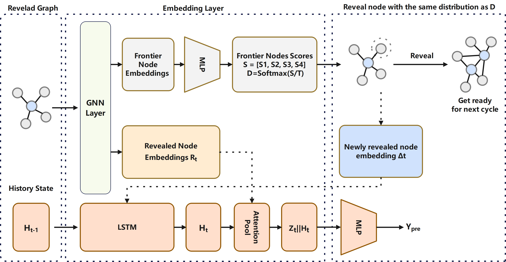
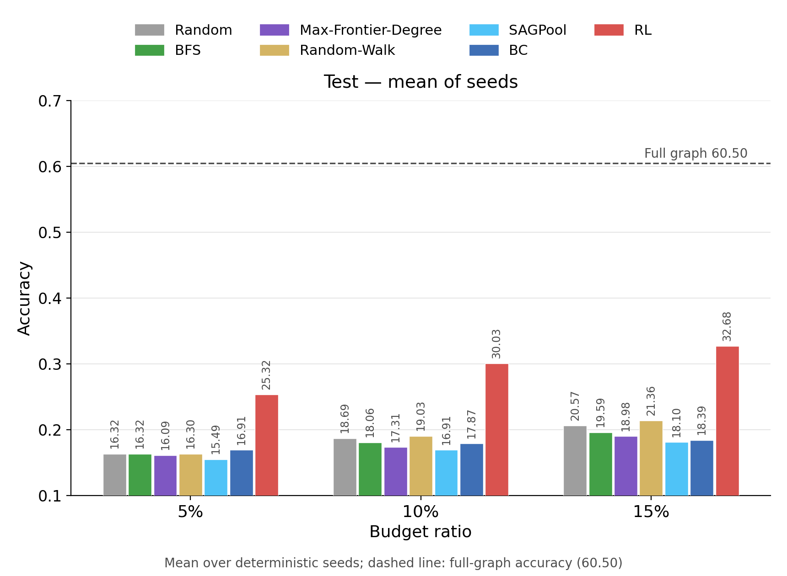

# Learning Where to Read: Adaptive Node-Revealing Policies for Budget-Limited Graph Classification

**Anonymous authors** (paper under double-blind review)

> English full text, version 2. The Chinese counterpart is `main_zh-v2.md`; figures live in `figures/`.
> Inline math is written in $...$; 【REF：…】 are citation placeholders to be filled.

---

## Abstract

Graph classification methods almost universally assume that the entire graph is available at prediction time, yet on large graphs discriminative evidence is often concentrated in a small region while node-by-node inspection carries real cost. We study **budget-limited active graph reading**: an agent starts from a single seed node, repeatedly selects frontier nodes to reveal under a fixed node budget, and then classifies the revealed subgraph. We first give a leakage-proof formalization of the problem and prove that optimal reading is computationally intractable — NP-complete in the deterministic case and PSPACE-hard under succinct random graph models — so learning an amortized policy is a complexity-theoretic necessity rather than an engineering compromise. We further prove that task-agnostic greedy reading enjoys a $(1-1/e)$ optimality guarantee in the conditionally independent world, but that evidence correlation and reachability blockade on graphs make the guarantee fail by construction (with a gap of at least $0.24$ on a constructed instance), while the v1 protocol — frontier edge features visible for free before reveal — has a provably strict benefit; the evidence reader, in turn, can be characterized as an **amortized Bayesian filter** whose terminal readout is the posterior mode and is independent of the deployment policy. Empirically, the learned policy recovers about 81% of full-graph test accuracy on COLLAB within a 20% node budget, surpasses the best fixed strategy by up to 11.3 points on CIFAR10, and does not yet surpass the best fixed strategy on PPA, which marks the current boundary of the approach.

---

## 1 Introduction

Graph classification supports applications ranging from security provenance analysis to molecular screening, yet the dominant paradigm trains and evaluates on fully observed graphs. This assumption fails systematically in real settings: observation itself has a cost, and discriminative evidence is often concentrated in a small region (§2). Once only part of the graph can be inspected, the order of inspection matters — a breadth-first scan wastes budget on irrelevant neighborhoods and a degree-greedy scan ignores the task entirely, while every revealed node changes what the frontier makes visible and what is worth revealing next, so "where to read next" is a sequential decision problem. This paper formally brings this evidence-acquisition perspective into graph classification: we study **budget-limited active graph reading**, learning a policy that decides where to read under a budget and predicts from the read subgraph alone.

Prior work offers partial answers but stops short of this setting: graph pooling answers "which nodes matter" on the **complete** graph 【REF：graph-pooling、sagpool】, graph explanation justifies a prediction only **after** it is made 【REF：subgraphx、graph-explainability】, and active learning and feature acquisition on graphs budget training labels and node attributes respectively 【REF：active-learning-graphs、feature-acquisition】 (discussed one by one in §3). What is missing is twofold: a reproducible evaluation protocol that keeps partial observation leakage-proof, and evidence that a learned policy indeed beats fixed strategies at matched budgets.

Our contribution unfolds along four lines. **Protocol.** We give a three-tier visibility model — frontier attachment (T0) and frontier edge features (T1) are visible at zero cost before reveal, while everything about unvisited nodes (T2) is permanently disabled — and enforce leakage-proofness with two mechanically testable invariants (§4.1). **Theory.** We prove that optimal reading is computationally intractable — NP-complete in the deterministic case and PSPACE-hard under succinct random graph models — so amortized learning is a necessity rather than an engineering compromise; task-agnostic greedy reading carries a $(1-1/e)$ guarantee in the conditionally independent world yet fails on graphs through evidence correlation and reachability blockade (a constructed instance with a gap of at least $0.24$); the v1 protocol — frontier edge features free before reveal — has a provably strict benefit; and the evidence reader can be characterized as an amortized Bayesian filter whose terminal readout is the posterior mode, independent of the deployment policy (§4.3–4.7). **Method.** Behavior cloning distills an initial policy from successful teacher trajectories, reinforcement learning fine-tunes it with an asymmetric reward judged by a frozen classifier, and the evidence reader accumulates read evidence in a recurrent state decoupled from node selection (§5). **Experiments.** On COLLAB all fixed strategies collapse to the majority-class level, and the learned policy recovers about 81% of full-graph test accuracy within a 20% budget; on CIFAR10 it surpasses the best fixed strategy by up to 11.3 points; on PPA it does not yet surpass the best fixed strategy, which marks the current boundary (§6).

---

## 2 Background

In several realistic graph classification scenarios the default assumption "the whole graph is available at prediction time" fails systematically, and it fails in different ways. In security provenance, evidence graphs reach the TB scale and are heavily noisy, with discriminative signals hidden in a very small subgraph 【REF：evidence-concentration】. In biological networks, information is highly redundant with many repeated multi-source cues and near-duplicate patterns, so indiscriminate extra observation mostly injects noise rather than new information. In financial fraud investigation, due-diligence and KYC queries are billed per call and investigation budgets are naturally limited. All three scenarios share one premise: **acquiring the graph itself has a cost**. The effective question is therefore not "the more we read the better," but how to extract discriminative features efficiently under a small budget.

The way large language model agents operate under a context budget offers a direct analogy 【REF：llm-agent-context】: such an agent does not read an entire codebase; it retrieves relevant fragments, accumulates context, and stops once it can answer. We import this evidence-acquisition idea into graph classification, obtaining **budget-limited active graph reading** (AGR): give the model only a small node budget, let a policy actively decide "where to look" step by step, and classify using only the revealed subgraph once the budget is exhausted.

Short as this task statement is, it imposes two demanding requirements. The first is **evaluation discipline**: under partial observation, if any unrevealed content enters the decision or the prediction through any channel, the budget constraint is toothless — the protocol must upgrade "what may be seen" into a mechanically testable property (§4.1). The second is a **methodological requirement**: every reveal changes what the frontier makes visible and what is worth revealing next, so reading is intrinsically a sequential decision problem; and we prove in §4.3 that optimal reading within a budget is computationally intractable, making amortized learning a complexity-theoretic necessity. These two requirements shape, respectively, our evaluation protocol (§4.1) and our reader design (§5).

## 3 Related Work

**Graph classification and pooling under full observation.** Message-passing classifiers such as GIN consume the entire graph 【REF：gin】, and pooling methods score nodes on the complete graph with task-aware attention and sparsify the computation accordingly, from differentiable cluster assignment to self-attention top-$k$ selection 【REF：diffpool、sagpool、pooling-survey】. All of these answer "which nodes matter once the whole graph has been read"; under a node budget, the same question must be answered **before** the graph is visible, from frontier information alone.

**Graph explanation.** Explanation methods identify a justifying subgraph for a trained model's prediction on an **already observed** graph. Our setting reverses the direction of this step: evidence must be acquired **before** there is a prediction to explain, and explanation-style scoring is unavailable under partial observation by construction.

**Learned sequential readers.** Closest to our setting are agents that "selectively read a graph within a budget." GAM trains recurrent walkers with reinforcement learning for budgeted whole-graph classification: a rank network inspects the neighbors of the current node and samples the next step, an LSTM integrates the reading history, and several walkers can pool their histories into a shared memory 【REF：gam】. RWE-SGNN keeps the walk but switches to a DQN rewarded by the decrease of a downstream loss, using a **sampler–predictor split** across two models to generate class-relevant substructures for self-supervised graph classification 【REF：rwesgnn】. AgentNet replaces RL with straight-through Gumbel transitions, letting a population of identity-carrying agents walk differentiably and sublinearly, exchanging state with visited nodes at every step 【REF：agentnet】. RAW casts the walk as a POMDP for semi-supervised **node** classification, brings edge content into the observation, and aggregates features of neighbors above a relevance threshold 【REF：raw】. The four tasks bracket ours: RAW protects the prediction of a single node with the rest of the graph observable by default; the other three share our graph-level objective. Yet all violate the discipline our protocol enforces. First, unrevealed content enters decisions and even predictive representations: GAM inspects neighbor content before moving, RAW aggregates features of never-visited neighbors, and AgentNet absorbs neighbor state at every step, with its differentiable transitions back-propagating gradients into the embeddings of unvisited candidates. Second, none maintains a "single-seed, monotonically growing revealed set": budgets are accounted in walk steps or agent counts, GAM may revisit nodes, RWE-SGNN launches multiple walks from top-scored entry points scored on the whole graph, and AgentNet scatters agents across the graph. Third, GAM, RAW, and AgentNet all read out predictions from the same recurrent state that drives selection; RWE-SGNN's two-model split is akin to our decoupling but carries no revelation discipline. Our reader, by construction, guarantees that the prediction path is a function of the revealed set alone.

---

## 4 Problem Setup

### 4.1 Protocol

The AGR protocol specifies how budgets are accounted, what is visible at each step, and how the final judgment is made; its design goal is to eliminate information leakage under partial observation. We discuss these four aspects in turn.

**Budget and seeds.** The budget $B$ counts revealed nodes and **excludes** the seed; it is reported as a fraction of the graph's node count (5/10/15% in the main experiments, 10/15/20% for COLLAB), and all comparisons are made at matched budgets averaged over multiple deterministic seeds. The seed $s_0$ is produced by the deterministic pseudo-random formula $(\mathrm{idx}\times 31+\mathrm{seed}\times 17+7)\bmod n$ from the graph index and is a constant for a fixed graph, which makes every trajectory exactly reproducible.

**Revelation process.** The agent reveals step by step from the seed: at each step it may reveal one node chosen from the current **frontier** (the unrevealed nodes adjacent to the revealed region), so the revealed set stays connected, monotonically growing, and free of revisits. When the frontier is empty but budget remains (e.g., the seed falls in an isolated small component), the agent may teleport to an unrevealed node and keep reading; teleports consume no budget.

**Visibility and the two protocols.** Visibility has three tiers: revealed node features, revealed edges (with features), and the existence and attachment of the frontier (T0) are visible to every method; everything about unvisited nodes (T2) is permanently disabled for the predictor; the entire difference between the two protocols lies in the third tier — the **features of frontier edges**, edges with one revealed and one unrevealed endpoint (T1), are hidden in the base protocol $o^0$ and free to inspect before reveal in the v1 protocol $o^1$ (Visible ≠ Revealed), consuming no budget. The free T1 tier lets a policy "look at the edge first, then decide whom to reveal"; its value is characterized rigorously in §4.7.

**Final judgment and leakage-proofness.** When the budget is exhausted, the revealed subgraph is classified once: fixed baselines and the base reader use a frozen full-graph classifier, while the evidence reader uses its own evidence head, with the frozen classifier's judgment reported as a reference (acc_clf). Evaluation is fully deterministic: the same (graph, seed) must produce the same trajectory; evaluation takes the argmax with ties broken toward the smaller index, and only training samples from the distribution at a temperature. Leakage-proofness is guaranteed by two **invariants** enforced by unit tests: first, the prediction is a function of the revealed set alone, so the same revealed set must yield the same prediction under different budgets; second, embeddings of unrevealed frontier nodes must not enter the prediction path — verified by poisoning frontier embeddings with random noise and asserting that the logits do not change. Together these upgrade "what may be seen" from a convention into a mechanically testable property.

### 4.2 Problem Formalization

This section writes the protocol of §4.1 as mathematical objects. Let $\omega_G=(Y,V,E,X,Z)$: $Y\in[K]$ is the graph label, $V=[n]$ a fixed vertex set, $E$ the edge set, and $X,Z$ node and edge features. Starting from the revealed set $S_0=\{s_0\}$, each step selects an action $a_t$ from the frontier $F_t=N(S_t)\setminus S_t$ and reveals it, giving $S_{t+1}=S_t\cup\{a_t\}$; the transition is deterministic and $|S_t|=t+1$.

**Observations.** Protocol $p\in\{0,1\}$ is given by a measurable family $\Phi^p_t:\mathcal G\times 2^V\to\mathcal O^p_t$ with $o^p_t=\Phi^p_t(\omega_G,S_t)$. The base protocol $o^0_t$ consists of the ordered action history, the edges associated with $S_t$ (the structure of revealed and frontier edges), the features of revealed nodes, and the features of edges with both endpoints revealed; the v1 protocol adds the frontier edge features as a direct sum, $o^1_t=o^0_t\oplus(Z_e)_{e\in\partial_t}$ where $\partial_t$ is the frontier edge set — the free T1 tier of §4.1.

Both protocols satisfy three **structural axioms**, the interface that later theorems rely on repeatedly: cumulative nesting — for $\tau\le t$, $o_\tau$ is a measurable restriction of $o_t$, hence $\sigma(o_{1:t})=\sigma(o_t)$; coarsening — $o^0_t$ is a measurable function of $o^1_t$; and frontier computability — $F_t$ is a measurable function of $o_t$.

**Objective.** A policy is a family of kernels mapping the observation history to a distribution over $F_t$ (randomization allowed), and a terminal classifier $f$ outputs a label from $o_B$. The value function is

$$
V^*(B)\;=\;\sup_{\pi,f}\ \Pr\big[f(o_B)=Y\big],
$$

with the corresponding notation $V^{*,p}(B)$ under protocol $p$ (used in §4.7). The belief is defined as $b_t=\Pr(\omega_G\in\cdot\mid o_t)$.

### 4.3 Computational Complexity of Optimal Reading

**Proposition 1 (NP-complete).** The decision problem "does a legal revelation sequence exist under which the terminal classifier outputs $y$" (OPT-READ) is NP-complete; the optimization version is NP-hard, and the hardness holds whenever $B$ is part of the input. The proof reduces from Set Cover: set nodes carry set-indicator features and are all adjacent to the seed, and a "frontier-constraint failure lemma" ensures the dynamic action space excludes no combination on this gadget, reducing the problem to pure set selection. Notably, the hardness comes from the combinatorial core of "which observations to buy under a budget," not from adaptivity itself; full proof in Appendix A.1.

**Theorem 1 (PSPACE-hard).** Under a succinct graph model of "a polynomial-size deterministic skeleton plus independent random bits," with adaptive policies and a polynomial-size circuit classifier, deciding whether $V^*(B)\ge\tau$ is PSPACE-hard. The proof reduces from SSAT (stochastic quantified Boolean formulas, i.e., "games against nature"); a dedicated lemma is needed to show that a general POMDP cannot be embedded directly — the AGR secret is fixed at the start and revelation only reads it, unlike the reactive semantics of a POMDP; full proof in Appendix A.2.

Together, the two complexity results yield a direct corollary: the optimal policy is a strategy tree of depth $B$ with branching controlled by the frontier size, which is infeasible to solve exactly; **amortizing** the per-instance search cost into one-shot cross-graph policy learning (teacher → BC → RL) is therefore a complexity-theoretic necessity.

### 4.4 The Guarantee and the Necessary Failure of Greedy Reading

**Theorem 2 (guarantee in the conditionally independent world).** If node evidence is conditionally independent given the label (CI), the information gain $f(S)=I(Y;X_S)$ is adaptive monotone and adaptive submodular, and the greedy policy that maximizes the expected marginal gain at each step achieves $(1-1/e)\cdot\mathrm{OPT}$. The proof is a restoration of the adaptive Nemhauser theorem in this setting: the potential $\Phi_t=\mathrm{OPT}-\mathbb E[f(A_t)\mid\psi_t]$ shrinks by a factor $(1-1/B)$ per step; full proof in Appendix A.4.

**Proposition 2 (the necessary failure of the guarantee).** On graphs, evidence correlation first breaks submodularity — under an XOR structure two nodes carry zero marginal information each and complete information jointly, marginal gains increase and submodularity fails; embedded into the frontier constraint, reachability blockade keeps the informative node out of the action space forever, while any stepwise marginal-scoring policy is permanently attracted to weak-signal distractor nodes. On the constructed instance, greedy's terminal accuracy is at most $0.757$ while the optimal policy attains $1$, a gap of at least $0.24$ that does not vanish with budget; full proof in Appendix A.3.

### 4.5 The Evidence Reader Is an Amortized Bayesian Filter

**Theorem 3.** Under the formalization of §4.2, for any budget $B$: (a) the optimal policy and the optimal reachable conditional value depend only on the belief state $(b_t,S_t)$, reducing the problem to a belief MDP; (b) the optimal terminal readout is the posterior mode $\arg\max_k\Pr(Y{=}k\mid o_B)$, and $\Pr(Y{=}k\mid o_B{=}v)$ is **independent of the deployment policy** that produced $v$ — cumulative nesting encodes "why the agent stopped here" into $o_B$, and the policy's chain factor cancels in the Bayes ratio; (c) the log posterior obeys a one-step update that degenerates, under the CI model, into an additive recursion over per-node log likelihood ratios with per-step cost $O(K)$ independent of $t$; (d) the LSTM family contains this additive filter — with ideal gates it is coordinate-wise exact for exponential-family evidence and the tanh readout preserves the argmax exactly, while an $\varepsilon$-implementation with finite gates accumulates log-domain error at most $\le B\varepsilon$ linearly, inducing excess classification error at most $e^{2B\varepsilon}-1$. Full proof in Appendix A.5.

Part (b) deserves elaboration because it corrects a common intuition. One usually expects the "selection effect" of an adaptive policy to make the posterior depend on the deployment policy — the survivorship-bias analogy from survey sampling; in AGR this does **not** happen: everything the policy saw while choosing (including the frontier structure that drove it to stop) is already encoded in the terminal observation, so the selection effect cannot survive the Bayesian update. This yields a rigorous argument for "decision-and-classification in one terminal judgment": the Bayesian readout is a policy invariant, and the disadvantage of a frozen external classifier is not information-theoretic but statistical — its training distribution differs from the subgraph visitation distribution of the deployment policy; the evidence head is trained on the same trajectories as the policy, estimating the same invariant exactly on the deployment visitation distribution.

Honesty requires noting that by cumulative nesting, integrating history with an LSTM **adds no information** — $o_t$ already contains everything seen, so "memory" is information-theoretically redundant. The value of the evidence mechanism is statistical and computational: integrating $B$ steps of weak evidence incrementally, as opposed to one-shot classification of the entire revealed subgraph, has different statistical efficiency in the small-sample, high-noise regime; and the recursive update matches the Bayesian filtering form by prior design. The ablations in §6.3 test exactly the component-level contributions of this theorem.

### 4.6 The Information-Theoretic Ceiling

**Theorem 4 (unified Fano upper bound).** For any (adaptive, randomized) policy and any terminal classifier,

$$
\Pr[\hat y\ne y]\;\ge\;h_2^{-1}\!\big(H(Y\mid o_B)\big)\;\ge\;\frac{H(Y)-I(Y;o_B)-1}{\log K}.
$$

That is, the accuracy upper bound is controlled uniquely by the mutual information the reading policy acquires; by the data-processing inequality, $I(Y;o_B)\le I(Y;G)$ — no reading can exceed the information of the full graph. A computable numerical ceiling additionally requires an explicit calibration assumption (the excess of classifier cross-entropy over full-graph information entropy is controlled by the uniform baseline, i.e., $\mathrm{KL}(q\,\|\,P(Y\mid G))\le\mathrm{KL}(P_Y\,\|\,U)=\ln K-H(Y)$; note the direction is $P_Y\to U$ — only that direction equals $\ln K-H(Y)$; derivation and numerical walkthrough in Appendix A.6). The ceiling is then $\mathrm{ceiling}=1-f^{-1}(T)$ with $T=\mathrm{CE}_{\text{test}}-(\ln K-H(Y))$ and $f(e)=h_2(e)+e\log(K-1)$. Proof in Appendix A.6.

**Table 5: Information-theoretic ceilings (test split)**

| Dataset | $K$ | $H(Y)$ (nats) | CE (nats) | Ceiling | Full-graph acc. |
| ------- | --- | -------------- | ---------- | -------- | ---------------- |
| CIFAR10 | 10  | 2.3026         | 1.2424     | **0.7090** | 0.6046 ✓ |
| PPA     | 37  | 2.8361         | 2.0660     | **0.7850** | 0.6975 ✓ |
| COLLAB  | 3   | 0.9953         | 0.7420     | **0.8001** | 0.6647 ✓ |

### 4.7 The Strict Benefit of Frontier Information

This section asks why the protocol deserves to be a design dimension at all: is the free frontier-edge feature of v1 merely an engineering convenience?

**Theorem 5.** For the protocol pair $(o^0,o^1)$ of §4.2 and any budget $B$: (a) **weak monotonicity**: $V^{*,1}(B)\ge V^{*,0}(B)$ — any policy and classifier under $o^0$ can be simulated verbatim on $o^1$; a coupled execution on the same random source makes the two revealed sets identical pointwise and the success events identical pointwise; (b) **strict separation at equal budget**: there is an instance with $V^{*,1}(2)=\alpha^2(3-2\alpha)$ and $V^{*,0}(2)=\alpha$, a difference of $\alpha(1-\alpha)(2\alpha-1)>0$, where $\alpha\in(\tfrac12,1)$ is the accuracy of each binary piece of evidence; (c) **myopia repair under the same greedy rule**: on the XOR indicator instance of Proposition 2, after attaching an edge feature of accuracy $\alpha$, the **same** greedy rule that maximizes information gain stepwise is capped at $0.757$ under $o^0$ yet reaches $1$ in two steps under $o^1$; (d) **mechanism localization**: in an edge-evidence observation model, the difference in discriminative information between the two protocols is exactly the signal energy on the cut (the frontier edge set $\partial S_t$), $\sigma^{-2}\sum_{e\in\partial S_t}\zeta_e^2$ — v1 opens precisely the cut channel for free. Full proof in Appendix A.7.

Three mechanisms deserve elaboration. The benefit shape in (b) is a **budget waiver that changes the parity of information votes**: the free edge feature consumes no budget, letting $B=2$ accommodate three equally strong conditionally independent votes, and majority voting over an odd number of votes strictly beats an even number — under $o^0$ the optimal fusion of two equally strong votes degenerates to a single vote (ties split evenly), so the strict loss comes entirely from the parity. The mechanism in (c) is a **structural prior that advances two-step joint information**: the edge feature makes "a partner node hides two hops deep" visible before its only entrance is selected, letting marginal scoring see beyond the myopic horizon; an accompanying sealing lemma also marks the boundary — an edge feature generated from a single XOR member alone carries zero information about the label, so edge features must be anchored to the label directly to have value. This matches real data: valuable edge features are generated by label-conditional processes (e.g., interaction types in PPA), while zero-information placeholder edge features (e.g., COLLAB) are predicted to yield no gain. Finally, (d) says that in a strongly correlated world discriminative information physically concentrates on cuts, so the protocol's gift hits the target; in a near-independent world the independent information carried by cut edges is negligible — predicting that the gain of the v1 ablation should vary with the label signal strength of a dataset's edge features, for which the ablation in §6.3 is a first-order test.

---

## 5 Method

Figure 1 shows the overall architecture of the evidence reader. The selection path (upper half) is byte-identical to the base reader and stateless; the evidence path (lower half) accumulates read evidence in a recurrent state; the two share one encoder and are isolated by two guardrails — guardrail one, the evidence stream never enters the policy scores; guardrail two, the prediction path reads only embeddings of revealed nodes. This structure directly instantiates three theoretical conclusions of §4: the necessity of amortization shapes the learned policy, the policy invariance of the readout supports decision-and-classification-in-one terminal judgment, and recurrent accumulation is the neural realization of additive Bayesian filtering.

### 5.1 Decision and Evidence Paths

The revealed subgraph, together with T1 frontier edge features, is fed to a shared GINE encoder; the selection head is an MLP scoring all frontier nodes. During training the reader reveals by temperature sampling; at evaluation it takes the argmax. The entire path is stateless, so introducing the evidence stream changes no selection behavior.

The evidence stream at each step consists of four operations. The encoder produces embeddings $\Delta_t$ of the newly revealed nodes at step $t$ (step 0 is the seed); an LSTM integrator merges them into the recurrent state, $h_t=\mathrm{LSTM}(\Delta_t,h_{t-1})$; a history-guided attention pooling uses $h_t$ as the query and revealed node embeddings as K/V, producing the readout vector $z_t$; the evidence head $\mathrm{MLP}([z_t;h_t])$ outputs the per-step class distribution. In the decomposition of Theorem 3, the LSTM is a relaxed implementation of the additive Bayesian filter, the attention pool provides extra readout capacity for the non-CI world, and the evidence head is the posterior-mode readout.

### 5.2 Teacher Trajectories and Behavior Cloning

Teachers generate reading trajectories by gradient saliency, information gain, structural heuristics, and mixtures thereof 【REF：teacher-details-SI】; trajectories are scored by the frozen classifier's correctness on the final revealed subgraph, filtered for successes, and class-balanced. Behavior cloning minimizes the negative log likelihood of every teacher action on the filtered trajectories $\mathcal{D}=\big\{(o_t^{\mathrm{E}},\,a_t^{\mathrm{E}})\big\}$:

$$
\mathcal{L}_{act}=\frac{1}{|\mathcal{D}|}\sum_{\tau\in\mathcal{D}}\sum_{t=1}^{T_\tau}-\log\,\pi_\theta\big(a_t^{teacher}\mid s_t\big)
$$

$$
L_{ev}=\frac{1}{|E|}\sum_{\tau\in\mathcal{D}}\sum_{t=0}^{B_\tau}\mathrm{CE}(z_{\tau,t},y_\tau),\qquad |E|=\sum_\tau (B_\tau+1)
$$

$$
\mathcal{L}_{BC}=\mathcal{L}_{act}+\lambda_{ev}\,\mathcal{L}_{ev}
$$

### 5.3 RL Fine-Tuning

Reinforcement learning treats each revelation as an action and terminal correctness as the return. The policy gradient weights the log likelihood of the whole trajectory by the terminal advantage,

$$
\nabla_\theta J(\theta)\;=\;\mathbb{E}_{\tau\sim\pi_\theta}\Big[\sum_{t=0}^{B-1}A_\tau\,\nabla_\theta\log\pi_\theta\big(a_t\,\big|\,o_t\big)\Big],
$$

$$
L_{RL}= -R\sum_t\log\pi(a_t),\qquad L^{total}=L_{RL}+\lambda\cdot L_{ev}
$$

---

## 6 Experiments

### 6.1 Setup

We evaluate on three large graph-classification benchmarks: OGBG-PPA 【REF：ogbg】, CIFAR10 superpixels 【REF：lrgb】, and COLLAB 【REF：tudataset】. Budget fractions are 5/10/15% (10/15/20% for COLLAB); all numbers are averages over four deterministic seeds. Fixed baselines comprise four revelation strategies — Random, BFS, Max-Frontier-Degree, Random-Walk — plus SAGPool adapted as a static selector; a frozen full-graph classifier provides the upper bound per dataset, and its accuracy on revealed subgraphs is reported as the reference head (acc_clf).

**Table 1: CIFAR10 superpixels, test accuracy (%).** The RL-ref head is the frozen classifier's accuracy on RL-revealed subgraphs; BC is the main comparison configuration, and the BC variants of the evidence reader are in Table 4.

| Budget | Random | BFS   | Max-Frontier-Degree | RW    | SAGPool | BC    | RL        | RL-ref |
| ------ | ------ | ----- | ------------------- | ----- | ------- | ----- | --------- | ------ |
| 5%     | 16.32  | 16.32 | 16.09               | 16.30 | 15.49   | 16.91 | **25.32** | 16.68  |
| 10%    | 18.69  | 18.06 | 17.31               | 19.03 | 16.91   | 17.87 | **30.03** | 19.78  |
| 15%    | 20.57  | 19.59 | 18.98               | 21.36 | 18.10   | 18.39 | **32.68** | 22.98  |

Full-graph classifier (upper bound) 60.5; information-theoretic ceiling 70.9 (Table 5).

**Table 2: COLLAB, accuracy (%), every cell is valid/test.** Fixed strategies are pinned at the majority-class level.

| Budget | Random      | BFS         | Max-Frontier-Degree | RW          | SAGPool     | BC          | RL              | RL-ref      |
| ------ | ----------- | ----------- | ------------------- | ----------- | ----------- | ----------- | --------------- | ----------- |
| 10%    | 15.43/15.57 | 15.53/15.57 | 15.63/15.57         | 15.43/15.57 | 15.43/15.57 | 16.78/16.42 | **52.20/51.90** | 15.88/15.72 |
| 15%    | 15.43/15.57 | 15.73/15.57 | 15.83/15.72         | 15.43/15.57 | 15.43/15.57 | 20.24/19.96 | **54.56/53.44** | 18.09/18.21 |
| 20%    | 15.43/15.57 | 15.98/15.72 | 16.03/15.87         | 15.43/15.57 | 15.43/15.57 | 27.56/25.60 | **58.02/55.74** | 20.64/20.26 |

Full-graph classifier (upper bound) valid 71.54 / test 69.06; information-theoretic ceiling 80.0 (Table 5).

### 6.2 Results

On CIFAR10 superpixels (Table 1, Figure 3), the fixed strategies sit in a narrow 16–21 band and behavior cloning lands in the same band — imitating task-agnostic teachers does not by itself beat the best heuristic. RL fine-tuning pushes the policy far out of this band: 25.32, 30.03, and 32.68 across the three budgets, 9.0–11.3 points above the best fixed strategy at the same budget and up to 14.3 points above BC. The gap between RL and the reference head (32.68 vs 22.98 at the 15% budget) shows that the policy reveals subgraphs the frozen classifier reads **better**, not merely "more nodes." Measured against the ceiling, at the 15% budget RL is at 32.7 with full graph 60.5 and ceiling 70.9: the policy has captured most of the increment beyond the fixed-strategy band, but ample room remains to the information upper bound.

On COLLAB (Table 2, Figure 2), all fixed strategies and SAGPool stay at 15.4–16.0 on both splits — the majority-class level of this imbalanced dataset — the most extreme form of the greedy failure characterized by Proposition 2 in §4.4: task-agnostic selection never escapes the collapse. Behavior cloning improves to valid 16.8–27.6 and test 16.4–25.6; RL fine-tuning reaches 51.90, 53.44, and 55.74 on test, recovering 75.2–80.7% of full-graph test accuracy (69.06) — the remaining gap is primarily limited by the full-graph classifier's own accuracy (full graph 69.06 against an information ceiling of 80.0), not by the reading policy. The reference head sharpens the mechanism judgment again: the frozen classifier reading RL-revealed subgraphs reaches only 15.7–20.3, so what turns revealed evidence into prediction is the evidence head, not the frozen readout — consistent with the readout analysis of Theorem 3(b).

**Table 3: OGBG-PPA, accuracy (%), every cell is valid/test.** Learned policies do not yet surpass the best fixed strategy; BC collapses to near random.

| Budget | Random      | BFS         | Max-Frontier-Degree | RW          | SAGPool     | BC        | RL          | RL-ref      |
| ------ | ----------- | ----------- | ------------------- | ----------- | ----------- | --------- | ----------- | ----------- |
| 5%     | 18.86/20.16 | 23.45/24.45 | 25.31/26.20         | 19.71/21.46 | 26.08/27.28 | 3.90/3.97 | 23.53/26.90 | 19.65/20.73 |
| 10%    | 31.14/33.07 | 30.06/35.68 | 36.33/37.28         | 32.34/34.54 | 36.25/37.92 | 7.23/7.37 | 28.12/32.34 | 26.83/27.41 |
| 15%    | 39.37/41.88 | 40.84/42.92 | 42.94/44.52         | 40.21/42.99 | 43.03/45.08 | 9.04/9.03 | 30.76/35.05 | 31.87/32.99 |

Full-graph classifier (upper bound) valid 64.2 / test 65.6; information-theoretic ceiling 78.5 (Table 5).

On PPA the fixed strategies separate cleanly with budget, and SAGPool is the strongest fixed baseline on the test split. In stark contrast to the other two datasets, learned policies are not yet competitive: behavior cloning collapses to 3.9–9.0, well below every fixed strategy; RL fine-tuning, although always above its reference head (20.7–33.0), trails the best fixed baseline by 0.4–10.0 points at every budget. The signal-to-noise ratio of policy gradients is naturally low at low success rates, consistent with this observation — but a complete attribution (reward sparsity, PPA's budget granularity, class imbalance) is not yet established, and we draw no conclusion about adaptive reading from this negative result.

### 6.3 Ablation

**Table 4: BC ablation, test accuracy (%).** no-pool removes the history-guided attention pooling, no-lstm removes the recurrent accumulator, v1 removes both; COLLAB budgets are 10/15/20%.

| Dataset (budgets)   | Variant | B1    | B2    | B3    |
| ------------------- | ------- | ----- | ----- | ----- |
| CIFAR10 (5/10/15%)  | full    | 18.35 | 20.07 | 20.45 |
| CIFAR10             | no-pool | 17.16 | 18.09 | 19.01 |
| CIFAR10             | no-lstm | 17.56 | 18.26 | 19.15 |
| CIFAR10             | v1      | 16.91 | 18.58 | 19.38 |
| COLLAB (10/15/20%)  | full    | 16.42 | 19.96 | 25.60 |
| COLLAB              | no-pool | 15.72 | 18.41 | 21.11 |
| COLLAB              | no-lstm | 15.72 | 18.21 | 20.11 |
| COLLAB              | v1      | 15.88 | 18.04 | 20.64 |

Table 4 and Figure 4 are the component-level test of Theorem 3. Recurrent accumulation is the largest contributor on COLLAB: removing the LSTM costs 5.5 points at the 20% budget, and removing both components costs 5.0 points with the sharpest degradation at the largest budget. On CIFAR10 the effects are smaller but consistent in direction: attention pooling contributes 1.0–1.4 points, and the full variant leads at every budget. This pattern matches the mechanism analysis of §4.5: long-range evidence integration matters most on sparse, large-diameter COLLAB — the revealed subgraph is connected, yet its diameter exceeds what a two-layer encoder can reach in a single forward pass, and additive filtering integrates evidence read far apart across steps; the grid structure of CIFAR10 has bounded diameter, so the two readouts converge, matching the theoretical expectation that "the two readouts coincide when evidence is sufficient."

---

## 7 Discussion

### 7.1 Limitations

**Mechanistic decomposition of the gains.** RL's gains contain both "selection" and "calibration" components, and the reference head helps us separate them. On CIFAR10 the RL terminal judgment is far above the frozen classifier's accuracy on typical revealed subgraphs, indicating that selection (finding information-richer regions) is the dominant mechanism; on COLLAB the opposite holds — the frozen classifier reading RL-revealed subgraphs reaches only 15.7–20.3 while the evidence head reaches 51.9–55.7, so the gains are realized mainly by the evidence head's advantage over the frozen readout — exactly the "estimating the policy-invariant posterior mode on the deployment visitation distribution" characterized by Theorem 3(b). Fully ruling out calibration effects requires matched-training controls, which we leave to future work.

**Alignment with theory.** The theory in this paper is not decoration; it corresponds point by point with the experiments. The COLLAB collapse is the empirical version of the greedy failure proved in Proposition 2; the distribution of RL-over-BC gains matches the prediction that "information concentration determines learning gains"; PPA's low success rate is consistent with the signal-to-noise analysis; and on all three datasets the learned policy's accuracy rises monotonically with budget, consistent with the monotonicity of the information bound in the budget.

**Boundaries of the current evidence.** Our conclusions are bounded in four ways. First, the gains narrow at the smallest budget — at a 5% budget on CIFAR10, RL recovers less than half of full-graph accuracy — so the method currently suits scenarios tolerating moderate inspection fractions. Second, per-class accuracy is uneven: the hardest CIFAR10 class is near random on test, the best–worst class gap is 71.7 points, and class-balanced filtering barely helps, indicating a capability boundary rather than a data-volume issue. Third, PPA is a negative result reported as such; its attribution remains incomplete as discussed above.

### 7.2 Future Work

**Reward design and potential-based shaping.** The terminal reward is a single Bernoulli event whose inter-trajectory variance $p(1-p)$ dominates gradient noise, giving low-success-rate tasks such as PPA a naturally low signal-to-noise ratio. Potential-based shaping is a theoretical free lunch: define $\Phi$ from the evidence head's current confidence or margin and set $r'_t=r_t+\Phi(s_{t+1})-\Phi(s_t)$; under the finite-horizon undiscounted objective this shifts every policy's return by the same constant, leaving the optimal policy set unchanged while giving every step a dense gradient signal — the evidence head can thus be reused at the RL stage as a zero-bias reward shaper. A systematic attribution for PPA (reward sparsity, graph diameter and budget granularity, hub-dominated degree distributions) together with this scheme is the top near-term experiment.

**Adaptive stopping and anytime validity.** The current protocol fixes the budget at preset fractions, yet "how much to read" is itself a decision. Under the CI model the evidence head's sequential likelihood-ratio process is a nonnegative martingale, and Ville's maximal inequality gives budget-free validity: stopping at the first crossing of $1/\alpha$ and announcing confidence $1-\alpha$ is valid at any stopping budget, so early stopping does not destroy statistical validity. Realizing this as a soft stopping rule turns "how much to read" from a fixed hyperparameter into a data-driven decision, and makes the over-reading risk a measurable object.

**Dataset-level gain predictors and mechanistic teachers.** The theory yields two cheaply estimable gain predictors: information concentration (a small participation ratio predicts large learning gains) and evidence correlation structure (a large equicorrelation parameter indicates a redundancy-limited regime where gains concentrate in decorrelation); both can be estimated directly from per-node linear probes or edge-endpoint feature correlations, and if measured orderings contradict the predictions, the mechanistic conjecture is falsified. Likewise, the cut-expansion greedy of the correlated world is a closed-form teacher probe whose success rate relative to the information-gain teacher directly measures whether reality is closer to the independent or the correlated world. Incorporating spectral statistics (spectral gap, Cheeger constant, degree-distribution surplus) into dataset profiles could turn "which dataset merits a learned reader" from a post hoc observation into an a priori prediction.

**Protocol and objective extensions.** The current protocol assumes single-label mutually exclusive classification; multi-label and regression targets require redefining the reward, the information ceiling (Fano's $K$-class form replaced by the corresponding estimator), and metrics. A longer-term direction generalizes the budget from "node fraction" to heterogeneous inspection costs, letting the policy learn when to stop under cost awareness.

## 8 Conclusion

We presented a leakage-proof formalization and benchmark for budget-limited active graph reading, together with a body of theory: optimal reading is intrinsically hard (NP-complete, PSPACE-hard), task-agnostic greedy reading carries a provable guarantee and a provable failure, the protocol's free frontier information has a strict benefit, and the evidence reader is an amortized Bayesian filter with a policy-invariant posterior-mode readout. Methodologically, behavior cloning followed by RL fine-tuning (asymmetric reward) turns task-agnostic reading into task-aware reading: on COLLAB, 20% of the nodes recover about 81% of full-graph test accuracy; on CIFAR10 the learned policy surpasses the best fixed strategy by up to 11.3 points; and ablations confirm that recurrent evidence accumulation carries the main gains.

---

## Appendix

This appendix gives **self-contained proofs** of all theoretical results in §4 of the main text. It assumes only undergraduate probability and linear algebra — no information theory or computational complexity background. Organization: each proof is preceded by a **Preliminaries** block that first explains every concept and standard fact it uses (proved on the spot when short; otherwise with a source and a reading pointer); the proofs are numbered step by step, and each step cites the fact it relies on (the tools of A.0 are labeled (P1)–(P5), (I1)–(I5), Proposition F with (F-a)(F-b), and (U2)). Read A.0 first; A.1–A.7 are then essentially independent (only A.3 and A.7(c) share Fano, and A.7(c) reuses the construction of A.3).

Conventions: entropies and mutual informations are in **bits** (logarithms base 2); logarithms in likelihood ratios and Gaussian computations are natural ($\ln$) (the softmax exponent base must match the logarithm base: with base 2 the exponent is $2^{\Lambda}$, equivalent to the natural-base version); when numerical ceilings are involved, units are converted consistently — see the numerical walkthrough in A.6. $[K]=\{1,\dots,K\}$. Measure-theoretic "modulo null sets" issues are omitted throughout; they affect no almost-sure (a.s.) statement. 【Citation】 marks a standard result with its source; 【Assumption】 marks an explicit modeling choice (these assumptions are models the paper must declare).

### A.0 Common Preliminaries

#### A.0.1 Six facts about probability

**(P1) Total probability and Bayes' rule.** If events $B_1,\dots,B_m$ are disjoint and cover the sample space, then for any event $A$: $\Pr[A]=\sum_i\Pr[A\mid B_i]\Pr[B_i]$. Treating "each value of a random variable $X$" as such a partition gives **Bayes' rule**:

$$
\Pr[Y{=}y\mid X{=}x]=\frac{\Pr[X{=}x\mid Y{=}y]\,\Pr[Y{=}y]}{\Pr[X{=}x]},\qquad \Pr[X{=}x]=\sum_{y'}\Pr[X{=}x\mid Y{=}y']\Pr[Y{=}y'].
$$

Intuition: $\Pr[Y{=}y]$ is the prior (before the evidence), $\Pr[Y{=}y\mid X{=}x]$ the posterior (after); the posterior-to-prior ratio is determined by the likelihood ratio of the evidence under the two hypotheses.

**(P2) Conditional expectation and the tower property.** $\mathbb E[X\mid\mathcal G]$ is "the average of $X$ computed with the information in $\mathcal G$"; it is a function of $\mathcal G$: wherever the $\mathcal G$-information coincides, the value coincides. **Tower property**: for $\mathcal G_0\subseteq\mathcal G_1$,

$$
\mathbb E\big[\,\mathbb E[X\mid\mathcal G_1]\,\big|\,\mathcal G_0\big]=\mathbb E[X\mid\mathcal G_0].
$$

Intuition: averaging within fine groups first and then averaging the group means over coarse groups equals averaging over the coarse groups directly (daily averages then weekly averages = weekly averages). We use two corollaries repeatedly: (i) if $X$ is a function of $\mathcal G$, then $\mathbb E[X\mid\mathcal G]=X$; (ii) if $Z$ is independent of $(X,\mathcal G)$, an expectation given $\mathcal G$ can be computed in two steps, first conditioning on $(\mathcal G,Z)$ and then integrating out $Z$.

**(P3) Joint independence survives conditioning.** If $X$ is **jointly** independent of $(Y,Z)$, then $X$ and $Y$ remain independent given $Z$, and hence $I(Y;X\mid Z)=0$ for any function $g$. Proof: joint independence gives the product decomposition $\Pr[X{\in}A,Y{\in}B\mid Z{=}z]=\Pr[X{\in}A\mid Z{=}z]\,\Pr[Y{\in}B\mid Z{=}z]$; summing over $B$, the denominator $\Pr[Y{\in}B\mid Z{=}z]$ cancels, giving $\Pr[X{\in}A\mid Z{=}z,Y{\in}B]=\Pr[X{\in}A\mid Z{=}z]$. ∎ **Conditional independence** is written $X\perp Y\mid Z$: independent given $Z$ — the precise statement that "$Z$ already carries all the dependence between $X$ and $Y$."

**(P4) Randomized policies = deterministic policies + independent uniform randomness.** Suppose each step may draw an independent uniform $U_t\sim U[0,1]$ (independent of the graph). Any randomized policy (sampling actions from a distribution $\mu(\cdot\mid h)$) can be written as a deterministic function

$$
a(h,U)=\min\Big\{a:\ \textstyle\sum_{a'\le a}\mu(a'\mid h)\ge U\Big\},
$$

i.e., cut $[0,1]$ into segments whose lengths equal the action probabilities and pick the segment into which $U$ falls (segment lengths match probabilities, so the sampling is correct). **We use this representation throughout**: the policy's randomness is externalized into uniform variables, and everything else is a deterministic function of observations — conditioning on history becomes conditioning on deterministic functions.

**(P5) The optimum is attained by a deterministic policy.** For a fixed history, a randomized policy's value is a convex combination of its deterministic sub-policies' values (weighted by the action distribution), and a convex combination never exceeds its largest component; hence the deterministic policy that takes the best branch at every step is no worse than any randomized one. ∎ So in A.2, A.5, and A.7 it is without loss of generality to consider deterministic policies.

**(U2) Measurability of parametrized integrals 【technical note, skippable】.** Several places below assert that "the quantity obtained by integrating against the belief $b$ is a measurable function of $(b,S)$." Measurability guarantees these quantities are representable by some function (hence by learnable object classes); the proof uses the monotone class theorem and is standard technique 【citation: parametrized integrals over standard Borel spaces, any measure theory text】. On first reading, accept it as a technical assumption; it plays no role in the logical content of the arguments.

#### A.0.2 Five facts about entropy and mutual information

**(I1) Definitions.** $H(Y)=-\sum_k p_k\log_2 p_k$: the optimal average code length for encoding $Y$ under its true distribution (bits). $H(Y\mid Z)=\mathbb E_z[H(Y\mid Z{=}z)]$: the average remaining code length after seeing $Z$. $I(Y;Z)=H(Y)-H(Y\mid Z)$: the code length $Z$ saves; it is symmetric, and $I(Y;Z)=0\iff Y\perp Z$.

**(I2) Chain rule.** $I(Y;Z_1,Z_2)=I(Y;Z_1)+I(Y;Z_2\mid Z_1)$, extended recursively: $I(Y;Z_{1:m})=\sum_i I(Y;Z_i\mid Z_{1:i-1})$. Proof: expand both entropies by definition and regroup with (P1) — "total information = sum of marginal information as each variable joins." ∎

**(I3) Conditioning reduces entropy.** $H(Y\mid Z,W)\le H(Y\mid Z)$: on average, knowing one more quantity cannot increase the remaining uncertainty 【citation: Cover–Thomas ch.2, two lines via Jensen】. ∎

**(I4) The data-processing inequality (DPI).** If $Z$ is a (random) function of $W$, then $I(Y;Z)\le I(Y;W)$: processing data creates nothing new. Proof: the chain rule gives $I(Y;W,Z)=I(Y;Z)+I(Y;W\mid Z)=I(Y;W)+I(Y;Z\mid W)$; the Markov property $Y-W-Z$ gives $I(Y;Z\mid W)=0$, and comparing the two identities yields the claim. ∎

**(I5) Binary entropy.** $h_2(p)=-p\log_2p-(1-p)\log_2(1-p)$: maximal $h_2(1/2)=1$, zero at $h_2(0)=h_2(1)=0$, and **strictly decreasing** on $[1/2,1]$. Proof: $h_2'(p)=\log_2\frac{1-p}{p}<0$ for $p>1/2$. ∎ Numerical values used (4 decimals): $h_2(0.7)=0.8813$, $h_2(0.52)=0.9989$, $h_2(0.7164)\approx0.860$, $h_2(0.6829)\approx0.901$; and $h_2^{-1}(0.8)=0.2429$ (by numerical inversion under strict monotonicity: $h_2(0.24)=0.7950<0.8<h_2(0.25)=0.8113$, linear interpolation).

#### A.0.3 Fano's inequality (cited by A.3 and A.6)

**Proposition F.** For $Y\in[K]$ and any estimate $\hat Y$ based on an observation $Z$, with error rate $p_e=\Pr[\hat Y\ne Y]$:

$$
h_2(p_e)+p_e\log_2(K-1)\ \ge\ H(Y\mid Z).
$$

**Proof (four steps).**

1. Introduce the error indicator $E=\mathbf 1\{\hat Y\ne Y\}$ and expand the joint conditional entropy twice via the chain rule:

$$
H(E,Y\mid Z)\overset{(\mathrm i)}{=}H(E\mid Z)+H(Y\mid E,Z)\overset{(\mathrm{ii})}{=}H(Y\mid Z)+H(E\mid Y,Z).
$$

(i) treats $(E,Y)$ as one variable and expands by definition; (ii) expands $Y$ first, then $E$. Key point: given $(Y,Z)$, $\hat Y$ is a deterministic function of $Z$ and $E$ is determined by it, so $H(E\mid Y,Z)=0$, and (ii) gives $H(E,Y\mid Z)=H(Y\mid Z)$.
2. From (i): $H(E\mid Z)\le H(E)=h_2(p_e)$ (conditioning reduces entropy, (I3); $E$ is a two-point variable whose entropy is $h_2$), so $H(Y\mid Z)\le h_2(p_e)+H(Y\mid E,Z)$.
3. Expand the last term over $E$:

$$
H(Y\mid E,Z)=(1-p_e)\underbrace{H(Y\mid E{=}0,Z)}_{=0}+p_e\,H(Y\mid E{=}1,Z),
$$

when $E=0$ there is no error and $Y$ is determined by $(\hat Y,Z)$, so the entropy is zero.
4. When $E=1$ the estimate has consumed one label, leaving at most $K-1$ candidates, and any $(K-1)$-point distribution has entropy $\le\log_2(K-1)$. Substituting finishes the proof. ∎

**Reading:** high residual uncertainty ⟹ the error rate must be high — the quantitative form of "without enough information one cannot judge well"; $h_2^{-1}$ converts entropy into an error-rate lower bound.

#### A.0.4 Two complements to Proposition F

**(F-a) "No information loss" corollary.** If a signal $S'$ adds conditionally independent information beyond $S$, then $\mathbb E\big[\max_k\Pr(Y{=}k\mid S,S')\big]\ge\mathbb E\big[\max_k\Pr(Y{=}k\mid S)\big]$: after the addition the old decision remains available, so the maximum cannot drop (two lines via the tower property, (P2)). ∎ A.7(b) uses this to make rigorous "any policy's value ≤ the three-vote fusion."

**(F-b) A policy's value = a mixture over leaves.** Any (randomized) policy's execution is a probabilistic decision tree: which "leaf" the terminal observation lands in is determined by the graph and the exogenous random numbers. The policy's success probability is the leaf-weighted sum of per-leaf success probabilities (total probability, (P1)). Hence "every leaf's value $\le c$" ⟹ "the policy's value $\le c$"; conversely, one leaf attaining $c$ gives an attainable lower bound. Used repeatedly in A.1, A.3, and A.7.

### A.1 Proof of Proposition 1 (OPT-READ is NP-complete)

**Preliminaries.**

- **Decision vs optimization.** "How well can one do" (optimization) is thresholded into "can one do at least this well" (decision): solving the optimization solves the decision (compute the optimum and compare), so decision-hardness ⟹ optimization is at least as hard. We prove the decision version.
- **P / NP / certificates.** P = solvable in polynomial time; NP = decision problems whose solutions (certificates) are short (polynomial length) and **verifiable** in polynomial time. Verifying is easier than solving (checking a filled sudoku is easy; solving from a blank grid is hard).
- **NP-hard / NP-complete.** $B$ is NP-hard if every problem in NP reduces to it; adding $B\in\mathrm{NP}$ makes it NP-complete.
- **Karp reduction** $A\le_p B$: a polynomial-time computable map $R$ with $x\in A\iff R(x)\in B$. Hardness flows backwards along reductions: a fast solver for $B$ gives one for $A$ (map $x\mapsto R(x)$, solve $B$); contrapositively, $A$ hard ⟹ $B$ hard.
- **Set Cover (decision version):** given a universe $U=\{1,\dots,N\}$, sets $S_1,\dots,S_m\subseteq U$, and budget $B$; is there a subfamily of at most $B$ sets whose union covers $U$? One of Karp's 21 NP-complete problems (1972) 【citation】.
- **Boolean circuits:** acyclic networks of AND/OR/NOT gates; size = number of gates; "polynomial size" = the gate count is a polynomial in the input length.

**Decision problem OPT-READ.** Input: an explicit graph $G$, seed $s_0$, budget $B$, a terminal classifier $f$ given as a Boolean circuit, a label $y$, and threshold $\tau=1$. Question: does a legal revelation sequence $a_1,\dots,a_B$ ($a_t\in F_t$) exist with $f(G_{S_B})=y$?

**Proof (Set Cover $\le_p$ OPT-READ, five steps).**

**Step 1 (gadget).** Given a Set Cover instance $(U,S_1,\dots,S_m,B)$, construct:

| Object     | Construction                                                                                                            |
| ---------- | ----------------------------------------------------------------------------------------------------------------------- |
| Nodes      | seed $s_0$; set nodes $c_1,\dots,c_m$; element nodes $u_j\ (j\in U)$                                                     |
| Edges      | each $c_i$ adjacent to $s_0$; $u_j$ adjacent to every $c_i$ with $j\in S_i$                                              |
| Features   | feature of $c_i$ = the 0/1 indicator vector of $S_i$ (dimension $N$); features of $u_j$ constant                         |
| Circuit $f$ | input: revelation indicator $\mathbf r\in\{0,1\}^m$ ($r_i=1\iff c_i$ revealed); output 1 iff $\bigcup_{i:r_i=1}S_i\supseteq U$ |
| Label      | $y=1$                                                                                                                    |

Circuit implementation: for each $j$, an OR gate with fan-in $\{r_i:j\in S_i\}$ ("is $j$ covered?"), and $N$ such OR gates feeding one AND gate; $O(\sum_i|S_i|)$ gates, polynomial.

**Step 2 (frontier-constraint failure lemma).** The usual difficulty in such reductions is that the dynamic constraint "may only choose frontier nodes" prunes combinations. Here every set node is adjacent to the seed, so at $t=1$, $F_1\supseteq\{c_1,\dots,c_m\}$: **where the constraint matters, it excludes no combination of set nodes**, and the problem degenerates to pure set selection. Note the graph's diameter is $\le 2$ — the failure occurs on the most ordinary structure, so the reduction uses no exotic graphs.

**Step 3 (WLOG lemma).** Revealing an element node $u_j$ does not change $\mathbf r$ (it records only set nodes), so $f$'s output is unchanged; hence deleting such actions from any successful sequence (or replacing them with any unrevealed $c_i$) keeps it successful. Conclusion: a successful sequence of length $\le B$ exists $\iff$ one exists that contains **only set nodes**.

**Step 4 (equivalence chain, both directions).**
- (⟸) If Set Cover is yes, take a covering subfamily $\{S_{i_1},\dots,S_{i_{B'}}\}$ ($B'\le B$) and reveal $c_{i_1},\dots,c_{i_{B'}}$ in order: by Step 2 they are on the frontier throughout, so the sequence is legal; $\mathbf r$ indicates coverage and $f=1$.
- (⟹) If a legal successful sequence exists, by Step 3 assume it contains only set nodes, $\{c_{i_1},\dots,c_{i_{B'}}\}$; $f=1$ means $\bigcup_k S_{i_k}\supseteq U$, i.e., that family is a cover.

**Step 5 (size accounting and NP membership).** $O(m+N+B)$ nodes, features of dimension $N$, circuit of $O(\sum|S_i|)$ gates: the construction runs in polynomial time. The certificate is the revelation sequence ($\le B\lceil\log_2 m\rceil$ bits, one index per action); verification = simulating the deterministic frontier update step by step (adjacency scan per step) plus circuit evaluation, all in polynomial time ⟹ OPT-READ ∈ NP. Combining: NP-complete; the optimization version (maximizing success probability) is NP-hard; all statements hold with $B$ part of the input. ∎

**Corollary (randomized generalization).** The general case with non-degenerate $P(G)$ and noisy observations is at least as hard: a point mass is a special case of a general distribution, and a polynomial solver for the general case must be correct on the special case, contradicting NP-completeness. ∎

### A.2 Proof of Theorem 1 (PSPACE-hard)

**Preliminaries.**

- **PSPACE:** the class of decision problems solvable in polynomial **space** (time may be exponential). $\mathrm{NP}\subseteq\mathrm{PSPACE}$: a polynomial-time algorithm's bookkeeping is itself polynomial space. Games and planning often live in PSPACE: they require backtracking over exponentially deep trees while recording only polynomial information per level.
- **SSAT (stochastic quantified Boolean formulas).** The variables of a formula $\psi$ carry a prefix $\mathcal Q_1x_1\cdots\mathcal Q_nx_n$ with $\mathcal Q_i\in\{\exists,\mathcal R\}$: $\mathcal R$-variables are independent fair coins, **tossed once at the start**; an ∃-variable's value is set by a **strategy** — a function of all coin values seen so far. An assignment = the coin values (the ℛ part) plus the strategy's choices (the ∃ part); the value is $V_{\text{SSAT}}(\varphi)=\sup_\sigma\Pr[\psi(\text{assignment})=1]$. Deciding $V_{\text{SSAT}}\ge\theta$ is PSPACE-complete 【citation: Papadimitriou, *Games against Nature*, JCSS 1985】. Semantics: sequential decision-making in the face of nature (coin tosses) — exactly the AGR world of "a secret fixed at the start, adaptively purchased observations."
- **Why the PSPACE-completeness of finite-horizon POMDPs cannot be cited directly** 【citation: Papadimitriou–Tsitsiklis 1987】: the AGR world is written once at the start and revelation merely reads it, whereas a POMDP's hidden state responds to actions in real time — different semantics. One must first rule out a direct embedding (Lemma A.1) and then route through SSAT.

**Lemma A.1 (static-secret obstruction) with proof.** Claim: the "time-unrolled star" gadget — one preplaced observation node per (time, action) pair, all adjacent to the seed, with feature conditionals implementing a POMDP's predictive law — admits **no** consistent joint distribution for general POMDPs.

Proof: take two layers and actions $\{1,2\}$, and consider the node $v_{2,1}$ for "step 2, action 1." Consistency demands

$$
\Pr[X_{2,1}{=}o\mid X_{1,1}{=}o_1]=P(o_2{=}o\mid a_1{=}1,\,o_1),\qquad \Pr[X_{2,1}{=}o\mid X_{1,2}{=}o_1]=P(o_2{=}o\mid a_1{=}2,\,o_1),
$$

where $P$ is the POMDP's predictive law; the first layer also requires $\Pr[X_{1,a}{=}o_1]=P(o_1\mid a_1{=}a)$. Marginalize both left-hand sides over $o_1$ — the left sides are **the same quantity** $\Pr[X_{2,1}{=}o]$ (the marginal feature distribution of the same node), so we must have (total probability, (P1))

$$
\sum_{o_1}P(o_1\mid a_1{=}1)\,P(o_2{=}o\mid 1,o_1)\;=\;\sum_{o_1}P(o_1\mid a_1{=}2)\,P(o_2{=}o\mid 2,o_1),
$$

i.e., the POMDP's prediction of $o_2$ must be identical under both first actions — false for general POMDPs. Counterexample: states $\{0,1\}$, known start 0, action 1 = stay, action 2 = flip, observation = the state itself. Then the left sum $=P(o_2{=}1\mid a_1{=}1)=0$ (staying at 0) and the right sum $=P(o_2{=}1\mid a_1{=}2)=1$ (flipped to 1), and $0\ne1$ — contradiction. ∎

A tree expansion with "one node per information history" restores consistency, but the node count $\sum_{t\le h}|A|^t$ is exponential and not a polynomial reduction. Conclusion: AGR is correctly characterized as a "partially observed system whose secret is fixed at the start," and the hardness anchor is SSAT.

**Reduction (SSAT $\le_p$ OPT-READ, four steps).** Given an instance (prefix, $\psi$, $\theta$).

**Step 1 (gadget).** For each variable $i$: if $\mathcal Q_i=\exists$, create two **branch nodes** $p_{i,0},p_{i,1}$ (revealing one assigns the value); if $\mathcal Q_i=\mathcal R$, create a single **coin node** $p_i$ (feature = the tossed bit, one-hot). All of group 1 is adjacent to the seed; adjacent variable groups are **fully bipartite** (every node of group $i$ adjacent to every node of group $i-1$, $i\ge2$). Branch-node features are identity codes $(i,\text{branch})$; all edge features are constants. The sampling circuit of $P(G)$ tosses $\#\mathcal R$ independent fair coins to fill the coin nodes' features (polynomial size). Budget $B=n$, threshold $\tau=\theta$, label fixed $y=1$.

**Step 2 (frontier clock lemma).** Induction claim: once groups $1..i-1$ have each revealed exactly one node, the frontier = the unrevealed nodes of group $i$ ∪ all nodes of group $i{+}1$. Base: $F_0=$ group 1 (adjacent to the seed). Step: unrevealed nodes of group $i$ are adjacent to the revealed node of group $i-1$; every node of group $i{+}1$ is adjacent to the revealed node of group $i$; nothing farther is adjacent (full bipartite only between adjacent groups). Corollary: a legal policy either proceeds in order, revealing exactly one per group (well-formed, $n$ steps covering all variables), or wastes budget on a twin node of some ∃ group — by $B=n$ and the pigeonhole principle some group is then uncovered, and the decoder in $f$ finds the missing variable and outputs 0.

**Step 3 (terminal classifier circuit).** Decode $(i,v_i)$ from each revealed node's identity features (branch index for ∃ groups, coin bit for ℛ groups); check that every variable is covered exactly once, else output 0; otherwise output $\psi(v_1,\dots,v_n)$ (hardwired circuit). $O(|\psi|+n)$ gates.

**Step 4 (policy correspondence and size).** By (P5) consider deterministic policies.
- (SSAT→AGR) Given an SSAT strategy $\sigma$, build an AGR policy $\pi_\sigma$: reveal group by group in chain order; in an ∃ group reveal the branch $\sigma$ selects, in an ℛ group reveal the unique coin node. Information correspondence: by cumulative nesting, all information visible to $\pi_\sigma$ when deciding group $i$ (revealed features plus structure) contains exactly the coin values of groups $1..i-1$ — precisely what $\sigma$ sees when assigning $x_i$; so trajectory by trajectory the two processes produce the same assignment and the same success, $V_{\text{AGR}}(\pi_\sigma)=V_{\text{SSAT}}(\sigma)$.
- (AGR→SSAT) A well-formed AGR policy reads out an SSAT strategy verbatim with equal value; a malformed one has value $0<\tau$ by the clock lemma. Hence $V^*_{\text{AGR}}=V_{\text{SSAT}}(\varphi)$: the two decision problems are equivalent.
- Size: at most $2n$ nodes; features, classifier circuit, and sampling circuit all polynomial ⟹ polynomial reduction; combined with SSAT PSPACE-completeness, PSPACE-hard. ∎

**Note (honesty clause: hardness, not completeness).** In the **explicit finite-support** model ($P(G)$ = a uniform distribution over a polynomial-size list), the decision is in PSPACE: run a depth-first Bellman evaluation over information states (revealed structure + an $M$-dimensional belief vector), keeping one belief vector per level on the stack at any time — total space $O(B\cdot M)$, polynomial; time is exponential but PSPACE bounds only space. Membership for succinct models (polynomial sampling circuits) is open — "can the secret be succinctly represented" is exactly the dividing line between the two models.

### A.3 Proof of Proposition 2 (the necessary failure of greedy)

**Preliminaries.** The XOR distribution: $Y\sim U\{0,1\}$, $X_a\sim U\{0,1\}$ independent, $X_b:=Y\oplus X_a$. The joint table of $(Y,X_a)$ (all four cells $1/4$) shows they are independent ((I1): $I=0\iff$ independent); $X_b$ completes the "any two determine the third" relationship. Other tools: (P3), (I2)(I3), and Proposition F (A.0.3).

**Construction.** Distractor nodes $d_1,\dots,d_L$ ($L\ge B$) adjacent to the seed, with $\Pr(X_{d_j}{=}Y\mid Y)=\tfrac12+\delta_j$, conditionally independent given $Y$, and total information

$$
\sum_{j=1}^L I(Y;X_{d_j})=\sum_{j=1}^L\big[1-h_2(\tfrac12+\delta_j)\big]\ \le\ 0.2\ \text{bits}
$$

【Assumption: satisfiable — with $L=100$ and $\delta_j\equiv0.005$, one vote carries $1-h_2(0.52)=0.0011$ bits and the total is $0.11\le0.2$ bits】. Node $a$ is adjacent to the seed; $b$ is adjacent only to $a$ (two hops deep).

**Step 1 (correlation breaks submodularity).** The joint table gives $I(Y;X_a)=I(Y;X_b)=0$; given $(X_a,X_b)$, $Y=X_a\oplus X_b$ is fully determined ⟹ $H(Y\mid X_a,X_b)=0$ ⟹ $I(Y;X_a,X_b)=1$ bit. Marginal gains: $f(\{a\})-f(\emptyset)=0$, while $f(\{a,b\})-f(\{b\})=1-0=1$ — node $a$'s gain **increases** in the presence of $b$: increasing marginals, submodularity fails. The breaking point is $X_a\not\perp X_b\mid Y$ (given $Y$, $X_b$ is determined by $X_a$), exactly the CI structure that the guarantee of A.4 relies on. ∎

**Step 2 (XOR marginal gains vanish identically).** Consider any history $D$ not containing the other XOR member's observation ($D$ consists of the seed's constant features and some distractor votes). By construction $X_a$ is jointly independent of $(Y,D)$ ($X_a\perp Y$ and independent of every distractor vote); by (P3), conditioning creates no information: $I(Y;X_a\mid D)=0$. Symmetrically for $X_b$ (given $X_a$, or given $Y$, the marginal of $X_b$ stays uniform — without the other piece there is no information). ∎

**Step 3 (reachability blockade + the greedy sequence).** $b$'s only neighbor is $a$, so $b\in F_t\iff a\in S_t\wedge b\notin S_t$. Greedy rule: reveal the action with the largest expected marginal information gain. Step-by-step comparison: XOR gains are $0$ (Step 2) $<$ the gain $1-h_2(\tfrac12+\delta_j)>0$ of any unrevealed distractor; and $L\ge B$ ensures distractors never run out. Induction gives: greedy reveals distractors at every step, never selects $a$, so $b$ never enters the frontier. ∎

**Step 4 (Fano closure).** First, **information subadditivity** under CI: for the observed $D$ and a new $X_v$,

$$
I(Y;X_v\mid D)=H(X_v\mid D)-H(X_v\mid Y,D)\overset{\text{CI}}{=}H(X_v\mid D)-H(X_v\mid Y)\overset{(I3)}{\le}H(X_v)-H(X_v\mid Y)=I(Y;X_v),
$$

the second equality uses conditional independence (given $Y$, $X_v$ is unrelated to $D$); then (I2) amplifies term by term: $I(Y;\text{terminal observation})\le\sum_{\text{revealed}}I(Y;X_{d_j})\le0.2$. Hence $H(Y\mid o_B)\ge H(Y)-0.2=0.8$ bits; Proposition F gives $h_2(p_e)\ge0.8$, so $p_e\ge h_2^{-1}(0.8)=0.2429$: **any** terminal decision rule (including the optimal MAP) has accuracy $\le0.757$. ∎

**Step 5 (optimal policy and the gap).** The optimal policy takes two steps: reveal $a$ (bringing $b$ into the frontier), then reveal $b$; at the end $Y=X_a\oplus X_b$ is recovered exactly, accuracy $=1$. The gap is $\ge1-0.757=0.243$ and independent of the budget (with a larger budget greedy still exhausts it on distractors — a defect of the policy class, not of the budget). ∎

### A.4 Proof of Theorem 2 ($(1-1/e)$ in the CI world)

**Preliminaries.**

- **Monotone and submodular:** $f$ is monotone if $S\subseteq T\Rightarrow f(S)\le f(T)$, and submodular if marginal gains diminish, $f(S\cup\{v\})-f(S)\ge f(T\cup\{v\})-f(T)$ ($S\subseteq T,\ v\notin T$). Intuition: "helping in need is precious, embellishing success is cheap" — the mathematization of "diversity has value."
- **The classical Nemhauser–Fisher–Wolsey theorem (static):** for monotone submodular $f$ with a cardinality constraint $|S|\le B$, the greedy that picks the largest marginal gain each step achieves $(1-1/e)\cdot\mathrm{OPT}$. We first give the static proof in full (fully digestible at undergraduate level), then the adaptive extension.
- **The adaptive submodular framework** 【citation: Golovin & Krause, *Adaptive Submodularity*, JAIR 2011】: observations are sequential — what can be chosen at step $t$ depends on what was seen in steps $1..t-1$. Replace "marginal gain" by the **expected conditional gain given the history** $\mathbb E[\Delta_f(v)\mid\psi]$ ($\psi$ = observed history): adaptive monotonicity = nonnegative gains under any history; adaptive submodularity = gains shrink as the history grows.

**Lemma A.2 (CI ⟹ adaptive monotone and adaptive submodular) with proof.** Objective $f(S)=I(Y;X_S)$. Monotone: the chain rule (I2) and nonnegativity of conditional mutual information. Submodular: for $S\subseteq T$, CI gives $H(X_v\mid Y,X_S)=H(X_v\mid Y)$ (given $Y$, $X_v$ is unrelated to the conditioning set), so

$$
I(Y;X_v\mid X_S)=H(X_v\mid X_S)-H(X_v\mid Y),
$$

the second term is independent of $S$ while the first decreases as $S$ grows ((I3)), so marginal gains diminish. Adaptive version: replace the conditioning set by any observed history — verbatim (CI holds for every conditioning subset). ∎

**The static Nemhauser proof in full (five steps).** Let $O$ be an optimal set ($|O|\le B$), $S_0\subseteq S_1\subseteq\cdots$ the greedy sets, $\text{OPT}=f(O)$.

1. **Potential:** $\Phi_t=\text{OPT}-f(S_t)$ — the distance still to the optimum.
2. **Pigeonhole:** order $O$ arbitrarily as $v_1,\dots,v_{|O|}$; the chain rule (I2) and monotonicity give

$$
\text{OPT}-f(S_t)\ \le\ f(S_t\cup O)-f(S_t)=\sum_{i=1}^{|O|}\Delta(v_i\mid S_t\cup\{v_1,\dots,v_{i-1}\})\ \overset{\text{submod.}}{\le}\ \sum_{i=1}^{|O|}\Delta(v_i\mid S_t)\ \le\ |O|\cdot\Delta(v_g\mid S_t),
$$

where $v_g$ is greedy's choice this step (it maximizes $\Delta(\cdot\mid S_t)$). Hence $\Delta(v_g\mid S_t)\ge\Phi_t/|O|\ge\Phi_t/B$.
3. **Multiplicative decrease:** $\Phi_{t+1}=\Phi_t-\Delta(v_g\mid S_t)\le(1-1/B)\Phi_t$.
4. **Geometric convergence:** $\Phi_B\le(1-1/B)^B\,\text{OPT}\le\text{OPT}/e$ (the standard calculus limit $(1-1/B)^B\nearrow e^{-1}$).
5. **Conclusion:** $f(S_B)\ge\text{OPT}-\text{OPT}/e=(1-1/e)\,\text{OPT}$. ∎

**Adaptive version (two changes + the five steps repeated).** Change one: sets become histories (the observed sequence $\psi_t$ greedy has walked; what is "collected" is the whole revealed observation). Change two: the potential becomes a conditional expectation, $\Phi_t=\text{OPT}-\mathbb E[f(S_t)\mid\psi_t]$. The pigeonhole step is replaced by the standard lemma 【citation: Golovin–Krause JAIR 2011, the pigeonhole step of the main theorem】:

> Run the optimal policy $\pi^*$ after the greedy history $\psi_t$: the sum of its remaining steps' conditional expected gains equals $\mathbb E[f(S_t\cup A_{\pi^*\circ\psi_t})\mid\psi_t]-f(S_t)$ (chain rule, (I2)), which is at least $\text{OPT}-f(S_t)$ — the union contains $\pi^*$'s choices, and monotonicity ensures this is no worse than running $\pi^*$ alone (adaptive monotonicity: seeing greedy's observations cannot hurt the optimal policy). Averaging over the $B-t$ steps, some step has conditional gain $\ge\Phi_t/B$; and by adaptive submodularity that action's gain under greedy's own (earlier, poorer) history is no smaller.

The remaining three steps (multiplicative decrease, geometric convergence, conclusion) are verbatim the static ones, giving $\mathbb E[f(A^{g}_B)]\ge(1-1/e)\,\text{OPT}$. ∎

**Tightness note.** The $(1-1/e)$ approximation for Set Cover cannot be improved by polynomial algorithms 【citation: Feige 1998, unless P=NP】; the greedy guarantee is "exactly in place" — no universally better ratio can be expected.

### A.5 Proof of Theorem 3 (the evidence head = an amortized Bayesian filter)

This is the longest section: three pieces of background first, then the proof in four parts (a)–(d).

**Background one: σ-algebras and "information."** $\sigma(o)$ denotes "all events whose truth can be decided from $o$"; $\sigma(o_1)\subseteq\sigma(o_2)$ reads "$o_2$ contains all of $o_1$'s information." We use only this intuition, with no measure-theoretic development.

**Background two: beliefs.** $b_t=\Pr(\omega_G\in\cdot\mid o_t)$ — the posterior over the complete graph given the current observation (Bayes' rule, (P1); existence for continuous features is covered by the technical note after (U2)).

**Background three: the LSTM unit, part by part.** With input embedding $e_t$, previous hidden state $h_{t-1}$, and cell state $c_{t-1}$:

$$
f_t=\sigma(W_fe_t+U_fh_{t-1}+b_f),\quad i_t=\sigma(\cdots)\quad(\text{forget/input gates},\in(0,1)^d),
$$

$$
\tilde c_t=\tanh(W_ce_t+U_ch_{t-1}+b_c),\qquad c_t=f_t\odot c_{t-1}+i_t\odot\tilde c_t,\qquad h_t=o_t\odot\tanh(c_t).
$$

Intuition: **the cell state $c$ is a long-term accumulator** — the forget gate sets how much of the old accumulator is kept, the input gate how much new evidence is written in; the output gate plus $\tanh$ handles the readout. The content of Theorem 3(d) is that this "accumulator + readout" contains the additive update of Bayesian filtering.

#### A.5.1 Two basic lemmas

**Lemma A.3 (history compression).** $\sigma(o_{1:t})=\sigma(o_t)$ — the current observation contains the entire history. Proof: "⊇" is clear. "⊆": the action sequence is encoded in $o_t$ (each $a_j$ is a coordinate-wise function of $o_t$), and $o_j=\rho_{jt}(o_t)$ (the protocol's cumulative nesting axiom: for $\tau\le t$, $o_\tau$ is a measurable restriction of $o_t$); whoever can compute $a_j$ and $o_j$ can decide every event depending on them. ∎

**Lemma A.4 (beliefs determine the frontier).** If two observation values $o\ne o'$ share the same $S$ and induce the same posterior ($b=b'$), we get a contradiction. Proof: let $A_o=\{\omega:\Phi_t(\omega,S)=o\}$ (the graph worlds consistent with observation $o$). The posterior's definition gives $b(A_o)=1$ and $b'(A_{o'})=1$, while $A_o\cap A_{o'}=\emptyset$ for $o\ne o'$, so $b(A_o)=b'(A_o)\le1-b'(A_{o'})=0$, contradicting $b(A_o)=1$. ∎

**Corollary (honesty clause).** By Lemma A.3, under nesting the map $o\mapsto b$ is (mod null sets) **injective**: history, observation, and belief are information-equivalent. So "the belief is a sufficient statistic" is **itself not a compression**; the substance of Theorem 3 lies in the one-step recursion (A.5.4) and in parametrized tracking by a fixed-capacity model (A.5.5) — amortization is the content, compression is not. This is also the source of the main text's remark that "LSTM integration of history adds no information."

#### A.5.2 (a) Reduction to a belief MDP

**Lemma A.5 (conditional law of the future).** Fix a time $t$ and any "continuation" (a policy and terminal classifier from $t$ on). For any bounded measurable functional $\Psi$ of the future $(\omega_G,a_t,o_{t+1},\dots,o_B)$ there is a measurable $\psi$ with

$$
\mathbb E[\Psi\mid\mathcal F_t]=\psi(b_t,S_t)\quad\text{a.s.},\qquad\mathcal F_t=\sigma(o_t).
$$

**Proof (four steps).**

1. **Externalize randomness** ((P4)): write the continuation's policy as a deterministic function of $(o,U)$, $U=(U_t,\dots,U_{B-1})$ independent uniform.
2. **The future is a deterministic function:** given $(\omega_G,S_t,U)$ the future unfolds deterministically — $a_t=\pi_t(\Phi_t(\omega_G,S_t),U_t)$, $S_{t+1}=S_t\cup\{a_t\}$, $o_{t+1}=\Phi_{t+1}(\omega_G,S_{t+1})$, … — so $\Psi$ can be written $\check\Psi(\omega_G,S_t,U)$.
3. **Triple conditional independence:** condition on $\mathcal F_t$ — the conditional law of $\omega_G$ is $b_t$ (definition of posterior), $S_t$ is measurable (corollary (i) of (P2)), $U$ is independent of everything; and the three are conditionally independent ($U$ is independent anyway; all information about $\omega_G$ is summarized in $b_t$).
4. **Integrate:** the conditional expectation is the integral of the deterministic function $\check\Psi$ against $(b_t,\mathrm du^{B-t})$:

$$
\mathbb E[\Psi\mid\mathcal F_t]=\iint\check\Psi(\omega,S_t,u)\,db_t(\omega)\,du^{B-t}=:\psi(b_t,S_t),
$$

and $\psi$'s measurability is exactly (U2). ∎

**Proposition A.6 (upper bound and attainability).** Define $\mathfrak W_B(b)=\max_k b\big(Y^{-1}(k)\big)$ (the terminal value: the largest posterior component) and the Bellman recursion

$$
\mathfrak W_t(b,S)=\max_{a\in F(b,S)}Q_t(b,S,a),\qquad Q_t(b,S,a)=\int\mathfrak W_{t+1}\big(\mathfrak B(b,a,\Phi_{t+1}(\omega,S\cup\{a\}))\big)\,db(\omega),
$$

where $\mathfrak B$ is the Bayesian operator (prior, action, new observation ⟶ posterior). Then (i) every $(\pi,f)$ has success probability $J(\pi,f)\le\mathbb E[\mathfrak W_0(b_0)]$; (ii) a belief policy and the posterior-mode readout attain it; hence $V^*(B)=\mathbb E[\mathfrak W_0(b_0)]$, and the optimal policy may be taken to depend only on $(t,b_t,S_t)$.

**Proof (three steps).**

1. **Terminal upper bound:** $Y$ is a coordinate of $\omega_G$ and $b_B$ is the conditional law given $o_B$, so $\mathbb E[\mathbf 1\{f(o_B)=Y\}\mid\mathcal F_B]=\Pr(Y=f(o_B)\mid o_B)\le\max_k\Pr(Y{=}k\mid o_B)=\mathfrak W_B(b_B)$; take expectations.
2. **Backward induction:** claim $\mathbb E[\mathfrak W_{t+1}(b_{t+1})\mid\mathcal F_t]\le\mathfrak W_t(b_t)$ a.s. First condition on $\mathcal F_t\vee\sigma(U_t)$: $\mathfrak W_{t+1}(b_{t+1})$ is a functional of the future, so by Lemma A.5 (with the continuation "execute $\pi_t(\cdot,U_t)$ now, then anything") it equals $Q_t(b_t,S_t,\pi_t(o_t,U_t))$; the action is legal, hence in $F$, and is dominated by the max: $\le\mathfrak W_t(b_t)$. Then integrate out $U_t$ via the tower property (P2)(ii). Descending level by level to $t=0$ and chaining with Step 1 gives (i).
3. **Attainability:** take the belief policy $\pi^*_t=\arg\max_a Q_t(\cdot,\cdot,a)$ (ties to the smallest index; the deterministic version of (P5); by Lemma A.4, $(b_t,S_t)$ determines $o_t$, so the choice is indeed a function of the belief) and the posterior-mode readout $f^*$. Induct along $\pi^*$: the inequality in Step 2 is an equality at every level (the chosen action realizes the max; the terminal readout realizes the equality condition of Step 1), and chaining gives $J(\pi^*,f^*)=\mathbb E[\mathfrak W_0(b_0)]$. ∎

#### A.5.3 (b) Terminal readout: the posterior mode and policy invariance

**Proposition A.7 (pointwise optimality of the posterior mode).** For any measurable $g$:

$$
\Pr\big(g(o_B)\ne Y\big)=\mathbb E\Big[\max_k\Pr(Y{=}k\mid o_B)-\Pr\big(Y=g(o_B)\mid o_B\big)\Big]\ \ge\ 0,
$$

with equality iff $g(o_B)$ is pointwise in the posterior-mode set. Proof: $\Pr(g\ne Y)=\mathbb E[\Pr(Y\ne g(o_B)\mid o_B)]=\mathbb E[1-\Pr(Y{=}g(o_B)\mid o_B)]$ (corollary (i) of (P2)), dominated pointwise by $1-\max_k\Pr(Y{=}k\mid o_B)$, with pointwise equality conditions. ∎

**Proposition A.8 (policy invariance of the posterior).** Let two policies $\pi,\pi'$ each depend only on the current observation and exogenous independent randomness (representation (P4)). If an observation value $v$ occurs with positive probability under both, then

$$
\Pr\nolimits_\pi(Y{=}y\mid o_B{=}v)=\Pr\nolimits_{\pi'}(Y{=}y\mid o_B{=}v)\qquad\forall y.
$$

**Proof (four steps).**

1. **Decompose the event.** Let $S(v)$, $\vec a(v)$ be the revealed set and the action sequence encoded in $v$, and $A_v=\{\omega:\Phi_B(\omega,S(v))=v\}$ (the event that the graph world is consistent with $v$ — **policy-independent**). The event $\{o_B=v\}$ occurs iff $A_v$ occurs **and** the policy's execution chain selects exactly the actions $\vec a(v)$; call the latter the chain event $C_\pi(\xi,v)$ ($\xi$ = the policy's random source).
2. **The chain event is graph-free.** By cumulative nesting, every intermediate observation along the execution chain is a layer-wise restriction of $v$ (a deterministic function of $v$), so whether "the intermediate observations match what the chain requires" depends only on $(\xi,v)$, not on $\omega_G$; $C_\pi$ is an event about $\xi$.
3. **Factorization.** Since $\xi\perp\omega_G$, for every $y$:

$$
\Pr\nolimits_\pi(o_B{=}v\mid Y{=}y)=\frac{\Pr(A_v\cap\{Y{=}y\})\cdot\Pr\nolimits_\xi(C_\pi(\xi,v))}{\Pr(Y{=}y)}.
$$

4. **Cancellation.** Substitute into Bayes' rule (P1): the chain factor $\Pr_\xi(C_\pi)$ is identical in numerator and denominator and **cancels**,

$$
\Pr\nolimits_\pi(Y{=}y\mid o_B{=}v)=\frac{\Pr(Y{=}y)\Pr(A_v\mid Y{=}y)}{\sum_{y'}\Pr(Y{=}y')\Pr(A_v\mid Y{=}y')},
$$

and the right side is independent of $\pi$. ∎

**Note (correcting a common intuition).** One usually expects the "survivorship bias" of adaptive selection to make the posterior policy-dependent (the survey-sampling analogy). Proposition A.8 shows this does not happen in AGR: everything the policy saw while choosing (including the frontier structure that drove it to stop) is already encoded in $o_B$ — the information about "why it stopped here" is in the observation, and the selection effect cannot survive a Bayesian update. The strict meaning of "decision-and-classification-in-one terminal judgment" is thus statistical: the Bayesian readout is a **policy invariant**; the frozen external classifier's disadvantage is not information-theoretic but statistical — its training distribution mismatches the deployment policy's visitation distribution, as does its function class; the evidence head is trained on the same trajectories as the policy, estimating the same invariant exactly on the deployment visitation distribution.

#### A.5.4 (c) Exact recursion and the CI additive form

**Proposition A.9.**
(i) If $o_t\leftrightarrow(o_{t-1},\nu_t)$ is a bimeasurable decomposition ($\nu_t$ = the newly visible data of the step: new node features, new frontier structure/features, new revealed edge features; both protocols satisfy this), then wherever marginal likelihoods are positive,

$$
\log\frac{\Pr(Y{=}y\mid o_t)}{\Pr(Y{=}y_0\mid o_t)}=\log\frac{\Pr(Y{=}y\mid o_{t-1})}{\Pr(Y{=}y_0\mid o_{t-1})}+\log\frac{\Pr(\nu_t{=}\nu\mid Y{=}y,o_{t-1})}{\Pr(\nu_t{=}\nu\mid Y{=}y_0,o_{t-1})}.
$$

Proof: apply Bayes' rule (P1) twice to the pair $(o_{t-1},\nu_t)$ — $\Pr(Y{=}y\mid o_t)=\Pr(Y{=}y\mid o_{t-1})\Pr(\nu_t{=}\nu\mid Y{=}y,o_{t-1})/\Pr(\nu_t{=}\nu\mid o_{t-1})$ — then take the ratio to the reference class $y_0$ and the logarithm; the denominator $\Pr(\nu_t\mid o_{t-1})$ cancels. ∎
(ii) Under the **CI model** 【Assumption: node features are conditionally independent given $Y$ with known likelihoods $p_v(x\mid y)$, and the class-conditional laws are mutually absolutely continuous; the rest of the observation is uninformative about $Y$】, the label-relevant content is only $\{X_v\}_{v\in S_t}$, and the likelihood factorizes:

$$
\Pr(Y{=}y\mid o_t)=\frac{\pi_0(y)\prod_{v\in S_t}p_v(X_v\mid y)}{\sum_{y'}\pi_0(y')\prod_{v\in S_t}p_v(X_v\mid y')}=\mathrm{softmax}\Big(\Lambda_t(y)\Big)_y,\qquad \Lambda_t(y)=\ln\pi_0(y)+\sum_{v\in S_t}\ln p_v(X_v\mid y),
$$

(the denominator is independent of $y$; the softmax exponent base must match the logarithm base — see the conventions at the top of the appendix). Recursively, substituting $S_t=S_{t-1}\cup\{a_{t-1}\}$, each step adds **exactly one term** $\ln p_{a_{t-1}}(X_{a_{t-1}}\mid y)$ — the per-step update costs $O(K)$, independent of $t$ (amortized); class-common additive terms (such as $-\ln p_v(X_v)$) cancel in the softmax identically across classes. Absolute continuity keeps everything well defined. ∎

#### A.5.5 (d) LSTM representation and error accumulation

**Proposition A.10.** Let the additive filter's target be $\Lambda_t$ (A.5.4(ii), natural logarithms).
(a) **Exact representation by the ideal additive unit.** Open the LSTM gates fully ($f\equiv i\equiv1$) and take the input-side squashing to be the identity, giving the additive update $c_t=c_{t-1}+W_ce_t+b_c$. Let the evidence be exponential family 【Assumption】

$$
p_v(x\mid y)=h_v(x)\exp\big(\langle\eta_{v,y},T(x)\rangle-A_{v,y}\big)
$$

(with $T$ a sufficient statistic, $|T|\le C$, $A$ finite, and $\phi_v:=\ln h_v$ bounded measurable). Take the embedding

$$
e_t=\mathrm{vec}\big(\mathrm{onehot}(a_{t-1})\otimes T(X_{a_{t-1}})\big)\oplus\mathrm{onehot}(a_{t-1})\oplus\phi_{a_{t-1}}(X_{a_{t-1}})\oplus\mathbf 1,
$$

cell dimension $K$, $c_0=(\ln\pi_0(y))_{y}$, and let row $y$ of $W_c$ and entry $y$ of $b_c$ both be $\phi+\langle\mathrm{vec}(\eta_{\cdot,y}),\mathrm{onehot}\otimes T\rangle+\langle(-A_{\cdot,y}),\mathrm{onehot}\rangle$. **Inductive proof:** base case $t=0$, $c_0=\Lambda_0$. Inductive step: the $y$-coordinate of the increment = (the $\phi$ coordinate enters all classes with coefficient 1) + (the outer-product coordinate extracts $\langle\mathrm{vec}(\eta_{\cdot,y}),\mathrm{onehot}(a_{t-1})\otimes T(X_{a_{t-1}})\rangle=\langle\eta_{a_{t-1},y},T(X_{a_{t-1}})\rangle$) + ($-A_{a_{t-1},y}$) $=\phi_{a_{t-1}}(X_{a_{t-1}})+\langle\eta_{a_{t-1},y},T(X_{a_{t-1}})\rangle-A_{a_{t-1},y}=\ln p_{a_{t-1}}(X_{a_{t-1}}\mid y)$ — exactly the new term of $\Lambda$ (A.5.4(ii)). Hence coordinate-wise $c_t=\Lambda_t$, and $\mathrm{softmax}(c_t)$ equals the posterior exactly. ∎

(b) **The tanh readout preserves the argmax exactly.** The output $h_t=\sigma(b_o)\tanh(c_t)$ (take $W_o=0$ so the output gate is a positive constant): all coordinates pass through the same strictly increasing positive transformation, so the order is unchanged and $\arg\max_y h_t(y)=\arg\max_y\Lambda_t(y)$ — the MAP terminal judgment is realized exactly. For a calibrated probability readout $\mathrm{softmax}(\gamma h_t)$: the expansion $\gamma\tanh(x/\gamma)=x-x^3/(3\gamma^2)+O(x^5\gamma^{-4})$ gives $\sup_{|x|\le M}|\gamma\tanh(x/\gamma)-x|\le M^3/(3\gamma^2)$; with the 1-Lipschitz property of softmax (in $\|\cdot\|_\infty$), choosing $\gamma\ge\sqrt{M^3/(3\varepsilon)}$ makes the coordinate-wise difference to $\mathrm{softmax}(\Lambda)$ at most $\varepsilon$. ∎

(c) **An $\varepsilon$-implementation with finite gates.** Take $b_f=b_i=\mathrm{logit}(1-\delta)$ (i.e., $\sigma(b_f)=1-\delta$), so the update becomes $\hat c_t=(1-\delta)\hat c_{t-1}+(1-\delta)(W_ce_t+b_c)$. Let $L=\sup_{v,x,y}|\ln p_v(x\mid y)|<\infty$ (from $|T|\le C$ and boundedness of $A$ and $\phi$) and $M=|\ln\pi_0|_\infty+BL$ (an upper bound for $|\Lambda_t|$). **Inductive error bound:** write $s_t:=W_ce_t+b_c$ (the step's affine increment; each coordinate $\le L$ in absolute value), so $\Lambda_t=\Lambda_{t-1}+s_t$, and

$$
\mathrm{err}_t=\hat c_t-\Lambda_t=(1-\delta)\hat c_{t-1}+(1-\delta)s_t-\Lambda_{t-1}-s_t=(1-\delta)\,\mathrm{err}_{t-1}-\delta\,\Lambda_{t-1}-\delta\,s_t,
$$

whence $|\mathrm{err}_t|\le(1-\delta)|\mathrm{err}_{t-1}|+\delta M+\delta L\le|\mathrm{err}_{t-1}|+\delta(M+L)$. With $\mathrm{err}_0=0$, induction gives $|\mathrm{err}_t|\le t\,\delta(M+L)$, so $\|\hat c_B-\Lambda_B\|_\infty\le B\delta(M+L)$; choosing $\delta\le\varepsilon/(M+L)$ gives $\le B\varepsilon$. ∎

(d) **From error to decision.** Suppose $\|\hat c_B-\Lambda_B\|_\infty\le\delta'$; write $p=\mathrm{softmax}(\Lambda)$, $\hat p=\mathrm{softmax}(\hat c)$. Two steps:

- **Coordinate-wise multiplicative control:** from $\sum_je^{\hat c_j}\ge e^{-\delta'}\sum_je^{\Lambda_j}$ and $e^{\hat c_k}\le e^{\delta'}e^{\Lambda_k}$ we get $\hat p_k\le e^{2\delta'}p_k$; symmetrically $p_k\le e^{2\delta'}\hat p_k$, so $|\hat p_k-p_k|\le(e^{2\delta'}-1)p_k$ (using $e^{-2\delta'}\ge2-e^{2\delta'}$, i.e., AM–GM). Summing: $\|\hat p-p\|_{\mathrm{TV}}=\tfrac12\sum_k|\hat p_k-p_k|\le\tfrac12(e^{2\delta'}-1)$.
- **Decision chain:** let $\hat f=\arg\max\hat p$ and let $g=\max_kp_k-p_{\hat f}$ be the per-sample optimality gap:

$$
g\ \le\ \big(\max_kp_k-\max_k\hat p_k\big)+\big(\hat p_{\hat f}-p_{\hat f}\big)\ \le\ 2\|p-\hat p\|_\infty\ \le\ \|p-\hat p\|_1=2\,\mathrm{TV},
$$

(the first term because max is 1-Lipschitz; the second because $\hat p_{\hat f}=\max\hat p$; the last since $\ell_\infty\le\ell_1$). Combining with the identity of Proposition A.7, the excess error $\Pr(\hat f\ne Y)-\Pr(f^*\ne Y)=\mathbb E[g]\le2\,\mathbb E[\mathrm{TV}]\le e^{2\delta'}-1$; substituting $\delta'=B\varepsilon$ gives the main-text statement. ∎

**Interface with the architecture + honesty note.** (a)(c) say the LSTM integrator is a relaxed implementation of additive Bayesian filtering, and (c) quantifies the gate-decay error budget; the attention pool's role is to provide readout capacity in the **non-CI world** — there the exact sufficient statistic is the posterior over the whole $o_t$ (corollary of Lemma A.4), and pooled readout is learned compression; the evidence head is the readout layer of Proposition A.7. Ablation mapping: no-lstm removes the accumulator, no-pool swaps the readout only, v1 removes both. Honesty note: a real LSTM's input-side $\tanh$ is not the identity — (a)'s "exact" statement is about the **additive abstract unit** (gates fully open + identity input compression); the deviations from input compression and finite gates together constitute the "relaxed implementation," with the gate-decay part quantified by (c) and the input-compression part learned away by the network. This matches the main text's wording "the LSTM is a relaxed implementation of additive filtering."

### A.6 Proof of Theorem 4 (the unified Fano upper bound and the computable ceiling)

**Unified upper bound.** Fano's inequality is proved in A.0.3. For randomized policies: by (P4) externalize the randomness into uniform variables; for a fixed realization the policy is deterministic and $o_B$ is a deterministic function of $\omega_G$; apply Fano pointwise and take expectations over the random source (the left side's error rate is the average of pointwise quantities). $H(Y\mid o_B)=H(Y)-I(Y;o_B)$ (definition, (I1)); the crude form follows from $h_2\le1$ and $\log_2(K-1)\le\log_2 K$. DPI (I4): the Markov chain $Y\leftarrow\omega_G\rightarrow o_B$ gives $I(Y;o_B)\le I(Y;G)$ — no reading exceeds the full graph's information. ∎

**The calibrated ceiling.** Three steps.

1. **CE decomposition.** Cross-entropy $\mathrm{CE}(q)=\mathbb E_G[-\ln q_Y(G)]$. Identity: $\mathrm{CE}(q)=H(Y\mid G)+\mathrm{KL}(q\,\|\,P(Y\mid G))$. Proof: $\mathrm{KL}(q\|P)=\mathbb E[\ln q_Y-\ln P(Y|G)]=\mathrm{CE}(q)-\mathbb E[-\ln P(Y|G)]$, and the last term is $H(Y\mid G)$. ∎
2. **Calibration assumption** 【Assumption; note the direction】: $\mathrm{KL}(q\,\|\,P(Y\mid G))\le\mathrm{KL}(P_Y\,\|\,U)$, where $P_Y$ is the label marginal and $U$ the uniform distribution. The right side has a closed form:

$$
\mathrm{KL}(P_Y\|U)=\sum_y p_y\ln\frac{p_y}{1/K}=\sum_y p_y\ln p_y+\ln K=\ln K-H(Y),
$$

the "scale of label uncertainty." **Direction check:** the reverse direction $\mathrm{KL}(U\|P_Y)=-\ln K-\frac1K\sum_y\ln p_y$ in general does **not** equal $\ln K-H(Y)$ (example: $p=(0.5,0.3,0.2)$ gives $0.0702\ne0.0652$) — when citing the standard ceiling one must use the $P_Y\to U$ direction.
3. **Three-line closure.** The assumption gives $\mathrm{CE}\le H(Y\mid G)+\ln K-H(Y)$, so $T:=\mathrm{CE}-(\ln K-H(Y))\le H(Y\mid G)$; by DPI, $T\le H(Y\mid o_B)$ for every policy; substituting into Fano (A.0.3) gives $\Pr[\text{error}]\ge f^{-1}(T)$ with $f(e)=h_2(e)+e\log_2(K-1)$, and the ceiling $=1-f^{-1}(T)$. The sufficient and necessary signal that the assumption fails is a ceiling below some measured curve; all three datasets pass (Table 5), and on failure one should temperature-calibrate before reporting bounds. ∎

**Numerical walkthrough (line-by-line verifiable; units: bits = nats $\times\log_2 e=1.4427$).** The inversion of $f$ uses bisection:

| Dataset | $\ln K-H(Y)$ | $T$ (nat) | $T$ (bit) | Solve $h_2(e)+e\log_2(K{-}1)=T$ | Ceiling |
| --- | --- | --- | --- | --- | --- |
| CIFAR10 ($K{=}10$) | $2.3026-2.3026=0$ | $1.2424$ | $1.7925$ | $e\approx0.291$ ($0.8700+0.291\times3.1699=1.7924$) | $0.709$ ✓ |
| PPA ($K{=}37$) | $3.6109-2.8361=0.7748$ | $1.2912$ | $1.8628$ | $e\approx0.215$ ($0.7509+0.215\times5.1699=1.8624$) | $0.785$ ✓ |
| COLLAB ($K{=}3$) | $1.0986-0.9953=0.1033$ | $0.6387$ | $0.9215$ | $e\approx0.200$ ($0.7219+0.200\times1=0.9219$) | $0.800$ ✓ |

Matching Table 5 exactly.

### A.7 Proof of Theorem 5 (the strict benefit of frontier information)

**Preliminaries: Bayesian updating for symmetric binary evidence.** $Y\sim\mathrm{Bern}(\tfrac12)$ and a piece of evidence $S$ pointing at $Y$ with accuracy $\Pr(S{=}Y\mid Y)=\alpha$. The posterior is governed by the **log-odds**: with $m(u)=\ln\frac{1/2+u}{1/2-u}$, the identity $\sigma(m(u))=\tfrac12+u$ holds (one line of algebra: substitute into $\sigma(x)=1/(1+e^{-x})$). For several conditionally independent pieces of evidence, the joint likelihood ratio is the product of the per-vote likelihood ratios ((P1) twice), so **log-odds add**.

**Lemma A.11 (fusion of equally strong binary votes) with proof.** $M$ conditionally independent votes of equal accuracy $\alpha$: MAP decides $Y{=}0\iff$ LLR $=m(\alpha)\cdot(\#\{S_i{=}0\}-\#\{S_i{=}1\})>0$, i.e., **majority voting** (equal weights, uniform prior). Accuracy:

- $M=2$: given $Y$, the number of correct votes $\sim\mathrm{Bin}(2,\alpha)$; above-half has probability $\alpha^2$, and a split vote is decided arbitrarily at half: $\alpha^2+\tfrac12\cdot2\alpha(1-\alpha)=\alpha$ — **even-vote fusion degenerates to a single vote**.
- $M=3$: $\alpha^3+3\alpha^2(1-\alpha)=\alpha^2(3-2\alpha)$. ∎

**Lemma A.12 (XOR sealing) with proof.** Let $X_b=Y\oplus X_a$ with $X_a\sim\mathrm{Bern}(\tfrac12)$ independent; if $Z$ is generated from $X_a$ alone (given $X_a$, $Z$ is conditionally independent of $(Y,X_b)$), then $(X_a,Z)\perp(Y,X_b)$. Proof: first note $X_b\sim\mathrm{Bern}(\tfrac12)$ and $X_b\perp X_a$ (a joint table with all four cells $1/4$). The joint distribution factorizes under the constraint $j=y\oplus i$:

$$
\Pr(X_a{=}i,Z{\in}A,Y{=}y,X_b{=}j)=\Pr(X_a{=}i)\,K(i,A)\,\Pr(Y{=}y)\,\mathbf 1\{j{=}y{\oplus}i\},
$$

summing over $j$ gives $\Pr(X_a{=}i,Z{\in}A,Y{=}y)=\tfrac14K(i,A)$, independent of $y$ ($X_a,Z\perp Y$); combining with the marginals $\Pr(X_a{=}i,Z{\in}A)\Pr(Y{=}y)$ gives mutual independence of all four. In particular $\Pr(Y{=}y\mid X_a,Z)=\tfrac12$ and $I(Y;X_a,Z)=0$. ∎ **Design implication:** a valuable edge feature must be anchored to $Y$ directly (or involve both members) — an edge feature restating a single member carries zero information.

**(a) Weak monotonicity (coupled simulation).** "Coupling" = running the two processes in parallel on the **same** random source $(\omega_G,U_{0:B-1})$, so trajectories can be compared pointwise. Take any $o^0$ policy and classifier $(\pi,f)$ and build their $o^1$ counterparts: $\tilde\pi_t(\cdot\mid\tilde o_t):=\pi_t(\cdot\mid\kappa_t(\tilde o_t))$ and $\tilde f:=f\circ\kappa_B$, where $\kappa_t$ is the coarsening map (discard the frontier-feature block — the protocol axiom guarantees it exists). **Induction claim:** at every step $S^0_t=S^1_t$ and $o^0_t=\kappa_t(o^1_t)$. Base $t=0$: both sides have $S_0=\{s_0\}$, and coarsening gives the observation relation directly. Step: $S^0_t=S^1_t$ ⟹ same graph and same revealed set give the same frontier; the two actions come from the same kernel and the same $U_t$, and $\tilde\pi$ reads $\kappa_t(o^1_t)=o^0_t$ (induction hypothesis), so $a^0_t=a^1_t$ and $S_{t+1}$ agree; the observation relation is preserved by coarsening. At the end, $\tilde f(o^1_B)=f(o^0_B)$, the success events coincide pointwise ⟹ $J^1(\tilde\pi,\tilde f)=J^0(\pi,f)$; taking the supremum over all $(\pi,f)$ gives $V^{*,0}(B)\le V^{*,1}(B)$. ∎

**Why not finish with the DPI:** (I4) only gives monotonicity of mutual information; the "value" is a sup after policy–observation interaction, and DPI does not directly compare two sups — the coupling above turns "an $o^0$ policy is an $o^1$ policy" into a full induction, which is the proof of the value statement (DPI is demoted to corollary intuition).

**(b) Strict separation at equal budget.** Instance 【Assumption】: $V=\{s_0,w,d_1,d_2\}$, a three-leaf star; $Y\sim\mathrm{Bern}(\tfrac12)$; $X_w$ pure noise; $X_{d_1},X_{d_2}$ of accuracy $\alpha\in(\tfrac12,1)$, conditionally independent given $Y$; the frontier edge $(s_0,w)$ carries a feature $z$ of accuracy $\alpha$, conditionally independent of the other evidence; all other edge features constant; $B=2$.

*v1 side (three sub-steps)*: (1) $z$ is present for free from $t=0$ ($(s_0,w)$ is a frontier edge); once $w$ is revealed the edge becomes a revealed edge and $z$ is still present — **free throughout**. (2) The terminal content of trajectory $(d_1,d_2)$ is $\{z,X_{d_1},X_{d_2}\}$: three equally strong conditionally independent votes, with accuracy $\alpha^2(3-2\alpha)$ by Lemma A.11. (3) Any trajectory's content is a subset of this triple; by (F-a), adding conditionally independent signals never decreases $\mathbb E\max_k\Pr(Y{=}k\mid\cdot)$, so any policy (adaptive = a mixture over trajectory leaves, (F-b)) has value $\le\alpha^2(3-2\alpha)$, and this trajectory attains it ⟹ $V^{*,1}(2)=\alpha^2(3-2\alpha)$.

*v0 side (three sub-steps)*: (1) $z$ becomes visible only after $w$ is revealed. (2) Enumerate the contents of all two-step trajectories: $\{w,d_j\}\to\{z,X_{d_j}\}$, $\{d_1,d_2\}\to$ the two $X$'s, $X_w$ pure noise — at most two equally strong votes, so every leaf has value $\le\alpha$ by Lemma A.11. (3) The first step is taken before any label-bearing observation ($o^0_0$ has only structure), so the policy's value is a mixture of leaf values (F-b) $\le\alpha$, attained by $(w,d_1)$ ⟹ $V^{*,0}(2)=\alpha$.

*Difference:* $\alpha^2(3-2\alpha)-\alpha=3\alpha^2-2\alpha^3-\alpha=\alpha(1-\alpha)(2\alpha-1)>0$ for $\alpha\in(\tfrac12,1)$ (expand term by term to verify). ∎ (Numerically: at $\alpha=0.7$, $0.784$ vs $0.700$, a gap of $0.084$.)

**(c) Myopia repair.** Keep the XOR instance of Proposition 2 as is ($L\ge B=2$, distractor total information $\le0.2$ bits), and attach to edge $(a,b)$ a feature $z_{ab}$ 【Assumption】: $\Pr(z_{ab}{=}Y\mid Y)=\alpha=\tfrac12+\kappa$ with $\kappa>\delta_j\ \forall j$, conditionally independent of the other evidence. The greedy rule is unified as maximizing the one-step information gain $g_p(v)=I(Y;o^p_{t+1}\mid o^p_t)$ at each step (ties to the smallest index), each protocol using its own observations.

*v1, step 1*: $F_0=\{a,d_1,\dots,d_L\}$ ($b$ is not on the frontier). Revealing $a$ newly exposes $(X_a,z_{ab})$ ($(a,b)$ becomes a frontier edge, its feature free), and $X_a$ is jointly independent of $(Y,z_{ab})$, so

$$
g_1(a)=I(Y;X_a,z_{ab})=\underbrace{I(Y;X_a)}_{=0}+I(Y;z_{ab}\mid X_a)=I(Y;z_{ab})=1-h_2(\alpha),
$$

(a single symmetric vote's posterior entropy is $h_2$, so its information is $1-h_2$); $g_1(d_j)=1-h_2(\tfrac12+\delta_j)$. Since $h_2$ is strictly decreasing on $[\tfrac12,1]$ ((I5)) and $\tfrac12+\delta_j<\alpha$, we get $g_1(a)>g_1(d_j)$: choose $a$. Numerically ($\kappa=0.2,\delta=0.02$): $1-h_2(0.7)=0.1187$ vs $1-h_2(0.52)=0.0011$.

*v1, step 2*: having seen $(X_a,z_{ab})$, the remaining entropy is $H(Y\mid X_a,z_{ab})=h_2(\alpha)=0.8813$. Candidate gains:

- $g_1(b)=h_2(\alpha)-H(Y\mid X_a,z_{ab},X_b)=h_2(\alpha)-0=0.8813$ ($Y=X_a\oplus X_b$ fully determined).
- $g_1(d_j)=h_2(\alpha)-H(Y\mid z_{ab},X_{d_j})$ — the fusion entropy of two unequal-strength votes, which must be **averaged over the four pattern leaves** (a common mistake is to take only the "consistent leaf"):

| Leaf (under $Y{=}0$) | Probability | Mode mass | Entropy $h_2$ |
| --- | --- | --- | --- |
| $(0,0)$ consistent | $\alpha(\tfrac12+\delta)=0.364$ | $\sigma(m(\kappa)+m(\delta))=0.716$ | $0.860$ |
| $(1,1)$ consistent | $(1-\alpha)(\tfrac12-\delta)=0.144$ | same | $0.860$ |
| $(0,1)$ inconsistent | $\alpha(\tfrac12-\delta)=0.336$ | $\sigma(m(\kappa)-m(\delta))=0.683$ | $0.901$ |
| $(1,0)$ inconsistent | $(1-\alpha)(\tfrac12+\delta)=0.156$ | same | $0.901$ |

(with $m(0.2)=0.8473$, $m(0.02)=0.0800$, and $\sigma$ converted via the identity $\sigma(m(u))=\tfrac12+u$.) Averaging over $Y$: consistent leaves have total probability $\frac{0.364+0.144}{2}\times2=0.508$, inconsistent $0.492$, so

$$
H(Y\mid z_{ab},X_{d_j})=0.508\times0.860+0.492\times0.901\approx0.8804,\qquad g_1(d_j)=0.8813-0.8804\approx0.0009,
$$

(at higher precision $0.88035$ and $0.00094$, the values quoted in the main text.) Since $g_1(b)\gg g_1(d_j)$, choose $b$. At the end $Y=X_a\oplus X_b$ is recovered exactly ⟹ accuracy $1$. (Numerical audit: an earlier version used the consistent-leaf entropy $0.860$ instead of the leaf average; after the correction the distractor's gain is even smaller, the conclusion unchanged with a larger margin — greedy's disadvantage grows from about 42× to about 935×.)

*v0 side*: revealing $a$ newly exposes only $X_a$ ($(a,b)$ is a frontier edge but its feature is hidden; $z_{ab}$ is invisible while both endpoints are unrevealed). By Lemma A.12, $g_0(a)=I(Y;X_a)=0<g_0(d_j)$ ⟹ greedy never selects $a$ ⟹ $b$ never enters the frontier and the budget is exhausted on distractors; by the Fano closure of A.3 Step 4, terminal accuracy $\le0.757$. ∎

**(d) Mechanism localization.** One more block of background is needed.

**Background: GMRFs and optimal Gaussian testing.** For a multivariate Gaussian $u\sim\mathcal N(0,\Sigma)$ the **precision matrix** is $Q=\Sigma^{-1}$; the Gaussian Markov property says $Q_{uv}=0\iff u_u\perp u_v$ given all others — the graph's adjacency structure is exactly the conditional-independence structure 【Assumption: take $Q=L+\lambda I$ with $L$ the graph Laplacian ($x^\top Lx=\sum_{(i,j)\in E}(x_i-x_j)^2$) and $\lambda>0$ for positive definiteness】. For two equal-covariance Gaussians with mean difference $\theta_S$, the optimal test has an LLR that is Gaussian, $\mathcal N(\mp d^2/2,\,d^2)$ under the two hypotheses, with error $\Phi(-d/2)$ and $d^2=\theta_S^\top\Sigma_{SS}^{-1}\theta_S$ 【citation: classical LDA, Anderson ch.6; "$d^2$ = signal energy over noise covariance"】.

*Variational identity:* minimize $\tfrac12x^\top Qx$ subject to $x_S=\theta_S$ — the first-order condition on the free block $T=V\setminus S$ gives $x_T^*=-Q_{TT}^{-1}Q_{TS}\theta_S$; substituting back, the minimum is $\tfrac12\theta_S^\top(Q_{SS}-Q_{ST}Q_{TT}^{-1}Q_{TS})\theta_S$; by the **Schur complement identity** $(Q^{-1})_{SS}=(Q_{SS}-Q_{ST}Q_{TT}^{-1}Q_{TS})^{-1}$ (verifiable by two lines of block Gaussian elimination) the bracket equals $(\Sigma_{SS})^{-1}$; multiplying by 2 and expanding $x^\top Lx$ gives

$$
d^2(S)=\min_{x_S=\theta_S}\Big[\sum_{(i,j)\in E}(x_i-x_j)^2+\lambda\sum_ix_i^2\Big],
$$

and enlarging $S$ shrinks the feasible set ⟹ $d^2$ is monotone. ∎

*Perimeter law in the anchored model* 【Assumption: $\lambda\to0$ with the unexplored region pinned to the baseline — the noise covariance is the principal-submatrix inverse $L_{SS}^{-1}$】: check the quadratic form directly,

$$
\theta_S^\top L_{SS}\theta_S=\sum_{i\in S}d_i\theta_i^2-2\sum_{E(S)}\theta_i\theta_j=\underbrace{\sum_{E(S)}(\theta_i-\theta_j)^2}_{\text{internal edge differences}}+\underbrace{\sum_{i\in S}\deg_\partial(i)\,\theta_i^2}_{\text{boundary term}},
$$

(the second equality: expanding $\sum_{E(S)}(\theta_i-\theta_j)^2$ yields the internal degrees $d_i^{\mathrm{in}}$ as the main term, and the difference from the full degrees is exactly the boundary degree $\deg_\partial$). Under a uniform displacement $\theta=\Delta\mathbf 1_S$ the internal differences vanish ⟹ $d^2_{\text{anch}}=\Delta^2|\partial S|$: **all discriminative information lives on the cut**. ∎ (Honesty clause: this perimeter law cannot be stated on the marginal model — as $\lambda\to0$ the uniform displacement's $d^2\to0$ (the harmonic extension's energy vanishes; the constant vector lies in the kernel of $L$); the protocol's conclusions use only the anchored and edge-evidence models, whose assumptions are declared in the main text.)

*Edge-evidence model* 【Assumption: every edge carries $Z_e=Y\zeta_e+\eta_e$ with $\eta_e\overset{\mathrm{iid}}{\sim}\mathcal N(0,\sigma^2)$, and there are no node features】: the LLR is $\sum_{e\,\text{available}}(\zeta_eZ_e-\zeta_e^2/2)/\sigma^2$ — the energy of independent channels adds over the available channels: $d^2_0(S)=\sigma^{-2}\sum_{e\in E[S]}\zeta_e^2$ (edges with both endpoints revealed), and v1 adds the frontier-edge channels, giving the difference

$$
d^2_1(S)-d^2_0(S)=\sigma^{-2}\sum_{e\in\partial S_t}\zeta_e^2\ \ge\ 0,
$$

with equality iff the signal on the cut is zero. ∎

**Overall reading:** the protocol's entire incremental information physically lives on the cut; v1 opens the cut channel for free, and the budget waiver ((b): the same budget fits an odd number of votes) and the structural prior's advance ((c): marginal scoring sees beyond the myopic horizon) are its two modes of value realization; the sealing Lemma A.12 marks the null region (edge features must be anchored to $Y$).

---

## Reproducibility Statement

All experiments use per-graph deterministic seed formulas, fixed data splits, and a single evaluation mode (including per-class breakdowns and dual-readout accuracies); full configurations are embedded in every checkpoint, and results are averaged over four seeds. Code, configurations, trajectory data, the leakage-invariant test suite, and the complete theoretical derivations will be released with the paper; the information-theoretic ceilings are computed by a bisection-inversion script.

## LLM Usage Statement

An LLM-based coding assistant was used for implementing the experimental codebase and for writing assistance; the theoretical propositions and proofs were completed and verified by the authors, and all results, claims, and conclusions were verified by the authors, who take full responsibility. Per ICLR policy, this statement moves to the appendix in the submission version.
