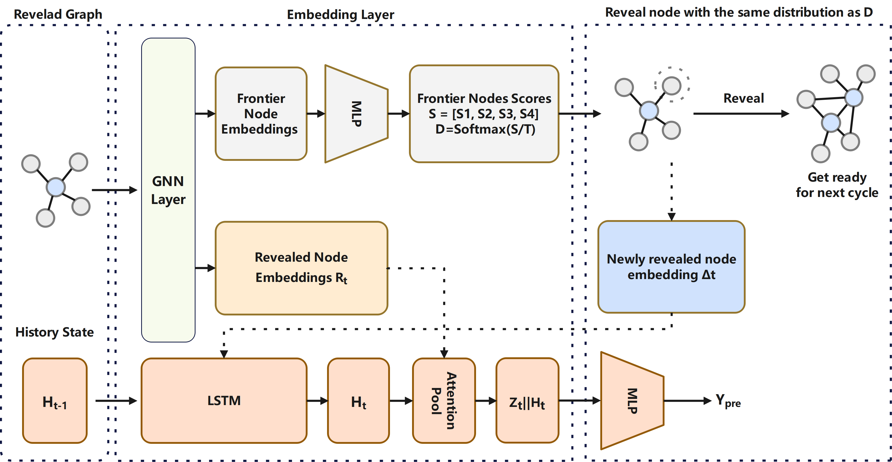

# Learning Where to Read: Adaptive Node-Revealing Policies for Budget-Limited Graph Classification

**Anonymous authors** (paper under double-blind review)

> **v3, compression-iteration draft**: working draft after main-text compression; the full detailed original is `main_zh-v2.md` (Chinese).
> Relative to v2: the Background section is merged into the Introduction, and the paper is renumbered from Related Work onward (Problem Setup = Sec. 3, Method = Sec. 4, Experiments = Sec. 5). Theoretical results and proofs have been moved out of the paper and archived in `AGR/Design-Notes/AGR-理论分析总集.md`.
> This round: theory removed, appendix renumbered to A.0–A.2, em-dashes removed and parenthetical asides reduced in the main text. Inline math uses $...$; [REF: ...] marks placeholder citations.

---

## Abstract

Graph classification methods almost universally assume that the entire graph is available at prediction time, yet on large graphs discriminative evidence is often concentrated in a small region while node-by-node inspection carries real cost. Existing pooling and explanation methods all operate under full observation and cannot answer, before the graph is visible, where reading should go; the direction has long lacked a leak-proof evaluation protocol, as well as evidence that a learned policy beats fixed ones at matched budgets. We therefore propose *budget-limited active graph reading*: an agent starts from a single seed node, step by step selects frontier nodes to reveal under a fixed node budget, and once the budget is exhausted classifies only the revealed subgraph. Training proceeds in three stages, namely teacher-trajectory distillation, behavior cloning, and reinforcement fine-tuning with an asymmetric reward judged by a frozen classifier, while the evidence reader is decoupled from node selection and accumulates what has been read in a recurrent state, guaranteeing by construction that prediction depends only on the revealed set. Experiments show that the learned policy recovers about $81\%$ of full-graph test accuracy on COLLAB under a $20\%$ node budget, and exceeds the best fixed policy by up to $11.3$ percentage points on CIFAR10. These results indicate that task-aware adaptive reading can substantially recover full-graph accuracy under a very small inspection budget.

---

## 1 Introduction

Graph classification supports applications from security provenance and biological network analysis to financial anti-fraud, yet the dominant paradigm trains and evaluates on fully observed graphs. The assumption fails systematically in real settings: in security provenance the discriminative signal often hides in a small subgraph of a large, noisy evidence graph [REF: evidence-concentration]; in biological networks, undiscriminating additional observation injects more noise than new information; and in financial anti-fraud, due-diligence and KYC queries are billed per call. The three scenarios share one premise: **acquiring the graph itself has a cost**. The way LLM agents operate under a context budget offers a direct analogy [REF: llm-agent-context]: they do not read the entire codebase; they retrieve relevant fragments, accumulate context, and stop once the information suffices to answer. Once only part of a graph can be inspected, the order of inspection matters: a breadth-first scan squanders the budget on irrelevant neighborhoods, a degree greedy ignores the task entirely, and each revealed node changes what the frontier makes visible and what is worth revealing next, so where to read next is a sequential decision problem. This paper formally brings this evidence-acquisition perspective into graph classification: we study **budget-limited active graph reading** (AGR), learning a policy that decides where to read under a budget and predicts using only the revealed subgraph.

Existing lines of work each provide part of the answer but stop short of this setting: graph pooling answers "which nodes matter" on the **complete** graph [REF: graph-pooling, sagpool], graph explanation finds reasons for a prediction **after** it is made [REF: subgraphx, graph-explainability], and active learning and active feature acquisition on graphs budget training labels and node attributes respectively [REF: active-learning-graphs, feature-acquisition] (Sec. 2 discusses each in turn). What is missing is twofold: an evaluation protocol that makes partial graph observation leak-proof and reproducible, and evidence that a learned policy indeed beats fixed policies under matched budgets.

This paper rests on two observations. The first is informational discipline: to learn and compare readers under partial observation, one must first pin down what is visible at each step. Revealed content and frontier attachment structure are visible, frontier edge features are freely queryable, and all content of unvisited nodes is permanently disabled; under this discipline the reader depends by construction only on the revealed set, and the prediction cannot peek at unrevealed evidence. The second is why learning is necessary: the reading order of a fixed heuristic is entirely task-agnostic and struggles to steer the budget toward regions that are actually useful for classification; in our experiments such heuristics either collapse to the majority class or cluster in a narrow band. A reading policy therefore has to learn task-aware selection from data rather than rely on hand-crafted rules.

To this end we give a leak-proof formalization of the problem (Sec. 3) together with a three-stage training pipeline (Sec. 4): behavior cloning distills an initial policy from successful trajectories of task-agnostic teachers, namely gradient saliency, information gain, and structural heuristics; reinforcement fine-tuning uses the frozen classifier's judgment on the final revealed subgraph as the reward, in an asymmetric form that suppresses gradient noise from failed trajectories; and the evidence reader is decoupled from the selection path, accumulating what has been read step by step in a recurrent state so that prediction and selection do not interfere.

Our contributions unfold along three lines. **Protocol.** We formalize the above discipline as a three-tier visibility model with leak-proof budget accounting (Sec. 3). **Method.** Behavior cloning distills an initial policy from successful teacher trajectories; reinforcement learning fine-tunes it with an asymmetric reward judged by a frozen classifier; the evidence reader accumulates what has been read in a recurrent state decoupled from node selection (Sec. 4). **Experiments.** On COLLAB all fixed policies collapse to the majority-class level, and the learned policy recovers about $81\%$ of full-graph test accuracy with a $20\%$ budget; on CIFAR10 it exceeds the best fixed policy by up to $11.3$ percentage points; on PPA it does not yet surpass the best fixed policy, which marks the clear boundary of the current method (Sec. 5).

---

## 2 Related Work

**Graph classification and pooling under full-graph observation.** Message-passing classifiers such as GIN consume the entire graph [REF: gin], and pooling methods score nodes on the complete graph with task-aware attention and sparsify computation accordingly, from differentiable cluster assignments to self-attention top-$k$ selection [REF: diffpool, sagpool, pooling-survey]. All of these answer "which nodes matter after the whole graph has been read"; under a node budget the same question must be answered **before** the graph is visible, from frontier information alone.

**Graph explanation.** Explanation methods identify reasons for a trained model's prediction on an **already observed** graph. Our setting reverses the direction of this step: evidence must be acquired **before** there is a prediction to explain, and explanation-style scoring is unavailable under partial observation by construction.

**Learned sequential readers.** Closest to our setting are agents that "selectively read graphs within a budget". GAM trains a recurrent walker with reinforcement learning for budgeted whole-graph classification: a rank network inspects neighbors and samples the next step while an LSTM integrates the reading history [REF: gam]; RWE-SGNN switches to a DQN rewarded by the decrease of downstream loss, using a **sampler–predictor split** of two models to generate class-relevant substructures [REF: rwesgnn]; AgentNet uses straight-through Gumbel transitions to let a population of identity-carrying agents walk differentiably, exchanging state with the visited node at every step [REF: agentnet]; RAW formulates walking as a POMDP for semi-supervised **node** classification and incorporates edge content into observations [REF: raw]. The four tasks bracket ours. RAW protects the label of a single node with the rest of the graph observable by default, while the other three share our graph-level objective, yet all of them, to varying degrees, violate the discipline our protocol enforces. First, unrevealed content enters decisions and even predictive representations: GAM inspects neighbor contents before moving, RAW aggregates features of never-visited neighbors, and AgentNet absorbs neighbor states each step, with differentiable transitions back-propagating into the embeddings of unvisited candidates. Second, none maintains a "single-seed, monotonically growing revealed set": budgets are accounted by walk steps or agent counts, GAM may revisit nodes, RWE-SGNN launches multiple walks from globally top-scored entries, and AgentNet spreads agents across the whole graph. Third, GAM, RAW and AgentNet all read out the prediction from the same recurrent state that drives selection; RWE-SGNN's two-model split points the same way as our decoupling but has no revelation discipline. Our reader guarantees by construction that the prediction path is a function of the revealed set only.

---

## 3 Problem Setup

### 3.1 Protocol

The AGR protocol fixes how the budget is accounted, what is visible at each step, and how the final judgment is made; its design goal is to rule out information leakage under partial observation. We describe these aspects in turn.

**Budget and seed.** The budget $B$ is the number of revealed nodes, **excluding** the seed, and is reported as a fraction of the graph's node count; the main experiments use 5/10/15% and COLLAB 10/15/20%. All comparisons are made at matched budgets, averaged over multiple deterministic seeds. The seed $s_0$ is produced by a deterministic pseudo-random formula from the graph index.

**Revelation process.** The agent reveals step by step from the seed: at each step exactly one node from the current **frontier** may be selected for revelation, so the revealed set grows monotonically and never revisits. When the frontier is empty but budget remains, for example when the seed falls in an isolated small component, a teleport to an unrevealed node is allowed, consuming one unit of budget.

**Visibility.** Visibility has three tiers: revealed node features, revealed edges with features, and the existence and attachment structure of the frontier (T0) are visible to all methods; the **features of frontier edges**, i.e., edges with one revealed and one unrevealed endpoint (T1), are freely queryable before revelation and consume no budget, so a policy may "look at the edge first, then decide whom to reveal"; all content of unvisited nodes (T2) is permanently disabled for the predictor.

### 3.2 Problem Formalization

This section writes the protocol of Sec. 3.1 as mathematical objects. Let $\omega_G=(Y,V,E,X,Z)$: $Y\in[K]$ is the graph label, $V=[n]$ a fixed vertex set, $E$ the edge set, and $X,Z$ node and edge features respectively. The revealed set starts from $S_0=\{s_0\}$; at each step an action $a_t$ is chosen from the frontier $F_t=N(S_t)\setminus S_t$, and after revelation $S_{t+1}=S_t\cup\{a_t\}$; the transition is deterministic and $|S_t|=t+1$.

**Observation.** A protocol $p\in\{0,1\}$ is given by a family of measurable maps $\Phi^p_t:\mathcal G\times 2^V\to\mathcal O^p_t$, with $o^p_t=\Phi^p_t(\omega_G,S_t)$. The observation $o_t$ consists of the ordered action history, the edges associated with $S_t$ (the structure of revealed and frontier edges), the features of revealed nodes, and the features of edges with both endpoints revealed; under protocol $p{=}1$ it additionally contains frontier edge features $Z_e\ (e\in\partial_t)$, where $\partial_t$ is the frontier edge set.

**Objective.** A policy is a family of kernels mapping observation histories to distributions on $F_t$, with randomization allowed; a terminal classifier $f$ outputs a label from $o_B$, and the value function is

$$
V^*(B)\;=\;\sup_{\pi,f}\ \Pr\big[f(o_B)=Y\big],
$$

with $V^{*,p}(B)$ under protocol $p$.

---

## 4 Method



### 4.1 Overview

Figure 1 gives the overall architecture of the evidence reader: the revealed subgraph, together with T1 frontier edge features, is fed to a shared GINE encoder, on top of which sit two decoupled paths, a stateless selection path (Sec. 4.2) and a recurrent evidence path (Sec. 4.3). The final-step output of the latter carries the terminal readout. During training the reader randomizes revelation with a temperature; at evaluation it takes the argmax.

### 4.2 Selection Head

Motivation. The protocol restricts what the selection head may use to $o_t$: candidate nodes are unrevealed with no readable features, and any scoring that depends on global structure is unavailable, for example whole-graph top-$k$ pooling. The selection head is therefore designed as a lightweight scorer over visible information, not a heavy reasoning module.

Mechanism. The shared encoder runs message passing on the visible subgraph, which consists of the revealed part, frontier attachment structure, and T1 frontier edge features, producing embeddings for all nodes; for each frontier candidate $v$, it concatenates

$$
u_v=\big[\,h_v\ ;\ \rho_t\ ;\ \phi_v\,\big],
$$

where $h_v$ is its embedding, $\rho_t\in[0,1]$ is the remaining budget fraction, shared by all candidates so that the score perceives the remaining steps, and $\phi_v\in\mathbb R^3$ are structural features computable within the visible subgraph: the normalized revealed degree (connections of $v$ to the revealed subgraph), the signed normalized frontier degree (distinguishing "exits on the revealed side" from "frontier candidates"), and the local clustering coefficient among revealed neighbors. The selection head $\mathrm{MLP}$ outputs a scalar score, normalized by a softmax over the frontier into a policy

$$
\pi_\theta(a_t{=}v\mid o_t)\;=\;\frac{\exp s_\theta(u_v)}{\sum_{v'\in F_t}\exp s_\theta(u_{v'})}.
$$

This path is entirely stateless: each candidate's score is a function of the current visible state only, independent of how the history came about.

### 4.3 Evidence Path

The terminal judgment needs a readout from $o_B$ to a label. Two naive options each have flaws: encoding and reading out the final revealed subgraph in one shot has capacity limited by the encoder's receptive field, and message passing cannot let distant pieces of read evidence interact; looking only at the last step discards all history. The evidence path instead accumulates new evidence step by step in a recurrent state, so information transfer between any two steps is carried by an explicit state.

**Mechanism.** Each step's evidence stream consists of four actions (Figure 1, lower half). (i) The encoder produces an embedding $\Delta_t$ for the node newly revealed at step $t$, where step 0 is the seed, taken from the same forward pass as the selection path; (ii) an LSTM integrator merges it into the history state, $h_t=\mathrm{LSTM}(\Delta_t,h_{t-1})$; (iii) history-guided attention pooling uses $h_t$ as query and revealed node embeddings as K/V, with single-head scaled dot-product producing the readout $z_t=\sum_i\alpha_i v_i$, $\alpha=\mathrm{softmax}(Kq/\sqrt d)$, where the accumulated state decides "what to look back at now"; (iv) the evidence head $\mathrm{MLP}([z_t;h_t])$ outputs a per-step class distribution, and the terminal judgment takes the step-$B$ output.

**Role.** Two design disciplines decouple prediction from selection: the evidence stream never enters the selection scores, and the gradients of the LSTM and attention pooling come only from the stepwise supervision $\mathcal L_{ev}$, never from the policy gradient, so the policy updates in the RL stage cannot corrupt the readout. Evaluation reports both the evidence head's terminal judgment and the reference head, i.e., the frozen classifier reading the same revealed subgraph, and the gap between them distinguishes "selecting well" from "reading well".

### 4.4 Training Objective

**Teacher trajectories and behavior cloning.** Teachers generate reading trajectories by gradient saliency, information gain, structural heuristics, and their hybrid combinations [REF: teacher-details-SI]; trajectories are scored by the frozen classifier's correctness on the final revealed subgraph, filtered for successes, and class-balanced, yielding $\mathcal{D}=\big\{(o_t^{\tau},\,a_t^{\tau})\big\}$, where $\tau$ indexes trajectories and $t=0,\dots,B_\tau{-}1$. Behavior cloning minimizes the per-step negative log-likelihood of actions

$$
\mathcal{L}_{act}=\frac{1}{N_{\mathrm{act}}}\sum_{\tau\in\mathcal{D}}\sum_{t=0}^{B_\tau-1}-\log\,\pi_\theta\big(a_t^{\tau}\mid o_t^{\tau}\big),
$$

where $N_{\mathrm{act}}=\sum_\tau B_\tau$ is the total number of actions; simultaneously the evidence head is supervised by a stepwise cross-entropy, where $\ell_\theta^{\tau}(t)$ denotes the evidence head's logits at step $t$ and $N_{\mathrm{ev}}=\sum_\tau(B_\tau+1)$ is the total number of stepwise predictions, including the step-0 seed prediction:

$$
\mathcal{L}_{ev}=\frac{1}{N_{\mathrm{ev}}}\sum_{\tau\in\mathcal{D}}\sum_{t=0}^{B_\tau}\mathrm{CE}\big(\ell_\theta^{\tau}(t),\,y_\tau\big),
\qquad
\mathcal{L}_{BC}=\mathcal{L}_{act}+\lambda_{ev}\,\mathcal{L}_{ev}.
$$

$\mathcal L_{ev}$ is the only training signal of the evidence path (Sec. 4.3); for the selection path it is an auxiliary task, providing a stepwise shaping signal of "does what has been read support some class" during rollouts.

**Reinforcement fine-tuning.** BC inherits the teachers' biases; RL uses the frozen classifier $f$'s judgment on the final revealed subgraph $o_B$ as the reward, compressing each trajectory into a single scalar. The reward takes the asymmetric form: $R(\tau)=+1$ if $f(o_B^{\tau})=y_\tau$ and $-0.1$ otherwise. Advantages are standardized within a batch with the negative side down-weighted: $A_\tau=(R_\tau-\hat\mu)/(\hat\sigma+\varepsilon)$, and negative advantages are additionally multiplied by $\eta<1$, where $\hat\mu,\hat\sigma$ are batch statistics and $\eta$ suppresses gradient noise from failed trajectories. The terminal reward is a single-shot event with large across-trajectory variance, so the RL stage keeps $\mathcal L_{ev}$ as a dense auxiliary supervision to reduce policy-gradient variance; the policy gradient takes the batch mean of the advantage-weighted whole-trajectory log-likelihood, with $\mathcal B$ the current rollout batch:

$$
\mathcal{L}_{RL}= -\frac{1}{|\mathcal{B}|}\sum_{\tau\in\mathcal{B}}A_\tau\sum_{t=0}^{B-1}\log\pi_\theta\big(a_t^{\tau}\mid o_t^{\tau}\big),
\qquad
\mathcal{L}^{total}=\mathcal{L}_{RL}+\lambda_{ev}\,\mathcal{L}_{ev}.
$$

### 4.5 Algorithm

Inference and training share the same rollout loop: one forward pass on the visible subgraph per step, with cost $O(|E(G_t)|)$ determined by the subgraph induced by the revealed set and the frontier, usually far smaller than the whole graph; a $B$-step trajectory costs linearly in $B$. Rollouts for training and evaluation run in lockstep batches across graphs. The three-stage pipeline of teacher trajectories, behavior cloning, and reinforcement fine-tuning is given in Algorithm 1 (Appendix A.1). Implementation details on architecture, optimization, and seed conventions are given in Appendix A.0.

---

## 5 Experiments

### 5.1 Experimental Setup

We evaluate on three large-scale graph classification benchmarks: OGBG-PPA [REF: ogbg], CIFAR10 superpixels [REF: lrgb], and COLLAB [REF: tudataset]. The three cover different structural regimes the protocol must face: CIFAR10 superpixels are node-feature-centric, near-grid, and bounded-diameter; PPA has only 7-dimensional edge features and averages 243 nodes; COLLAB has only topology. The metric is accuracy (%). Fixed baselines comprise four revelation strategies, namely Random, BFS, Max-Frontier-Degree, and Random-Walk, plus the adapted SAGPool; the frozen full-graph classifier provides each dataset's upper bound, and its accuracy on the revealed subgraph is reported as the reference head ($\mathrm{acc\_clf}$).

**How baselines enter the protocol.** The four fixed strategies and the adapted SAGPool share one protocol interface: at each step they select exactly one unrevealed endpoint from the current frontier, with budget accounting, seed formulas, and terminal judgment identical to the learned methods, differing only in the **sequential heuristic** that orders reading; SAGPool's scorer is turned into a stepwise static selector, and the resulting distribution shift at evaluation is part of that baseline's setting. Full adaptation details are in Appendix A.2; all methods share the same terminal judgment, upper bound, and reference-head protocol.

**Table 1: CIFAR10 superpixels, test accuracy (%).** The reference head is the frozen classifier on RL-revealed subgraphs; BC is the main comparison configuration, and the evidence reader's BC variants are in Table 4.

| Budget | Random | BFS   | Max-Fr.-Deg. | RW    | SAGPool | BC    | RL        | RL-Ref |
| ------ | ------ | ----- | ------------ | ----- | ------- | ----- | --------- | ------ |
| 5%     | 16.32  | 16.32 | 16.09        | 16.30 | 15.49   | 16.91 | **25.32** | 16.68  |
| 10%    | 18.69  | 18.06 | 17.31        | 19.03 | 16.91   | 17.87 | **30.03** | 19.78  |
| 15%    | 20.57  | 19.59 | 18.98        | 21.36 | 18.10   | 18.39 | **32.68** | 22.98  |

Full-graph classifier (upper bound) 60.5.

**Table 2: COLLAB, accuracy (%), all cells validation/test.** Fixed policies are pinned at the majority-class level.

| Budget | Random      | BFS         | Max-Fr.-Deg. | RW          | SAGPool     | BC          | RL              | RL-Ref      |
| ------ | ----------- | ----------- | ------------ | ----------- | ----------- | ----------- | --------------- | ----------- |
| 10%    | 15.43/15.57 | 15.53/15.57 | 15.63/15.57  | 15.43/15.57 | 15.43/15.57 | 16.78/16.42 | **52.20/51.90** | 15.88/15.72 |
| 15%    | 15.43/15.57 | 15.73/15.57 | 15.83/15.72  | 15.43/15.57 | 15.43/15.57 | 20.24/19.96 | **54.56/53.44** | 18.09/18.21 |
| 20%    | 15.43/15.57 | 15.98/15.72 | 16.03/15.87  | 15.43/15.57 | 15.43/15.57 | 27.56/25.60 | **58.02/55.74** | 20.64/20.26 |

Full-graph classifier (upper bound) valid 71.54 / test 69.06.

### 5.2 Main Results

The results answer three questions: can the learned policy beat all fixed baselines at matched budgets (Tables 1–3); is the gain cashed by "selecting well" or by "reading well" (the dual-readout protocol of Sec. 4.3); and where the method's boundary of applicability lies (the negative result on PPA).

On CIFAR10 superpixels (Table 1), fixed policies concentrate in a narrow 16–21 band and behavior cloning falls in the same band, so imitating task-agnostic teachers alone does not beat the best heuristics. Reinforcement fine-tuning pushes the policy far out of this band: the three budget tiers reach 25.32, 30.03, and 32.68, exceeding the best fixed policy at the same budget by 9.0–11.3 percentage points and BC by up to 14.3. Taking the 15% budget gap between 32.68 and 22.98 as an example, the difference between RL and the reference head shows that the policy reveals subgraphs the frozen classifier reads **better**, not merely "reveals more". Against the full-graph upper bound, at 15% budget RL reaches 32.7 with the full-graph classifier at 60.5, recovering about 54% of full-graph accuracy: reinforcement fine-tuning captures most of the increment beyond the fixed-policy band, but substantial headroom remains.

On COLLAB (Table 2), all fixed policies and SAGPool stay at 15.4–16.0 on both splits, the majority-class level of this imbalanced dataset, where the greedy failure appears in its most extreme form: task-agnostic selection never escapes collapse. Behavior cloning improves to valid 16.8–27.6 and test 16.4–25.6; reinforcement fine-tuning reaches 51.90, 53.44, and 55.74 on test, recovering 75.2–80.7% of full-graph test accuracy (69.06). The remaining gap is mainly bounded by the full-graph classifier's own accuracy, not by the reading policy. The reference head sharpens the mechanism: the frozen classifier reading RL-revealed subgraphs achieves only 15.7–20.3, so it is the evidence head that converts revealed evidence into prediction, not the frozen readout.

**Table 3: OGBG-PPA, accuracy (%), all cells validation/test.** Learned policies do not yet beat the best fixed policy; BC collapses to near random.

| Budget | Random      | BFS         | Max-Fr.-Deg. | RW          | SAGPool     | BC        | RL          | RL-Ref      |
| ------ | ----------- | ----------- | ------------ | ----------- | ----------- | --------- | ----------- | ----------- |
| 5%     | 18.86/20.16 | 23.45/24.45 | 25.31/26.20  | 19.71/21.46 | 26.08/27.28 | 3.90/3.97 | 23.53/26.90 | 19.65/20.73 |
| 10%    | 31.14/33.07 | 30.06/35.68 | 36.33/37.28  | 32.34/34.54 | 36.25/37.92 | 7.23/7.37 | 28.12/32.34 | 26.83/27.41 |
| 15%    | 39.37/41.88 | 40.84/42.92 | 42.94/44.52  | 40.21/42.99 | 43.03/45.08 | 9.04/9.03 | 30.76/35.05 | 31.87/32.99 |

Full-graph classifier (upper bound) valid 64.2 / test 65.6.

On PPA the fixed policies separate cleanly with budget, and SAGPool is the strongest fixed baseline on test. In stark contrast to the other two datasets, the learned policies are not yet competitive: behavior cloning collapses to 3.9–9.0, well below all fixed policies; on test, reinforcement fine-tuning consistently beats its reference head (26.9–35.1 vs. 20.7–33.0) yet trails the best fixed baseline by 0.4–10.0 percentage points at every budget tier. The policy gradient's signal-to-noise ratio is naturally low at low success rates, consistent with this observation; however, a complete attribution, involving reward sparsity, PPA's budget granularity, and class imbalance, is not yet established, and we draw no conclusion about adaptive reading from this negative result.

### 5.3 Ablation and Analysis

**Table 4: BC ablation, test accuracy (%).** no-pool removes history-guided attention pooling, no-lstm removes the recurrent accumulator, and v1 removes both; COLLAB budgets are 10/15/20%.

| Dataset (budget tiers) | Variant | Tier 1 | Tier 2 | Tier 3 |
| ---------------------- | ------- | ------ | ------ | ------ |
| CIFAR10 (5/10/15%)     | full    | 18.35  | 20.07  | 20.45  |
| CIFAR10                | no-pool | 17.16  | 18.09  | 19.01  |
| CIFAR10                | no-lstm | 17.56  | 18.26  | 19.15  |
| CIFAR10                | v1      | 16.91  | 18.58  | 19.38  |
| COLLAB (10/15/20%)     | full    | 16.42  | 19.96  | 25.60  |
| COLLAB                 | no-pool | 15.72  | 18.41  | 21.11  |
| COLLAB                 | no-lstm | 15.72  | 18.21  | 20.11  |
| COLLAB                 | v1      | 15.88  | 18.04  | 20.64  |

Table 4 ablates the evidence path's two components item by item (Sec. 4.3): no-pool removes the history-guided readout, no-lstm removes the recurrent accumulator, and v1 removes both, so the terminal judgment degenerates to an unguided mean pooling of revealed embeddings. The recurrent accumulator is the largest contributor on COLLAB: removing the LSTM costs 5.5 percentage points of accuracy at the 20% budget, and removing both costs 5.0 with the sharpest degradation at the largest budget tier. On CIFAR10 each effect is smaller but directionally consistent: attention pooling contributes 1.2–2.0 percentage points, and the full variant leads at every tier.

---

## 6 Discussion

### 6.1 Limitations

**Mechanistic decomposition of the gains.** RL's gains contain two components, "selection" and "calibration", and the reference head separates them. On CIFAR10 the RL terminal judgment is far above the frozen classifier's accuracy on typical revealed subgraphs, indicating that selection is the dominant mechanism, namely finding evidence-richer regions; on COLLAB the opposite holds, as the frozen classifier reads RL-revealed subgraphs at only 15.7–20.3 while the evidence head judges 51.9–55.7, so the gain is cashed mainly by the evidence head's advantage over the frozen readout. Completely ruling out calibration effects would require matched-training controls, which we leave to future work.

**Boundary of current evidence.** Our conclusions are bounded by two limits. First, the gains narrow at the smallest budgets: at CIFAR10's 5% budget RL recovers less than half of full-graph accuracy, so the method currently applies to settings that allow moderate inspection fractions. Second, per-class accuracy is uneven: CIFAR10's hardest class is near random on test, the best and worst classes differ by 71.7 percentage points, and class-balanced filtering barely helps, indicating a capability boundary rather than a data-volume issue.

### 6.2 Future Work

**Frontier attention filtering and selection cost.** On hub-dominated graphs such as PPA and COLLAB the frontier swells rapidly with revelation, and hundreds of candidates dilute both the per-step scoring cost and the supervision signal of the selection head. A direct extension places a lightweight **frontier attention filter** before the selection head: using the current recurrent state as query, it attention-ranks the frontier candidates and passes only a shortlist to the selection head for precise scoring. The filter only reorders or truncates the candidates of $F_t$ and consumes no budget, so the protocol semantics are unchanged; its risk is that high-value nodes may be filtered out prematurely, which calls for coverage guarantees such as $\varepsilon$-coverage or widening the shortlist with budget, together with an analysis of the trade-off between filtering error and budget gain.

**Adaptive stopping, anytime validity, and protocol extensions.** The current protocol fixes the budget in fractional tiers, yet "how much to read" is itself a decision. Protocol extensions in the same direction include multi-label and regression objectives, generalizing the budget from "node-count fractions" to heterogeneous inspection costs, and letting the policy learn when to stop reading under cost awareness.

## 7 Conclusion

We presented a leak-proof formalization and evaluation benchmark for budget-limited active graph reading: a three-tier visibility protocol makes learning and evaluation under partial observation comparable and reproducible. On the method side, behavior cloning followed by reinforcement fine-tuning with an asymmetric reward turns task-agnostic reading into task-aware reading: on COLLAB a 20% node budget recovers about 81% of full-graph test accuracy, on CIFAR10 the learned policy beats the best fixed policy by up to 11.3 percentage points, and ablations confirm that the recurrent evidence accumulator carries the main gains.

---

## Appendix

This appendix collects implementation details (A.0), the training pipeline (A.1), and the baseline adaptation (A.2).

### A.0 Implementation Details

The shared encoder is a GINE-style edge-feature convolution, by default 2 layers of width 128 with dropout 0.1 (configurable layer-wise); the selection MLP and the evidence modules (LSTM 128→128, single-head attention pooling, evidence head $2d{\to}d{\to}K$) operate at the same width; the evidence modules add about 0.2M parameters over base, with forward cost comparable to base ($\Delta_t$ comes from the same forward pass, so there is no second encoder). Optimization uses Adam (representative configuration: learning rate $10^{-3}$, batch size 64, about 10 BC epochs, with RL fine-tuned for a few more epochs); training rollouts sample at temperature and evaluation takes the argmax, with 4 deterministic seeds per graph. Budget tiers, class counts, and feature dimensions per dataset are given by the dataset registry; all hyperparameters and architectures are embedded in the corresponding checkpoints and released with the code, and per-dataset differences are not enumerated here.

### A.1 Training Pipeline (Algorithm 1)

The pseudocode below gives the three-stage pipeline of Sec. 4.5; budget accounting and the terminal judgment follow the protocol of Sec. 3.1.

```
Algorithm 1  Three-stage training pipeline
Input : training graphs {G_i}; frozen classifier f_hat;
        budget tiers B; teachers {gradient, info-gain,
        structural, hybrid}
Output: policy and evidence-head parameters theta

# Stage A: teacher trajectories
for G_i, seed s0, teacher T:
    S <- {s0}
    while |S| - 1 < B:       # budget = reveals, excl. seed
        F <- N(S) \ S
        if F = empty then teleport (costs 1 budget)
        a <- T(observation); reveal a; S <- S union {a}
        # record (o_t, a_t) stepwise
    if f_hat(G_S) = y: D <- D union {this trajectory}
Class-balance D

# Stage B: behavior cloning
repeat: sample a batch from D, reproduce observations
        by temperature rollout; gradient descent on L_BC

# Stage C: reinforcement fine-tuning
repeat: rollout with theta at temperature;
        R <- +1 if f_hat(o_B)=y else -0.1
        standardize advantages; gradient descent on L^total
```

### A.2 How Baselines Enter the Protocol

**Fixed strategies.** The four fixed strategies, Random, BFS, Max-Frontier-Degree, and Random-Walk, share one protocol interface: at each step they select exactly one unrevealed endpoint from the current frontier, with budget accounting, seed formulas, and terminal judgment identical to the learned methods; they differ only in the **sequential heuristic** that orders reading. Random samples uniformly over frontier edges and reveals their unrevealed endpoint; BFS reveals in first-in-first-out order of frontier-edge discovery; Max-Frontier-Degree reveals the frontier node with the most connections to the revealed subgraph; Random-Walk walks along random edges from the current node and reveals the first unrevealed node it arrives at.

**SAGPool.** SAGPool requires substantive adaptation to enter the protocol: its original form performs one-shot top-$k$ selection on the complete graph, consuming unobserved global structure and guaranteeing neither connectivity to the seed. The adapted version turns its scorer into a stepwise static selector: at each step it recomputes gating scores on the visible subgraph only (revealed ∪ frontier, with frontier node features zeroed) and reveals the highest-scoring frontier node (ties broken by smaller id, deterministic); the scorer itself is still trained on complete graphs with standard supervision, and the resulting distribution shift at evaluation is part of that baseline's setting. All methods share the same terminal judgment, upper bound, and reference-head protocol.

---

## Reproducibility Statement

All experiments use the per-graph deterministic seed formula, fixed dataset splits, and a single evaluation mode including per-class breakdowns and dual-readout accuracies; complete configurations are embedded in every checkpoint, and all results are averages over four seeds. Code, configurations, trajectory data, and the leakage-invariant test suite will be released with the paper.

## LLM Usage Statement

An LLM-based coding assistant was used for implementing the experimental codebase and writing support; all results, claims, and conclusions were verified by the authors, who take full responsibility. Per ICLR policy, this statement moves to the appendix in the submitted version.
