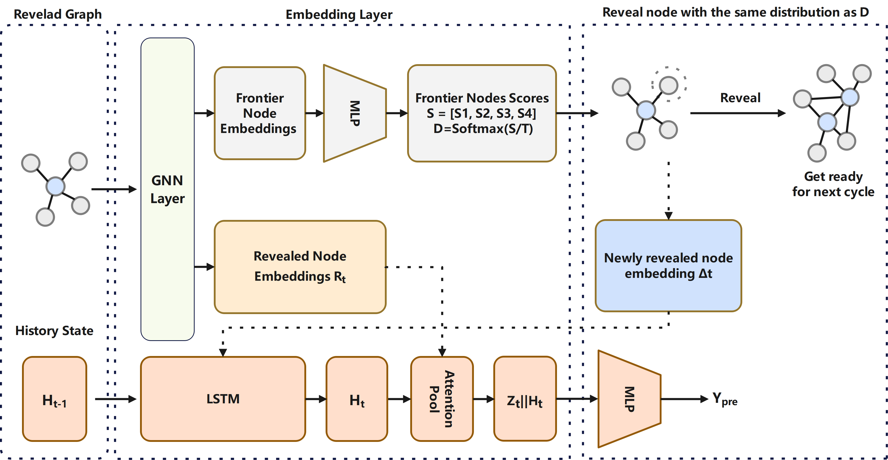
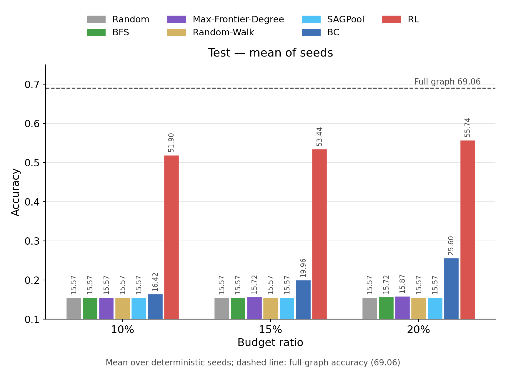
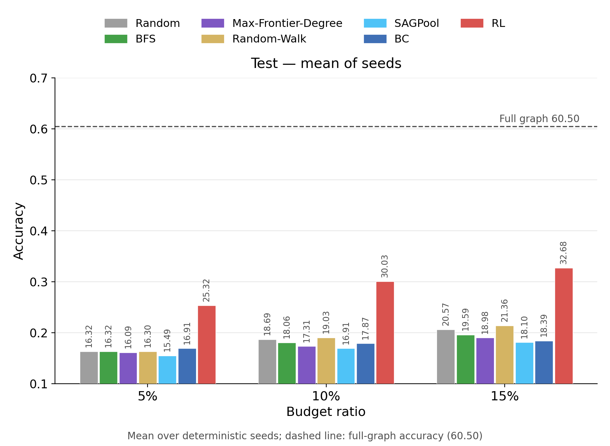
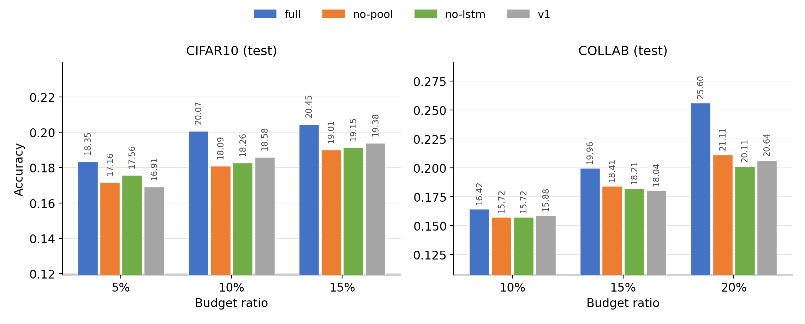

# 学习读哪里：预算受限图分类的自适应节点揭示策略

**匿名作者**（双盲评审中的论文）

> 本文件是 `main.tex` 的中文全文版，内容与英文稿同步；图表见 `figures/` 目录。
> 行内公式以 $...$ 记号书写；【REF：…】为待补文献占位。

---

## 摘要

图分类方法几乎普遍假设预测时整张图是可得的，然而在大图上判别性证据往往集中于很小的区域，而逐节点检查带有真实成本。我们研究**预算受限的图主动阅读**：智能体从单个种子节点出发，在固定节点预算下反复选择前沿节点进行揭示，随后对已揭示子图做分类。本文首先给出该问题的防泄漏形式化，并证明最优读取在计算上是本质困难的——确定性情形 NP-complete，简洁随机图模型下 PSPACE-难——因此学习式摊销策略是复杂度意义上的必然而非工程妥协。我们进一步证明：任务无关的贪心阅读在条件独立世界具有 $(1-1/e)$ 最优性保证，但图上的证据相关与可达性封锁使该保证必然失效（构造实例上差距不低于 $0.24$），而 v1 协议——前沿边特征在揭示前免费可见——具有可证明的严格收益；证据读取器则可刻画为**摊销贝叶斯滤波**，其终端读出是后验众数且与部署策略无关。

---

## 1 引言

图分类支撑着从安全溯源分析到分子筛选的众多应用，而主流范式在完整观测的图上训练与评估。这一假设对基准是便利的，对大图却不自然：逐节点检查昂贵而缓慢，且大部分内容与标签无关。在溯源图、程序依赖图和大规模交互图中，决定标签的证据往往集中在小子图上。【REF：evidence-concentration】

如果只能检查图的一部分，检查的顺序就变得重要。广度优先的扫读会把预算浪费在无关邻域上，度数贪心的扫读则完全无视任务；每揭示一个节点都会改变前沿的可见信息与后续值得揭示的对象，因此"接下来读哪里"是一个序列决策问题。大语言模型智能体的实践者面临同样的约束——必须在上下文预算下决定下一步检索什么——并用学习到的、任务感知的策略来解决它。【REF：llm-agent-context】本文把这一"证据获取"的视角正式引入图分类。

已有工作各自提供了部分回答，但都止步于这一设定。图池化方法（如 SAGPool）在**完整图**上对节点做任务感知打分以稀疏化表示【REF：graph-pooling、sagpool】，回答的是"哪些节点重要"，而非"预算下接下来揭示谁"；子图采样提供仅依赖结构、与任务无关的视图【REF：subgraph-sampling】；图解释方法（如 SubgraphX）在图已被完全观测**之后**为预测提供理由【REF：subgraphx、graph-explainability】；图上的主动学习预算的是训练标签【REF：active-learning-graphs】，主动特征获取预算的是属性、且多为一次性选择【REF：feature-acquisition】。缺失的是两样东西：一个让部分图观测防泄漏、可复现的评测协议，以及学习策略在同预算下确实胜过固定策略的证据。

协议方面，我们采用三层可见性模型：前沿节点的存在性（T0）与前沿边特征（T1）在揭示前零成本可见，未访问节点的一切内容（T2）对预测器永久禁用。方法方面，我们分两阶段训练揭示策略：行为克隆从启发式教师的成功轨迹中蒸馏出初始策略，强化学习再以冻结全图分类器判定的非对称奖励进行微调；在结构上，与选点解耦的证据读取器以循环状态累积已读证据。理论方面，我们证明最优读取的计算复杂度、贪心阅读的保证与必然失效以及证据读取器作为摊销贝叶斯滤波的身份（§4）。

---

## 2 相关工作

**图分类与图池化。** 消息传递分类器消费整张图，池化方法则以任务感知的注意力在完整图上为节点打分、据此稀疏化表示，SAGPool 是其中的代表【REF：graph-pooling、sagpool】。这类方法回答的是"整图中哪些节点重要"，前提恰是整图已经可见；而在预算受限设定里，打分必须在部分观测下进行。我们将 SAGPool 改造为匹配预算下的静态选择基线，实验显示它同样依赖全图上下文才能发挥作用。

**子图采样与任务无关选择。** 随机游走、邻域扩张等采样视图在不询问任务的情况下产生子图【REF：subgraph-sampling】。它们廉价且天然支持序列化，因而其中数个成为我们的固定基线；§3.3 将说明任务无关贪心的失效是结构性的，§5.2 中 COLLAB 的塌缩则是其现实版本。

**图解释。** SubgraphX 等解释方法为训练好的全图模型在已观测图上的预测识别理由子图【REF：subgraphx、graph-explainability】。我们的设定方向相反：证据必须在预测之前获取，解释式打分在部分观测下按构造不可得。本文仍将此类打分用作教师与静态基线，但学习策略必须在"边读边看"的约束下行动。

**图上的主动学习与主动特征获取。** 图上的主动学习预算的是训练标签【REF：active-learning-graphs】；主动特征获取预算的是节点属性，且通常一次性或按列选择【REF：feature-acquisition】。我们预算的是测试时的序列结构观测，动作空间与泄漏风险都随之改变。证据式与 POMDP 风格的读取器为预测累积观测【REF：evidential-pomdp】，与本文的证据读取器同属一线；差别在于我们的版本与选点策略解耦训练、在防泄漏协议下评估，并具有 §3.4 给出的贝叶斯滤波理论身份。复杂度方面，预算受限读取与"与自然博弈"式的部分观测问题同构，其难度须经由随机量化布尔公式（SSAT）刻画而非引用一般 POMDP 结果（§3.2）【REF：ssat、games-against-nature、adaptive-submodularity】。

---

## 3 Problem Setup

### 3.1 问题形式化

我们依次固定基本对象、协议与优化目标。设 $\omega_G=(Y,V,E,X,Z)$：$Y\in[K]$ 为图标签，$V=[n]$ 为固定顶点集，$E$ 为边集，$X,Z$ 分别为节点与边特征。种子 $s_0$ 由协议的确定性公式从图索引产生，对固定图是常量；初始已揭示集 $S_0=\{s_0\}$。每一步智能体从**前沿** $F_t=N(S_t)\setminus S_t$ 中选择动作 $a_t$，揭示后 $S_{t+1}=S_t\cup\{a_t\}$；转移是确定性的，$|S_t|=t+1$。

**协议**规定每一步的观测 $o_t$由有序动作史、与 $S_t$ 关联的边（即已揭示边与前沿边的结构）、已揭示节点的特征、以及双端已揭示边的特征、前沿边的特征。用可见性分层来说：前沿的存在性与挂接关系（T0）对所有方法必备，前沿边特征（T1）是 v1 的免费层，而未访问节点的一切内容（T2）对预测器永久禁用。两协议满足三条结构公理：累积嵌套——$\tau\le t$ 时 $o_\tau$ 是 $o_t$ 的可测限制，故 $\sigma(o_{1:t})=\sigma(o_t)$；粗化——$o^0_t$ 是 $o^1_t$ 的可测函数；前沿可算——$F_t$ 是 $o_t$ 的可测函数。

**目标**如下：策略是把观测历史映到 $F_t$ 上分布的核族（允许随机化），终端分类器 $f$ 从 $o_B$ 输出标签，值函数为

$$
V^*(B)\;=\;\sup_{\pi,f}\ \Pr\big[f(o_B)=Y\big],
$$

信念定义为 $b_t=\Pr(\omega_G\in\cdot\mid o_t)$。预算 $B$ 一律按其占节点总数的比例报告，所有比较在匹配预算、四个确定性种子平均下进行。

协议的防泄漏由两条**不变量**保证，并由单元测试强制执行：其一，预测只是已揭示集合的函数，因此相同的揭示集在不同预算下必须给出相同预测；其二，未揭示前沿节点的嵌入不得进入预测路径——我们以随机噪声毒化前沿嵌入并断言 logits 不变来验证。这两条把"允许看什么"从约定升级为可机械检验的性质。

### 3.2 最优读取的计算复杂度

**命题 1（NP-complete）**：判定"是否存在合法揭示序列使终端分类器输出 $y$"（OPT-READ）是 NP-complete，优化版为 NP-hard，且难度在 $B$ 为输入一部分时成立。证明由 Set Cover 归约：集合节点携带集合指示特征并全部与种子相邻，一条"前沿约束失效引理"使动态动作空间在该 gadget 上不排除任何组合，问题于是退化为纯集合选择。值得注意的是，难度来自"预算下选哪些观测"的组合内核，而非自适应性本身；完整证明见附录 A.1。

**定理 1（PSPACE-难）**：在"多项式规模确定性骨架 + 独立随机位"的简洁图模型、自适应策略与多项式规模电路分类器下，判定 $V^*(B)\ge\tau$ 为 PSPACE-难。证明经由 SSAT（随机量化布尔公式，即"与自然博弈"）归约；需要专门引理说明不能直接嵌入一般 POMDP——AGR 的秘密在开局写定、揭示只是读取，与 POMDP 的实时应答语义不同；完整证明见附录 A.2。

两条复杂度结果共同给出一个直接推论：最优策略是深度 $B$、分叉数由前沿规模控制的策略树，精确求解不可行；因此把逐实例的搜索成本**摊销**为一次性的跨图策略学习（教师 → BC → RL）是复杂度意义上的必然。

### 3.3 贪心的保证与必然失效

**定理 2（条件独立世界的保证）**：若节点证据给定标签条件独立（CI），则信息增益 $f(S)=I(Y;X_S)$ 自适应单调且自适应次模，逐步最大化预期边际增益的贪心达到 $(1-1/e)\cdot\mathrm{OPT}$。证明即自适应 Nemhauser 定理在此设定下的还原：势函数 $\Phi_t=\mathrm{OPT}-\mathbb E[f(A_t)\mid\psi_t]$ 每步以 $(1-1/B)$ 收缩；完整证明见附录 A.4。

**命题 2（保证的必然失效）**：图上的证据相关性首先破坏次模性——XOR 结构下两个节点各自的边际信息均为零、联合信息完全，边际增益递增、次模性失效；将其嵌入前沿约束后，可达性封锁使强信息节点从不进入动作空间，而任何逐步边际打分的策略都被弱信号干扰节点永久吸引。构造实例上，贪心的终端精度不超过 $0.757$、最优策略精度为 $1$，差距不低于 $0.24$ 且不随预算消失；完整证明见附录 A.3。

### 3.4 证据读取器是摊销贝叶斯滤波

**定理 3**：在 §3 协议下，对任意预算 $B$：(a) 最优策略与最优可达条件值只依赖信念状态 $(b_t,S_t)$，问题归约为信念 MDP；(b) 最优终端判读是后验众数 $\arg\max_k\Pr(Y{=}k\mid o_B)$，且 $\Pr(Y{=}k\mid o_B{=}v)$ **与产生 $v$ 的部署策略无关**——累积嵌套使"为何停在这里"已编码进 $o_B$，贝叶斯比中的策略链因子被约去；(c) 对数后验满足单步更新，在 CI 模型下退化为逐节点对数似然比的加法递归，每步代价 $O(K)$ 且与 $t$ 无关；(d) LSTM 单元族包含该加法滤波器——理想门下对指数族证据逐坐标精确、tanh 输出精确保持 argmax，有限偏置的 $\varepsilon$ 实现之对数域误差按 $\le B\varepsilon$ 线性累积，诱导的超额分类错误不超过 $e^{2B\varepsilon}-1$。完整证明见附录 A.5。

其中 (b) 值得展开，因为它纠正了一个常见直觉。人们通常预期自适应策略的"选择效应"会使后验依赖部署策略——类似问卷调查中的幸存者偏差；在 AGR 中这**不成立**：策略做选择时看到的一切（包括驱动其停下的前沿结构）都已编码进终端观测，选择效应无法在贝叶斯更新后幸存。由此得到"决策-分类一体终判"的严格论证：贝叶斯读出是策略不变量，冻结外部分类器的劣势不是信息论的，而是统计的——其训练分布不等于部署策略的子图访问分布；证据头与策略同轨训练，恰在部署访问分布上估计同一个不变量。

需要诚实说明的是：由累积嵌套，LSTM 积分历史**不增加信息**——$o_t$ 已包含全部已见内容，"记忆"在信息论上是冗余的。证据机制的价值是统计与计算的：把 $B$ 步弱证据逐步积分，对比一次性对整个揭示子图分类，在小样本高噪声区间的统计效率不同；递归更新结构先验地匹配贝叶斯滤波的形式；§5.3 的消融正是对该定理组件级贡献的检验。

### 3.5  信息论天花板

**定理 4（Fano 统一上界）**：对任意（允许自适应、随机化的）策略与任意终端分类器，

$$
\Pr[\hat y\ne y]\;\ge\;h_2^{-1}\!\big(H(Y\mid o_B)\big)\;\ge\;\frac{H(Y)-I(Y;o_B)-1}{\log K}.
$$

即精度上界由揭示策略获取的互信息唯一控制；由数据处理不等式，$I(Y;o_B)\le I(Y;G)$，任何读取都不能超过全图信息。要得到可计算的数值天花板，还需一条显式校准假设（分类器交叉熵对全图信息熵的超额受均匀基线控制，即 $\mathrm{KL}(q\,\|\,P(Y\mid G))\le\mathrm{KL}(P_Y\,\|\,U)=\ln K-H(Y)$，注意方向是 $P_Y\to U$——只有该方向等于 $\ln K-H(Y)$，推导与数值走查见附录 A.6），此时天花板为 $\mathrm{ceiling}=1-f^{-1}(T)$，其中 $T=\mathrm{CE}_{\text{test}}-(\ln K-H(Y))$、$f(e)=h_2(e)+e\log(K-1)$。证明见附录 A.6。

**表 5：信息论天花板（test split）**

| 数据集  | $K$ | $H(Y)$（nats） | CE（nats） | 天花板           | 全图精度  |
| ------- | ----- | ---------------- | ---------- | ---------------- | --------- |
| CIFAR10 | 10    | 2.3026           | 1.2424     | **0.7090** | 0.6046 ✓ |
| PPA     | 37    | 2.8361           | 2.0660     | **0.7850** | 0.6975 ✓ |
| COLLAB  | 3     | 0.9953           | 0.7420     | **0.8001** | 0.6647 ✓ |

### 3.6 前沿信息的严格收益

本节回答协议为什么值得作为一个设计维度：v1 免费开放的前沿边特征是否只是工程便利。记协议 $p\in\{0,1\}$ 下的最优值为 $V^{*,p}(B)$。

**定理 5**：对 §3.1 的协议对 $(o^0,o^1)$ 与任意预算 $B$：(a) **弱单调**：$V^{*,1}(B)\ge V^{*,0}(B)$——任何 $o^0$ 下的策略与分类器都可在 $o^1$ 上逐字模拟，同一随机源上的耦合执行使两过程揭示集逐点相同、成功事件逐点相等；(b) **等预算严格分离**：存在实例使 $V^{*,1}(2)=\alpha^2(3-2\alpha)$、$V^{*,0}(2)=\alpha$、差为 $\alpha(1-\alpha)(2\alpha-1)>0$，其中 $\alpha\in(\tfrac12,1)$ 是每个二元证据的判别精度；(c) **同一贪心规则的近视修复**：在命题 2 的 XOR 指示器实例上增配一条精度 $\alpha$ 的边特征后，逐步最大化信息增益的**同一**贪心规则在 $o^0$ 下被封死在 $0.757$、在 $o^1$ 下两步达到 $1$；(d) **机制定位**：在边证据观测模型中，两协议的判别信息差恰为割（前沿边集 $\partial S_t$）上的信号能量 $\sigma^{-2}\sum_{e\in\partial S_t}\zeta_e^2$——v1 免费开放的正是割通道。完整证明见附录 A.7。

三个机制值得展开。(b) 的收益形态是**预算免额改变信息票数的奇偶性**：免费边特征不消耗预算，使 $B=2$ 容纳三张等强条件独立票，而奇数票的多数表决严格超越偶数票——$o^0$ 下两张等强票的最优融合恰好退化为单票（平票各半），严格损失全部来自偶性。(c) 的机制是**结构先验预支两步联合信息**：边特征使"深两跳的伙伴节点存在"在选中其唯一入口之前就可见，边际打分由此跨越近视视界；配套的密封引理同时划定边界——只由单个 XOR 成员生成的边特征对标签零信息，边特征的价值必须直接锚定标签。这与真实数据一致：有价值的边特征由标签条件过程生成（如 PPA 的相互作用类型），而零信息占位边特征（如 COLLAB）预期增益趋零。(d) 则说明在强相关世界里判别信息物理地集中在割上，协议赠品正中靶心；在近独立世界里割边携带的独立信息份额可以忽略——这预言 v1 消融的增益应随数据集边特征的标签信号强度变化，§5.3 的消融是其一阶检验。

---

## 4 Method

图 4 给出证据读取器的总体架构。选点路径（上半部）与基础读取器逐字节一致且无状态；证据路径（下半部）以循环状态累积已读证据；两路共享同一个编码器，并由两条护栏隔离——护栏一，证据流不进入策略分数；护栏二，预测路径只读已揭示节点的嵌入。这一结构直接落实 §3 的三个理论结论：摊销的必然性决定了学习式策略的形态，读出的策略不变性支持决策-分类一体终判，而循环累积则是加法贝叶斯滤波的神经实现。

### 4.1 决策与证据路径

已揭示子图连同 T1 前沿边特征送入共享 GINE 编码器；选点头是一个对全部前沿节点打分的 MLP。训练时，读取器按温度随机化揭示，评估时取 argmax。整条路径无状态，证据流的引入不改变任何选点行为。

每步的证据流由四个动作构成。编码器对第 $t$ 步新揭示的节点（步 0 为种子）产生嵌入 $\Delta_t$；LSTM 积分器将其并入历史状态，$h_t=\mathrm{LSTM}(\Delta_t,h_{t-1})$；历史引导注意力池化以 $h_t$ 为 query、已揭示节点嵌入为 K/V，产生读出向量 $z_t$；证据头 $\mathrm{MLP}([z_t;h_t])$ 输出逐步类别分布。按定理 3 的分解，LSTM 是加法贝叶斯滤波的松弛实现，注意力池化为非 CI 世界提供额外读出容量，证据头即后验众数读出。

### 4.2 教师轨迹与行为克隆

教师按梯度显著性、信息增益、结构启发式及其混合组合生成阅读轨迹【REF：teacher-details-SI】；轨迹由冻结分类器在最终揭示子图上的正确性打分，过滤出成功者并按类平衡。行为克隆在过滤后的教师轨迹 $\mathcal{D}=\big\{(o_t^{\mathrm{E}},\,a_t^{\mathrm{E}})\big\}$ 上最小化每步动作的负对数似然

$$
\mathcal{L}_{act}=\frac{1}{|\mathcal{D}|}\sum_{\tau\in\mathcal{D}}\sum_{t=1}^{T_\tau}-\log\,\pi_\theta\big(a_t^{teacher}\mid s_t\big)
$$

$$
L_{ev}=\frac{1}{|E|}\sum_{\tau\in\mathcal{D}}\sum_{t=0}^{B_\tau}\mathrm{CE}(z_{\tau,t},y_\tau),\qquad |E|=\sum_\tau (B_\tau+1)
$$

$$
\mathcal{L}_{BC}=\mathcal{L}_{act}+\lambda_{ev}\,\mathcal{L}_{ev}
$$

### 4.3 强化微调

强化学习把每步揭示视为动作、把终端正确性视为回报。策略梯度以终端优势加权全轨迹的对数似然

$$
\nabla_\theta J(\theta)\;=\;\mathbb{E}_{\tau\sim\pi_\theta}\Big[\sum_{t=0}^{B-1}A_\tau\,\nabla_\theta\log\pi_\theta\big(a_t\,\big|\,o_t\big)\Big],
$$

$$
L_{RL}= -R\sum_t\log\pi(a_t),\qquad L^{total}=L_{RL}+\lambda\cdot L_{ev}
$$

---

## 5 Experiments

### 5.1 实验设置

我们在三个大规模图分类基准上评估：OGBG-PPA【REF：ogbg】、CIFAR10 超像素【REF：lrgb】与 COLLAB【REF：tudataset】。预算比例为 5/10/15%（COLLAB 为 10/15/20%）；所有数字为四个确定性种子平均。固定基线包括 Random、BFS、Max-Frontier-Degree、Random-Walk 四种揭示策略，以及改造为静态选择器的 SAGPool；冻结全图分类器提供每个数据集的上界，其在揭示子图上的精度作为参照头（acc_clf）报告。

**表 1：CIFAR10 超像素，test 精度（%）。** 参照头为冻结分类器在 RL 揭示子图上的精度；BC 为主对比配置，证据读取器的 BC 变体见表 4。

| 预算 | Random | BFS   | 最大前沿度 | RW    | SAGPool | BC    | RL              | 参照头 |
| ---- | ------ | ----- | ---------- | ----- | ------- | ----- | --------------- | ------ |
| 5%   | 16.32  | 16.32 | 16.09      | 16.30 | 15.49   | 16.91 | **25.32** | 16.68  |
| 10%  | 18.69  | 18.06 | 17.31      | 19.03 | 16.91   | 17.87 | **30.03** | 19.78  |
| 15%  | 20.57  | 19.59 | 18.98      | 21.36 | 18.10   | 18.39 | **32.68** | 22.98  |

全图分类器（上界）60.5；信息论天花板 70.9（表 5）。

**表 2：COLLAB，精度（%），所有单元格为 验证/测试。** 固定策略钉死在多数类水平；RL 的验证精度在 20% 预算出现回落。

| 预算 | Random      | BFS         | 最大前沿度  | RW          | SAGPool     | BC          | RL                    |
| ---- | ----------- | ----------- | ----------- | ----------- | ----------- | ----------- | --------------------- |
| 10%  | 15.43/15.57 | 15.53/15.57 | 15.63/15.57 | 15.43/15.57 | 15.43/15.57 | 16.78/16.42 | **52.20/51.90** |
| 15%  | 15.43/15.57 | 15.73/15.57 | 15.83/15.72 | 15.43/15.57 | 15.43/15.57 | 20.24/19.96 | **54.56/53.44** |
| 20%  | 15.43/15.57 | 15.98/15.72 | 16.03/15.87 | 15.43/15.57 | 15.43/15.57 | 27.56/25.60 | **58.02/55.74** |

全图分类器（上界）验证 71.54 / 测试 69.06；信息论天花板 80.0（表 5）。

### 5.2 结果

在 CIFAR10 超像素上（表 1、图 2），固定策略集中在 16–21 点的窄带内，行为克隆也落在同一带中——模仿任务无关的教师本身并不足以胜过最优启发式。强化微调把策略远远推出这条带：三个预算档分别达到 25.32、30.03 与 32.68，比同预算最优固定策略高 9.0–11.3 个百分点，比 BC 高最多 14.3 个百分点。RL 与参照头之间的差距（15% 预算下 32.68 对 22.98）表明策略揭示的是冻结分类器读得**更好**的子图，而非仅仅"揭示得更多"。以天花板衡量，15% 预算下 RL 为 32.7、全图 60.5、天花板 70.9：策略已经吃掉了固定策略带之外的大部分增量，但距信息上界仍有充足空间。

在 COLLAB 上（表 2、图 1），所有固定策略与 SAGPool 在两个 split 上都停在 15.4–16.0，即该不平衡数据集的多数类水平——§3.3 命题 2 所刻画的贪心失效在这里以最极端的形式出现：任务无关的选择从未逃脱塌缩。行为克隆改善到验证 16.8–27.6、测试 16.4–25.6；强化微调在测试上达到 51.90、53.44、55.74，恢复全图测试精度（65.5）的 79–85%，已十分接近该数据集 80.0 的信息论天花板——剩余差距更多受全图分类器自身的精度限制，而非读取策略。参照头再次强化了机制判断：冻结分类器自己读 RL 揭示的子图只有 15.7–20.3，因此把揭示证据转化为预测的是证据头，而非冻结读出，这与定理 3(b) 的读出分析一致。需要指出的一个非单调细节是 RL 的验证精度在 20% 预算回落至 50.82，而测试精度单调上升；§7 将回到这一点。

**表 3：OGBG-PPA，精度（%），所有单元格为 验证/测试。** 学得策略尚未超过最优固定策略；BC 塌缩至接近随机。

| 预算 | Random      | BFS         | 最大前沿度  | RW          | SAGPool     | BC        | RL          |
| ---- | ----------- | ----------- | ----------- | ----------- | ----------- | --------- | ----------- |
| 5%   | 18.86/20.16 | 23.45/24.45 | 25.31/26.20 | 19.71/21.46 | 26.08/27.28 | 3.90/3.97 | 23.53/26.90 |
| 10%  | 31.14/33.07 | 30.06/35.68 | 36.33/37.28 | 32.34/34.54 | 36.25/37.92 | 7.23/7.37 | 28.12/32.34 |
| 15%  | 39.37/41.88 | 40.84/42.92 | 42.94/44.52 | 40.21/42.99 | 43.03/45.08 | 9.04/9.03 | 30.76/35.05 |

全图分类器（上界）验证 64.2 / 测试 65.6；信息论天花板 78.5（表 5）。

PPA 上固定策略随预算干净地分开，SAGPool 是测试 split 上最强的固定基线。与另两个数据集形成鲜明对照，学得策略目前不具备竞争力：行为克隆塌缩到 3.9–9.0，远低于所有固定策略；强化微调虽然始终高于其参照头（20.7–33.0），却在每个预算档落后于最优固定基线 0.4–10.0 个百分点。策略梯度的信噪比在低成功率下天然偏低，与此观察一致——但完整的归因（奖励稀疏、PPA 图的预算粒度、类不平衡）尚未建立，我们不从这一负结果中引出任何自适应阅读的结论。

### 5.3 消融

**表 4：BC 消融，test 精度（%）。** no-pool 去掉历史引导注意力池化，no-lstm 去掉循环累积器，v1 两者皆去；COLLAB 预算为 10/15/20%。

| 数据集（预算档）    | 变体    | 档 1  | 档 2  | 档 3  |
| ------------------- | ------- | ----- | ----- | ----- |
| CIFAR10（5/10/15%） | full    | 18.35 | 20.07 | 20.45 |
| CIFAR10             | no-pool | 17.16 | 18.09 | 19.01 |
| CIFAR10             | no-lstm | 17.56 | 18.26 | 19.15 |
| CIFAR10             | v1      | 16.91 | 18.58 | 19.38 |
| COLLAB（10/15/20%） | full    | 16.42 | 19.96 | 25.60 |
| COLLAB              | no-pool | 15.72 | 18.41 | 21.11 |
| COLLAB              | no-lstm | 15.72 | 18.21 | 20.11 |
| COLLAB              | v1      | 15.88 | 18.04 | 20.64 |

表 4 与图 3 是定理 3 的组件级检验。循环累积是 COLLAB 上最大的贡献者：去掉 LSTM 使 20% 预算下的精度损失 5.5 个百分点，两个组件同时去掉损失 5.0 个百分点且在最大预算档退化最剧。CIFAR10 上各项效应更小但方向一致，注意力池化贡献 1.0–1.4 个百分点，完整变体在每一档领先。这一格局与 §4.3 的机制分析吻合：长程证据整合在稀疏、长直径的 COLLAB 上最为关键——揭示子图虽然连通，其直径却超出了两层编码器单次前向的可达范围，加法滤波把相距很远的已读证据跨步积分起来；CIFAR10 的网格结构直径有界，两种读法的差距随之收窄，正对应"证据充分时两种读法收敛"的理论预期。

---

## 6 Discussion

### 6.1 Limitations

**收益的机制分解。** RL 的收益同时包含"选择"与"校准"两个成分，参照头帮助我们把二者分开。CIFAR10 上 RL 的终判大幅高于冻结分类器对典型揭示子图的精度，说明选择（找到信息更富集的区域）是主导机制；COLLAB 上则相反，冻结分类器读 RL 揭示的子图只有 15.7–20.3，而证据头终判 51.9–55.7，收益主要由证据头相对冻结读出的优势兑现——这正是定理 3(b) 所刻画的"在部署访问分布上估计策略不变的后验众数"。要彻底排除校准效应仍需匹配训练的对照，我们将其留作后续工作。

**与理论的对照。** 本文的理论不仅是装饰，它们与实验逐点对应。COLLAB 的塌缩是命题 2 所证贪心失效的现实版本；RL 相对 BC 的增益分布与"信息集中度决定学习收益"的预测一致；PPA 的低成功率与信噪比分析相符；而 RL 验证精度在 COLLAB 20% 预算的回落，则对应"信息界保证预算单调、经验曲线可以非单调"这一理论缝隙——其机制（过读或证据相关导致的饱和）是后续分析的对象。

**当前证据的边界。** 本文的结论受四条边界约束。其一，收益在最小预算下收窄，CIFAR10 的 5% 预算下 RL 恢复不足全图精度的一半，方法目前适用于允许中等比例检查的场景。其二，类间精度不均：CIFAR10 最难类别在测试上接近随机，最好与最差类相差 71.7 个百分点，类平衡过滤几乎无改善，表明这是能力边界而非数据量问题。其三，PPA 是如实报告的负结果，如上所述其归因尚不完整。

### 6.2 Future Work

**奖励设计与势函数整形。** 终端奖励是单点 Bernoulli 事件，轨迹间方差 $p(1-p)$ 主导梯度噪声，低成功率任务（如 PPA）的信噪比天然偏低。势函数整形是一条理论上的免费午餐：以证据头当前预测的置信度或 margin 定义 $\Phi$，取 $r'_t=r_t+\Phi(s_{t+1})-\Phi(s_t)$，有限时域无折扣目标下各策略的回报只被同一常数平移、最优策略集不变，而每一步都获得密集梯度信号——证据头因此可以在 RL 阶段复用为零偏差的奖励整形器。PPA 的系统归因（奖励稀疏、图直径与预算粒度、hub 主导的度分布）与该方案是近期首要实验。

**自适应终止与 anytime 有效性。** 当前协议把预算固定为比例档，而"读多少"本身是一个决策。CI 模型下证据头的序贯似然比过程是非负鞅，Ville 极大不等式给出预算无关的有效性：按"首次越过 $1/\alpha$ 即以 $1-\alpha$ 置信宣布"的规则停读，该声明在任意停止预算下成立，早停不破坏统计有效性。将其实现为软终止规则，既回应"信息界保证预算单调、经验曲线可以非单调"的理论缝隙（§5.2 中 COLLAB 20% 档的验证回落），也把过读风险变成可测量的对象。

**数据集级收益预测与机制化教师。** 理论给出两个可廉价估计的收益预测子：信息集中度（参与比小则学习收益大）与证据相关结构（等相关参数大则冗余受限、收益集中在去相关），二者可由逐节点线性探针或边端点特征相关直接估计；若实测排序与预测相悖，机制猜想即被否证。同样地，相关世界的割扩张贪心是一个闭式可算的教师探针，其相对信息增益教师的成功率直接测量"现实更接近独立世界还是相关世界"。把谱统计量（谱隙、Cheeger 常数、度分布盈余）纳入数据集画像，可以把"哪个数据集值得上学习式读取"从事后观察变为事前预测。

**协议与目标扩展。** 当前协议假设单标签互斥分类；多标签与回归目标需要重定义奖励、信息天花板（Fano 的 $K$ 类形式换为相应估计量）与指标。更长远的方向是把预算从"节点数比例"推广到异质检查成本，并让策略在成本感知下学习何时停读。

## 7 Conclusion

我们为预算受限的图主动阅读给出了防泄漏的形式化与基准，并围绕它建立了一组理论结果：最优读取本质困难（NP-complete、PSPACE-难），任务无关贪心有可证的保证也有可证的失效， 协议的免费前沿信息具有严格收益，而证据读取器是策略无关后验众数的摊销贝叶斯滤波。在方法上，行为克隆接强化微调（非对称奖励）把任务无关阅读转化为任务感知阅读：COLLAB 上以 20% 节点恢复全图测试精度的最高 85% 且逼近信息论天花板，CIFAR10 上超最优固定策略最高 11.3 个百分点，消融证实循环证据累积承担了主要收益

---

## 附录

本附录给出正文 §3 全部理论结果的**自包含证明**：只假设读者具备本科概率论与线性代数基础，不假设信息论或计算复杂性背景。组织方式：每个证明前设**预备知识**小节，把该证明用到的概念与标准结论先讲清楚（短的就地给出证明，长的注明出处与阅读位置）；证明本身分步编号，每一步标注所依据的事实编号（A.0 的工具记为 (P1)–(P5)、(I1)–(I5)、命题 F 与 (F-a)(F-b)、(U2)）。建议先通读 A.0，此后 A.1–A.7 各节基本独立（仅 A.3 与 A.7(c) 共用 Fano，A.7(c) 复用 A.3 的构造）。

约定：熵与互信息以**比特**为单位（对数以 2 为底）；似然比与高斯计算中的 $\ln$ 为自然对数（softmax 的指数必须与对数底匹配：以 2 为底时指数取 $2^{\Lambda}$，与自然底版本等价）；涉及数值天花板时统一换算，见 A.6 的数值走查。$[K]=\{1,\dots,K\}$。测度论的"模零测"版本问题一律从略，不影响任何几乎必然（a.s.）陈述。文中【引用】标注标准结论及其出处；【假设】标注显式建模选择（这些假设本身是论文须声明的模型）。

### A.0 公共预备知识

#### A.0.1 概率的六个事实

**（P1）全概率公式与贝叶斯公式。** 若事件 $B_1,\dots,B_m$ 互斥且并为全空间，则对任意事件 $A$：$\Pr[A]=\sum_i\Pr[A\mid B_i]\Pr[B_i]$。把"随机变量 $X$ 的每个取值"当作这样一个划分，得**贝叶斯公式**：

$$
\Pr[Y{=}y\mid X{=}x]=\frac{\Pr[X{=}x\mid Y{=}y]\,\Pr[Y{=}y]}{\Pr[X{=}x]},\qquad \Pr[X{=}x]=\sum_{y'}\Pr[X{=}x\mid Y{=}y']\Pr[Y{=}y'].
$$

直观：$\Pr[Y{=}y]$ 是先验（看证据前），$\Pr[Y{=}y\mid X{=}x]$ 是后验（看证据后）；后验与先验之比由证据在两类下的似然比决定。

**（P2）条件期望与塔性质。** $\mathbb E[X\mid\mathcal G]$ 是"用 $\mathcal G$ 中的信息算出的 $X$ 的平均"，它是 $\mathcal G$ 的函数：$\mathcal G$ 信息相同处取值相同。**塔性质**：$\mathcal G_0\subseteq\mathcal G_1$ 时

$$
\mathbb E\big[\,\mathbb E[X\mid\mathcal G_1]\,\big|\,\mathcal G_0\big]=\mathbb E[X\mid\mathcal G_0].
$$

直观：先用细信息分组求平均、再用粗信息对组平均求平均，等于直接用粗信息求平均（先按天平均再按周平均 = 按周平均）。本文反复用两个推论：(i) $X$ 是 $\mathcal G$ 的函数时 $\mathbb E[X\mid\mathcal G]=X$；(ii) $Z$ 与 $(X,\mathcal G)$ 独立时，$\mathbb E[X\mid\mathcal G]$ 可分两步先条件于 $(\mathcal G,Z)$ 再收回 $Z$。

**（P3）联合独立在条件化下保持。** 若 $X$ 与 $(Y,Z)$ **联合**独立，则给定 $Z$ 后 $X$ 与 $Y$ 仍独立，从而对任意函数 $g$ 有 $I(Y;X\mid Z)=0$。证：由联合独立，$\Pr[X{\in}A,Y{\in}B\mid Z{=}z]=\Pr[X{\in}A\mid Z{=}z]\,\Pr[Y{\in}B\mid Z{=}z]$（乘积分解），对 $B$ 求和后分母 $\Pr[Y{\in}B\mid Z{=}z]$ 恰好约去，得 $\Pr[X{\in}A\mid Z{=}z,Y{\in}B]=\Pr[X{\in}A\mid Z{=}z]$。∎ **条件独立**记 $X\perp Y\mid Z$：给定 $Z$ 后独立——精确表述"$Z$ 已包含 $X,Y$ 之间的全部关联"。

**（P4）随机化策略 = 确定性策略 + 独立均匀随机数。** 设每步可抽取与图无关的独立均匀变量 $U_t\sim U[0,1]$。任何随机化策略（在候选集上按分布 $\mu(\cdot\mid h)$ 抽动作）都可写成确定性函数：

$$
a(h,U)=\min\Big\{a:\ \textstyle\sum_{a'\le a}\mu(a'\mid h)\ge U\Big\},
$$

即把 $[0,1]$ 按各动作概率切段、$U$ 落入哪段选哪个动作（段长 = 概率，抽中概率正确）。**后文一律用此表示**：策略的随机性被外化为均匀变量，其余全部是观测的确定性函数——"条件于历史"的推理因此化为对确定函数的条件化。

**（P5）最优值在确定性策略处取得。** 固定历史，随机化策略的值是各确定性子策略值的凸组合（按动作分布加权），凸组合不超过最大分量，故逐步取最优分支的确定性策略不逊于任何随机化策略。∎ 因此 A.2、A.5、A.7 中只考虑确定性策略不失一般性。

**（U2）参数化积分的可测性【技术注记，可先跳过】。** 后文多次出现"对信念 $b$ 积分所得的量是 $(b,S)$ 的可测函数"。可测性保证这些量原则上可由某个函数表示（进而属于可学习的对象类）；证明用单调类定理，属标准技术【引用：标准 Borel 空间上的参数化积分，见任何测度论教材】。初读可当作技术假设接受，不参与论证的逻辑内容。

#### A.0.2 熵与互信息的五个事实

**（I1）定义。** $H(Y)=-\sum_k p_k\log_2 p_k$：按真实分布给 $Y$ 编码的最优平均码长（比特）。$H(Y\mid Z)=\mathbb E_z[H(Y\mid Z{=}z)]$：看过 $Z$ 后的平均剩余码长。$I(Y;Z)=H(Y)-H(Y\mid Z)$：$Z$ 省下的码长；对称，且 $I(Y;Z)=0\iff Y\perp Z$。

**（I2）链式法则。** $I(Y;Z_1,Z_2)=I(Y;Z_1)+I(Y;Z_2\mid Z_1)$，多变量逐级推广：$I(Y;Z_{1:m})=\sum_i I(Y;Z_i\mid Z_{1:i-1})$。证：按定义把两个熵展开、用（P1）合并同类项即得——"总信息 = 逐个加入时的边际信息之和"。∎

**（I3）条件作用降低熵。** $H(Y\mid Z,W)\le H(Y\mid Z)$：平均而言多知道一个量不会增加剩余不确定性【引用：Cover–Thomas ch.2，Jensen 不等式两行】。∎

**（I4）数据处理不等式（DPI）。** 若 $Z$ 是 $W$ 的（随机）函数，则 $I(Y;Z)\le I(Y;W)$：加工数据不会无中生有。证：链式法则给 $I(Y;W,Z)=I(Y;Z)+I(Y;W\mid Z)=I(Y;W)+I(Y;Z\mid W)$；马尔可夫性 $Y-W-Z$ 使 $I(Y;Z\mid W)=0$，比较两式即得。∎

**（I5）二元熵。** $h_2(p)=-p\log_2p-(1-p)\log_2(1-p)$：$h_2(1/2)=1$ 最大，$h_2(0)=h_2(1)=0$，在 $[1/2,1]$ **严格递减**。证：求导 $h_2'(p)=\log_2\frac{1-p}{p}<0$（$p>1/2$）。∎ 本文用到的数值（4 位小数）：$h_2(0.7)=0.8813$，$h_2(0.52)=0.9989$，$h_2(0.7164)\approx0.860$，$h_2(0.6829)\approx0.901$；$h_2^{-1}(0.8)=0.2429$（由严格递减数值反解：$h_2(0.24)=0.7950<0.8<h_2(0.25)=0.8113$，线性插值即得）。

#### A.0.3 Fano 不等式（A.3、A.6 引用）

**命题 F。** $Y\in[K]$，任意基于观测 $Z$ 的估计 $\hat Y$，错误率 $p_e=\Pr[\hat Y\ne Y]$，则

$$
h_2(p_e)+p_e\log_2(K-1)\ \ge\ H(Y\mid Z).
$$

**证明（四步）。**

1. 引入错误指示 $E=\mathbf 1\{\hat Y\ne Y\}$，对联合条件熵做两次链式展开：

$$
H(E,Y\mid Z)\overset{(\mathrm i)}{=}H(E\mid Z)+H(Y\mid E,Z)\overset{(\mathrm{ii})}{=}H(Y\mid Z)+H(E\mid Y,Z).
$$

(i) 把 $(E,Y)$ 合成一个变量按定义展开；(ii) 先展开 $Y$ 再展开 $E$。关键：给定 $(Y,Z)$ 时 $\hat Y$ 是 $Z$ 的确定函数、$E$ 随之确定，故 $H(E\mid Y,Z)=0$，于是 (ii) 式给出 $H(E,Y\mid Z)=H(Y\mid Z)$。
2. 由 (i)：$H(E\mid Z)\le H(E)=h_2(p_e)$（(I3) 条件降熵；$E$ 是两点分布、熵即 $h_2$），故 $H(Y\mid Z)\le h_2(p_e)+H(Y\mid E,Z)$。
3. 按 $E$ 展开末项：

$$
H(Y\mid E,Z)=(1-p_e)\underbrace{H(Y\mid E{=}0,Z)}_{=0}+p_e\,H(Y\mid E{=}1,Z),
$$

E=0 时无错误、$Y$ 由 $(\hat Y,Z)$ 确定，熵为零。
4. E=1 时估计已占掉一个标签，$Y$ 至多剩 $K-1$ 个候选，任何 $K-1$ 点分布的熵 $\le\log_2(K-1)$。代入即得。∎

**读法**：剩余不确定性高 ⟹ 错误率必须高——"信息不够就判不准"的定量形式；$h_2^{-1}$ 把熵换算成错误率下界。

#### A.0.4 命题 F 的两个补充

**（F-a）"信息不损"推论。** 若信号 $S'$ 在 $S$ 之外追加条件独立信息（$Y,S',S$ 下 $S'$ 与"决策可用的一切"相容），则 $\mathbb E\big[\max_k\Pr(Y{=}k\mid S,S')\big]\ge\mathbb E\big[\max_k\Pr(Y{=}k\mid S)\big]$：追加信息后旧决策仍是可行选项，最大值不降（两行：(P2) 塔性质）。∎ A.7(b) 用它把"任意策略的值 ≤ 三票融合"补严谨。

**（F-b）策略值 = 叶值混合。** 任何（随机化）策略的执行结果是一棵概率决策树：终端观测取哪个"叶"由图与外生随机数决定。策略的成功概率 = 各叶成功概率按叶概率的加权和（全概率公式 (P1)）。故"每个叶的值 $\le c$"⟹"策略值 $\le c$"；反之某叶达到 $c$ 即给出可达下界。A.1、A.3、A.7 反复使用。

### A.1 命题 1 的证明（OPT-READ 是 NP-complete）

**预备知识。**

- **判定 vs 优化**："最好能做到多好"加阈值化为"能否做到至少这么好"：能解优化就能解判定（算出最优值与阈值比较），故判定难 ⟹ 优化至少同样难。
- **P / NP / 证书**：P = 多项式时间可解；NP = 证书短（多项式长）且给定证书可在多项式时间**验证**的判定问题。验证比求解容易（检查数独填法容易、从空盘求解难）。
- **NP-hard / NP-complete**：所有 NP 问题都能归约到它为 NP-hard；再加自身 ∈ NP 即 NP-complete。
- **Karp 归约** $A\le_p B$：多项式时间可计算映射 $R$ 使 $x\in A\iff R(x)\in B$。难度逆流传递：$B$ 有快解 ⟹ $A$ 有快解（$x\mapsto R(x)$ 再解 $B$）；逆否：$A$ 难 ⟹ $B$ 难。
- **Set Cover（判定版）**：输入全集 $U=\{1,\dots,N\}$、集合族 $S_1,\dots,S_m\subseteq U$、预算 $B$；问是否存在至多 $B$ 个集合其并为 $U$。Karp 1972 年 21 个 NP-complete 问题之一【引用】。
- **布尔电路**：与/或/非门组成的无环网络，规模 = 门数；"多项式规模" = 门数是输入长度的多项式。

**决策问题 OPT-READ。** 输入：显式图 $G$、种子 $s_0$、预算 $B$、以布尔电路给出的终端分类器 $f$、标签 $y$、阈值 $\tau=1$。问：是否存在合法揭示序列 $a_1,\dots,a_B$（$a_t\in F_t$）使 $f(G_{S_B})=y$。

**证明（Set Cover $\le_p$ OPT-READ，五步）。**

**第 1 步（gadget 构造）。** 给定 Set Cover 实例 $(U,S_1,\dots,S_m,B)$，构造：

| 对象      | 构造                                                                                                                   |
| --------- | ---------------------------------------------------------------------------------------------------------------------- |
| 节点      | 种子$s_0$；集合节点 $c_1,\dots,c_m$；元素节点 $u_j\ (j\in U)$                                                    |
| 边        | 每个$c_i$ 与 $s_0$ 相连；$u_j$ 与每个含 $j$ 的 $c_i$ 相连                                                    |
| 特征      | $c_i$ 的特征 = $S_i$ 的 0/1 指示向量（维 $N$）；$u_j$ 特征为常量                                               |
| 电路$f$ | 输入揭示指示$\mathbf r\in\{0,1\}^m$（$r_i=1\iff c_i$ 已揭示）；输出 1 当且仅当 $\bigcup_{i:r_i=1}S_i\supseteq U$ |
| 标签      | $y=1$                                                                                                                |

电路实现：对每个 $j$ 建一个扇入为 $\{r_i:j\in S_i\}$ 的 OR 门（"$j$ 被覆盖吗"），$N$ 个 OR 门经一个 AND 门输出；门数 $O(\sum_i|S_i|)$，多项式。

**第 2 步（前沿约束失效引理）。** 一般归约的困难在于"每步只能选前沿节点"这一动态约束会砍掉候选组合。本 gadget 中所有集合节点都与种子相邻，故 $t=1$ 时 $F_1\supseteq\{c_1,\dots,c_m\}$：**约束在需要它的地方不排除任何集合节点组合**，问题退化为纯集合选择。注意图直径 $\le 2$——失效发生在最平凡的结构上，归约不依赖奇异图。

**第 3 步（WLOG 引理）。** 揭示元素节点 $u_j$ 不改变 $\mathbf r$（$\mathbf r$ 只记录集合节点），故 $f$ 的输出不变；于是任何成功序列中删去 $u_j$ 类动作（或替换为任意未揭示的 $c_i$）仍是成功序列。结论：存在长度 $\le B$ 的成功序列 $\iff$ 存在长度 $\le B$ 且**只含集合节点**的成功序列。

**第 4 步（等价链，双向验证）。**
-（⟸）若 Set Cover 为 yes，取覆盖族 $\{S_{i_1},\dots,S_{i_{B'}}\}$（$B'\le B$），按序揭示 $c_{i_1},\dots,c_{i_{B'}}$：由第 2 步它们始终在前沿、合法；$\mathbf r$ 指示覆盖，$f=1$。
-（⟹）若有合法成功序列，由第 3 步可设其只含集合节点、记为 $\{c_{i_1},\dots,c_{i_{B'}}\}$；$f=1$ 意味 $\bigcup_k S_{i_k}\supseteq U$，即该集合族是覆盖。

**第 5 步（规模核算与 NP 成员）。** 节点数 $O(m+N+B)$、特征维 $N$、电路门数 $O(\sum|S_i|)$：构造多项式时间。证书 = 揭示序列（每动作记其标号，共 $\le B\lceil\log_2 m\rceil$ 比特）；验证 = 逐步模拟确定性 frontier 更新（每步扫描邻接表）+ 电路求值，多项式时间 ⟹ OPT-READ ∈ NP。综合：NP-complete；优化版（最大化正确概率）随之 NP-hard；$B$ 作为输入的一部分时全部成立。∎

**推论（随机推广）。** $P(G)$ 非退化、观测带噪的一般情形至少同样难：确定性点质量是一般分布的特例，若一般问题有多项式解法，它在点质量特例上也须正确，与 NP-complete 矛盾。∎

### A.2 定理 1 的证明（PSPACE-难）

**预备知识。**

- **PSPACE**：多项式**空间**（时间可以指数）可解的判定问题类。$\mathrm{NP}\subseteq\mathrm{PSPACE}$：多项式时间算法的中间记录本身就是多项式空间。博弈与规划问题常居 PSPACE：需求回溯指数深的树，但每层只需记多项式信息。
- **SSAT（随机量化布尔公式）**。公式 $\psi$ 的变量排成前缀 $\mathcal Q_1x_1\cdots\mathcal Q_nx_n$，$\mathcal Q_i\in\{\exists,\mathcal R\}$：$\mathcal R$-变量是独立公平硬币、**开局一次掷定**；∃-变量的取值是一个**策略**——此前全部硬币值的函数。赋值 = 硬币值（ℛ 部分）+ 策略选择（∃ 部分）；值 $V_{\text{SSAT}}(\varphi)=\sup_\sigma\Pr[\psi(\text{赋值})=1]$。判定 $V_{\text{SSAT}}\ge\theta$ 为 PSPACE-complete【引用：Papadimitriou, *Games against Nature*, JCSS 1985】。语义：在自然（掷硬币）面前做序贯决策——正是 AGR"秘密开局写定、自适应购买观测"的世界。
- **为什么不能直接引用有限时域 POMDP 的 PSPACE-complete**【引用：Papadimitriou–Tsitsiklis 1987】：AGR 的世界一次写定、揭示只是读取，POMDP 的隐藏状态随动作实时演化——语义不同，须先排除直接嵌入（引理 A.1），再绕道 SSAT。

**引理 A.1（静态秘密障碍）与证明。** 断言："时间展开星形"gadget——各时刻各动作对应一个预置观测节点、全部邻接种子、用特征的条件分布实现 POMDP 的预测——在一般 POMDP 下**不存在**一致的联合分布。

证：取两层、动作集 $\{1,2\}$，考察"第 2 步动作 1"的节点 $v_{2,1}$。一致性要求

$$
\Pr[X_{2,1}{=}o\mid X_{1,1}{=}o_1]=P(o_2{=}o\mid a_1{=}1,\,o_1),\qquad \Pr[X_{2,1}{=}o\mid X_{1,2}{=}o_1]=P(o_2{=}o\mid a_1{=}2,\,o_1),
$$

其中 $P$ 为 POMDP 的预测律；第 1 层还要求 $\Pr[X_{1,a}{=}o_1]=P(o_1\mid a_1{=}a)$。把两式左端各自对 $o_1$ 边缘化——左端是**同一个量** $\Pr[X_{2,1}{=}o]$（同一节点的特征边缘分布），于是必须（全概率公式 (P1)）

$$
\sum_{o_1}P(o_1\mid a_1{=}1)\,P(o_2{=}o\mid 1,o_1)\;=\;\sum_{o_1}P(o_1\mid a_1{=}2)\,P(o_2{=}o\mid 2,o_1),
$$

即 POMDP 在两个首动作下的 $o_2$ 预测必须相同——这对一般 POMDP 不成立。反例：状态 $\{0,1\}$、起点 0 已知、动作 1 = 保持、动作 2 = 翻转、观测 = 状态本身。则左和 $=P(o_2{=}1\mid a_1{=}1)=0$（保持 0），右和 $=P(o_2{=}1\mid a_1{=}2)=1$（翻成 1），$0\ne 1$，矛盾。∎

按"每个信息历史一个节点"树形展开可恢复一致性，但节点数 $\sum_{t\le h}|A|^t$ 指数，不构成多项式归约。结论：AGR 的正确刻画是"秘密开局写定的部分观测系统"，难度锚点取 SSAT。

**归约（SSAT $\le_p$ OPT-READ，四步）。** 给定实例（前缀、$\psi$、$\theta$）。

**第 1 步（gadget）。** 对每个变量 $i$：$\mathcal Q_i=\exists$ 时建两个**分支节点** $p_{i,0},p_{i,1}$（揭示其一 = 给 $x_i$ 赋值）；$\mathcal Q_i=\mathcal R$ 时建单个**硬币节点** $p_i$（特征 = 掷定位，one-hot 两位）。第 1 组全部节点邻接种子；相邻变量组之间**完全二部**（组 $i$ 每个节点邻接组 $i-1$ 每个节点，$i\ge2$）。分支节点特征 = 身份码 $(i,\text{branch})$；全部边特征取常量。$P(G)$ 的采样电路掷 $\#\mathcal R$ 个独立公平硬币填入硬币节点特征（多项式规模）。预算 $B=n$、阈值 $\tau=\theta$、标签恒 $y=1$。

**第 2 步（frontier 时钟引理）。** 归纳断言：若组 $1..i-1$ 各已揭示恰一个节点，则前沿 = 组 $i$ 的未揭示节点 ∪ 组 $i{+}1$ 的全部节点。基例：$F_0=$ 组 1（邻接种子）。归纳步：组 $i$ 的未揭示节点与已揭示的组 $i-1$ 相邻故在前沿；组 $i{+}1$ 每个节点与组 $i$ 已揭示节点相邻故在前沿；更远的组不相邻（完全二部只连相邻组）。推论：合法策略要么**按序进行、每组恰揭一个**（良构，$n$ 步恰好覆盖全部变量），要么在某 ∃ 组的孪生节点上浪费预算——由 $B=n$ 与鸽笼原理，此时必有某组无覆盖，$f$ 的解码步骤发现缺变量、输出 0。

**第 3 步（终端分类器电路）。** 从每个已揭示节点的身份特征解码 $(i,v_i)$（∃ 组得分支号、ℛ 组得硬币位）；检查每个变量恰被覆盖一次，否则输出 0；否则输出 $\psi(v_1,\dots,v_n)$（电路硬连线）。门数 $O(|\psi|+n)$。

**第 4 步（策略对应与规模）。** 由 (P5) 只考虑确定性策略。
-（SSAT→AGR）给定 SSAT 策略 $\sigma$，构造 AGR 策略 $\pi_\sigma$：按链序逐组揭示；∃ 组揭示 $\sigma$ 指定的分支、ℛ 组揭示唯一硬币节点。信息对应：由累积嵌套，$\pi_\sigma$ 决定第 $i$ 组动作时可见的全部信息（已揭示节点特征 + 结构）恰包含前 $i-1$ 组所有硬币值——即 $\sigma$ 赋 $x_i$ 时可见的信息；故逐轨迹地两过程产生相同赋值、相同成败，$V_{\text{AGR}}(\pi_\sigma)=V_{\text{SSAT}}(\sigma)$。
-（AGR→SSAT）良构 AGR 策略逐字读出 SSAT 策略、值相等；非良构策略由时钟引理值为 $0<\tau$。综合 $V^*_{\text{AGR}}=V_{\text{SSAT}}(\varphi)$，两判定问题等价。

- 规模：节点 $\le 2n$，特征、电路、采样电路多项式 ⟹ 多项式归约；结合 SSAT 的 PSPACE-complete 得 PSPACE-难。∎

**注（诚实条款：hardness 而非 completeness）。** 在**显式有限支撑**模型（$P(G)$ = 多项式大小清单上的均匀分布）中，判定 ∈ PSPACE：对信息状态（揭示结构 + $M$ 维信念向量）做深度优先 Bellman 求值，任一时刻栈上每层保存一个 $M$ 维信念向量，总空间 $O(B\cdot M)$ 多项式；时间指数但 PSPACE 只限空间。简洁模型（多项式采样电路）下的成员关系是公开问题——"秘密能否被简洁表示"正是两个模型的分界。

### A.3 命题 2 的证明（贪心的必然失效）

**预备知识。** XOR 分布：$Y\sim U\{0,1\}$、$X_a\sim U\{0,1\}$ 独立、$X_b:=Y\oplus X_a$。$(Y,X_a)$ 的联合分布表（四格各 $1/4$）说明二者独立（(I1)：$I=0\iff$ 独立）；而 $X_b$ 与二者构成"两个已知一个、第三个必确定"的关系。其余工具：(P3)、(I2)(I3)、命题 F（A.0.3）。

**构造。** 干扰节点 $d_1,\dots,d_L$（$L\ge B$）与种子相邻，$\Pr(X_{d_j}{=}Y\mid Y)=\tfrac12+\delta_j$、给定 $Y$ 条件独立、总信息

$$
\sum_{j=1}^L I(Y;X_{d_j})=\sum_{j=1}^L\big[1-h_2(\tfrac12+\delta_j)\big]\ \le\ 0.2\ \text{比特}
$$

【假设：可满足——$L=100$、$\delta_j\equiv0.005$ 时单票信息 $1-h_2(0.52)=0.0011$、总量 $0.11\le0.2$ 比特】。$a$ 与种子相邻；$b$ 只与 $a$ 相邻（两跳深）。

**第 1 步（相关性破坏次模性）。** 联合分布表 ⟹ $I(Y;X_a)=I(Y;X_b)=0$；给定 $(X_a,X_b)$ 时 $Y=X_a\oplus X_b$ 完全确定 ⟹ $H(Y\mid X_a,X_b)=0$ ⟹ $I(Y;X_a,X_b)=1$ 比特。边际增益：$f(\{a\})-f(\emptyset)=0$，而 $f(\{a,b\})-f(\{b\})=1-0=1$——同一节点 $a$ 的增益因 $b$ 在场而**变大**，边际递增、次模性失效。断裂点：$X_a\not\perp X_b\mid Y$（给定 $Y$，$X_b$ 由 $X_a$ 完全决定），恰是 A.4 引理所依赖的 CI 结构。∎

**第 2 步（XOR 边际增益恒零）。** 考虑任何不含另一 XOR 成员观测的历史 $D$（$D$ 由种子特征常量与若干干扰票组成）。由构造，$X_a$ 与 $(Y,D)$ 联合独立（$X_a\perp Y$ 且与诸干扰票独立）；由 (P3)，条件化不产生信息：$I(Y;X_a\mid D)=0$。对 $X_b$ 同理（给定 $X_a$ 或给定 $Y$，$X_b$ 都是均匀边际——缺另一块时无信息）。∎

**第 3 步（可达性封锁 + 贪心序列）。** $b$ 的唯一邻居是 $a$，故 $b\in F_t\iff a\in S_t\wedge b\notin S_t$。贪心规则：每步选预期边际信息增益最大的动作。逐步比较：XOR 节点增益 $=0$（第 2 步）$<$ 任何未揭示干扰票的增益 $1-h_2(\tfrac12+\delta_j)>0$；又 $L\ge B$ 保证预算耗尽前干扰票不缺。归纳即得：贪心每步选干扰票，从不选 $a$，故 $b$ 全程不进入前沿。∎

**第 4 步（Fano 收口）。** 先证**信息次可加性**（CI 下）：对 $D$ 中已有观测与新增 $X_v$，

$$
I(Y;X_v\mid D)=H(X_v\mid D)-H(X_v\mid Y,D)\overset{\text{CI}}{=}H(X_v\mid D)-H(X_v\mid Y)\overset{(I3)}{\le}H(X_v)-H(X_v\mid Y)=I(Y;X_v),
$$

第二等号用条件独立（给定 $Y$ 后 $X_v$ 与 $D$ 无关）；随后 (I2) 逐项放大：$I(Y;\text{终端观测})\le\sum_{\text{已揭示}}I(Y;X_{d_j})\le0.2$。于是 $H(Y\mid o_B)\ge H(Y)-0.2=0.8$ 比特；命题 F 给 $h_2(p_e)\ge0.8$，$p_e\ge h_2^{-1}(0.8)=0.2429$，即**任意**终端判法（含最优 MAP）精度 $\le0.757$。∎

**第 5 步（最优策略与差距）。** 最优策略两步：先揭示 $a$（把 $b$ 引入前沿），再揭示 $b$；终端 $Y=X_a\oplus X_b$ 精确恢复，精度 $=1$。差距 $\ge1-0.757=0.243$，且与预算无关（预算增大时贪心依旧在干扰票上耗尽——这是策略类缺陷而非预算缺陷）。∎

### A.4 定理 2 的证明（CI 世界的 $(1-1/e)$）

**预备知识。**

- **单调与次模**：$f$ 单调指 $S\subseteq T\Rightarrow f(S)\le f(T)$；次模指边际收益递减 $f(S\cup\{v\})-f(S)\ge f(T\cup\{v\})-f(T)$（$S\subseteq T,\ v\notin T$）。直觉："雪中送炭贵、锦上添花贱"——多样性有价值的数学化。
- **经典 Nemhauser–Fisher–Wolsey 定理（静态版）**：单调次模 $f$、基数约束 $|S|\le B$，逐步选边际增益最大者的贪心达到 $(1-1/e)\cdot\mathrm{OPT}$。先给静态版的完整证明（本科可完整吃下），再做自适应推广。
- **自适应次模框架**【引用：Golovin & Krause, *Adaptive Submodularity*, JAIR 2011】：观测是序贯的——第 $t$ 步能选什么取决于前 $t-1$ 步看到了什么。把"边际增益"换成"**给定历史的条件期望增益**" $\mathbb E[\Delta_f(v)\mid\psi]$（$\psi$ 为已见观测史）：自适应单调 = 任何历史下增益非负；自适应次模 = 历史越丰富增益越小。

**引理 A.2（CI ⟹ 自适应单调且自适应次模）与证明。** 目标 $f(S)=I(Y;X_S)$。单调：链式法则 (I2) 与条件互信息非负。次模：$S\subseteq T$ 时，CI 使 $H(X_v\mid Y,X_S)=H(X_v\mid Y)$（给定 $Y$ 后 $X_v$ 与条件集无关），故

$$
I(Y;X_v\mid X_S)=H(X_v\mid X_S)-H(X_v\mid Y),
$$

第二项与 $S$ 无关，而第一项随 $S$ 增大递减（(I3)），故边际增益递减。自适应版：条件集换成任意历史已见观测，逐字照抄（CI 对任意条件子集成立）。∎

**静态 Nemhauser 的完整证明（五步）。** 设最优集 $O$（$|O|\le B$）、贪心集合序列 $S_0\subseteq S_1\subseteq\cdots$、$\text{OPT}=f(O)$。

1. **势函数**：$\Phi_t=\text{OPT}-f(S_t)$——离最优还差多少。
2. **鸽笼**：把 $O$ 排成任意顺序 $v_1,\dots,v_{|O|}$，链式法则 (I2) 与单调性给

$$
\text{OPT}-f(S_t)\ \le\ f(S_t\cup O)-f(S_t)=\sum_{i=1}^{|O|}\Delta(v_i\mid S_t\cup\{v_1,\dots,v_{i-1}\})\ \overset{\text{次模}}{\le}\ \sum_{i=1}^{|O|}\Delta(v_i\mid S_t)\ \le\ |O|\cdot\Delta(v_g\mid S_t),
$$

其中 $v_g$ 是贪心本步的选择（它取 $\Delta(\cdot\mid S_t)$ 的最大值）。故 $\Delta(v_g\mid S_t)\ge\Phi_t/|O|\ge\Phi_t/B$。
3. **乘性下降**：$\Phi_{t+1}=\Phi_t-\Delta(v_g\mid S_t)\le(1-1/B)\Phi_t$。
4. **几何收敛**：$\Phi_B\le(1-1/B)^B\,\text{OPT}\le\text{OPT}/e$（微积分标准极限 $(1-1/B)^B\nearrow e^{-1}$）。
5. **结论**：$f(S_B)\ge\text{OPT}-\text{OPT}/e=(1-1/e)\,\text{OPT}$。∎

**自适应版（两处修改 + 五步照抄）。** 修改一：集合换成历史（贪心走到的观测序列 $\psi_t$，其"已收集"即已揭示观测的整体）。修改二：势换条件期望 $\Phi_t=\text{OPT}-\mathbb E[f(S_t)\mid\psi_t]$。鸽笼步骤换为标准引理【引用：Golovin–Krause JAIR 2011，主定理的鸽笼步骤】：

> 在贪心历史 $\psi_t$ 之后运行最优策略 $\pi^*$：其剩余各步的逐条件增益之和等于 $\mathbb E[f(S_t\cup A_{\pi^*\circ\psi_t})\mid\psi_t]-f(S_t)$（(I2) 链式法则），不小于 $\text{OPT}-f(S_t)$——并集包含 $\pi^*$ 的选择，单调性保证不逊于 $\pi^*$ 单独运行（自适应单调性：多看到贪心的观测不会让最优策略变差）。$B-t$ 步均摊，必有一步条件增益 $\ge\Phi_t/B$；再由自适应次模，该动作在贪心自身（更早、更贫）历史下的增益不更低。

其余三步（乘性下降、几何收敛、结论）与静态版逐字相同，得 $\mathbb E[f(A^{g}_B)]\ge(1-1/e)\,\text{OPT}$。∎

**紧性注。** Set Cover 的 $(1-1/e)$ 近似在多项式算法中不可改进【引用：Feige 1998，除非 P=NP】；故贪心保证"刚好到位"，不能指望普遍更优。

### A.5 定理 3 的证明（证据头 = 摊销贝叶斯滤波）

本节最长，先补三件背景，再按 (a)–(d) 四部分证明。

**背景一：σ-代数与"信息"。** $\sigma(o)$ 表示"全部能由 $o$ 判定真伪的事件"；$\sigma(o_1)\subseteq\sigma(o_2)$ 读作"$o_2$ 包含 $o_1$ 的全部信息"。本文只用这个直觉，不做测度论展开。

**背景二：信念。** $b_t=\Pr(\omega_G\in\cdot\mid o_t)$——给定当前观测后对完整图的后验分布（(P1) 的贝叶斯公式；连续特征情形的存在性见 (U2) 后的技术注记）。

**背景三：LSTM 单元逐件套。** 输入嵌入 $e_t$、上一步隐状态 $h_{t-1}$、细胞态 $c_{t-1}$：

$$
f_t=\sigma(W_fe_t+U_fh_{t-1}+b_f),\quad i_t=\sigma(\cdots)\quad(\text{遗忘/输入门}，\in(0,1)^d),
$$

$$
\tilde c_t=\tanh(W_ce_t+U_ch_{t-1}+b_c),\qquad c_t=f_t\odot c_{t-1}+i_t\odot\tilde c_t,\qquad h_t=o_t\odot\tanh(c_t).
$$

直觉：**细胞态 $c$ 是长时累加器**——遗忘门决定旧累加保留多少、输入门决定新证据写入多少；输出门加 $\tanh$ 负责读出。定理 3(d) 的内容即：这套"累加器 + 读出"包含贝叶斯滤波的加法更新。

#### A.5.1 两条基础引理

**引理 A.3（历史压缩）。** $\sigma(o_{1:t})=\sigma(o_t)$——当前观测包含全部历史信息。证："$\supseteq$"显然。"⊆"：动作序列编码在 $o_t$ 中（$a_j$ 是 $o_t$ 各坐标的确定函数），而 $o_j=\rho_{jt}(o_t)$（协议的累积嵌套公理：$\tau\le t$ 时 $o_\tau$ 是 $o_t$ 的可测限制）；能算出 $a_j$ 与 $o_j$ 就能判定一切依赖它们的事件。∎

**引理 A.4（信念决定前沿）。** 若两个观测值 $o\ne o'$ 有相同 $S$ 且诱导相同后验（$b=b'$），则矛盾。证：记 $A_o=\{\omega:\Phi_t(\omega,S)=o\}$（与观测 $o$ 相容的图世界）。后验定义给 $b(A_o)=1$、$b'(A_{o'})=1$，而 $o\ne o'$ 时 $A_o\cap A_{o'}=\emptyset$，于是 $b(A_o)=b'(A_o)\le1-b'(A_{o'})=0$，与 $b(A_o)=1$ 矛盾。∎

**推论（诚实条款）。** 由引理 A.3，嵌套性下 $o\mapsto b$（模零测）是**单射**：历史、观测、信念三者信息等价。所以"信念是充分统计量"**本身不是压缩**；定理 3 的实质在下文的单步递归（A.5.4）与固定容量参数化追踪（A.5.5）——摊销是内容，压缩不是。这也是正文"LSTM 积分历史不增加信息"注记的出处。

#### A.5.2 (a) 信念 MDP 归约

**引理 A.5（条件未来律）。** 固定时刻 $t$ 与任意"延续"（从 $t$ 起的策略与终端分类器），则对关于未来 $(\omega_G,a_t,o_{t+1},\dots,o_B)$ 的任意有界可测泛函 $\Psi$，存在可测函数 $\psi$ 使

$$
\mathbb E[\Psi\mid\mathcal F_t]=\psi(b_t,S_t)\quad\text{a.s.},\qquad\mathcal F_t=\sigma(o_t).
$$

**证明（四步）。**

1. **外化随机性**（(P4)）：把延续的策略写成 $(o,U)$ 的确定函数，$U=(U_t,\dots,U_{B-1})$ 独立均匀。
2. **未来是确定函数**：给定 $(\omega_G,S_t,U)$，未来逐代确定——$a_t=\pi_t(\Phi_t(\omega_G,S_t),U_t)$、$S_{t+1}=S_t\cup\{a_t\}$、$o_{t+1}=\Phi_{t+1}(\omega_G,S_{t+1})$……故 $\Psi$ 可写成 $\check\Psi(\omega_G,S_t,U)$。
3. **三重条件独立**：条件于 $\mathcal F_t$——$\omega_G$ 的条件律恰为 $b_t$（后验定义）、$S_t$ 可测（(P2) 推论 (i)）、$U$ 与一切独立；且三者条件独立（$U$ 本来独立；$\omega_G$ 的全部信息已总结进 $b_t$）。
4. **积分**：条件期望 = 把确定函数 $\check\Psi$ 对 $(b_t,\mathrm du^{B-t})$ 积分：

$$
\mathbb E[\Psi\mid\mathcal F_t]=\iint\check\Psi(\omega,S_t,u)\,db_t(\omega)\,du^{B-t}=:\psi(b_t,S_t),
$$

$\psi$ 的可测性即 (U2)。∎

**命题 A.6（上界与可达）。** 定义 $\mathfrak W_B(b)=\max_k b\big(Y^{-1}(k)\big)$（终端值：最大后验分量）与 Bellman 递归

$$
\mathfrak W_t(b,S)=\max_{a\in F(b,S)}Q_t(b,S,a),\qquad Q_t(b,S,a)=\int\mathfrak W_{t+1}\big(\mathfrak B(b,a,\Phi_{t+1}(\omega,S\cup\{a\}))\big)\,db(\omega),
$$

其中 $\mathfrak B$ 为贝叶斯算子（先验、动作、新观测 ⟶ 后验）。则 (i) 任意 $(\pi,f)$ 的成功概率 $J(\pi,f)\le\mathbb E[\mathfrak W_0(b_0)]$；(ii) 存在信念策略与后验众数读出取等；故 $V^*(B)=\mathbb E[\mathfrak W_0(b_0)]$，最优策略可取为只依赖 $(t,b_t,S_t)$ 的策略。

**证明（三步）。**

1. **终端上界**：$Y$ 是 $\omega_G$ 的坐标、$b_B$ 是给定 $o_B$ 的条件律，故 $\mathbb E[\mathbf 1\{f(o_B)=Y\}\mid\mathcal F_B]=\Pr(Y=f(o_B)\mid o_B)\le\max_k\Pr(Y{=}k\mid o_B)=\mathfrak W_B(b_B)$；取期望。
2. **向后归纳**：断言 $\mathbb E[\mathfrak W_{t+1}(b_{t+1})\mid\mathcal F_t]\le\mathfrak W_t(b_t)$ a.s.。先条件于 $\mathcal F_t\vee\sigma(U_t)$：$\mathfrak W_{t+1}(b_{t+1})$ 是未来泛函，由引理 A.5（延续取"本步执行 $\pi_t(\cdot,U_t)$、其后任意"）它等于 $Q_t(b_t,S_t,\pi_t(o_t,U_t))$；动作合法故属于 $F$，被 max 支配：$\le\mathfrak W_t(b_t)$。再对 $U_t$ 用塔性质 (P2)(ii) 收回。逐层下塔到 $t=0$，与步骤 1 连接得 (i)。
3. **可达性**：取信念策略 $\pi^*_t=\arg\max_a Q_t(\cdot,\cdot,a)$（并列取最小标号，(P5) 的确定性版本；由引理 A.4，$(b_t,S_t)$ 决定 $o_t$，故该选择确是信念的函数）与终端读出 $f^*=$ 后验众数。对 $\pi^*$ 归纳：步骤 2 的不等式每层取等（选中的动作实现 max；终端读出实现步骤 1 的取等条件），链乘得 $J(\pi^*,f^*)=\mathbb E[\mathfrak W_0(b_0)]$。∎

#### A.5.3 (b) 终端读出：后验众数与策略不变性

**命题 A.7（后验众数逐点最优）。** 对任意可测 $g$：

$$
\Pr\big(g(o_B)\ne Y\big)=\mathbb E\Big[\max_k\Pr(Y{=}k\mid o_B)-\Pr\big(Y=g(o_B)\mid o_B\big)\Big]\ \ge\ 0,
$$

取等当且仅当 $g(o_B)$ 逐点属于后验众数集。证：$\Pr(g\ne Y)=\mathbb E[\Pr(Y\ne g(o_B)\mid o_B)]=\mathbb E[1-\Pr(Y{=}g(o_B)\mid o_B)]$（(P2) 推论 (i)），逐点被 $1-\max_k\Pr(Y{=}k\mid o_B)$ 支配，取等条件逐点成立。∎

**命题 A.8（后验的策略不变性）。** 设两策略 $\pi,\pi'$ 均只依赖当前观测与外生独立随机性（(P4) 表示）。若观测值 $v$ 在两策略下都以正概率出现，则

$$
\Pr\nolimits_\pi(Y{=}y\mid o_B{=}v)=\Pr\nolimits_{\pi'}(Y{=}y\mid o_B{=}v)\qquad\forall y.
$$

**证明（四步）。**

1. **分解事件**。记 $S(v)$、$\vec a(v)$ 为 $v$ 中编码的揭示集与动作序，$A_v=\{\omega:\Phi_B(\omega,S(v))=v\}$（图世界与 $v$ 一致的事件——**与策略无关**）。事件 $\{o_B=v\}$ 发生当且仅当 $A_v$ 发生**且**策略沿执行链恰好选出 $\vec a(v)$，记后者为链事件 $C_\pi(\xi,v)$（$\xi$ 为策略随机源）。
2. **链事件与图无关**。由累积嵌套，执行链上每个中间观测都是 $v$ 的逐层限制（$v$ 的确定函数），故"中间观测是否等于链上所要求"只依赖 $(\xi,v)$、与 $\omega_G$ 无关；$C_\pi$ 是关于 $\xi$ 的事件。
3. **因子化**。$\xi\perp\omega_G$，故对任意 $y$：

$$
\Pr\nolimits_\pi(o_B{=}v\mid Y{=}y)=\frac{\Pr(A_v\cap\{Y{=}y\})\cdot\Pr\nolimits_\xi(C_\pi(\xi,v))}{\Pr(Y{=}y)}.
$$

4. **约去**。代入贝叶斯公式 (P1)：分子分母中的链因子 $\Pr_\xi(C_\pi)$ 完全相同而**约去**，

$$
\Pr\nolimits_\pi(Y{=}y\mid o_B{=}v)=\frac{\Pr(Y{=}y)\Pr(A_v\mid Y{=}y)}{\sum_{y'}\Pr(Y{=}y')\Pr(A_v\mid Y{=}y')},
$$

右端与 $\pi$ 无关。∎

**注（纠正一个常见直觉）。** 人们通常预期自适应策略的"选择效应"使后验依赖部署策略（问卷调查的幸存者偏差类比）。命题 A.8 说明在 AGR 中不成立：策略做选择时看到的一切（含驱动其停下的前沿结构）都已编码进 $o_B$，"为何停在这里"的信息就在观测里，选择效应无法在贝叶斯更新后幸存。由此得"决策-分类一体终判"的严格含义：贝叶斯读出是**策略不变量**；冻结外部分类器的劣势不是信息论的，而是统计的——其训练分布不等于部署策略的子图访问分布；证据头与策略同轨训练，恰在部署访问分布上估计同一个不变量。

#### A.5.4 (c) 精确递归与 CI 加法型

**命题 A.9。**
(i) 若 $o_t\leftrightarrow(o_{t-1},\nu_t)$ 双可测（$\nu_t$ = 本步新增可见数据：新节点特征、新前沿结构/特征、新揭示边特征；两协议均满足），则在边际似度为正处

$$
\log\frac{\Pr(Y{=}y\mid o_t)}{\Pr(Y{=}y_0\mid o_t)}=\log\frac{\Pr(Y{=}y\mid o_{t-1})}{\Pr(Y{=}y_0\mid o_{t-1})}+\log\frac{\Pr(\nu_t{=}\nu\mid Y{=}y,o_{t-1})}{\Pr(\nu_t{=}\nu\mid Y{=}y_0,o_{t-1})}.
$$

证：对联合 $(o_{t-1},\nu_t)$ 用两次贝叶斯 (P1)——$\Pr(Y{=}y\mid o_t)=\Pr(Y{=}y\mid o_{t-1})\Pr(\nu_t{=}\nu\mid Y{=}y,o_{t-1})/\Pr(\nu_t{=}\nu\mid o_{t-1})$——对参考类 $y_0$ 取比、取对数，分母的 $\Pr(\nu_t\mid o_{t-1})$ 约去。∎

(ii) **CI 模型**【假设：节点特征给定 $Y$ 条件独立、似然 $p_v(x\mid y)$ 已知、诸类条件分布互相绝对连续；观测中其余部分与 $Y$ 无关】下，标签相关信息仅为 $\{X_v\}_{v\in S_t}$，似然因子化：

$$
\Pr(Y{=}y\mid o_t)=\frac{\pi_0(y)\prod_{v\in S_t}p_v(X_v\mid y)}{\sum_{y'}\pi_0(y')\prod_{v\in S_t}p_v(X_v\mid y')}=\mathrm{softmax}\Big(\Lambda_t(y)\Big)_y,\qquad \Lambda_t(y)=\ln\pi_0(y)+\sum_{v\in S_t}\ln p_v(X_v\mid y),
$$

（分母与 $y$ 无关；softmax 的指数与对数底匹配，见附录开头约定）。递归：$S_t=S_{t-1}\cup\{a_{t-1}\}$ 代入，每步**恰新增一项** $\ln p_{a_{t-1}}(X_{a_{t-1}}\mid y)$——每步更新代价 $O(K)$、与 $t$ 无关（摊销）；类间公共的加性项（如 $-\ln p_v(X_v)$）在 softmax 中逐类相同而约去。绝对连续性保证各处良定义。∎

#### A.5.5 (d) LSTM 表示与误差累积

**命题 A.10。** 记加法滤波的目标为 $\Lambda_t$（A.5.4(ii)，自然对数）。
(a) **理想加法单元精确表示**。把 LSTM 门全开（$f\equiv i\equiv1$）、输入侧压缩取恒等，得加性更新 $c_t=c_{t-1}+W_ce_t+b_c$。设证据为指数族【假设】

$$
p_v(x\mid y)=h_v(x)\exp\big(\langle\eta_{v,y},T(x)\rangle-A_{v,y}\big)
$$

（$T$ 为充分统计量、$|T|\le C$、$A$ 有限、$\phi_v:=\ln h_v$ 有界可测）。取嵌入

$$
e_t=\mathrm{vec}\big(\mathrm{onehot}(a_{t-1})\otimes T(X_{a_{t-1}})\big)\oplus\mathrm{onehot}(a_{t-1})\oplus\phi_{a_{t-1}}(X_{a_{t-1}})\oplus\mathbf 1,
$$

细胞维数 $K$、$c_0=(\ln\pi_0(y))_{y}$，令 $W_c$ 的第 $y$ 行、$b_c$ 的第 $y$ 分量均为 $\phi+\langle\mathrm{vec}(\eta_{\cdot,y}),\mathrm{onehot}\otimes T\rangle+\langle(-A_{\cdot,y}),\mathrm{onehot}\rangle$。**归纳证明**：基例 $t=0$，$c_0=\Lambda_0$ 成立。归纳步：增量的第 $y$ 坐标 =（$\phi$ 坐标以系数 1 进入所有类）+（外积坐标挑出 $\langle\mathrm{vec}(\eta_{\cdot,y}),\mathrm{onehot}(a_{t-1})\otimes T(X_{a_{t-1}})\rangle=\langle\eta_{a_{t-1},y},T(X_{a_{t-1}})\rangle$）+（$-A_{a_{t-1},y}$）$=\phi_{a_{t-1}}(X_{a_{t-1}})+\langle\eta_{a_{t-1},y},T(X_{a_{t-1}})\rangle-A_{a_{t-1},y}=\ln p_{a_{t-1}}(X_{a_{t-1}}\mid y)$——恰是 $\Lambda$ 的新增项（A.5.4(ii)）。故逐坐标 $c_t=\Lambda_t$，$\mathrm{softmax}(c_t)$ 精确等于后验。∎

(b) **tanh 读出精确保持 argmax**。输出 $h_t=\sigma(b_o)\tanh(c_t)$（取 $W_o=0$ 使输出门为正常数）：各坐标经**同一**严格增正变换，大小次序不变，故 $\arg\max_y h_t(y)=\arg\max_y\Lambda_t(y)$——MAP 终判精确实现。校准概率读出 $\mathrm{softmax}(\gamma h_t)$：用展开 $\gamma\tanh(x/\gamma)=x-x^3/(3\gamma^2)+O(x^5\gamma^{-4})$ 得 $\sup_{|x|\le M}|\gamma\tanh(x/\gamma)-x|\le M^3/(3\gamma^2)$，再由 softmax 的 1-Lipschitz 性（对 $\|\cdot\|_\infty$），取 $\gamma\ge\sqrt{M^3/(3\varepsilon)}$ 时与 $\mathrm{softmax}(\Lambda)$ 逐坐标差 $\le\varepsilon$。∎

(c) **有限偏置的 $\varepsilon$ 实现**。取 $b_f=b_i=\mathrm{logit}(1-\delta)$（即 $\sigma(b_f)=1-\delta$），更新变为 $\hat c_t=(1-\delta)\hat c_{t-1}+(1-\delta)(W_ce_t+b_c)$。记 $L=\sup_{v,x,y}|\ln p_v(x\mid y)|<\infty$（由 $|T|\le C$、$A$ 与 $\phi$ 有界）与 $M=|\ln\pi_0|_\infty+BL$（$|\Lambda_t|\le M$ 的上界）。**归纳证明误差界**：记 $s_t:=W_ce_t+b_c$（本步仿射增量，各坐标绝对值 $\le L$），则 $\Lambda_t=\Lambda_{t-1}+s_t$，而

$$
\mathrm{err}_t=\hat c_t-\Lambda_t=(1-\delta)\hat c_{t-1}+(1-\delta)s_t-\Lambda_{t-1}-s_t=(1-\delta)\,\mathrm{err}_{t-1}-\delta\,\Lambda_{t-1}-\delta\,s_t,
$$

逐项放缩 $|\mathrm{err}_t|\le(1-\delta)|\mathrm{err}_{t-1}|+\delta M+\delta L\le|\mathrm{err}_{t-1}|+\delta(M+L)$。基例 $\mathrm{err}_0=0$，归纳得 $|\mathrm{err}_t|\le t\,\delta(M+L)$，故 $\|\hat c_B-\Lambda_B\|_\infty\le B\delta(M+L)$；取 $\delta\le\varepsilon/(M+L)$ 即 $\le B\varepsilon$。∎

(d) **误差到决策**。设 $\|\hat c_B-\Lambda_B\|_\infty\le\delta'$，记 $p=\mathrm{softmax}(\Lambda)$、$\hat p=\mathrm{softmax}(\hat c)$。两步放缩：

- **逐坐标乘性控制**：由 $\sum_je^{\hat c_j}\ge e^{-\delta'}\sum_je^{\Lambda_j}$ 与 $e^{\hat c_k}\le e^{\delta'}e^{\Lambda_k}$ 得 $\hat p_k\le e^{2\delta'}p_k$；对称地 $p_k\le e^{2\delta'}\hat p_k$，故 $|\hat p_k-p_k|\le(e^{2\delta'}-1)p_k$（用 $e^{-2\delta'}\ge2-e^{2\delta'}$，即 AM–GM）。求和：$\|\hat p-p\|_{\mathrm{TV}}=\tfrac12\sum_k|\hat p_k-p_k|\le\tfrac12(e^{2\delta'}-1)$。
- **决策链**：记 $\hat f=\arg\max\hat p$，逐样本最优差距 $g=\max_kp_k-p_{\hat f}$：

$$
g\ \le\ \big(\max_kp_k-\max_k\hat p_k\big)+\big(\hat p_{\hat f}-p_{\hat f}\big)\ \le\ 2\|p-\hat p\|_\infty\ \le\ \|p-\hat p\|_1=2\,\mathrm{TV},
$$

（第一项因 $\max$ 是 1-Lipschitz；第二项因 $\hat p_{\hat f}=\max\hat p$；末项 $\ell_\infty\le\ell_1$）。结合命题 A.7 的恒等式，超额错误 $\Pr(\hat f\ne Y)-\Pr(f^*\ne Y)=\mathbb E[g]\le2\,\mathbb E[\mathrm{TV}]\le e^{2\delta'}-1$；代 $\delta'=B\varepsilon$ 即正文所述。∎

**与架构的对接 + 诚实注记。** (a)(c) 说明 LSTM 积分器是加法贝叶斯滤波的松弛实现，(c) 给出门衰减的误差预算；注意力池化的角色是在**非 CI 世界**提供读出容量——彼时精确充分统计量是整个 $o_t$ 的后验（引理 A.4 推论），池化读出是学习式压缩；证据头即命题 A.7 的读出层。消融映射：no-lstm 去掉累积器、no-pool 只换读出、v1 两者皆去。诚实注记：真实 LSTM 的输入侧 $\tanh$ 并非恒等——(a) 的"精确"是对**加性抽象单元**（门全开 + 恒等输入压缩）陈述的；输入压缩与有限门的偏差共同构成"松弛实现"，其中门衰减部分由 (c) 定量，输入压缩部分由网络学习补偿。这与正文"LSTM 是加法滤波的松弛实现"的措辞一致。

### A.6 定理 4 的证明（Fano 统一上界与可计算天花板）

**统一上界。** Fano 不等式已在 A.0.3 证明。对随机化策略：由 (P4) 把随机性外化为均匀变量，固定其取值后策略是确定性的、$o_B$ 是 $\omega_G$ 的确定函数，逐点应用 Fano，再对随机源取期望（左侧错误率是逐点量的平均）。$H(Y\mid o_B)=H(Y)-I(Y;o_B)$（(I1) 定义）；粗形式由 $h_2\le1$ 与 $\log_2(K-1)\le\log_2 K$。DPI (I4)：马尔可夫链 $Y\leftarrow\omega_G\rightarrow o_B$ 给 $I(Y;o_B)\le I(Y;G)$——任何读取不超过全图信息。∎

**校准天花板。** 分三步。

1. **CE 分解**。交叉熵 $\mathrm{CE}(q)=\mathbb E_G[-\ln q_Y(G)]$。恒等式：$\mathrm{CE}(q)=H(Y\mid G)+\mathrm{KL}(q\,\|\,P(Y\mid G))$。证：$\mathrm{KL}(q\|P)=\mathbb E[\ln q_Y-\ln P(Y|G)]=\mathrm{CE}(q)-\mathbb E[-\ln P(Y|G)]$，末项即 $H(Y\mid G)$。∎
2. **校准假设**【假设，注意方向】：$\mathrm{KL}(q\,\|\,P(Y\mid G))\le\mathrm{KL}(P_Y\,\|\,U)$，其中 $P_Y$ 为标签边际、$U$ 为均匀分布。右端有闭式：

$$
\mathrm{KL}(P_Y\|U)=\sum_y p_y\ln\frac{p_y}{1/K}=\sum_y p_y\ln p_y+\ln K=\ln K-H(Y),
$$

即"标签不确定度的规模"。**方向核对**：反方向 $\mathrm{KL}(U\|P_Y)=-\ln K-\frac1K\sum_y\ln p_y$ 一般**不等于** $\ln K-H(Y)$（例：$p=(0.5,0.3,0.2)$ 时 $0.0702\ne0.0652$）——引用标准天花板时须用 $P_Y\to U$ 方向。
3. **三行闭合**。假设给 $\mathrm{CE}\le H(Y\mid G)+\ln K-H(Y)$，故 $T:=\mathrm{CE}-(\ln K-H(Y))\le H(Y\mid G)$；由 DPI，$T\le H(Y\mid o_B)$ 对一切策略成立；代入 Fano（A.0.3）得 $\Pr[\text{错}]\ge f^{-1}(T)$，$f(e)=h_2(e)+e\log_2(K-1)$，天花板 $=1-f^{-1}(T)$。假设失败的充要信号是天花板低于某条已测曲线；三个数据集实测均通过（表 5），失败时应先温度校准再报界。∎

**数值走查（可逐行验算，单位：比特 = nat $\times\log_2 e=1.4427$）。** $f$ 的反演用二分法：

| 数据集                | $\ln K-H(Y)$           | $T$（nat） | $T$（bit） | 解$h_2(e)+e\log_2(K{-}1)=T$                            | 天花板       |
| --------------------- | ------------------------ | ------------ | ------------ | -------------------------------------------------------- | ------------ |
| CIFAR10（$K{=}10$） | $2.3026-2.3026=0$      | $1.2424$   | $1.7925$   | $e\approx0.291$（$0.8700+0.291\times3.1699=1.7924$） | $0.709$ ✓ |
| PPA（$K{=}37$）     | $3.6109-2.8361=0.7748$ | $1.2912$   | $1.8628$   | $e\approx0.215$（$0.7509+0.215\times5.1699=1.8624$） | $0.785$ ✓ |
| COLLAB（$K{=}3$）   | $1.0986-0.9953=0.1033$ | $0.6387$   | $0.9215$   | $e\approx0.200$（$0.7219+0.200\times1=0.9219$）      | $0.800$ ✓ |

与表 5 完全一致。

### A.7 定理 5 的证明（前沿信息的严格收益）

**预备知识：对称二元证据的贝叶斯更新。** $Y\sim\mathrm{Bern}(\tfrac12)$，证据 $S$ 以精度 $\Pr(S{=}Y\mid Y)=\alpha$ 指向 $Y$。则后验由**对数几率**（log-odds）决定：记 $m(u)=\ln\frac{1/2+u}{1/2-u}$，恒等式 $\sigma(m(u))=\tfrac12+u$（一行代数：$\sigma(x)=1/(1+e^{-x})$ 代入）。多张条件独立证据：联合似然比 = 各票似然比之积（(P1) 两次），**对数几率相加**。

**引理 A.11（等强二元票融合）与证明。** $M$ 张条件独立等精度（$\alpha$）票：MAP 判 $Y{=}0\iff$ LLR $=m(\alpha)\cdot(\#\{S_i{=}0\}-\#\{S_i{=}1\})>0$，即**多数表决**（等权、先验均匀）。精度：

- $M=2$：正确票数 $\sim\mathrm{Bin}(2,\alpha)$（固定 $Y$ 后各票独立以 $\alpha$ 正确），过半概率 $\alpha^2$，平票任意裁决各对一半：$\alpha^2+\tfrac12\cdot2\alpha(1-\alpha)=\alpha$——**偶票融合退化为单票**。
- $M=3$：$\alpha^3+3\alpha^2(1-\alpha)=\alpha^2(3-2\alpha)$。∎

**引理 A.12（XOR 密封）与证明。** $X_b=Y\oplus X_a$、$X_a\sim\mathrm{Bern}(\tfrac12)$ 独立；若 $Z$ 只由 $X_a$ 生成（给定 $X_a$ 时 $Z$ 与 $(Y,X_b)$ 条件独立），则 $(X_a,Z)\perp(Y,X_b)$。证：先注意 $X_b\sim\mathrm{Bern}(\tfrac12)$ 且 $X_b\perp X_a$（四格各 $1/4$ 的联合表）。联合分布按约束 $j=y\oplus i$ 因子化：

$$
\Pr(X_a{=}i,Z{\in}A,Y{=}y,X_b{=}j)=\Pr(X_a{=}i)\,K(i,A)\,\Pr(Y{=}y)\,\mathbf 1\{j{=}y{\oplus}i\},
$$

对 $j$ 求和得 $\Pr(X_a{=}i,Z{\in}A,Y{=}y)=\tfrac14K(i,A)$，与 $y$ 无关（$X_a,Z\perp Y$），再与边缘 $\Pr(X_a{=}i,Z{\in}A)\Pr(Y{=}y)$ 相等合并得四元独立。特别地 $\Pr(Y{=}y\mid X_a,Z)=\tfrac12$、$I(Y;X_a,Z)=0$。∎ **设计含义**：有价值的边特征必须直接锚定 $Y$（或同时涉及两个成员）——只重述单个成员的边特征信息量为零。

**(a) 弱单调的证明（耦合模拟）。** "耦合"= 让两个过程在**同一**随机源 $(\omega_G,U_{0:B-1})$ 上并行执行，从而可逐点比较轨迹。任取 $o^0$ 策略与分类器 $(\pi,f)$，构造 $o^1$ 侧对：$\tilde\pi_t(\cdot\mid\tilde o_t):=\pi_t(\cdot\mid\kappa_t(\tilde o_t))$、$\tilde f:=f\circ\kappa_B$，其中 $\kappa_t$ 为粗化映射（丢弃前沿特征块——协议公理保证它存在）。**归纳断言**：每步 $S^0_t=S^1_t$ 且 $o^0_t=\kappa_t(o^1_t)$。基例 $t=0$：两侧 $S_0=\{s_0\}$，粗化直接给观测关系。归纳步：$S^0_t=S^1_t$ ⟹ 同一图、同一揭示集给相同前沿；两过程动作由同一核、同一 $U_t$ 给出，而 $\tilde\pi$ 读取的 $\kappa_t(o^1_t)=o^0_t$（归纳假设），故 $a^0_t=a^1_t$、$S_{t+1}$ 相等；观测关系由粗化公理保持。终端：$\tilde f(o^1_B)=f(o^0_B)$，成功事件逐点相等 ⟹ $J^1(\tilde\pi,\tilde f)=J^0(\pi,f)$；对所有 $(\pi,f)$ 取上确界得 $V^{*,0}(B)\le V^{*,1}(B)$。∎

**为什么不用 DPI 直接收尾**：(I4) 只给互信息单调；"值"是策略与观测交互后的 sup，DPI 不直接比较两个 sup——上面的耦合把"v0 策略即 v1 策略"写成完整归纳，才是值的证明（DPI 降为推论直觉）。

**(b) 等预算严格分离的证明。** 实例【假设】：$V=\{s_0,w,d_1,d_2\}$，三叶星；$Y\sim\mathrm{Bern}(\tfrac12)$；$X_w$ 纯噪声；$X_{d_1},X_{d_2}$ 精度 $\alpha\in(\tfrac12,1)$、给定 $Y$ 条件独立；前沿边 $(s_0,w)$ 的特征 $z$ 精度 $\alpha$、与其它证据条件独立；其余边特征常量；$B=2$。

*v1 侧（三小步）*：(1) $z$ 从 $t=0$ 起免费在场（$(s_0,w)$ 是前沿边）；$w$ 被揭示后该边转为揭示边、$z$ 仍在场——**全程免费**。(2) 轨迹 $(d_1,d_2)$ 的终端内容 $=\{z,X_{d_1},X_{d_2}\}$：三张等强条件独立票，由引理 A.11 精度 $\alpha^2(3-2\alpha)$。(3) 任意轨迹的内容是该三元组的子集；由 (F-a)，增加条件独立信号不降低 $\mathbb E\max_k\Pr(Y{=}k\mid\cdot)$，故任意策略（自适应 = 决策树各叶的混合，(F-b)）值 $\le\alpha^2(3-2\alpha)$，且该轨迹达到 ⟹ $V^{*,1}(2)=\alpha^2(3-2\alpha)$。

*v0 侧（三小步）*：(1) $z$ 仅当 $w$ 被揭示后才可见。(2) 枚举所有二元轨迹的内容：$\{w,d_j\}\to\{z,X_{d_j}\}$、$\{d_1,d_2\}\to$ 两个 $X$、$X_w$ 恒噪声——至多两张等强票，由引理 A.11 每叶值 $\le\alpha$。(3) 第一步在任何含标签信息的观测之前执行（$o^0_0$ 只有结构），故策略值是各叶值的混合 (F-b) $\le\alpha$，且 $(w,d_1)$ 达到 ⟹ $V^{*,0}(2)=\alpha$。

*差*：$\alpha^2(3-2\alpha)-\alpha=3\alpha^2-2\alpha^3-\alpha=\alpha(1-\alpha)(2\alpha-1)>0$（对 $\alpha\in(\tfrac12,1)$ 逐项展开可验）。∎（数值：$\alpha=0.7$ 时 $0.784$ 对 $0.700$，差 $0.084$。）

**(c) 近视修复的证明。** 命题 2 的 XOR 实例原样保留（$L\ge B=2$、干扰总信息 $\le0.2$ 比特），增配边 $(a,b)$ 的特征 $z_{ab}$【假设】：$\Pr(z_{ab}{=}Y\mid Y)=\alpha=\tfrac12+\kappa$，$\kappa>\delta_j\ \forall j$，与其余证据条件独立。贪心规则统一为逐步最大化一步信息增益 $g_p(v)=I(Y;o^p_{t+1}\mid o^p_t)$（并列取最小标号），各协议用各自观测。

*v1 第 1 步*：$F_0=\{a,d_1,\dots,d_L\}$（$b$ 不在前沿）。揭示 $a$ 后新增可见 $(X_a,z_{ab})$（$(a,b)$ 转为前沿边、特征免费）。由 (P3)，$X_a$ 与 $(Y,z_{ab})$ 联合独立（$X_a\perp Y$、$z_{ab}\perp X_a\mid Y$ 合成），故

$$
g_1(a)=I(Y;X_a,z_{ab})=\underbrace{I(Y;X_a)}_{=0}+I(Y;z_{ab}\mid X_a)=I(Y;z_{ab})=1-h_2(\alpha),
$$

（单张对称票的后验熵恒 $h_2$，信息即 $1-h_2$）；$g_1(d_j)=1-h_2(\tfrac12+\delta_j)$。$h_2$ 在 $[\tfrac12,1]$ 严格递减（(I5)）且 $\tfrac12+\delta_j<\alpha$ ⟹ $g_1(a)>g_1(d_j)$，选 $a$。数值（$\kappa=0.2,\delta=0.02$）：$1-h_2(0.7)=0.1187$ 对 $1-h_2(0.52)=0.0011$。

*v1 第 2 步*：已见 $(X_a,z_{ab})$，剩余熵 $H(Y\mid X_a,z_{ab})=h_2(\alpha)=0.8813$。候选增益：

- $g_1(b)=h_2(\alpha)-H(Y\mid X_a,z_{ab},X_b)=h_2(\alpha)-0=0.8813$（$Y=X_a\oplus X_b$ 完全确定）。
- $g_1(d_j)=h_2(\alpha)-H(Y\mid z_{ab},X_{d_j})$——两张不等强票的融合熵，须对**四个模式叶平均**（这是常见错点：不能只取"一致叶"）：

| 叶（$Y{=}0$ 下） | 概率                                  | 众数质量                              | 熵$h_2$ |
| ------------------ | ------------------------------------- | ------------------------------------- | --------- |
| $(0,0)$ 一致     | $\alpha(\tfrac12+\delta)=0.364$     | $\sigma(m(\kappa)+m(\delta))=0.716$ | $0.860$ |
| $(1,1)$ 一致     | $(1-\alpha)(\tfrac12-\delta)=0.144$ | 同上                                  | $0.860$ |
| $(0,1)$ 不一致   | $\alpha(\tfrac12-\delta)=0.336$     | $\sigma(m(\kappa)-m(\delta))=0.683$ | $0.901$ |
| $(1,0)$ 不一致   | $(1-\alpha)(\tfrac12+\delta)=0.156$ | 同上                                  | $0.901$ |

（$m(0.2)=0.8473$、$m(0.02)=0.0800$，$\sigma$ 由恒等式 $\sigma(m(u))=\tfrac12+u$ 换算。）对 $Y$ 平均后：一致叶总概率 $\frac{0.364+0.144}{2}\times2=0.508$、不一致 $0.492$，

$$
H(Y\mid z_{ab},X_{d_j})=0.508\times0.860+0.492\times0.901\approx0.8804,\qquad g_1(d_j)=0.8813-0.8804\approx0.0009,
$$

（更高精度为 $0.88035$ 与 $0.00094$，正文取此值。）$g_1(b)\gg g_1(d_j)$ ⟹ 选 $b$。终端 $Y=X_a\oplus X_b$ 精确恢复 ⟹ 精度 $1$。（数值复核：早先版本误用一致叶熵 $0.860$ 代替叶平均，修正后干扰票增益更小、结论不变且裕度更大——贪心的优势从约 42 倍扩大到约 935 倍。）

*v0 侧*：揭示 $a$ 的新增可见仅 $X_a$（$(a,b)$ 为前沿边但特征隐藏；$z_{ab}$ 两端均未揭示时也不可见）。由引理 A.12，$g_0(a)=I(Y;X_a)=0<g_0(d_j)$ ⟹ 贪心永不选 $a$ ⟹ $b$ 永不入前沿、预算耗尽于干扰票；由 A.3 第 4 步的 Fano 收口，终端精度 $\le0.757$。∎

**(d) 机制定位的证明。** 需要一小节背景。

**背景：GMRF 与最优高斯检验。** 多元高斯 $u\sim\mathcal N(0,\Sigma)$ 的**精度矩阵** $Q=\Sigma^{-1}$；高斯 Markov 性：$Q_{uv}=0\iff$ 给定其余变量后 $u_u\perp u_v$——图的邻接结构就是条件独立结构【假设：取 $Q=L+\lambda I$，$L$ 为图 Laplacian（$x^\top Lx=\sum_{(i,j)\in E}(x_i-x_j)^2$）、$\lambda>0$ 保证正定】。两类等协方差高斯（均值差 $\theta_S$）的最优检验：LLR 是高斯变量、在两假设下为 $\mathcal N(\mp d^2/2,\,d^2)$，错误率 $=\Phi(-d/2)$，其中 $d^2=\theta_S^\top\Sigma_{SS}^{-1}\theta_S$【引用：LDA 经典，Anderson ch.6；"$d^2$ = 信号能量/噪声协方差"】。

*变分恒等式*：约束最小化 $\min_{x_S=\theta_S}\tfrac12x^\top Qx$——对自由块 $T=V\setminus S$ 的一阶条件给 $x_T^*=-Q_{TT}^{-1}Q_{TS}\theta_S$，代回得最小值 $\tfrac12\theta_S^\top(Q_{SS}-Q_{ST}Q_{TT}^{-1}Q_{TS})\theta_S$；由**Schur 求逆恒等式** $(Q^{-1})_{SS}=(Q_{SS}-Q_{ST}Q_{TT}^{-1}Q_{TS})^{-1}$（分块高斯消元两行可验）该括号 $=(\Sigma_{SS})^{-1}$；乘 2、展开 $x^\top Lx$ 即得

$$
d^2(S)=\min_{x_S=\theta_S}\Big[\sum_{(i,j)\in E}(x_i-x_j)^2+\lambda\sum_ix_i^2\Big],
$$

且 $S$ 增大时可行集缩小 ⟹ $d^2$ 单调。∎

*锚定模型周长律*【假设：$\lambda\to0$、未探索区钉在基线——噪声协方差取主子阵逆 $L_{SS}^{-1}$】：直接核对二次型，

$$
\theta_S^\top L_{SS}\theta_S=\sum_{i\in S}d_i\theta_i^2-2\sum_{E(S)}\theta_i\theta_j=\underbrace{\sum_{E(S)}(\theta_i-\theta_j)^2}_{\text{内部边差}}+\underbrace{\sum_{i\in S}\deg_\partial(i)\,\theta_i^2}_{\text{边界项}},
$$

（第二等式：$\sum_{E(S)}(\theta_i-\theta_j)^2$ 展开后主项为内部度 $d_i^{\mathrm{in}}$，与全度之差即边界度 $\deg_\partial$）。均匀位移 $\theta=\Delta\mathbf 1_S$ 时内部差为零 ⟹ $d^2_{\text{anch}}=\Delta^2|\partial S|$：**全部判别信息住在割上**。∎（诚实条款：该周长律不能陈述在边际模型上——$\lambda\to0$ 时均匀位移的 $d^2\to0$（调和延拓能量为零，常向量落进 $L$ 的核）；协议结论只用锚定与边证据两个模型，其假设已在正文声明。）

*边证据模型*【假设：每条边携带 $Z_e=Y\zeta_e+\eta_e$、$\eta_e\overset{\mathrm{iid}}{\sim}\mathcal N(0,\sigma^2)$、无节点特征】：LLR $=\sum_{e\,\text{可用}}(\zeta_eZ_e-\zeta_e^2/2)/\sigma^2$——独立通道的能量按可用通道求和：$d^2_0(S)=\sigma^{-2}\sum_{e\in E[S]}\zeta_e^2$（双端揭示边），v1 另加前沿边通道，差

$$
d^2_1(S)-d^2_0(S)=\sigma^{-2}\sum_{e\in\partial S_t}\zeta_e^2\ \ge\ 0,
$$

等号当且仅当割上信号为零。∎

**总读法**：协议的全部增量信息物理地位于割上；v1 免费开放割通道，预算免额（(b)：同样预算容纳奇数张票）与结构先验预支（(c)：边际打分跨越近视视界）是其价值兑现的两种形态；密封引理 A.12 划出无效区（边特征必须锚定 $Y$）。

---

## 可复现性声明

所有实验使用逐图确定性种子公式、固定数据划分与单一评测模式（含按类分解与双读出精度）；完整配置内嵌于每个 checkpoint，结果均为四种子平均。代码、配置、轨迹数据、泄漏不变量测试套件与理论推导全文将随论文发表释出；信息论天花板由二分反演脚本计算。

## LLM 使用声明

一个基于 LLM 的编码助手被用于实验代码库的实现与写作辅助；理论命题与证明由作者完成并复核，所有结果、声明与结论由作者验证，作者对内容负全责。按 ICLR 政策，本声明在投稿版本中移入附录。
