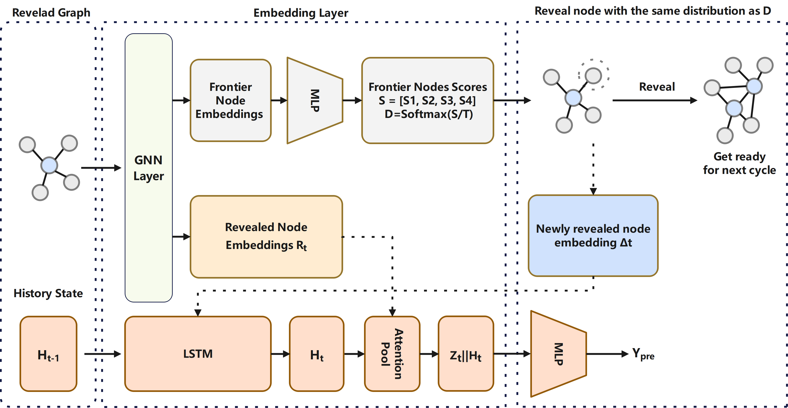
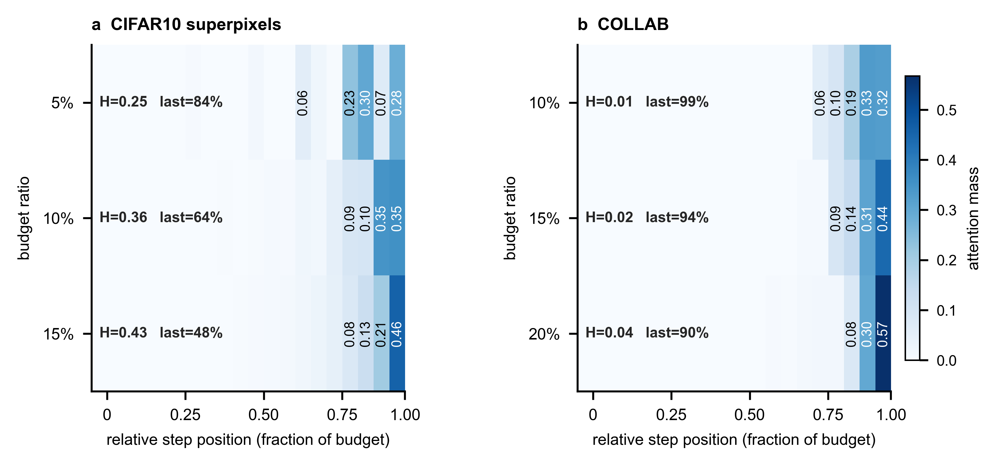
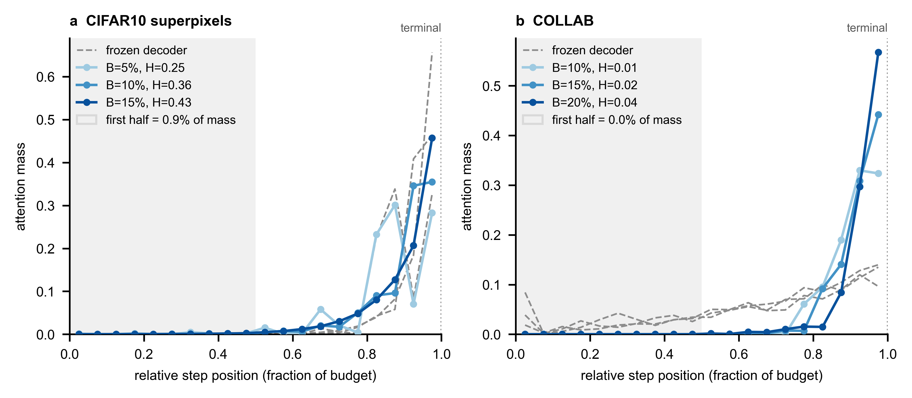

# 学习读哪里：预算受限图分类的自适应节点揭示策略

**匿名作者**（双盲评审中的论文）

> **v3 压缩迭代版**：正文压缩后的工作稿，在此版本上继续迭代；完整详细原件见 `main_zh-v2.md`。
> 与 v2 的差异：§2 背景并入引言，自"相关工作"起重编号，Problem Setup=§3、Method=§4、Experiments=§5；理论结果与证明已移出论文，存档于 AGR/Design-Notes/AGR-理论分析总集.md。行内公式以 $...$ 记号书写；【REF：…】为待补文献占位。
> 本轮：RL 奖励细节统一（both 组合奖励、以 classifier 奖励预热；§1、§4.4、§7 同步，摘要不动）；英文 md 全篇重译（初译 _tmp/main_en-v3-draft.md，定稿覆盖 main_en-v3.md）、tex 同步编译 11 页（v3_render6 验收通过，表 1–5 贴讨论段、图 2/3 缩至 0.8 倍行宽）。此前：§5.3 补充读出分解消融（表 5）与学习注意力分布分析（图 2、图 3，含统计熵），§6、§7 同步更新。此前：摘要换为导师修订版并引入方法名 BAGR；基线扩充协议适配版 Soft-Mask 与 AgentNet；AgentNet 按其原设计以自带读出头终判，不使用冻结分类器输出；CIFAR10 口径为相对最强基线最高 11.3 个百分点；算法 1 改为标准算法排版；全文润色。此前：理论结果与证明移出论文，附录重编号为 A.0–A.2（全部理论内容移入 AGR/Design-Notes/AGR-理论分析总集.md），正文去破折号并精简括号备注。此前：§2 背景并入引言、全文重编号、摘要按六句模板重写、算法 1 与基线适配移附录、正文多处精简。

---

## 摘要

图级预测通常假设可以完整访问输入图，然而当节点信息必须通过外部查询或高成本测量获取时，预测器必须在有限预算内决定观测什么。我们研究预算受限的图主动阅读：智能体逐步揭示节点，并从已获取的证据预测图标签。学习这样的策略颇具挑战，因为图标签不为探索动作提供直接监督，而阅读轨迹的组合空间使无引导的探索难以为继。我们提出 BAGR，一个结合顺序选点与循环证据累积的预算感知图读取器。为引导探索，我们生成特权教师轨迹，并按预训练分类器在已揭示子图上的预测表现过滤这些轨迹；模仿学习把示范转移为受观测约束的策略，提供任务相关的初始化；在策略强化学习随后以基于分类的奖励在自身轨迹上精炼策略，实现超越教师示范的任务驱动探索。我们在 CIFAR10 超像素、COLLAB 与 OGBG-PPA 上于显式观测与节点预算约束下评估 BAGR，实验结果显示其优于所评估的固定启发式。

---

## 1 引言

图分类支撑着从安全溯源、生物网络分析到金融反欺诈的众多应用，而主流范式在完整观测的图上训练与评估。这一假设在真实场景中系统性失效：安全溯源的判别信号往往只藏一小块子图里【REF：evidence-concentration】，生物网络中无差别的追加观测引入的噪声多于新信息，金融尽调与 KYC 查询按次计费。三个场景共享同一前提：**图的获取本身有成本**。一旦只能检查图的一部分，检查的顺序就变得重要：广度优先的扫读把预算浪费在无关邻域上，度数贪心完全无视任务，而每揭示一个节点都会改变前沿的可见信息与后续值得揭示的对象，"接下来读哪里"因此是一个序列决策问题。本文把这一证据获取的视角正式引入图分类：研究**预算受限的图主动阅读**（Budget-Limited Active Graph Reading, BAGR），学习一个策略在预算下决定读哪里，并仅用读到的子图完成任务。

已有工作各自提供了部分回答，但都止步于这一设定：图池化在**完整图**上回答"哪些节点重要"【REF：graph-pooling、sagpool】，图解释在预测**之后**才为预测找理由【REF：subgraphx、graph-explainability】，图上的主动学习与主动特征获取预算的分别是训练标签与节点属性【REF：active-learning-graphs、feature-acquisition】（§2 逐一讨论）。缺失的是两样东西：一个让部分图观测防泄漏、可复现的评测协议，以及学习策略在同预算下确实胜过固定策略的证据。

本文建立在两个观察之上。其一是信息纪律：要在部分观测下学习与比较读取器，必须定义每一步的可见信息。本文协议规定：已揭示内容与前沿挂接关系可见，前沿边特征免费可查，未访问节点的一切内容永久禁用。在这一纪律下，读取器从构造上只能依赖已揭示集合，预测无法偷看未揭示的证据。其二是学习策略的必要性：固定启发式的读取顺序完全无视任务，难以把预算引向对分类真正有用的区域，实验中它们或塌缩至多数类水平，或挤在窄带里。读取策略因此需要从数据中学习任务感知的选择，而非依赖手工设计。

为此，我们给出该问题的防泄漏形式化（§3），并提出 **BAGR**：一个结合顺序选点与循环证据累积的预算感知图读取器，以三阶段管线训练（§4）：行为克隆从梯度显著性、信息增益与结构启发式等任务无关教师的成功轨迹中蒸馏初始策略；强化微调综合冻结分类器对最终揭示子图的判定和累计证据读出的判定计算奖励，并以仅分类器判定的奖励预热；证据读取器与选点路径解耦，以循环状态逐步累积已读证据，使预测与选择互不干扰。

本文的贡献沿三条线展开。**协议**上，我们把上述纪律形式化为三层可见性模型与预算记账（§3）。**方法**上，行为克隆从教师成功轨迹蒸馏初始策略，强化学习经分类器奖励预热后以组合奖励微调，证据读取器以与选点解耦的循环状态累积已读证据（§4）。**实验**上，COLLAB 中固定策略与适配池化基线全部塌缩至多数类水平，学习策略以 20% 预算恢复全图测试精度的约 81%；CIFAR10 上超过最强基线最高 11.3 个百分点；PPA 上尚未超过最优基线，构成当前方法的明确边界（§5）。

---

## 2 相关工作

**全图观测下的图分类与池化。** GIN 等消息传递分类器消费整张图【REF：gin】，池化方法则以任务感知的注意力在完整图上为节点打分、据此稀疏化计算，从可微簇分配到自注意力 top-$k$ 选择【REF：diffpool、sagpool】。这些方法回答的都是"整图已读之后哪些节点重要"；而在节点预算下，同一问题必须在图可见**之前**、仅凭前沿信息回答。

**图解释。** 解释方法为训练好的模型在**已观测**图上的预测识别理由。我们的设定把这一步的方向倒过来：证据必须在"有预测可解释"**之前**获取，解释式打分在部分观测下按构造不可得。

**学习式序贯读取器。** 与本文设定最亲近的是"预算内选择性读图"的智能体。GAM 用强化学习训练循环游走器做预算化整图分类：rank 网络检视邻居并采样下一步，LSTM 积分阅读历史【REF：gam】；RWE-SGNN 改用 DQN、以下游损失的下降为奖励，以**采样器与预测器分离**的双模型生成类相关子结构【REF：rwesgnn】；AgentNet 用直通 Gumbel 转移让一群携带身份编码的智能体可微地游走、每步与所访节点交换状态【REF：agentnet】；RAW 把游走建成 POMDP 做半监督**节点**分类，并把边内容纳入观测【REF：raw】。四者的任务恰好包夹本文。RAW 保护单个节点的标签、图其余部分默认可观测，另外三者与本文同为图级目标，但都不同程度地违反了本文的协议。其一，未揭示内容进入决策乃至预测表示：GAM 移动前检视邻居内容，RAW 聚合从未访问邻居的特征，AgentNet 每步吸收邻居状态、可微转移还把梯度回传进未访问候选的嵌入。其二，没人维持"单种子、单调增长的已揭示集"：预算按游走步数记账。GAM 可重访节点，RWE-SGNN 从全图 top 打分的入口发起多条游走，AgentNet 把智能体撒满全图。其三，GAM、RAW 与 AgentNet 都从驱动选点的同一循环状态读出预测；RWE-SGNN 的双模型拆分与本文解耦同路，却没有任何揭示纪律。本文的读取器则从构造上保证：预测路径只是已揭示集合的函数。

---

## 3 Problem Setup

### 3.1 协议

AGR 协议规定预算的记账方式、每一步的可见信息与终判规则，其设计目标是在部分观测下杜绝信息泄漏。我们依次说明这三个方面。

**预算与种子。** 预算 $B$ 定义为揭示的节点数，**不含**种子，并按其占图节点总数的比例报告，主实验取 5/10/15%，COLLAB 取 10/15/20%；所有比较在匹配预算、多个确定性种子平均下进行。种子 $s_0$ 由确定性伪随机公式从图索引产生。

**揭示过程。** 智能体从种子出发逐步揭示：每步只允许从当前**前沿**中选一个节点揭示，从而已揭示集始终单调增长且不含重访。前沿为空但预算未尽时，例如种子落入孤立小分量，允许瞬移（teleport）到未揭示节点继续读取，瞬移消耗一次预算。

**可见性。** 可见性分三层：已揭示节点特征、已揭示边（含特征）与前沿的存在性、挂接关系（T0）对所有方法可见；一端已揭示、一端未揭示的**前沿边的特征**（T1）在揭示前即免费可查询且不消耗预算，策略可以"先看边、再决定揭谁"；未访问节点的一切内容（T2）对读取器永久禁用。

### 3.2 问题形式化

本节把 §3.1 的协议写成数学对象。设 $\omega_G=(Y,V,E,X,Z)$：$Y\in[K]$ 为图标签，$V=[n]$ 为固定顶点集，$E$ 为边集，$X,Z$ 分别为节点与边特征。已揭示集从 $S_0=\{s_0\}$ 出发，每步从前沿 $F_t=N(S_t)\setminus S_t$ 中选动作 $a_t$，揭示后 $S_{t+1}=S_t\cup\{a_t\}$；转移是确定性的，$|S_t|=t+1$。

**观测。** 协议由可测映射族 $\Phi_t:\mathcal G\times 2^V\to\mathcal O_t$ 给出，$o_t=\Phi_t(\omega_G,S_t)$。观测 $o_t$ 由有序动作史、与 $S_t$ 关联的边（已揭示边与前沿边的结构）、已揭示节点的特征以及双端已揭示边的特征构成、前沿边特征 $Z_e\ (e\in\partial_t)$，其中 $\partial_t$ 为前沿边集。

**目标。** 策略是把观测历史映到 $F_t$ 上分布的核族，允许随机化；终端分类器 $f$ 从 $o_B$ 输出标签，值函数为

$$
V^*(B)\;=\;\sup_{\pi,f}\ \Pr\big[f(o_B)=Y\big],
$$

## 4 Method



### 4.1 Overview

图 1 给出 BAGR 的总体架构：已揭示子图连同 T1 前沿边特征送入共享 GINE 编码器，其上是无状态选点路径（§4.2）与循环证据积累路径（§4.3）两条解耦的路径。后者最后一步的输出承担终判读出。训练时，读取器按温度随机化揭示，评估时取 argmax。

### 4.2 决策头

**动机。**协议把决策头能用的信息限定在 $o_t$ 内：候选节点尚未揭示、没有特征可读，任何依赖全局结构的打分都不可用，例如图池化在整图上的 top-$k$。决策头因此被设计为可见信息上的轻量打分器，而非重型推理模块。

**机制。**共享编码器对可见子图（已揭示部分、前沿挂接结构与 T1 前沿边特征）做消息传递，得到全部节点嵌入；对每个前沿候选 $v$，拼接

$$
u_v=\big[\,h_v\ ;\ \rho_t\ ;\ \phi_v\,\big],
$$

其中 $h_v$ 为其嵌入，$\rho_t\in[0,1]$ 为剩余预算比例，全部候选共享，使打分感知剩余步数；$\phi_v\in\mathbb R^3$ 为可见子图内可计算的结构特征：归一化已揭示连接度（$v$ 与已揭示子图的连接数）、带符号的归一化前沿度（区分"已揭示侧的出口"与"前沿候选"）与已揭示邻居间的局部聚类系数。决策头 $\mathrm{MLP}$ 输出标量分数，经前沿上的 softmax 归一化为策略

$$
\pi_\theta(a_t{=}v\mid o_t)\;=\;\frac{\exp s_\theta(u_v)}{\sum_{v'\in F_t}\exp s_\theta(u_{v'})}.
$$

该路径完全无状态：每个候选的分数只是当前可见状态的函数，与历史如何到达无关。

### 4.3 证据路径

终判需要一个从 $o_B$ 到标签的读出。两种朴素做法各有缺陷：对最终揭示子图做一次整体编码读出，容量受限于编码器感受野，消息传递无法让相距很远的已读证据交互；只看最后一步则丢弃全部历史。证据路径以递归状态逐步积分新证据，让任意两步间的信息传递由显式状态承载。

**机制。** 每步证据流由四个动作构成（图 1 下半部）。(i) 编码器对第 $t$ 步新揭示的节点（步 0 为种子）产生嵌入 $\Delta_t$，它取自选点路径的同一次前向；(ii) LSTM 积分器并入历史状态，$h_t=\mathrm{LSTM}(\Delta_t,h_{t-1})$；(iii) 历史引导注意力池化以 $h_t$ 为 query、已揭示节点嵌入为 K/V，单头缩放点积产生读出向量 $z_t=\sum_i\alpha_i v_i$，$\alpha=\mathrm{softmax}(Kq/\sqrt d)$，累计状态决定"此刻回头看什么"；(iv) 证据头 $\mathrm{MLP}([z_t;h_t])$ 输出逐步类别分布，终判取第 $B$ 步输出。

**角色。** 两条设计纪律把预测与选择解耦：证据流不进入选点分数；LSTM 与注意力池化的梯度只来自逐步监督 $\mathcal L_{ev}$，从不进入策略梯度。RL 阶段的策略更新因此不会破坏读出。评估同时报告证据头终判与冻结分类器读同一揭示子图的准确率，二者的差距用于区分 选点策略 和 证据积累。

### 4.4 Training Objective

**教师轨迹与行为克隆。** 教师按梯度显著性、信息增益、结构启发式及其混合组合生成阅读轨迹【REF：teacher-details-SI】；轨迹由冻结分类器在最终揭示子图上的正确性打分，过滤出成功者并按类平衡，得到 $\mathcal{D}=\big\{(o_t^{\tau},\,a_t^{\tau})\big\}$（$\tau$ 索引轨迹，$t=0,\dots,B_\tau{-}1$）。行为克隆最小化每步动作的负对数似然

$$
\mathcal{L}_{act}=\frac{1}{N_{\mathrm{act}}}\sum_{\tau\in\mathcal{D}}\sum_{t=0}^{B_\tau-1}-\log\,\pi_\theta\big(a_t^{\tau}\mid o_t^{\tau}\big),
$$

其中 $N_{\mathrm{act}}=\sum_\tau B_\tau$ 为动作总数；同时以逐步交叉熵监督证据头（$\ell_\theta^{\tau}(t)$ 为第 $t$ 步证据头的 logits，$N_{\mathrm{ev}}=\sum_\tau(B_\tau+1)$ 为逐步预测总数，含步 0 的种子预测）：

$$
\mathcal{L}_{ev}=\frac{1}{N_{\mathrm{ev}}}\sum_{\tau\in\mathcal{D}}\sum_{t=0}^{B_\tau}\mathrm{CE}\big(\ell_\theta^{\tau}(t),\,y_\tau\big),
\qquad
\mathcal{L}_{BC}=\mathcal{L}_{act}+\lambda_{ev}\,\mathcal{L}_{ev}.
$$

$\mathcal L_{ev}$ 是证据路径唯一的训练信号（§4.3）；提供"已读证据是否支持某个类"的逐步塑形。

**强化微调。** BC 继承教师的偏差；RL 把每条轨迹压成单一标量奖励，综合冻结分类器 $f$ 对最终揭示子图 $o_B$ 的判定与证据头终判的正确性。训练以仅分类器判定的非对称奖励预热，$R(\tau)=+1$ 若 $f(o_B^{\tau})=y_\tau$，否则 $-0.1$，再切换到组合奖励。优势在批量内标准化：$A_\tau=(R_\tau-\hat\mu)/(\hat\sigma+\varepsilon)$，其中 $\hat\mu,\hat\sigma$ 为 batch 统计。终端奖励是单点事件、轨迹间方差大，RL 阶段保留 $\mathcal L_{ev}$ 作为稠密的辅助监督以降低策略梯度方差；策略梯度取优势加权的全轨迹对数似然之批量均值（$\mathcal B$ 为当前批量）：

$$
\mathcal{L}_{RL}= -\frac{1}{|\mathcal{B}|}\sum_{\tau\in\mathcal{B}}A_\tau\sum_{t=0}^{B-1}\log\pi_\theta\big(a_t^{\tau}\mid o_t^{\tau}\big),
\qquad
\mathcal{L}^{total}=\mathcal{L}_{RL}+\lambda_{ev}\,\mathcal{L}_{ev}.
$$

### 4.5 Algorithm

推理与训练共用同一循环：每步一次可见子图前向，代价 $O(|E(G_t)|)$ 由已揭示集与前沿的诱导子图决定，一条 $B$ 步轨迹的开销随 $B$ 线性增长。三阶段管线：教师轨迹 → 行为克隆 → 强化微调 见算法 1（附录 A.1）。网络结构、优化配置与种子口径等实现细节见附录 A.0。

---

## 5 Experiments

### 5.1 Experimental Setup

我们在三个大规模图分类基准上评估：OGBG-PPA【REF：ogbg】、CIFAR10 超像素【REF：lrgb】与 COLLAB【REF：tudataset】。三者覆盖协议需要面对的不同结构形态：CIFAR10 超像素以节点特征为主、近似网格、直径有界；PPA 仅有 7 维边特征、平均 243 个节点；COLLAB 只有拓扑结构。指标为精度（%）。固定基线包括 Random、BFS、Max-Frontier-Degree、Random-Walk 四种揭示策略；适配基线包括 SAGPool、Soft-Mask 与 AgentNet，均被改造为符合协议的逐步选点器。冻结全图分类器提供每个数据集的上界，其在揭示子图上的精度作为参照头（acc_clf）报告。

**基线如何进入协议。** 四种固定策略与三个适配基线共用同一协议接口：每步只从当前前沿选一个未揭示端点，预算记账、种子公式与终判规则和学得方法完全一致，差异只在决定读取顺序的**选点规则**；SAGPool 与 Soft-Mask 的评分器被改造成逐步静态选择器，AgentNet 的游走被限制在前沿内，评测时由此产生的分布漂移是这些基线设定的一部分。完整适配细节见附录 A.2。终判口径依各方法原设计而定：固定策略与适配池化基线由冻结分类器终判；AgentNet 与本文方法一样自带分类头，按其原设计以自带读出头终判。

**表 1：CIFAR10 超像素，test 精度（%）。** BC和RL对应教师行为克隆和强化学习后的精度，参照头为冻结分类器在 RL 揭示子图上的精度。

| 预算 | Random | BFS   | 最大前沿度 | RW    | SAGPool | Soft-Mask | AgentNet | BC    | RL              | RL-参照头 |
| ---- | ------ | ----- | ---------- | ----- | ------- | --------- | -------- | ----- | --------------- | --------- |
| 5%   | 16.32  | 16.32 | 16.09      | 16.30 | 15.49   | 16.12     | 16.25    | 16.91 | **25.32** | 16.68     |
| 10%  | 18.69  | 18.06 | 17.31      | 19.03 | 16.91   | 18.45     | 18.30    | 17.87 | **30.03** | 19.78     |
| 15%  | 20.57  | 19.59 | 18.98      | 21.36 | 18.10   | 21.07     | 19.11    | 18.39 | **32.68** | 22.98     |

全图分类器（上界）60.5。

**表 2：COLLAB，精度（%），所有单元格为 验证/测试。** 固定策略与适配池化基线钉死在多数类水平。

| 预算 | Random      | BFS         | 最大前沿度  | RW          | SAGPool     | Soft-Mask   | AgentNet  | BC          | RL                    | RL-参照头   |
| ---- | ----------- | ----------- | ----------- | ----------- | ----------- | ----------- | --------- | ----------- | --------------------- | ----------- |
| 10%  | 15.43/15.57 | 15.53/15.57 | 15.63/15.57 | 15.43/15.57 | 15.43/15.57 | 15.43/15.57 | 52.1/51.9 | 16.78/16.42 | **52.20/51.90** | 15.88/15.72 |
| 15%  | 15.43/15.57 | 15.73/15.57 | 15.83/15.72 | 15.43/15.57 | 15.43/15.57 | 15.43/15.57 | 52.1/51.9 | 20.24/19.96 | **54.56/53.44** | 18.09/18.21 |
| 20%  | 15.43/15.57 | 15.98/15.72 | 16.03/15.87 | 15.43/15.57 | 15.43/15.57 | 15.48/15.57 | 52.1/51.9 | 27.56/25.60 | **58.02/55.74** | 20.64/20.26 |

全图分类器（上界）验证 71.54 / 测试 69.06。

### 5.2 Main Results

结果回答三个问题：学得策略能否在匹配预算下胜过基线；循环证据积累的收益；以及方法的边界。

在 CIFAR10 超像素上（表 1），固定策略集中在 16–21% 的窄带内，适配的 Soft-Mask 与 AgentNet 停留在带内或其附近，行为克隆也落在同一带中：模仿任务无关的教师轨迹并不足以胜过最优启发式。把策略远远推出这条带的是强化微调：对同预算最强基线的优势拉大到 9.0–11.3 个百分点，对 BC 的最大优势达到 14.3 个百分点，15% 档的 32.68 已恢复全图上界 60.5 的约 54%。同档 32.68 对 22.98 的参照头差距进一步表明：窄带之外的大部分增量被强化微调兑现，但到上界的剩余空间仍然很大。

在 COLLAB 上（表 2），任务无关的选择从未逃脱塌缩：所有固定策略与两个适配池化基线在两个 split 都停在 15.4–16.0，即该不平衡数据集的少数类水平。AgentNet 与本文方法一样以自带读出头终判，得到 52.1/51.9。但 AgentNet 精度在预算档间完全平坦,即该不平衡数据集的多数类水平；行为克隆随预算改善。BAGR 以 10% 预算即已追平 AgentNet，并随预算继续升至 55.74，恢复全图测试精度 69.06 的 75.2–80.7%，剩余差距主要受全图分类器自身精度的限制，而非读取策略。

两个数据集上，阅读器证据积累的读出显著优于冻结分类器读揭示子图的精度。

**表 3：OGBG-PPA，精度（%），所有单元格为 验证/测试。** 学得策略尚未超过最优基线。

| 预算 | Random      | BFS         | 最大前沿度  | RW          | SAGPool     | Soft-Mask   | AgentNet  | BC        | RL          | RL-参照头   |
| ---- | ----------- | ----------- | ----------- | ----------- | ----------- | ----------- | --------- | --------- | ----------- | ----------- |
| 5%   | 18.86/20.16 | 23.45/24.45 | 25.31/26.20 | 19.71/21.46 | 26.08/27.28 | 20.68/21.88 | 9.98/9.48 | 3.90/3.97 | 23.53/26.90 | 19.65/20.73 |
| 10%  | 31.14/33.07 | 34.07/35.68 | 36.33/37.28 | 32.34/34.54 | 36.25/37.92 | 32.25/33.89 | 9.98/9.48 | 7.23/7.37 | 28.12/32.34 | 26.83/27.41 |
| 15%  | 39.37/41.88 | 40.84/42.92 | 42.94/44.52 | 40.21/42.99 | 43.03/45.08 | 40.12/42.00 | 9.98/9.48 | 9.04/9.03 | 30.76/35.05 | 31.87/32.99 |

全图分类器（上界）验证 64.2 / 测试 65.6。

PPA 与前两个数据集形成鲜明对照：固定策略随预算干净地分开，SAGPool 是最强的基线，而没有一个学得策略超过它。行为克隆塌缩到 3.9–9.0，远低于所有基线；强化微调在测试上始终高于其参照头，26.9–35.1 vs 20.7–33.0，却在每个预算档落后于最优基线约10%；AgentNet 按其原设计以自带读出头终判，塌缩到单一类别。

### 5.3 Ablation and Analysis

**表 4：BC 消融，test 精度（%）。** no-pool 去掉历史引导注意力池化，no-lstm 去掉循环累积器，v1 两者皆去、终判退化为对已揭示嵌入的平均池化读出；COLLAB 预算为 10/15/20%。

| 数据集（预算档）    | 变体    | 档 1  | 档 2  | 档 3  |
| ------------------- | ------- | ----- | ----- | ----- |
| CIFAR10（5/10/15%） | full    | 18.35 | 20.07 | 20.45 |
| CIFAR10             | no-pool | 17.16 | 18.09 | 19.01 |
| CIFAR10             | no-lstm | 17.56 | 18.26 | 19.15 |
| CIFAR10             | v1      | 16.91 | 18.58 | 19.38 |
| COLLAB（10/15/20%） | full    | 16.42 | 19.96 | 25.60 |
| COLLAB              | no-pool | 15.72 | 18.41 | 21.11 |
| COLLAB              | no-lstm | 15.72 | 18.21 | 20.11 |
| COLLAB              | v1      | 15.88 | 18.04 | 20.64 |

证据路径的两个组件贡献并不对称。循环累积是 COLLAB 上最大的贡献者：去掉 LSTM 使 20% 预算档的精度损失 5.5 个百分点，两个组件同时去掉损失 5.0 个百分点且在最大预算档退化最剧；CIFAR10 上各项效应更小但方向一致，注意力池化贡献 1.2–2.0 个百分点。完整变体在两个数据集的每一档都领先。

**读出分解。** 为把循环证据积累进一步分解为解码与时间路由两个成分，我们冻结 RL 后的 reader 并采集其历史状态序列，在同一批 episode 上训练并评估五种读出变体（表 5）：终判分类器可以是冻结的证据头或在采集状态上以交叉熵重训，时间路由可以是仅取末步、对全部状态均匀池化或学习注意力。两个成分单独存在时都不产生增益：均匀池化接重训解码器与 terminal 基本持平，学习注意力接冻结解码器在 COLLAB 上增益为零、在 CIFAR10 上有微弱增益。两者结合给出全部增益。据此，读出增益不能归约为单纯的重训校准，而必须由解码器重训与学到的时间路由联合兑现：COLLAB 上表现为完全的联合特化，CIFAR10 上纯时间重加权与重训解码器约各贡献一半。均匀池化接冻结解码器在两个数据集上都低于 terminal，证实把无信息的早期步平均进读出是一种稀释。综合表 4 与表 5，循环证据累积不仅有用，其状态序列还支持优于终局读出的消费模式，这一自由度正是 §6.2 显式时间注意力与读出联训的依据。

表 5：读出分解消融，test 精度（%）。解码器列指终判分类器是否与注意力联合重训。

| 时间路由           | 解码器     | COLLAB          | CIFAR10         |
| ------------------ | ---------- | --------------- | --------------- |
| 仅末步（terminal） | 冻结证据头 | 53.59           | 29.25           |
| 均匀池化           | 重训       | 53.14           | 28.95           |
| 学习注意力         | 重训       | **56.99** | **31.13** |
| 均匀池化           | 冻结证据头 | 52.74           | 28.14           |
| 学习注意力         | 冻结证据头 | 53.64           | 30.19           |

**注意力分布。** 学习注意力的质量高度集中在轨迹末端，而集中的形态能否兑现为增益，取决于解码器是否与注意力共训（图 2、图 3）。CIFAR10 上三个预算档同构：轨迹前半程的质量不超过 1%，末四分位恒定占 87–89%；压在终局状态上的质量随预算从 84% 降至 48%，统计熵从 0.25 升至 0.43，读出的有效记忆视界约为最近四分之一的揭示步，并随预算展宽。COLLAB 是同一结构的极端形式：终局质量 90–99%，前半程严格为零。冻结解码器下形态出现分裂：CIFAR10 保持近期集中并真实获益，COLLAB 漂成近均匀且逐预算增益为零。学习到的注意力熵因此可以诊断时间重加权是否存在可利用的结构。





---

## 6 Discussion

### 6.1 Limitations

本文的结论受三条边界约束。其一，收益在最小预算下收窄：CIFAR10 的 5% 预算下 RL 恢复不足全图精度的一半，方法当前适用于允许中等比例检查的场景。其二，类间精度不均：CIFAR10 最难类别在测试上接近随机，最好与最差类相差 71.7 个百分点，类平衡过滤几乎无改善，表明这是能力边界而非数据量问题。其三，在仅有边特征的 PPA 上，学得策略尚未超过最优固定基线，正向结论目前限定在节点特征或纯拓扑主导的基准上，不外推到以边特征为主的设置。

### 6.2 Future Work

**前沿过滤与选点开销。** 在 PPA、COLLAB 这类 hub 主导的图上，前沿规模随揭示迅速膨胀，数百个候选使决策头的逐步打分开销与监督信号都被稀释。一个直接的扩展是在决策头之前加一层轻量**过滤器**，其风险是高价值节点可能被过早滤除，需要 $\varepsilon$-覆盖性保证，以及"过滤误差与预算增益"的权衡分析。

**显式时间注意力与读出联训。** §5.3 的分解把时间路由确认为读出侧的有效自由度，但当前它以事后校准的形式存在，历史表征本身并未为可解码而优化。将前缀因果的时间注意力移入 reader 与 BC/RL 联训，可让历史编码与时间路由共同学习，并使逐步监督天然抑制"只看末位"的捷径；其代价是全链路重训。分布分析中终局状态可由时间标量单独识别的现象也提示，联训需配合屏蔽或打乱时间通道的对照，以区分内容驱动的路由与位置捷径。

## 7 Conclusion

我们提出了 BAGR，一个面向预算受限图主动阅读的预算感知图读取器，并给出防泄漏的形式化与基准：三层可见性协议使部分观测下的学习与评测可比较、可复现。在方法上，行为克隆接以组合奖励做的强化微调，把任务无关阅读转化为任务感知阅读：COLLAB 上以 20% 节点恢复全图测试精度的约 81%，CIFAR10 上超最强基线最高 11.3 个百分点；消融证实循环证据累积承担主要收益，读出分解进一步把读出侧增益归因于重训解码器与注意力时间路由的联合效应。

---

## 附录

本附录收录实现细节（A.0）、训练管线（A.1）与基线适配（A.2）。

### A.0 Implementation Details

共享编码器为 GINE 式边特征卷积，默认 2 层、隐宽 128、dropout 0.1（逐层可配置）；选点 MLP 与证据模块（LSTM 128→128、单头注意力池化、证据头 $2d{\to}d{\to}K$）在同宽度上工作，证据模块参数量较 base 增加约 0.2M，前向开销与 base 相当（$\Delta_t$ 取自同一次前向，无第二编码器）。优化用 Adam（代表配置：学习率 $10^{-3}$、批量 64、BC 约 10 个 epoch，RL 在其上微调数个 epoch）；训练 rollout 按温度采样、评估取 argmax，并对每图使用 4 个确定性种子。各数据集的预算档、类别数与特征维度由数据集注册表给定；全部超参与结构内嵌于对应 checkpoint、随代码发布，逐数据集差异不逐一列出。

### A.1 训练管线（算法 1）

正文 §4.5 的三阶段管线伪代码如下；预算记账与终判规则与 §3.1 的协议一致。

```
算法 1  三阶段训练管线
输入: 训练图 {G_i}；冻结分类器 f̂；预算档 B；教师族 {梯度, 信息增益, 结构, 混合}
输出: 策略与证据头参数 θ

# 阶段 A：教师轨迹
for G_i, 种子 s₀, 教师 T:
  S ← {s₀}
  while |S|−1 < B:                       # 预算 = 揭示数，不含种子
    F ← N(S)\S；若 F=∅ 则瞬移（耗 1 预算）
    a ← T(观测)；揭示 a；S ← S∪{a}       # 逐步记录 (o_t, a_t)
  若 f̂(G_S)=y：𝒟 ← 𝒟 ∪ 该轨迹
按类平衡 𝒟

# 阶段 B：行为克隆
重复：从 𝒟 采样批量，按温度 rollout 复现观测；梯度下降 L_BC
直到收敛

# 阶段 C：强化微调
重复：以 θ 按温度 rollout；R ← +1[f̂(o_B)=y] 否则 −0.1；优势标准化；
梯度下降 L^total
直到收敛
```

### A.2 基线如何进入协议

**固定策略。** Random、BFS、Max-Frontier-Degree、Random-Walk 四种固定策略共用同一协议接口：每步只从当前前沿选一个未揭示端点，预算记账、种子公式与终判规则和学得方法完全一致；它们只在决定读取顺序的**选点规则**上不同。Random 在前沿边上均匀抽样、揭示其未揭示端点；BFS 按前沿边发现顺序先进先出；Max-Frontier-Degree 揭示与已揭示子图连接数最大的前沿节点；Random-Walk 从当前节点沿随机边游走、首次到达的未揭示节点即为揭示对象。

**SAGPool。** SAGPool 需要实质性适配才能进入协议：其原形在完整图上一次性 top-$k$ 选点，既消费未观测的全局结构，也不保证选点与种子连通。适配版把评分器改造成逐步静态选择器：每步只在可见子图（已揭示 ∪ 前沿，前沿节点特征置零）上重算其门控分数，揭示分数最高的前沿节点（平分取小 id，保证确定性）；评分器本身仍在完整图上按原版监督训练，评测时由此产生的分布漂移是该基线设定的一部分。所有方法共享同一上界与参照头口径。

**Soft-Mask。** Soft-Mask 是 SAGPool 的软加权版本：掩码生成器逐层为每个节点输出连续软掩码，消息传递被掩码调制，掩码只在完整图上由分类损失间接监督，没有预算与时序概念。适配与 SAGPool 同构：全图训练评分器，推理中每步在可见子图上重算第一层掩码分数、揭示分数最高的前沿节点；二者构成软加权与硬 top-$k$ 选点的成对对照。

**AgentNet。** 原版 AgentNet 让一群带身份嵌入的智能体在完整图上经 Gumbel 转移可微游走，每步吸收邻居状态并累加读出分类；智能体数乘步数远超 5–15% 的节点预算，没有预算概念。适配采取策略直译而非打分器移植：单智能体游走一步即揭示一个前沿节点，候选限缩为当前位置的前沿邻居，初始位置为种子；前沿候选为空时，智能体按探索分数在已揭示区内导航回有候选的位置，不消耗预算。与其原设计一致，游走策略与分类头一体学习，评测以其自带读出头终判。

---

## 可复现性声明

所有实验使用逐图确定性种子公式、固定数据划分与单一评测模式（含按类分解与双读出精度）；完整配置内嵌于每个 checkpoint，结果均为确定性种子平均，每方法四种子，CIFAR10 上的适配 AgentNet 为两种子。代码、配置、轨迹数据与泄漏不变量测试套件将随论文发表释出。

## LLM 使用声明

一个基于 LLM 的编码助手被用于实验代码库的实现与写作辅助；所有结果、声明与结论由作者验证，作者对内容负全责。按 ICLR 政策，本声明在投稿版本中移入附录。
